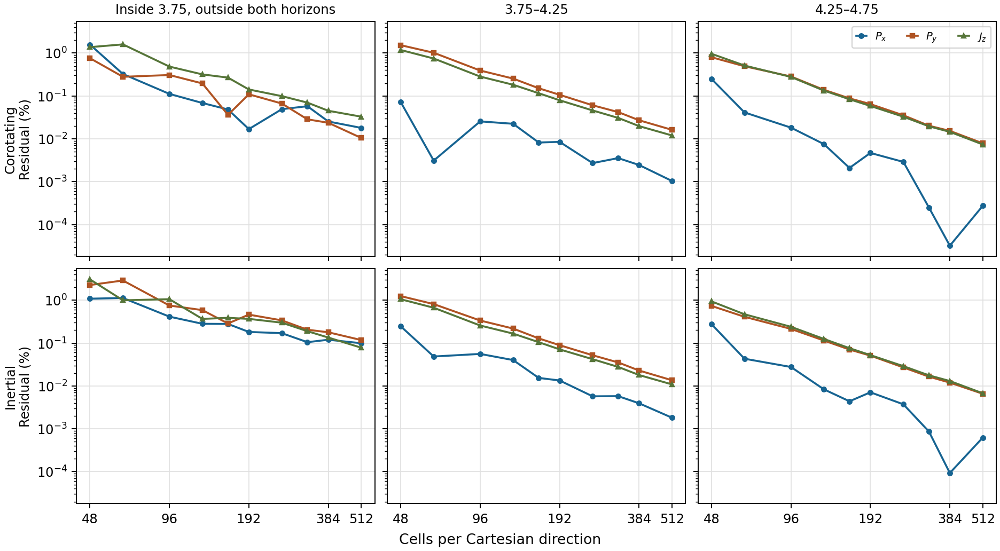

# Circumbinary diagnostic convergence and MPI

The verification uses short magnetized Bondi inflows onto an unequal-mass circular binary. Both frames start from the same physical data and reach the same time, $t=0.02$, without a disk relaxation. The mass ratio is 0.75, separation 4, aligned spins 0.3 and 0.2, and frame frequency 0.125. The component boundaries are the two modeled boosted Kerr horizons. Two additional surfaces sample component Kerr–Schild radii 1.4 and 1.2. Three barycentric spheres at 3.75, 4.25 and 4.75 bound the central volume with two holes and two consecutive shells. [Input](../tst/diagnostics/binary_shell.athinput) · [Surface and volume conventions](circumbinary-shells.md)

## Independent equation checks

For the translation generator in coordinate direction $i$, the conserved density, flux and source follow directly from the mixed stress tensor,

$$
U_i=\sqrt{-g}\,T^0{}_i,\qquad F^j{}_i=\sqrt{-g}\,T^j{}_i,\qquad
G_i=\tfrac12\sqrt{-g}\,T^{ab}\partial_i g_{ab}.
$$

With an outward coordinate area element $d\Sigma_j$, the inward momentum rate is $\int(w^jU_i-F^j{}_i)d\Sigma_j$. The same expression applied to the mass current gives net inward rest-mass flux. The signed balance for the central region subtracts the inward rates into both component holes from the inward rate through the outer sphere. For angular momentum about the global $z$ axis, differentiating the generator gives

$$
U_{J_z}=xU_y-yU_x,\qquad G_{J_z}=xG_y-yG_x+F^x{}_y-F^y{}_x .
$$

The four-dimensional reference constructs $u^a$, $b^a$, the fluid and electromagnetic mixed stress tensors and the moving worldtube normal independently of the production Valencia routines. Eight magnetized states include off-diagonal spatial metrics, nonzero shift, nonuniform lapse and nonzero surface velocity. The reference checks the two energy projections, mass, all six momentum and angular momentum flux components in each sector, and the three total force and torque components. The absolute tolerances for the force and torque are $2\times10^{-10}$ and $5\times10^{-10}$. The regional manufactured test independently integrates a pressure gradient over a domain with two tilted boosted ellipsoids removed. In the area-only controls, doubling the angular resolution reduces the errors of three Kerr surfaces by approximately four. [Independent reference and manufactured tests](../tst/diagnostics/helpers.cpp) · [Covariant conservative GRMHD equations](https://arxiv.org/abs/astro-ph/0301509)

## Spatial refinement and frame agreement

The uniform grids have 48, 64, 96, 128, 160, 192, 256, 320, 384 and 512 cells per direction, with $16^3$ active cells per block. Each surface has $N_\theta=N/2$, $N_\phi=N$ angular samples. The qualification checks passed for every sample and shell in the aligned series. These tests resolve the exterior diagnostic surfaces. The much smaller prescribed puncture masks inside them were under-resolved on the coarser grids.

The table gives the sum of absolute per-step residuals divided by the sum of absolute boundary, source and other contributions over the same steps. The metric in the central region is strongly varying, and its moving inner boundaries enter the balance separately.

| Frame | Region | $P_x$ at $512^3$ | $P_y$ at $512^3$ | $J_z$ at $512^3$ |
|---|---|---:|---:|---:|
| Corotating | Central | 0.0180% | 0.0105% | 0.0328% |
| Inertial | Central | 0.0994% | 0.1177% | 0.0781% |
| Corotating | $3.75 < r < 4.25$ | 0.00104% | 0.0162% | 0.0120% |
| Inertial | $3.75 < r < 4.25$ | 0.00182% | 0.0136% | 0.0109% |
| Corotating | $4.25 < r < 4.75$ | 0.000274% | 0.00784% | 0.00738% |
| Inertial | $4.25 < r < 4.75$ | 0.000626% | 0.00657% | 0.00675% |

All 18 displayed balances improve from $48^3$ to $512^3$. Several have an intermediate minimum. In the outer shell the corotating $P_x$ residual reached 0.000032% at $384^3$ before increasing to 0.000274%. The aligned $P_z$ residual rate is below $4.5\times10^{-13}$ in all three shells at $512^3$. A tilted-spin test below measures its behavior with finite vertical transport.



The endpoint study covers 293 physical columns per frame, including inward and outward conventions that duplicate a physical signal. For each available doubling triplet the reported order is $\log_2|[Q(N)-Q(2N)]/[Q(2N)-Q(4N)]|$. Changes below $10^{-12}\max(1,|Q|)$ in either pair do not receive an order. This also excludes many exact symmetry signals. Of 197 measurable columns on the $128^3,256^3,512^3$ triplet, 186 in the corotating frame and 188 in the inertial frame have positive order. A positive order on one triplet measures shrinking differences and by itself does not establish the continuum value. [All endpoint values, orders, frame differences and residuals](circumbinary-refinement.json)

- The two modeled horizon areas show orders 2.01 and 2.04 in the corotating frame, and 2.05 and 2.11 in the inertial frame. The central $J_z$ source shows orders 1.67 and 1.88. The central $P_y$ source refines more slowly, at orders 0.39 and 0.79. Its $384^3$ to $512^3$ change is 0.143% and 0.094% respectively.
- The weak inertial outer-shell $J_z$ source changes from $-4.883\times10^{-5}$ at $384^3$ to $-4.332\times10^{-5}$ at $512^3$. The difference is about 11% of the $384^3$ source, even though the transport balance closes well. A precision claim for this torque alone requires a separate resolution study at the production parameters.
- A geometric check has an exact continuum answer. Subtracting the two rest-frame Kerr ellipsoid volumes, each divided by its orbital Lorentz factor, gives central coordinate volume 212.5868299201. Its relative errors at $512^3$ are 0.113 and 0.133 parts per million. Both outer-shell volume errors are below 0.5 parts per million. The cut-cell errors oscillate with the placement of each boundary on the Cartesian grid.
- Frame comparisons rotate the inertial vectors into the corotating basis and include $-\boldsymbol\Omega\times\mathbf P$ in the transformed volume force. At $512^3$ the largest horizon frame differences across both holes and both stress sectors are 0.00592% for the momentum flux vector and 0.00989% for axial angular momentum flux. The central stored momentum vectors agree within 0.00050%. All quantities refer to the same physical endpoint.

## MPI and restarts

The original inertial evolution could overwrite the ADM metric while a task waiting for MPI still needed the old metric for the magnetic or boundary update. The magnetic flux through the second horizon showed a decomposition difference as large as $4.2\times10^{-9}$. The updated task dependencies complete the old-metric consumers before replacing ADM and recovering primitives. They preserve the serial stage order.

One, two and four MPI ranks ran with one B200 per rank on a single StellarAI node. The full signed histories, flags, rejected-volume columns, cumulative quantities and NaN patterns were compared at every output. The two-center cyclic-zoom case includes freezing and restoration. The separate changed-rank restart wrote its checkpoint on four GPUs and continued on two. It was compared to an uninterrupted one-GPU reference. A stationary restart reinitializes ADM at the checkpoint, so its recorded metric initialization epoch is checked separately.

| Case | History columns | Compared rows per run | Largest absolute difference |
|---|---:|---:|---:|
| Circular corotating, 1/2/4 GPUs | 464 | 9 | $5.69\times10^{-14}$ |
| Inertial, 1/2/4 GPUs | 464 | 7 | $5.69\times10^{-14}$ |
| Corotating cyclic zoom, 1/2/4 GPUs | 464 | 10 | $5.69\times10^{-14}$ |
| Four-to-two-rank restart vs uninterrupted | 464 | 3 | $2.85\times10^{-14}$ |

The CPU suite passed all 22 tests with MPI and the pre-diagnostics checkpoint fixture enabled. The numerical decomposition tolerance was $2\times10^{-10}$ absolute plus $2\times10^{-10}$ relative. These tests cover intra-node MPI. [History comparator](../tst/diagnostics/check_decomposition.py) · [Measured differences](circumbinary-convergence-checks.json)

## Production cost on a stationary background

For the gamma-law GRMHD shell-budget configuration with a prescribed circular orbit with aligned, constant spins in corotating coordinates, the metric and component embeddings are stationary. The problem generator can set the stationary flag after the stage task graph has been assembled. Checking that flag when the task runs removes redundant full-mesh updates. On an unchanged mesh the provider now runs once at initialization. Restart and mesh redistribution populate the new ADM arrays. Stationary gauge, spatial metric and proper area covectors on each surface are also reused. The interpolation stencil is rebuilt after a mesh or surface change. For moving surfaces, the ownership search first rejects blocks outside the surface bounding box.

One B200 evolved a $96^3$ mesh for 12 RK2 cycles, with $64\times128$ angular samples per surface and history cadence eight cycles. Both executables used the same CUDA 13.2 build and inputs. The table gives the median of three alternating-order, uninstrumented runs, in solver wall seconds. The reference commit was `f8771734`. Standard MHD history was enabled in every run.

| User diagnostics | Reference | Updated | Time reduction |
|---|---:|---:|---:|
| Flux diagnostics disabled | 0.7148 s | 0.6251 s | 12.5% |
| Seven surfaces | 0.9415 s | 0.6379 s | 32.2% |
| Seven surfaces and three shell budgets | 1.3436 s | 0.7894 s | 41.2% |

In a separate instrumented run of the full configuration, full ADM evaluations fell from 25 to 1, proper surface-covector builds from 201 to 7 and interpolation kernel launches from 804 to 416. With an explicitly stationary input, both builds evaluated bulk ADM once and the surface savings persisted. All physical history columns matched the reference to the decomposition tolerance. The updated full configuration still took 24% longer than the surface-only configuration on this small grid. Stage-resolved shell budgets sample the evolved fields and integrate cut cells each step. Changing the history output interval alone does not remove that cost. Inertial motion also requires surface geometry updates. The separate radiation transport module prepares its own ADM/tetrad geometry and is outside the supported shell-budget configuration. Long production runs and inter-node scaling were outside this single-node test. [Timing samples and kernel counts](circumbinary-convergence-checks.json) · [Torque output timing and selection checks](circumbinary-shells.md)

## Timestep, angular quadrature and vertical transport

At fixed $128^3$, the CFL number was reduced from 0.04 to 0.02 and 0.01, holding the physical endpoint and angular quadrature fixed. Successive changes in the outer fluid $J_z$ inward flux were $2.38\times10^{-10}$ and $5.54\times10^{-11}$ in the corotating run, a factor of 4.29. The inertial changes were $1.50\times10^{-7}$ and $7.93\times10^{-8}$, a factor of 1.89. The corotating first-horizon area was independent of timestep. Its inertial changes decreased by a factor of 2.14. This is consistent with the prescribed time-dependent ADM provider being evaluated at mesh time within the solver stages. Setting RK2 for the fluid does not guarantee second-order time accuracy for diagnostics sampling that moving metric.

At fixed $192^3$, increasing $N_\theta$ from 96 to 192 and then 384 changed the corotating outer fluid $J_z$ flux by $+6.79\times10^{-6}$ and $-2.07\times10^{-7}$. The corresponding inertial changes were $+6.86\times10^{-6}$ and $-2.22\times10^{-7}$. The spatially sampled integrand and surface quadrature both enter a joint refinement test. In particular, the corotating $96^3$ and $192^3$ values at the usual angular sampling happened to be very close. The central volume $P_y$ source was identical under angular-only refinement in both frames. [Timestep and angular data](circumbinary-convergence-checks.json)

The aligned binary has equatorial reflection symmetry. To test measurable vertical transport, a separate inertial series tilted both spins, setting $(\theta_1,\phi_1)=(47^\circ,35^\circ)$ and $(\theta_2,\phi_2)=(23^\circ,-76^\circ)$. At $384^3$ the central $P_z$ boundary and source rates were $+0.0700155$ and $-0.5717221$. All three shell residual fractions decreased on every doubling in this series.

| Region | $48^3$ | $96^3$ | $192^3$ | $384^3$ |
|---|---:|---:|---:|---:|
| Central, both horizons excised | 0.716% | 0.328% | 0.114% | 0.0770% |
| $3.75 < r < 4.25$ | 1.154% | 0.246% | 0.0712% | 0.0180% |
| $4.25 < r < 4.75$ | 1.017% | 0.277% | 0.0587% | 0.0147% |

## Reproduction

The build and Kokkos archive are documented in the [B200 build instructions](circumbinary-shells.md#reproducing-the-runs). Use `-DAthena_ENABLE_MPI=ON` with HPC-X for the decomposition runs. Each MPI rank was bound to one visible GPU using its node-local MPI rank. The campaign takes an executable or launcher wrapper, writes the effective inputs and histories, and runs its original frame, shell and zoom assertions. For a workstation-sized check the default sizes are 48, 64 and 96. The full spatial series used

```sh
python3 tst/diagnostics/shell_resolution_zoom.py ./athena-launch series \
  --sizes 48 64 96 128 160 192 256 320 384 512
python3 tst/diagnostics/compare_refinement.py series --output refinement.json
python3 tst/diagnostics/check_decomposition.py \
  inert-1/matched_bondi.user.hst inert-4/matched_bondi.user.hst
python3 tst/diagnostics/check_decomposition.py --stationary-restart \
  full/matched_bondi.user.hst resume/matched_bondi.user.hst
```

Slurm recorded 2,298 additional GPU-node seconds, including builds, the failed first tilted-input launch and the canceled pending job. The earlier campaign used 1,847 seconds. Combined usage was 4,145 seconds (1.151 of the four allocated GPU-node hours). [Allocation accounting](circumbinary-convergence-checks.json)
