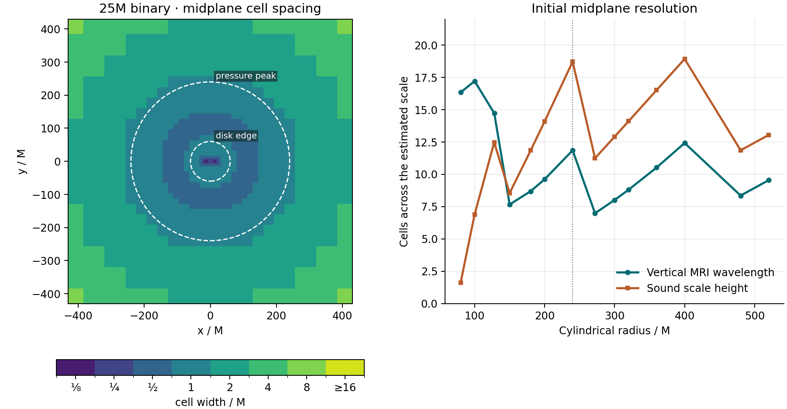

# Circular, aligned MAD sequences

The three inputs set total mass to one, component masses to 0.5, aligned spins to +0.7 and fixed separation to 25, 15 or 35. The six outer Cartesian faces use the native diode condition. The torus inner edge and pressure maximum are at 60 and 240 in all three runs. The vertical field uses the reference potential with radial power 2, falloff 1500 and target beta 100. The spin is constant from initialization. The gas, field, reconstruction and atmosphere parameters come from the aligned run's parameter dump.

Generate the decks with the dump used in the analysis repository.

```sh
python3 scripts/circumbinary_mad/inputs.py \
  ../circumbinary/cbd_paper/analysis/overhaul/surface/mad_spin_p0p7_header.txt inputs-mad
```

The [archived physical parameters](../scripts/circumbinary_mad/aligned_reference.par) reproduce the same decks byte for byte and record the SHA-256 of the original dump.

## Frame and field initialization

At phase zero the two spatial bases coincide. For grid velocity $v_g=\Omega\times x$, the rotating coordinates give $u'^i=u^i-v_g^i u^t$ and $\beta'^i=\beta^i+v_g^i$. Therefore the stored $Wv^i=u^i+\beta^i u^t$ is identical in both frames. The spatial pullback of the initial vector potential is also the identity. The constrained-transport curl initializes the face field. The code recovers Eulerian $B^i$ from $\sqrt\gamma B^i$ before evaluating the comoving $b^2$ for normalization. The circular orbit and fixed aligned spins give a stationary prescribed metric on unchanged rotating mesh blocks. Restarts and mesh changes rebuild local geometry and excision masks.

The deterministic phase-zero test compares nonzero fields, thermodynamics and velocity throughout both grids, including outside the light cylinder. With two MPI ranks, an independent evolution to $t=4M$ compared the coordinate-volume integrals of density, pressure and vertical field squared over $100<R<300$, $|z|<64$. Their absolute relative frame differences on a $96^3$ mesh were $1.6\times10^{-8}$, $5.6\times10^{-4}$ and $4.4\times10^{-5}$. The pressure difference decreased from 3.29% to 0.56% to 0.056% on $32^3$, $64^3$ and $96^3$. The density and field differences were small and nonmonotonic. These tests exercise the frame transformation during startup. Late-time turbulent statistics require a separate comparison.

## Mesh and residence times

The domain spans $[-4096,4096]^3$. Starting from $64^3$ cells, the grid refines the midplane in annular rows of $16\times16\times8$ blocks and adds separate three-dimensional patches around each hole. The 25M finest configuration has 13,400 blocks, or 27,443,200 active cells. The other two have 13,344 blocks each. A rectangular comparison design used 37,191,680 active cells. Ghost-inclusive cell counts are approximately 123.5 and 125.5 million for the 25M annular and rectangular grids. Wall-time savings depend on the measured update rate.



The table gives the worst spacing sampled at 128 midplane azimuths, using the actual 25M hierarchy. The initial vertical MRI wavelength estimate uses $2\pi |B_z|/(\sqrt{\rho h+B_z^2}\,\Omega_K)$ and the sound scale height uses $c_s/\Omega_K$. An independent 1M radial probe supplies the thermodynamic and field profiles. These weak-field midplane estimates quantify where to spend resolution. Measuring saturated turbulence and vertical profiles will test the grid in the evolved state. [Hawley et al., global disk convergence tests](https://arxiv.org/abs/1306.0243)

| Radius in M | Largest spacing in M | Cells per MRI wavelength | Cells per sound scale height |
| ---: | ---: | ---: | ---: |
| 80 | 1 | 16.3 | 1.6 |
| 100 | 0.5 | 17.2 | 6.9 |
| 128 | 0.5 | 14.7 | 12.5 |
| 150 | 1 | 7.7 | 8.5 |
| 180 | 1 | 8.7 | 11.8 |
| 240 | 1 | 11.8 | 18.7 |
| 300 | 2 | 8.0 | 12.9 |
| 400 | 2 | 12.4 | 18.9 |
| 520 | 4 | 9.5 | 13.0 |

The finest hole-centered spacing is M/8, giving 13.7 cells across the polar diameter of the component Kerr horizons. The interior sink at Kerr radius 0.45M spans 7.2 cells, below the code's recommended ten cells. Its flux safety radius is 0.54M. The history qualifies both horizons independently. The campaign saves full midplane and meridional primitive/field slices every two binary orbits to examine disk thickness and magnetic evolution.

The production sweep visits zones $0,1,2,1$ and repeats. The hole-centered spacings are 0.125, 0.25 and 0.5M, with nominal mask radii 1, 2 and 4M. The coarsening search radius is capped at 32M. On the annular 25M GPU mesh the measured stable timesteps on the outward sweep were 0.0451, 0.0850 and 0.0931M. Two further coarsenings also gave 0.0931M and the sixth zone had no eligible mesh blocks. The three-zone sequence keeps the 5M transfer spheres outside the largest mask and avoids those extra transitions. The accelerated pilot checks actual midplane leaf spacings in every zone. Physical dwell times are $0.6P,12M,4P$, where $P=2\pi a^{3/2}$. The intermediate dwell spans three local inverse Kepler frequencies at radius 2M around a component of mass 0.5. The outer residence samples a fraction of the aligned 25M reference inflow time of approximately 20 orbits near $3a$. In comparing returned horizons, discard the first $4\sqrt{5^3/0.5}=63.25M$ and measure the early interval separately. These dwell choices require an empirical late-time check.

## Horizon flux and the 5M reference

The history records the half-unsigned magnetic flux $\Phi_i=\frac12\int |B^j dA_j|$ in Heaviside–Lorentz units. The modeled horizons are the equal-time boosted component Kerr surfaces at $r_+=0.8570714M$. H1 and H2 are 5M coordinate spheres. BH1_KS5 and BH2_KS5 have fixed Kerr–Schild radius 5M. The moving-sphere net rest-mass rates at H1 and H2 normalize the fluxes.

| Aligned 25M reference | BH1 | BH2 |
| --- | ---: | ---: |
| Mean 5M net inward mass rate | 15.2473 | 14.4873 |
| Coordinate 5M half-unsigned flux | 24.4245 | 24.0921 |
| Coordinate 5M flux using total rate | 31.76 | 31.32 |
| Horizon half-unsigned flux | 13.4694 | 13.5227 |
| Horizon flux using total rate | 17.51 | 17.58 |
| Horizon flux using own hole's rate | 24.46 | 25.19 |

The common figure normalization is $\sqrt{4\pi}\langle\Phi_i\rangle/[m_i\sqrt{\langle\dot M_1+\dot M_2\rangle}]$. The own-hole convention replaces the summed rate with $\langle\dot M_i\rangle$. The source is the aligned analysis repository's `figures/source/data/magnetic_flux_reference.json`, entry `mad_p07`, and `figures/paper/magnetic_flux_profiles.pdf`. The 15M and 35M cases measure separation dependence.

The summary script integrates each diagnostic over qualified physical time. It reports valid exposure and skips intervals crossing a zoom change, a missing sample, or a failed surface qualification. Means during coarse intervals with masked holes cannot recover an unobserved horizon flux. Four consecutive time batches and the split at 63.25M after a return help identify secular drift and transition bias. Compare mature cyclic returns against an extended finest run initialized from the same checkpoint. Use independent cycles to estimate uncertainty before interpreting a difference from the reference.

```sh
python3 scripts/circumbinary_mad/flux_summary.py seq25/mad25.user.hst \
  --separation 25 --start-orbit 150 --end-orbit 200
```

## StellarAI execution

Start the 25M case on one node, one MPI rank per GPU, with the CUDA/HPC-X build of the dynbbh problem. The field guard checks the native face field for nonfinite values and the global maximum CT residual normalized by the global maximum face-field scale. It stops on a nonfinite value or relative residual above $10^{-7}$. A solenoidal field can still exhibit numerical or physical growth. Compare the peak field, flux histories and saved slices across returns.

The first lower-disk-resolution one-node MPI test visited 84 zoom events in 20M, including eight full returns. Its largest relative CT residual was $5.38\times10^{-15}$. This measured field transport through mesh changes before substantial horizon accretion. On the final annular three-zone grid, eight B200s completed 20 full returns in 100 steps. Maximum relative CT divergence was $6.97\times10^{-15}$. Both 5M surfaces passed on every history sample and both horizons passed on every finest return. Every tested disk radius from 100M through 400M retained its initial midplane spacings in every zone. The production initial slice independently gives a density-weighted median $Q_z=11.97$ and a meridional density RMS thickness $H/R=0.0606$ near 240M. The latter is a density moment, whereas the table above uses a sound scale height.

At 25M the medians of eight-step timing intervals after startup were 0.450 and 0.455 seconds per update on one node at the finest and outer zoom levels. Two nodes gave 0.399 and 0.378 seconds. At these initial rates 200 orbits would consume approximately 242 node-hours on one node, or 409 node-hours on two. These extrapolations exclude queueing, checkpoint I/O, the extended finest interval and paired replay. One node per sequence minimizes measured node-hours. [Pilot and scaling measurements](circumbinary-mad-grid.json)

The segment runner resumes only after a clean predecessor exit. It keeps two rolling scratch checkpoints and preserves the 200-orbit checkpoint for a paired comparison. At that checkpoint it extends the next finest residence for one ordinary sweep plus 0.55 orbits (about 5.2 resolved orbits at 25M), with the cyclic driver active. Wall-time restarts preserve the remaining dwell. After the extended residence, a separate serially scheduled replay uses the ordinary sweep from the same preserved checkpoint. Both branches therefore observe a common post-return interval after their histories diverge. The sequence stops on solver or field-guard failure. The final CPU job writes a per-hole report with the last four finest orbits and a separate common-time matched return after the branches diverged. It also measures the change between late-cycle halves with a moving two-cycle-block bootstrap. The 25M completion releases separate one-node 15M and 35M pilots and runs if the late drift interval and paired normalized-flux differences fit within the 30% comparison precision. A scientific review is required if the data are insufficient or drift exceeds that precision. Agreement with the paper is reported independently of this decision. The module and rank layout are in [the job script](../scripts/circumbinary_mad/run_stellar.sh).


## Where cyclic zoom saves time

All node-hour projections below use the same 25M binary, one node with eight B200s and 200 orbits. They omit waiting in the queue, the final finest extension, its paired replay and checkpoint I/O. Late accretion can change the cost per update. The figures compare matched production kernels and physical dwell times.

| MeshBlock dimensions | Finest throughout | Three zones, disk spacing fixed | Four zones, inner disk coarsened |
| --- | ---: | ---: | ---: |
| 16 × 16 × 8 | 436 node-hours | 242 node-hours | 182 node-hours |
| 32 × 32 × 8 | 260 node-hours | 148 node-hours | 106 node-hours |

On the original three-zone grid the outer residence has 13,120 active blocks versus 13,400 at the finest level. The global timestep increases by a factor of 2.06. A face-by-face search of the saved metric on the outer-zone checkpoint reproduces $\Delta t=0.0931203206611M$. One limiting cell is at $(-143.75,-63.75,-0.25)M$, at cylindrical radius 157.25M. In the $y$ direction its spacing is 0.5M, shift magnitude is 1.15514, and $\alpha\sqrt{\gamma^{yy}}=0.99262$. Even 200 orbits entirely at the outer-zone rate would cost about 213 node-hours on that layout. [Native checkpoint CFL audit](../scripts/circumbinary_mad/checkpoint_cfl.py)

The larger GPU blocks retain the worst sampled midplane spacings in the table at all 15 audit radii. Broader annular rows compensate for the change in block shape. At 25M the larger grid has 5,072 blocks and 41.55 million active cells, compared with 13,400 and 27.44 million. Despite the higher active-cell count, the larger blocks reduced the finest update from 0.446 to 0.266 seconds in a same-node comparison. The three-zone pilot completed six returns with maximum relative divergence $3.75\times10^{-15}$. At 15M, 25M and 35M the initial 240M annulus has median $Q_z=11.97$ and density RMS $H/R=0.0606$. Pass `--large-blocks` to the generator to select this geometry.

The optional `--wide-sweep` expands the coarsening search out to 192M while capping the actual frozen radius at 3M. Its physical dwells are $0.6P,12M,32M,4P,32M,12M$. In the outer residence, the 100M and 128M annuli change from 0.5M to 1M spacing. The 240M pressure maximum stays at 1M. On the large blocks the outer step takes 0.246 seconds and advances 0.13143M. The accelerated test passed four complete returns on this hierarchy with maximum relative divergence $3.56\times10^{-15}$, qualified 5M measurements in every zone, and both horizons qualified on each finest visit. A late matched-flux comparison is still needed to assess the effect of this extra disk coarsening.

A separate eight-rank GPU restart from the original outer zone reproduced all nine subsequent samples of the 5M transfer rates, per-hole magnetic fluxes, zoom events, timestep sequence and peak face field at the printed history precision. Maximum relative divergence after restart was $2.22\times10^{-15}$.
