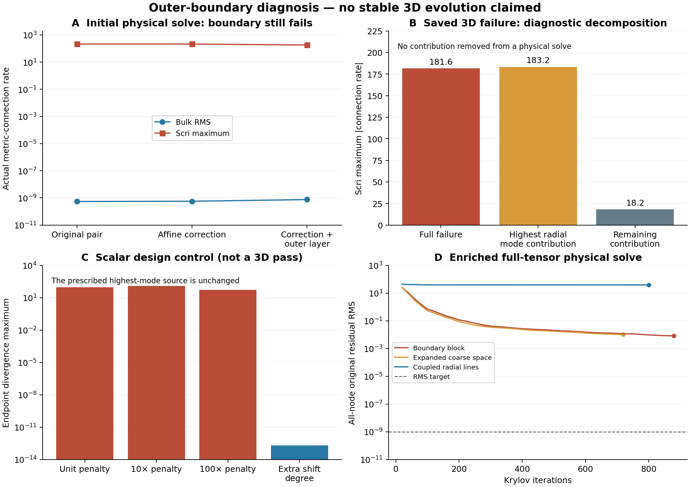

# Affine consistency and the unresolved outer radial mode

Follow-up: [local finite-difference endpoint closures](compatible-local-endpoint-20261027.md)
improve physical initial-state refinement but retain explicit scri failures.

**The 3D wormhole-to-trumpet milestone remains incomplete.** These experiments
are spatial/gauge components, not a stable evolution. The full metric-built
connection variation, physical curvature source, actual scri, and all core
cells are retained. No source, solved metric rate or constraint is filtered.

This continues [the combined-interface and initial-gauge study](compatible-wormhole-gauge-20261027.md).
The successful spherical reference remains the attenuated N1025 run to t=500
under its apparent-horizon-exterior acceptance budget. No new 3D horizon-mass
trajectory or puncture-neighborhood convergence result is available here.

## A geometric consistency repair that does not fix the physical failure

The base paired mapped derivatives preserve constants and an SBP identity, but
do not differentiate physical Cartesian affine fields exactly. The new
`AffineConsistentGrid` changes derivative coefficients using four physical modes
P spanning 1,x,y,z, orthonormal in the positive volume norm H. Write

    D+ = D0 + R,   D- = D0 - R,
    F = exact_derivative(P) - D0 P,
    K = F P* - P F* - P (P* F) P*,
    Rnew = (I - P P*) R (I - P P*).

Here the adjoint includes H, and R denotes the H-self-adjoint positive part of
the derivative. Compatibility requires P*F to be skew and P*RP to be symmetric;
the implementation rejects defects above 1e-10 instead of suppressing them.
The corrected pair is D0+K ± Rnew. K is skew-adjoint, the symmetric part stays
nonnegative, and all physical affine derivatives are retained with their
correct nonzero values. The orthogonal factors act on the *derivative
coefficients*, never on an evolved field or the physical source.

This is a **global low-rank update**, with nonlocal communication and truncation
implications. It is not a qualified local production stencil. Physical nodes,
quadrature, prescribed boundary values and interface transfer rows are unchanged.

The N=10/12/14 unrefined-shell study and N=10 combined AMR/shell study pass their
affine, paired-identity, positive-high-mode, full tensor energy and independent
variable-metric finite-variation component gates. Unrelated smooth errors and
the correction itself decrease with refinement. These mixed FD/spectral grids
do not establish a universal convergence order. Evidence:
`evidence/compatible-affine-moment-20261027`.

A full variable-metric manufactured solve with the correction converges in
580 iterations: independently recomputed RMS 2.9530e-10, maximum 6.3853e-8.
The determinant ranges from 1.189 to 1.406 and the boundary data include affine
content. This is a manufactured source, not an Einstein evolution. Evidence:
`evidence/compatible-affine-variable-solve-20261027`.

For the actual M=1/3 wormhole source the result is quite different:

| N=10 initial solve | Cells | Direct bulk rate RMS | Scri rate maximum | All-node rate RMS | Radial shift RMS error vs 1D |
|---|---:|---:|---:|---:|---:|
| Previous two-layer pair | 13,000 | 5.42e-10 | 213.72 | 12.044 | 8.964e-3 |
| Affine-corrected two-layer pair | 13,000 | approximately 5.6e-10 | 213.72 | 12.044 | 8.962e-3 |
| Affine-corrected, extra outer layer | 19,000 | 7.51e-10 | 181.56 | 4.572 | 4.230e-3 |

The extra layer uses map partition s=(0,.45,.8,1), not physical-radius cuts.
Its inner r<.15 shift error is 3.406e-4 and tangential RMS is 1.489e-3.
Null/fixed-angle boundary data remain exact to roundoff. The geometric affine
repair is useful, but clearly does not remove the physical scri failure.
Evidence: `compatible-wormhole-affine-n10-20261027` and
`compatible-wormhole-affine-buffer-n10-20261027` under `evidence/`.

## Why a tiny interior residual can coexist with a large endpoint residual

For n Lobatto nodes, p=n-1, the interior nodes are zeros of P'_p. Therefore the
highest Legendre metric-rate mode can have nearly invisible interior central
derivative and a large endpoint derivative. Its primitive

    B(q) = integral_0^q P_p(2s-1) ds

vanishes at **every original Lobatto node**, including both endpoints, although
its derivative is nonzero. A same-degree nodal shift representation cannot
represent that primitive. Replacing endpoint PDE rows by Dirichlet rows can
leave this range defect uncontrolled.

The scalar control uses the complete source C=P_p and solves
`-D+ D- beta = D+ C`, with homogeneous endpoint shift values. At n=10 the unit
paired penalty gives interior residual approximately 2.2e-15 but endpoint
residual 94.9. Increasing the penalty to n or n^2 does not reliably repair it
and degrades the separate fixed smooth-source control. No penalty change was
adopted. The highest-mode source depends on n: this is a falsifier, not a
physical convergence family.

An extra shift degree, with n+1 shift nodes and the original n metric nodes,
represents the primitive. A scalar central-derivative control then satisfies
all n metric divergence equations, including both endpoints, with the same
source and fixed shift values. At n=10 the endpoint residual is 2.064e-13;
n=12/14 also reach roundoff. The tall scalar system has the expected rank n-1.
This does not prove full tensor, mapped, paired-energy or interface consistency.
Evidence: `compatible-endpoint-mode-20261027` and
`compatible-endpoint-enrichment-20261027`.

The three-dimensional saved failure supports the mechanism. Decomposing only
the outermost-shell radial polynomial of the computed shift metric rate gives:

| Diagnostic at every scri node | Value |
|---|---:|
| Original connection-rate maximum | 181.563 |
| Highest radial degree-9 contribution maximum | 183.183 |
| Remaining contribution maximum | 18.170 |
| Remaining vector L2 / original vector L2 | 0.1398 |

This is an additive diagnostic decomposition, **not a filtered solution**.
Neither contribution is removed in any reported physical solve. Different
directions can cancel, so the signed contribution fraction can exceed one.
Evidence: `evidence/compatible-scri-high-mode-20261027`.

## Enriched full-tensor experiment and outstanding qualifications

`EnrichedOuterGauge` adds one vector coefficient per angular node in each
outermost shell. The represented shift includes B(q) times that coefficient.
The physical nodal shift values, including the prescribed null boundary lift,
are unchanged by this bubble; its derivative contributes to the complete
metric rate. All original metric-built connection-rate equations, including
scri, are now collocated. The extra unknowns balance the additional equations;
this does not append extra boundary conditions to the old trial space.

The first 19,000-cell solve hit its 180-second limit. Its last explicit residual
at iteration 880 was RMS 8.426e-3, maximum 0.4630. It failed the original
1e-9/1e-7 targets. The terminal manifest is exit 124; no final solution or
unrecorded final residual is inferred. Evidence:
`evidence/compatible-enriched-wormhole-n10-20261027`.

The bubble representation does not inherit the old SBP proof automatically.
In particular, a nodal volume norm sees zero bubble values and cannot measure
their physical energy, and off-node angular jumps need a consistent interface
treatment. `audit_enriched_energy.py` instead evaluates the actual off-node
trial polynomial and the polynomial interpolant of the unmodified operator
on a Gauss grid with the analytic map Jacobian. This states precisely which
physical-volume pairing is being tested; it does not assert an SBP identity.

The first 45-direction bubble-only check has positive minimum Rayleigh value
about 2.278e4, agreeing between Gauss orders 12 and 16. The directions include
smooth physical angular content, face jumps and random angular coefficients.
This limited result does not prove coercivity of the combined old/new space.
Evidence: `evidence/compatible-enriched-energy-20261027`.

Adding 36 ordinary nodal directions, with radial polynomial degrees through
nine and nonzero angular content, gives 81 directions. The minimum Rayleigh
value is 521.359 at both Gauss orders and remains positive. The test still
does not establish an exact energy identity, a spectral gap in the full space,
or interface consistency. Evidence:
`evidence/compatible-enriched-mixed-energy-20261027`.

Two further preconditioners retain the exact same enriched equations and
physical source. Both fail:

| Preconditioner | Terminal outcome | Last checked iterations | All-node original RMS | Original maximum |
|---|---|---:|---:|---:|
| Boundary block + existing coarse space | 180 s timeout | 880 | 8.426e-3 | 0.4630 |
| Coarse space enlarged with degree-two angular bubble modes | 300 s timeout | 720 | 1.025e-2 | 0.5140 |
| Coupled radial-line relaxation | 800-iteration cap, exit 1 | 800 | 39.344 | 1564.80 |

The radial-line blocks approximate angular row sums and retain all radial and
Cartesian-vector coupling; they are not exact local blocks. Their maximum
condition estimate is 1.598e5. This attempt is clearly worse and is not a
recommended preconditioner. Its complete failed solution is retained; the two
timeouts retain journals but have no final solution artifact.

For the retained radial-line solution, the independent finite-epsilon check of
the actual metric connection agrees with its declared linear variation to
7.80e-11 scaled RMS. Prescribed physical boundary shift values remain exact.
Those checks confirm the variation/boundary bookkeeping, **not** the failed
solution. The raw scri rate is 138.916 while the bulk RMS is 39.423; reporting
only the reduced boundary maximum would hide the much worse bulk failure.

Evidence is in `compatible-enriched-coarse-wormhole-n10-20261027` and
`compatible-enriched-line-wormhole-n10-20261027`. All probe manifests report
unchanged frozen source. Runs used one thread each, at most two concurrently,
with explicit 30–300 second bounds. Failed evidence was not overwritten.

## What the next implementation must establish

The scalar range repair and the 3D mode decomposition make enriched or mixed
representations worth further investigation. Simply adding an endpoint bubble
to the present collocation pair has **not** produced a usable solver. The next
candidate must supply a compatible derivative/divergence pair and interface
treatment for the actual enlarged space, or independently demonstrate both
conditioning and physical accuracy of another representation. In particular,
off-node angular content cannot be ignored just because its old nodal values
vanish. Small selected-space energy checks cannot replace this work.

Required checks remain arbitrary full variable metrics, independent original
equation residuals, physical-source refinement, scri metric rates and regularity,
all-cell and puncture-neighborhood errors, and scalable bounded solve cost.
Only then should the candidate enter the matched full Z4c/lapse/RK evolution.
The independent Z4 connection, AMR Cartesian core, configurable shells, actual
Omega=0 scri and free translation/linear modes remain requirements. There is no
new evolution, source projection, constraint filtering, puncture pin or floor
in these experiments.

The separate 1D checkout still matches the takeover receipt exactly: the same
HEAD and all 51 dirty/untracked status entries. No 1D files or processes were
changed. The requested stable 3D wormhole-to-trumpet reproduction remains the
active objective.
