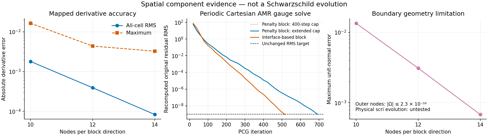

# Compatible gauge derivative and shell-interface research

The requested stable 3D wormhole-to-trumpet evolution is **not established**.
This work advances the replacement spatial operator motivated by the retained
negative-energy counterexample in the [alignment report](takeover-alignment-20261027.md).
The existing C++ evolution, native driver and scientific acceptance targets are
unchanged. No new black-hole evolution was launched in this component series.

The new evidence is stronger than a converged expanded vector solve: it checks
the actual metric-connection variation and an integration-by-parts identity.
It remains insufficient for adoption. Cartesian AMR and mapped shells have
passed separate controls, not a combined AMR/core/shell evolution. General
variable-metric conditioning, physical scri equations, puncture behavior and
matched long-time spherical evolution remain unfinished.



## Discrete definition and its limited energy statement

The metric-built connection uses a derivative `D+`, and the shift contribution
to the metric rate uses its paired `D-`. They satisfy

    H D+ + (D-)^T H = B,
    D± = H^-1 (Q ± R),  Q + Q^T = B,  R = R^T.

Here `H` is positive volume quadrature and `B` contains the physical boundary
flux. Interior transfers cancel paired interface fluxes. A positive high-mode
form `R` removes the centered derivative's extra periodic null mode while
annihilating the retained low-degree polynomials. This changes the declared
spatial discretization; it is not a post-solve projection of fields or errors.

The common Cartesian tensor components retain the full metric connection

    V^i = g^jk g^il (D+_j g_lk - 1/2 D+_l g_jk).

`compatible_tensor_gauge.py` differentiates this expression exactly, including
both inverse-metric variations and the derivative of the complete metric rate.
The shift rate contains `beta^k D-_k g_ij`, both metric-weighted shift gradients,
and `-2 g_ij D-_k beta^k / 3`. No discrete product rule is assumed. The metric
need not have unit determinant, and the independently evolved Z4 connection is
not substituted for the metric connection. This module is a spatial gauge
kernel; it does not yet evolve the independent Z4 fields or assemble the full
physical source and scri metric rates.

For a **constant** positive metric, and periodic or homogeneous Dirichlet shift
directions, the pairing yields

    <beta, -DV[S(beta)]>_(H g) = 1/2 <S(beta), S(beta)>_(H g^-1 g^-1).

The Dirichlet condition is on test directions at the outer boundary, not at the
puncture. Every core and shell cell remains in the volume integrals. For a
variable metric the lower-order terms remain in `DV`; the constant-metric
energy result is not claimed to prove coercivity of that operator.

The construction is informed by
[generalized SBP operators on curvilinear/nonconforming meshes](https://arxiv.org/abs/2305.18195)
and [order-preserving norm-compatible interpolation](https://arxiv.org/abs/1806.01931).
The finite-difference closure coefficients and local-band transfer constraints
used here are independently constructed and tested, not copied coefficient
tables or a theorem covering this full evolution.

## Rejected constructions remain visible

The initial dense closure satisfied polynomial and adjoint identities but did
not converge for smooth functions. Its archived `compatible-sbp-pair-v2` exit
status tested algebraic identities only; it must not be read as an accuracy
pass. The current reproduction explicitly fails a refinement gate in
`compatible-dense-rejection-20261027`.

A global correction to an interpolation matrix also satisfied moment equations
but failed smooth refinement and amplification checks. It is retained under the
explicitly rejected name `mortar_global_candidate`. The accepted component
candidate instead constrains both norm-adjoint transfers within a band whose
physical width shrinks with cell spacing. The value-amplification cap remains
16. The degree-four first attempt exceeded that cap; increasing its stencil
radius from six to ten cell widths passed without changing the cap. Full 3D
tensor-interface tests currently use degree two, not degree four.

Fixed local finite-difference closures have degree 2, 3 or 4 at block edges,
with higher-order centered interiors. They are not the former uniform
fourth-order mapped stencil. Successful 1D component construction is retained
in `compatible-local-mortar-v2-20261027`; earlier syntax errors, infeasible
closures and numerical failures are retained in their original directories.

## Cartesian AMR and original-residual solves

The periodic Cartesian control has 15 actual leaves, including six coarse/fine
face groups. At 15,000, 25,920 and 41,160 cells, the all-cell smooth derivative
RMS is 0.2865, 0.1872 and 0.1300 (observed orders 2.33 and 2.37). Maximum errors
are 1.48, 1.10 and 1.10; this does not establish pointwise high-order convergence.
Tensor face amplification remains below 13.29. Constant non-diagonal tensor
metric energy checks agree to roundoff, and variable scalar-coefficient energy
checks also pass. See `compatible-cartesian-amr-v2-20261027`.

The discrete manufactured linear solve uses 15,000 cells / 45,000 vector
unknowns. Its source is the actual operator applied to a smooth field plus a
small random component; it is not continuum MMS or an evolved black hole.
The RMS and pointwise residual targets remain `1e-9` and `1e-7`.

| Preconditioner and cap | Iterations | Original RMS | Original maximum | Outcome |
|---|---:|---:|---:|---|
| Cell scaling, 400 | 400 | 1.03e-1 | 3.24 | Fail |
| Block inverse + constant coarse modes, 400 | 400 | 2.17e-5 | 5.30e-4 | Fail |
| Block inverse + linear coarse modes, 400 | 400 | 1.19e-5 | 2.82e-4 | Fail |
| Block inverse + quadratic coarse modes, 400 | 400 | 9.93e-6 | 2.38e-4 | Fail |
| Balanced linear coarse correction, 400 | 400 | 1.14e-5 | 2.42e-4 | Fail |
| Linear coarse correction, new 800 cap | 691 | 9.78e-10 | 1.72e-8 | Pass |
| Interface-based block inverse, 400 | 400 | 2.33e-7 | 1.23e-5 | Fail |
| Interface-based block inverse, new 800 cap | 515 | 8.97e-10 | 2.12e-8 | Pass |

The increased iteration cap is explicit: it establishes that this problem can
be solved accurately within a bounded local CPU run, **not** that conditioning
is now satisfactory or mesh independent. The two passing solves took 14.5 and
10.9 seconds excluding setup. All probes had a 120-second wall-time limit.
The second block inverse includes the actual conforming upwind interface
contribution in its separable scalar approximation; AMR tangential coupling is
still approximate in the preconditioner, while the operator is unchanged.
The coarse pseudoinverse checks exactly three periodic translation modes.
Only the reported solution-error measure removes an arbitrary constant offset;
no state or original residual is projected.

## Mapped Cartesian-core/cubed-sphere candidate

`mapped_sbp_probe.py` keeps uniform cell centers in the Cartesian cube and uses
Legendre–Gauss–Lobatto nodes on each shell block. This shell-node choice is an
**unadopted implementation change**. Boundary collocation avoids a multiplication
versus trace mismatch in curved geometric coefficients. Components remain in
the common Cartesian basis. Patch edges retain separate unknowns coupled by
fluxes, without resetting one side to the other.

The core half-width is 0.25 and outer radius is 1. The map agrees with the
repository's unstretched cube-to-sphere map. A configurable partition in the
map coordinate `s` makes the radial layers; these partition values are not
physical radii. Discrete curl cofactors satisfy the metric divergence identity;
positive volume Jacobians, matching face normals and all interface orientations
are checked. The core/shell transfer is norm-adjoint between different nodal
quadratures. Its largest tensor value amplification is below 13.45.

The two-layer family has partition `s=(0, 0.45, 1)`:

| Nodes per direction | Cells | All-cell derivative RMS | Maximum | Surface unit-normal error |
|---|---:|---:|---:|---:|
| 10 | 13,000 | 1.7948e-3 | 1.6403e-2 | 1.3427e-2 |
| 12 | 22,464 | 3.9173e-4 | 4.3791e-3 | 3.0924e-3 |
| 14 | 35,672 | 8.3127e-5 | 3.2510e-3 | 6.8056e-4 |

The observed steep RMS decrease is a short mixed finite-difference/spectral
family, not a universal order claim. Core errors are separately recorded.
Constant derivatives are below `5e-12`; affine-field derivative errors decrease
with refinement, but are not exactly zero on curved shells. Constant and linear
shift fields remain admissible; no puncture parity or pinning is introduced.
The discrete outer normals converge to the analytic normals but are not exact.
All outer nodes have `|Omega| <= 2.23e-16`; this certifies their location, **not**
the physical null condition, pole cancellation or scri evolution equations.

The paired adjoint identity, including the outer flux, holds to less than
`9e-14` relative error. Constant-metric tensor energies agree with the positive
strain form to roundoff. A variable, non-diagonal metric with determinant
between 1.189 and 1.406 exercises all inverse-metric terms: central finite-epsilon
variation errors fall quadratically, reaching `3.57e-10` scaled RMS at epsilon
`1e-5`. The corresponding absolute pointwise discrepancy is `1.71e-6`, recorded
without filtering; this finite-epsilon discrepancy is not a solved gauge
residual.

A separate 43,000-cell test uses seven layers at
`s=(0,.45,.55,.60,.65,.70,.75,1)`. The tensor energy defect is at most
`4.59e-15`, and the variable-metric finite-epsilon check reaches `3.69e-10`
scaled RMS. It is a thin-layer component control, not a stability trajectory.
All nine declared mapped-component gates pass in
`compatible-mapped-shells-thin-20261027`. The first mapped run failed because
of a reporting type error; that source and traceback are retained separately.

## Required next steps and preservation

1. Qualify bounded original-residual solves for the complete variable-metric
   operator on the mapped candidate, including low/high-frequency controls.
2. Join the mapped-shell candidate and Cartesian AMR core in one operator.
   Their separate passing controls do not prove the combined interface system.
3. Bind physical lapse/shift boundary data, evolved scri metric rates and
   regularity equations using the analytic sphere geometry, and independently
   audit actual metric `V_t` and original scri pole residuals.
4. Port only a qualified candidate to C++, preserving all tensor equations and
   independent Z4 variables. Bind the matched 1D lapse controls into actual
   stages and restart state, then repeat bounded genuine 3D evolution tests.
5. Establish angular scatter, original-equation constraints, horizon mass and
   puncture-neighborhood convergence through collapse. These coarse cores do
   not resolve the late 1D puncture front; fixed regular representations and
   puncture-position tracking remain required, without a universal exponent,
   puncture parity, hidden clamps or excluded cells.

Every numerical probe has a frozen source capsule, input command, source hashes,
actual exit code, elapsed time and fixed CPU/time budget. Failures are retained.
The 1D checkout, its uncommitted files and jobs have not been changed.

For a fresh mapped-component reproduction from the 3D repository root, choose a
new output directory:

```sh
python3 tst/elliptic_shift_3d/run_python_probe.py \
  --source tst/elliptic_shift_3d/qualify_mapped_sbp.py \
  --dependency tst/elliptic_shift_3d/mapped_sbp_probe.py \
  --dependency tst/elliptic_shift_3d/compatible_sbp.py \
  --dependency tst/elliptic_shift_3d/compatible_tensor_gauge.py \
  --output tmp/fresh-compatible-mapped --seconds 120
```

No production build or native evolution pass is inferred from these Python
experiments. The full active goal remains unchanged and incomplete.
