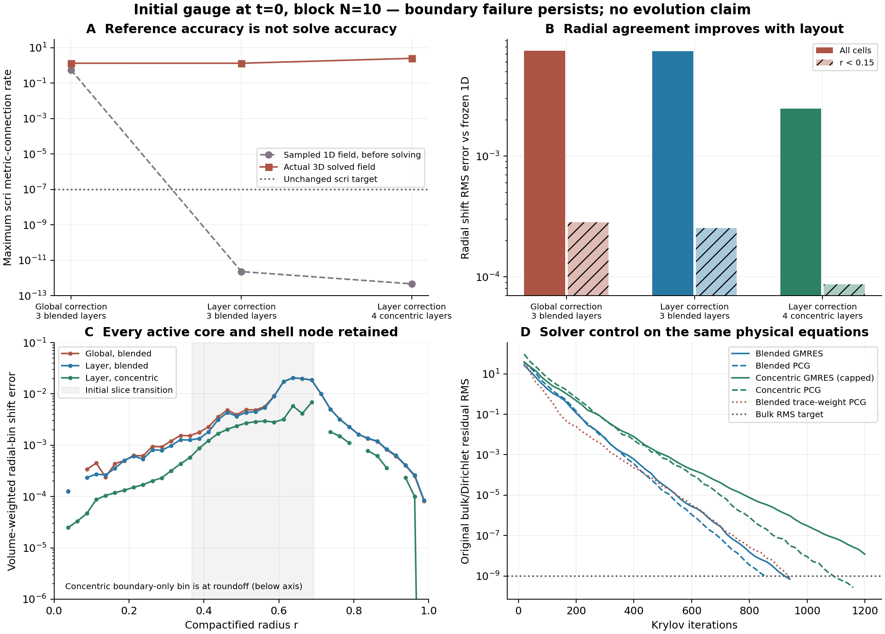

# Affine correction by shell layer and concentric radial interfaces

**No stable 3D evolution is established.** This follow-up isolates a nonlocal
coefficient defect and tests a more suitable radial layout. It retains the full
variable-metric connection-freezing equation and independent evolved Z4
connection. All experiments here are spatial components or initial elliptic
solves; neither native nor research RK evolution has adopted these candidates.
The earlier [endpoint study](compatible-local-endpoint-20261027.md) remains valid.

## A correction that does not couple distant radial layers

The old affine coefficient update acts on four global physical modes (1,x,y,z).
It preserves the SBP identity and positive high-mode form, but couples the
non-affine interior to the outer shell. A skew update on each individual block
cannot repair this while retaining the existing norms and boundary forms:
the necessary affine moment identity fails on every shell face.

The identity does hold for the union of all six faces in each complete radial
layer. At N=10 the layer compatibility defects are below 9e-16 for the two-,
three-, and seven-layer maps; the Cartesian core is below 8e-15. These measured
conditions are explicitly checked before constructing an update.

For each disjoint group, let P be its four H-orthonormal physical affine modes,
and let F be the restriction of the global affine derivative defect. The update

    K = F P* - P F* - P(P*F)P*,     K* = -K

changes derivative coefficients only. The full derivative returns exact
nonzero gradients of the linear modes; no shift field, metric rate, curvature
source or constraint is filtered. The symmetric high-mode update is applied
only to the positive **element-local** forms,

    R_local,new = (I - P P*) R_local (I - P P*).

All original interface jump penalties remain intact. Using the full R on a
discontinuous group basis would also remove interface jump control and is
deliberately not the construction used here. The correction still couples
angular faces within a layer, so it is not a strictly local production stencil.

The two-layer N=10/12/14 component family retains affine derivatives to 5e-13,
weighted adjoint identities to 1.2e-15, and interface jump actions to 1.9e-14.
The isolated jump energies are positive, about 1.40 on each Cartesian axis.
A core-supported disturbance has exactly zero derivative in the far outer
layer. The smooth exponential derivative converges at measured orders 3.14
and 3.02. Constant non-diagonal metric energy and arbitrary variable-metric
finite-variation checks pass, as do all six combined Cartesian-AMR interface
gates. These checks do not prove nonlinear stability or variable-metric
coercivity. Evidence: `compatible-layer-affine-qualification-20261027`.

## Reference-field improvement does not imply solved-field improvement

The frozen spherical t=0 shift and physical curvature source are sampled
independently, without a 3D solve or feedback from angular averages:

| Blended map, N=10 | Cells | Global-correction scri maximum | Layer-correction scri maximum |
|---|---:|---:|---:|
| 2 layers, s=(0,.45,1) | 13,000 | 0.5530 | 0.06056 |
| 3 layers, s=(0,.45,.8,1) | 19,000 | 0.5546 | 2.320e-12 |
| 7 layers, s=(0,.45,.55,.60,.65,.70,.75,1) | 43,000 | 0.5542 | 1.581e-12 |

This identifies a real radial nonlocality defect in the old coefficient update.
It does **not** eliminate the physical solve's boundary error. The complete
three-layer N=10 physical solve reaches original RMS 7.055e-10 in 940 iterations,
but its raw scri rate is 1.3204 and all-node RMS is 0.07213. The previous global
correction gave 1.3257 and 0.07221. Radial shift RMS changes from 7.434e-3 to
7.380e-3 and inner (r<.15) RMS from 2.835e-4 to 2.537e-4. The physical boundary
values and bulk gauge pass; the full boundary-rate gate still fails.

An unrelated full variable-metric two-layer manufactured solve passes in 780
iterations, with independently recomputed residual RMS 6.210e-10 and solution
error 2.487e-12. Its nonunit determinant, nonspherical data, random fine-scale
content and nonzero affine Dirichlet trace are retained. This is an engineering
solve, not a Schwarzschild evolution. Evidence:
`compatible-layer-affine-layout-audit-20261027`,
`compatible-layer-affine-wormhole-n10-20261027`, and
`compatible-layer-affine-mms-20261027`.

## Concentric shells around the physical radial transition

The frozen M=1/3 constructor transitions from the isotropic inner slice at
r=0.3667508104 to the hyperboloidal exterior at r=0.6919875107. In the old map,
constant-s interfaces have angle-dependent physical radii. The new candidate
has a Cartesian cube of half-width 0.2, a smooth cube-to-sphere element ending
at r=0.4, then genuine spherical interfaces at r=0.55, 0.7 and 1.0. The first
sphere encloses every corner of the core. The metric uses the same discrete
curl cofactors and positive SBP norms; the same interface mortars and physical
Omega=0 boundary remain. No physical initial data are changed.

The full four-shell smooth component family has 25,000 / 33,275 / 43,200 nodes
at block N=10/11/12. Weighted derivative RMS decreases
2.0425e-3 -> 1.4622e-3 -> 1.0877e-3, at observed orders 3.17/3.10. Geometry,
affine modes, weighted adjoints, constant-metric energy and full metric
finite-variation gates pass. A separate two-shell concentric family joins the
15-leaf AMR core and passes the original six component gates. The AMR test's
two-shell layout is distinct from the four-shell physical test.

On the sampled reference field, all-node rate RMS decreases from 24.273 to
18.535 between N=10 and N=12, while raw scri rates remain below 8e-13. The large
remaining error is in and near the radial transition. The odd N=11 smooth test
does not sample singular physical puncture data. Evidence:
`compatible-concentric-qualification-20261027` and
`compatible-concentric-reference-audit-20261027`.

The four-layer physical GMRES run reaches its 1,200-iteration cap with RMS
1.195e-8 and maximum 1.439e-6. The unrelated full variable-metric manufactured
run also fails its original residual gate at that cap: RMS 1.717e-8 and maximum
9.456e-7, despite solution RMS being below its 1e-7 threshold. Both failures
are retained. Evidence: `compatible-concentric-wormhole-n10-20261027` and
`compatible-concentric-mms-20261027`.

## Independent Krylov control at the actual flat initial metric

At the physical t=0 state g=I, the same strong bulk operator restricted to
homogeneous Dirichlet corrections has the tested positive strain-energy
identity. PCG can therefore be tested on this linear system without replacing
the full tensor equation. The driver rejects variable metrics for this control,
checks symmetry of the coarse inverse, and checks positive preconditioned
residuals and curvature at each iteration. Original residuals are recomputed
every 20 iterations. This is not a PCG prescription for later variable metrics.

| Physical N=10 case | Method | Iterations | Original RMS | Scri maximum | All-node rate RMS | Radial shift RMS | Inner shift RMS |
|---|---|---:|---:|---:|---:|---:|---:|
| 3 blended layers | GMRES | 940 | 7.055e-10 | 1.3204 | 0.07213 | 7.380e-3 | 2.537e-4 |
| 3 blended layers | PCG | 860 | 8.809e-10 | 1.3204 | 0.07213 | 7.380e-3 | 2.537e-4 |
| 4 concentric layers | GMRES, capped | 1,200 | 1.195e-8 | 2.4968 | 0.20154 | 2.470e-3 | 8.714e-5 |
| 4 concentric layers | PCG | 1,160 | 2.688e-10 | 2.4968 | 0.20154 | 2.470e-3 | 8.714e-5 |

The PCG runs pass the original bulk residual, direct bulk connection rate and
physical boundary values. **Both still fail the all-node and scri gate.**
Recomputed-versus-recursive residual discrepancies are at most 3.1e-12 and
1.1e-11 at their final checks. The independently solved concentric field has
better radial agreement but a worse boundary rate than the blended field;
reaching the bulk tolerance does not alter this tradeoff. The concentric map
also changes the core half-width and cell count, so the improvement cannot be
attributed solely to making the interfaces spherical. Evidence:
`compatible-layer-affine-pcg-n10-20261027` and
`compatible-concentric-pcg-n10-20261027`.

The original block inverse used an N^2 boundary penalty on shell elements,
inherited from Lobatto quadrature. A further control replaces this approximate
penalty with the actual trace norm max(t H^-1 t^T), which scales as N for the
new uniform endpoint quadrature. It retains the same full fine operator,
source, physical boundary data, coarse solve and positive block construction.
This hypothesis does not improve the blended physical solve: PCG needs 940
iterations instead of 860, reaches RMS 8.389e-10, and reproduces scri maximum
1.3204. It is retained as a failed performance improvement, not adopted as a
new default. Evidence: `compatible-layer-trace-mass-pcg-n10-20261027`.

The concentric boundary-only bin has prescribed radial-shift error at roundoff,
below the radial-bin display axis. This is labeled in the figure; that node
and its nonzero connection-rate residual remain in all saved norms.

## What is still required

The physical all-node boundary rate, conditioning and solve cost remain
unresolved. Any candidate must also reproduce the matched Z4c/lapse evolution,
retain all puncture-neighborhood cells and demonstrate convergence and horizon
mass preservation through collapse. Constant and linear shift modes remain free;
there is no puncture pin, parity rule, floor or solution/source projection.
The original objective remains active.

The next boundary experiment should test a local normal-derivative degree of
freedom at scri, while keeping the prescribed shift trace exact. Unlike the
previous global Lobatto bubble, an endpoint Hermite bubble can have zero nodal
values and support only the last radial cell. This is a hypothesis, **not an
implemented fix**: arbitrary angular content, the original metric-built rate,
energy/conditioning, and full variable-metric solves must all be checked. The
present results do not justify relaxing the boundary gate or adopting a
spherical projection to eliminate it.

## Reproducibility and preservation

The [integrity record](evidence/compatible-layer-turn-integrity-20261027/assessment.json)
checks all 32 newly recorded bounded probes from this and the preceding endpoint
round. All are terminal and every frozen source hash matches its capsule;
19 probes have nonzero exit codes, retained explicitly. Zero exit codes cover
only their stated component or diagnostic scope. Independent physical solves
agree in beta RMS to 1.85e-12 for blended GMRES/PCG and 2.63e-11 for capped
concentric GMRES versus converged PCG. The boundary defect is much larger than
this solver uncertainty.

The separate 1D checkout retains its exact recorded HEAD and all 51 dirty or
untracked status entries. No 1D files, branches or jobs were modified. All new
numerical processes used one CPU thread, bounded runtimes, and at most two
simultaneous probes. No production C++ or native time-evolution path changed.
