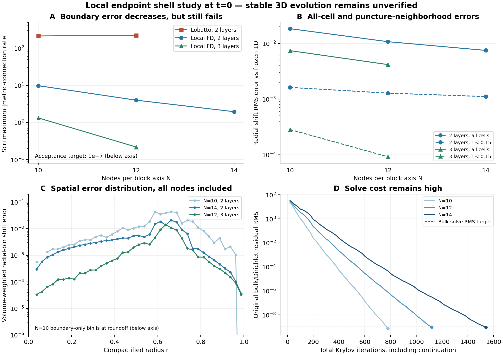

# Local endpoint shell closures and retained enriched-space failures

**No stable 3D collapse evolution is established.** This round tests full tensor
initial gauge solves and spatial components. It improves the physical scri
error substantially, but does not pass the original all-node connection-rate
target or demonstrate wormhole-to-trumpet evolution. The new finite-difference
shell rule is not integrated into either native or research RK evolution.

This continues the [affine and endpoint diagnosis](compatible-affine-and-endpoint-20261027.md).
The physical source remains the frozen successful spherical M=1/3 initial data.
The independent evolved Z4 connection has not been replaced or constrained.
All active core and shell cells remain in the reported diagnostics.

## What the further enriched-space checks established

Exact weighted adjoints were implemented for the paired derivatives, full
variable-metric connection variation, metric rate, enriched rate, and original
block-triangular preconditioner. The outer SBP boundary term is included at
actual scri. Independent inner-product checks on flat and variable non-diagonal
metrics give defects below 3.5e-13. Evidence:
`evidence/compatible-enriched-adjoint-20261027`.

A fully reorthogonalized Golub--Kahan diagnostic applies the unchanged operator
and its adjoint. Independent SVD controls include a condition-1e5 problem and
an inconsistent problem with a stationary residual of 0.25. The latter remains
a failed solve; stationarity is not interpreted as a zero residual. Evidence:
`compatible-bidiagonal-svd-control-20261027`.

On the physical enriched problem, 120 trial directions give a conditioning
**lower bound** of 178.53 for the right-preconditioned operator. The residual is
21.978 and its adjoint norm 21.690. This limited subspace does not establish a
near-null obstruction, full conditioning, or an incompatible source. The weak
direction and its actual action are saved in
`compatible-enriched-two-sided-20261027`.

A global radial coarse space retains three Cartesian vector directions and a
radial vector, while leaving every fine unknown and angular residual intact.
It uses the full tensor action, not a replacement spherical equation. It still
fails after 600 GMRES iterations: RMS 1.303e-2, maximum 1.069. Evidence:
`compatible-enriched-radial-coarse-20261027`.

For the actual flat conformal metric at t=0, a separate variational control uses
`A = S* S / 2` and source `-S* C / 2`. It has an exact positive strain-energy
identity, including the extra coefficients. Its weak endpoint moment equations
are **not** relabeled pointwise endpoint equations. It explicitly rejects a
general metric; this restricted control must not replace full nonlinear
connection freezing. A positive radial strain-block inverse was also tested.

| Flat-metric weak control | Iterations | Weak RMS | Original bulk RMS | Original scri maximum |
|---|---:|---:|---:|---:|
| Positive diagonal bubble blocks | 800 | 1.662e-2 | 1.666e-2 | 23.370 |
| Coupled positive radial strain blocks | 800 | 1.424e-2 | 1.428e-2 | 23.052 |

The energy identity agrees to 1.92e-16 relative error. That identity does not
establish conditioning or successful physical evolution. Both solves fail.
The second inverse uses positive energy blocks, rather than the rejected strong
angular-row-sum blocks from the preceding report. Evidence:
`compatible-weak-wormhole-n10-20261027` and
`compatible-weak-line-wormhole-n10-20261027`.

## A local finite-difference base rule at actual scri

`endpoint_sbp.py` supplies a uniform endpoint-collocated rule instead of global
Lobatto polynomial differentiation. The Cartesian core is unchanged. Shells
still contain the actual sphere at Omega=0, with the same null/fixed-angle
shift values. No extra shift coefficients are used in this family.

The local base pair has degree-two boundary closures and sixth-order centered
interior differences. A positive third-difference form controls high modes and
annihilates quadratics. The first five dimensionless norm weights are

    0.3298611111, 1.3208333333, 0.7666666667, 1.1013888889, 0.98125.

They are reflected at the right boundary and multiplied by h=1/(N-1).
The closure solves polynomial and SBP equations together with corrected
trapezoidal endpoint moments: +1/12 for the first correction moment and -1/120
for the third, with zero even corrections through degree four. It does not
reuse the midpoint quadrature corrections of the Cartesian core.

The previously tested global rank-four affine coefficient correction is still
applied. **The base closures are local; the complete corrected operator is not
strictly local.** Its nonlocality remains a production consideration. No field
or source is projected by that coefficient construction.

All local polynomial, positive-weight and degree-four quadrature checks pass.
The mapped N=10/12/14 family has the following errors for an unrelated smooth
Cartesian exponential:

| Block N | Cells, two layers | All-node derivative RMS | Scri derivative maximum |
|---|---:|---:|---:|
| 10 | 13,000 | 2.0611e-3 | 1.1967e-2 |
| 12 | 22,464 | 1.0978e-3 | 5.8185e-3 |
| 14 | 35,672 | 6.6258e-4 | 3.6656e-3 |

Observed all-node orders are 3.14 and 3.02 when parameterized by shell spacing.
These are measured smooth-case orders, not a universal accuracy claim.
Constant non-diagonal metric energy and independent full variable-metric
finite-variation checks also pass. Evidence:
`evidence/compatible-endpoint-fd-qualification-20261027`.

The same shell rule joins the genuine 15-leaf Cartesian AMR core. At block
N=10/11/12, all-cell derivative RMS decreases from 2.0611e-3 to 1.4759e-3 to
1.0978e-3. Core-only RMS decreases from 4.2510e-5 to 3.0170e-5 to 2.5886e-5.
Maximum transfer amplification is 4.706, below the unchanged cap 16. All six
interface/tensor component gates pass. This is smooth derivative convergence,
**not puncture-neighborhood convergence during collapse**. Evidence:
`evidence/compatible-endpoint-fd-amr-20261027`.

The full variable-metric manufactured solve reaches RMS 6.100e-10 and maximum
4.387e-8 in 800 iterations. Solution RMS error is 2.100e-12. The same complete
metric variation, nonunit determinant and nonzero affine Dirichlet data are
retained; no CFC approximation is made. Evidence:
`evidence/compatible-endpoint-fd-mms-20261027`.

## Physical initial gauge and refinement

The N=10 three-layer physical solve initially stopped at its 800-iteration cap
with RMS 3.448e-8. A separately recorded continuation verifies the saved grid,
weights and operator source hashes, then solves the remaining linear residual.
It passes the original bulk solve target after 160 additional iterations.
This continues a linear initial-state solve, not a time evolution. The failed
800-iteration record is retained and total cost is 960 iterations.

The corresponding N=12 capped run and its continuation are also kept separately.
Both the all-node norm and raw scri rate remain visible, even when the bulk and
prescribed boundary-value gates pass. Detailed family results follow below.

| Layers | Block N | Cells | Total iterations | Bulk/Dirichlet RMS | Raw scri rate maximum | All-node rate RMS | Radial shift RMS error | Shift RMS, r<0.15 |
|---|---:|---:|---:|---:|---:|---:|---:|---:|
| 2 | 10 | 13,000 | 780 | 7.205e-10 | 9.784 | 1.082 | 1.847e-2 | 1.622e-3 |
| 2 | 12 | 22,464 | 1,120 | 9.646e-10 | 3.987 | 0.3442 | 1.078e-2 | 1.280e-3 |
| 2 | 14 | 35,672 | 1,540 | 9.070e-10 | 1.952 | 0.1332 | 7.510e-3 | 1.109e-3 |
| 3 | 10 | 19,000 | 960 | 8.642e-10 | 1.326 | 0.07221 | 7.434e-3 | 2.835e-4 |
| 3 | 12 | 32,832 | 1,280 | 7.736e-10 | 0.2182 | 0.009041 | 4.176e-3 | 9.173e-5 |

All five final solves pass the independently recomputed original bulk residual,
bulk metric rate and prescribed physical boundary values. **Every row fails**
the unrelaxed all-node RMS 1e-8 / scri maximum 1e-7 gate. The N=14 two-layer
total includes 340 iterations continuing its retained 1,200-iteration failure;
the N=12 three-layer total includes 80 more after its 1,200-iteration cap.

The two-layer family has scri observed orders 4.47/4.28 and radial-shift orders
2.68/2.16, measured against h=1/(N-1). Inner-shift orders are only 1.18/0.86.
Thus the apparent exterior improvement does not establish adequate puncture
convergence. Three layers improve the outer error further but only provide two
resolutions. These are spatial initial-state observations, not temporal stability.

The radial-bin plot clips the N=10 boundary-only roundoff value below its display
axis and says so explicitly. No node is removed from any computed norm or saved
profile. Plot inputs and hashes are in the accompanying `assessment.json`.

An odd N=11 physical attempt was rejected by the constructor because the
cell-centered Cartesian core then contains r=0. That sampled puncture value is
unsupported by this physical constructor. No cell was removed, radius shifted,
field floored or parity condition imposed to make it run. This failure is kept
in `compatible-endpoint-fd-wormhole-n11-20261027`. The physical refinement family
uses even N=10/12/14, with every active cell included. The smooth AMR N=11 test
above is a different, nonsingular problem.

Two radial layers keep the complete even-grid family within the existing
50,000-cell guard; the three-layer N=10/N=12 controls remain separate. Partitions
are in map s, not physical radius. No resource or residual gate was relaxed.

## Boundary decomposition and locality

The independent saved-field audit decomposes the corrected connection rate into
the uncorrected action, the change to the shift strain, and the change to the
metric derivative. The terms close to about 1e-13. On the N=12 three-layer saved
solution, the uncorrected same-field scri maximum is 3.843, the shift-coefficient
contribution is 3.654, and the metric-derivative contribution is 8.600e-4. Their
sum has maximum 0.2182; maxima of individual terms must not be added as scalars.
Simply disabling the affine correction would worsen this saved-field residual.
This comparison is not a new solve with the uncorrected operator.

On the independently sampled 1D initial shift, the globally corrected scri
maximum is 0.5546 at N=10 and 0.3416 at N=12. There is a residual on the reference
field itself, before any Krylov solve. Saved-solution surface errors occur on
face interiors as well as edges and corners. Evidence:
`evidence/compatible-endpoint-fd-boundary-audit-20261027`.

A local-moment audit tests whether each block could receive a skew coefficient
update while its physical norm and boundary form stay fixed. All 18 shell
blocks fail the necessary compatibility condition, with maxima 5.499e-3 and
1.650e-3 at N=10/12; the complete global domain passes to roundoff. This rules
out that particular per-block correction, not all local SBP constructions.
Evidence: `evidence/compatible-endpoint-local-affine-audit-20261027`.

Further tests confining the correction to **complete six-face layers** are
reported in [the layer-local follow-up](compatible-layer-affine-20261027.md).

## Remaining work

Passing spatial identities and a manufactured solve is insufficient. The
physical boundary error, full solve cost, puncture representation, and matched
coupled Z4c/lapse/RK evolution still need qualification. The native adapter has
not changed. There is no new horizon-mass history, stable collapse trajectory,
or claim of scientific completion. The stable genuine 3D wormhole-to-trumpet
objective remains active.
