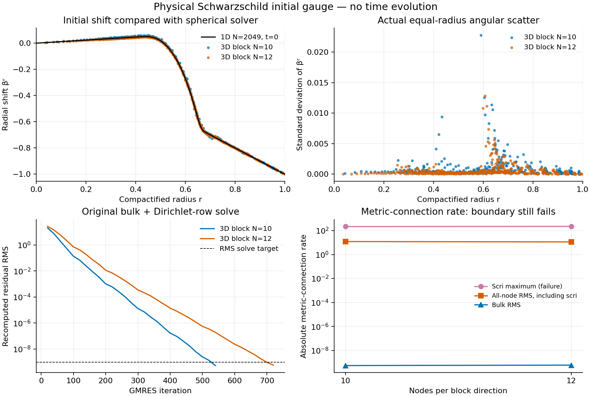

# Combined interfaces and the physical initial gauge: progress and scri failure

**Stable 3D Schwarzschild evolution remains unverified.** The compatible
candidate now solves the full variable-metric problem on a combined Cartesian
AMR/core/cubed-sphere grid. On the actual spherical wormhole initial data, its
bulk connection-freezing residual passes and the shift approaches the 1D
profile. However, the raw connection rate at scri is large and does not improve
between the two tested resolutions. The candidate is not adopted for evolution.

This report continues the [compatible-operator component study](compatible-gauge-prototype-20261027.md).
The subsequent [affine and endpoint diagnosis](compatible-affine-and-endpoint-20261027.md)
repairs the affine control, confirms that the physical scri failure persists,
and tests its high radial mode without filtering the source or solution.
It changes neither the scientific objective nor the historical failed evidence.
All work here is a standalone spatial/elliptic experiment. No new evolution,
Hamiltonian-constraint trajectory, horizon-mass result or native integration
pass is claimed.

## Combining the AMR core with the shells

`AMRShellGrid` joins 15 Cartesian leaves (one of the eight base leaves refined
into eight children) to 12 cubed-sphere blocks in two radial layers. It retains
all cells. The Cartesian periodic wrap fluxes and the shell prototype's temporary
coarse-core fluxes are removed from the resulting action; one norm-adjoint
physical coupling replaces them. There is no synthetic coarse state in the
final derivative, no puncture parity or pinning, and no discarded neighborhood.

Core faces contain four coarse quadrants, with four children replacing one
quadrant on the three faces touched by refinement. Their quadratures are joined
hierarchically to the shell quadrature, preserving both transfer directions'
degree-two tensor polynomial moments and physical face norms.

The first combination failed the unchanged value-amplification cap of 16:
maximum row sums were 58.18, 26.19 and 65.03 for block N=10,11,12. It passed
the energy identity, demonstrating again that this identity alone does not
qualify an interface. The failure is retained in
`compatible-combined-amr-shell-20261027`.

The repair minimizes the weighted coefficient norm subject to the same local
moment equations, starting from zero rather than a point-sampling prolongation
seed. Stencil support still shrinks with spacing. This changes interpolation
coefficients; it does not project evolved fields or constraints. The cap, norm
identity and polynomial targets are unchanged.

| Block N | Total cells | All-cell derivative RMS | Core-only RMS | Maximum transfer L1 |
|---|---:|---:|---:|---:|
| 10 | 27,000 | 1.7949e-3 | 4.8355e-5 | 4.416 |
| 11 | 35,937 | 7.8253e-4 | 5.9330e-5 | 4.275 |
| 12 | 46,656 | 3.9161e-4 | 3.9296e-5 | 4.151 |

The combined adjoint defects are below 2.2e-14 and polynomial errors below
1e-9. Full tensor energy and independent variable-metric finite-epsilon checks
pass. **The small core-only error is nonmonotone in this short family.** The
all-cell decrease does not establish puncture-neighborhood convergence. See
`compatible-combined-local-mortar-20261027` for all six scoped component gates.

## Full variable-metric solves and their cost

`TensorGauge` retains the advection of the variable metric, its complete shift
metric rate, both inverse-metric variations and the derivative of that rate.
No expanded continuum product rule is substituted. The metric determinant in
these tests ranges from 1.189 to 1.406; it is not projected to unity.

The test is discrete MMS with an actual smooth non-diagonal metric, smooth plus
random shift content, and nonzero affine Dirichlet data. It is not the Einstein
evolution source. Right-preconditioned GMRES uses a separable mapped block
inverse plus a coarse matrix assembled from the complete tensor action.
Targets remain 1e-9 RMS and 1e-7 pointwise, recomputed using the original action.

| Grid / change | Result | Iterations | Original RMS | Original maximum |
|---|---|---:|---:|---:|
| 13,000 cells, restart 60 / cap 600 | Fail | 600 | 2.30e-7 | 5.70e-5 |
| Same operator, restart 100 / new cap 900 | Pass | 700 | 2.88e-10 | 6.75e-8 |
| Minimum-norm core/shell transfers | Pass | 580 | 2.97e-10 | 6.47e-8 |
| 27,000-cell combined AMR/shell, uncached | 180 s timeout | unknown final count | unavailable | unavailable |
| Same combined operator, cached coefficients | Pass | 840 | 1.22e-10 | 9.07e-8 |

The timed-out run did not preserve intermediate residuals; this limitation is
explicit, not interpreted as a numerical convergence or divergence result.
Subsequent runs write a residual journal every 20 iterations. The successful
combined run took about 26 seconds to prepare and 80 seconds to solve, within
its 180-second budget. Iteration counts remain excessive for repeated RK stages;
these results do not establish mesh-independent conditioning.

Caching factors the fixed-stage variation into a point-local tensor acting on
the metric rate plus a coefficient tensor acting on its derivative. It retains
every term. On the combined 27,000-cell grid, an independent comparison against
the uncached implementation gives maximum difference 6.83e-13 and scaled RMS
2.73e-16 for a general symmetric perturbation. Coefficients use 23.3 MB and must
be rebuilt after a metric update. All final solve residuals are independently
recomputed with the uncached evaluator. Evidence is in
`compatible-cached-tensor-20261027` and the `compatible-*-variable-*` directories.

## Actual wormhole initial source and comparison to 1D

The initial-data constructor is the frozen, hash-verified source from the
successful spherical M=1/3 run. It supplies the physical isotropic Schwarzschild
wormhole with a hyperboloidal outer end, initially g_ij=delta_ij. This initial
condition is not a restriction on the evolved metric or a CFC substitution.
No current 1D source, job or working-tree file is used or changed.

The full three-dimensional curvature tensor is reconstructed as

    A_ij = (3/2) A_rr (n_i n_j - delta_ij/3),
    C_ij = -2 alpha A_ij.

The solve uses `-DV[S(beta)] = DV[C]`, so the diagnostic is independently
evaluated as `DV[C+S(beta)]`. Unlike MMS, the curvature source is supplied by
the physical initial-data constructor, not manufactured from a desired shift.
The connection damping coefficient is zero, matching the reference. These two
physical-source runs use the unrefined Cartesian core; the combined AMR run
above uses a manufactured source.

At actual scri, initial alpha=chi=1 and g=I. The three prescribed shift values
are beta=-x: they enforce the future null branch and fixed reference angles.
The analytic sphere normal is used for this check, not the approximate discrete
geometric normal. The elliptic boundary rows prescribe these values; they do
not additionally impose a connection-rate equation. There are no puncture
boundary rows. All core cells participate in the solve and its error norms.

| Quantity | Block N=10 | Block N=12 |
|---|---:|---:|
| Cells | 13,000 | 22,464 |
| GMRES iterations | 540 | 720 |
| Original residual RMS | 5.39e-10 | 5.81e-10 |
| Direct bulk metric-connection rate RMS | 5.42e-10 | 5.84e-10 |
| Radial shift RMS error vs 1D | 8.96e-3 | 5.36e-3 |
| Tangential shift RMS | 2.84e-3 | 1.71e-3 |
| Equal-radius radial angular scatter RMS | 2.22e-3 | 1.17e-3 |
| Shift RMS error at r<0.15 | 2.40e-3 | 1.09e-3 |
| **Raw scri metric-connection rate maximum** | **213.72** | **222.81** |

The two frozen 1D reference resolutions differ by about 2.64e-6 RMS at the N=10
sample points, much less than the 3D shift error. Angular averages are diagnostic
only and are never fed back into the elliptic action. Each saved profile retains
all nodal values, weights, errors and boundary labels. The r<0.15 number is an
additional diagnostic, not an exclusion from other norms.

The null and fixed-angle boundary conditions hold to roundoff, and the prescribed
lapse clock is exact. Nevertheless, **the raw scri connection-rate error is a
failure relevant to evolution**. Including scri nodes in the volume quadrature
gives an all-node rate RMS of about 12 at N=10, not 5.4e-10. The plotted all-node
norm keeps this distinction visible. The programs' three passing gates cover
the original bulk/Dirichlet solve, its direct bulk rate and the prescribed
boundary values; they do not certify full boundary regularity or stability.

The frozen constructor squares exponentially small transition-function values.
The first strict-floating-point run stopped on that underflow. Subsequent runs
retain its standard IEEE values and record underflow warnings during initial
construction only; invalid operations, division and overflow remain fatal, and
all solver arithmetic is trapped. This introduces no field floor or altered
initial-data formula. Another attempt reached the solve target but failed in
postprocessing because NumPy returned a multidimensional unique-index array;
that traceback and journal remain preserved. The correction flattens those
indices and saves the computed solution before further analysis.

## Diagnosing the boundary discrepancy

The affine-field audit tests the required physical shift beta=-x directly,
without an elliptic solve or any subtraction of its known continuum RHS.
For a flat constant metric it should produce zero metric rate. The current
mapped coefficients give the following nonzero values:

| Block N | Metric-rate maximum at scri | Connection-rate maximum at scri |
|---|---:|---:|
| 10 | 5.345e-2 | 5.001 |
| 12 | 1.367e-2 | 1.951 |
| 14 | 3.302e-3 | 0.6622 |

The central derivative control has almost the same metric-rate defect. Removing
the paired high-mode form therefore does not repair the main geometric error
and would abandon its near-null-mode protection. This is a consistency defect
in the curved derivative coefficients: constant preservation and the discrete
metric divergence identity do not imply exact differentiation of physical
affine fields. It must be addressed in the discretization, not by resetting
fields or subtracting a reference physical RHS.

A separate source audit samples the frozen 1D shift directly on the 3D grid:

| Radial partition in map s | Cells | DV[C] maximum at scri | Total reference rate maximum at scri |
|---|---:|---:|---:|
| (0,.45,1) | 13,000 | 31.75 | 85.40 |
| (0,.45,.8,1) | 19,000 | 0 | 5.001 |
| (0,.45,.55,.60,.65,.70,.75,1) | 43,000 | 0 | 5.001 |

An outer layer wholly beyond the curvature transition removes the sampled
curvature-source contribution at scri, but the affine geometric defect remains.
These are evaluations of sampled reference data, **not fresh solves** on the
new partitions. They do not establish that adding a buffer fixes the solved
boundary error. Evidence: `compatible-wormhole-boundary-audit-20261027` and
`compatible-mapped-affine-audit-20261027`.

## Next acceptance work

The next operator change must preserve the paired energy identity while making
physical affine fields consistent with the curved geometric coefficients.
An independently tested outer-layer treatment is also needed. Recheck all-cell
and regional accuracy, amplification, near-null modes, full variable-metric
residuals and actual boundary rates after any change. Do not add extra elliptic
boundary conditions merely to zero a reported surface rate.

Only after these pass should a candidate be integrated into the full matched
Z4c/lapse/RK evolution and physical scri regularity equations. The independent
Z4 connection, full tensor metric, Cartesian AMR, configurable shells, actual
Omega=0 surface, free constant/linear modes and puncture-position support remain
required. Wormhole-to-trumpet evolution, puncture-neighborhood convergence,
angular scatter through collapse, exterior constraints and horizon-mass
conservation are all still outstanding.

Every run retains frozen source, hashes, commands, actual exit status and time
budget. No failed run was overwritten or relabelled. The full goal remains active.
