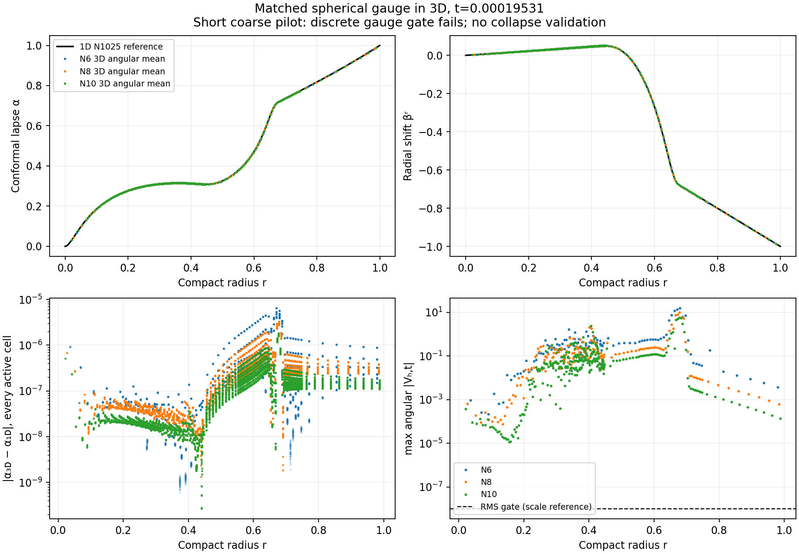

# Aligning the 3D experiment with the successful spherical configuration

The formulation alignment passes independent component tests. Short genuine 3D
runs approach the spherical lapse and shift profiles with refinement, but **do
not pass the discrete gauge or scri gates**. Wormhole-to-trumpet reproduction is
unfinished. The new interface treatment is a standalone candidate, not an
adopted evolution operator. This report follows the user's explicit takeover
and subsequent instruction to align with the evolved 1D code first; the dated
[handoff](TAKEOVER-20261027.md) retains the preceding paused state and failures.

## Verified spherical reference and scope

The source is the successful `telegraph-attenuated-duration-v1/matrix-source`
run in the separate 1D checkout, at observed tip
`a9214bccff96ae44f6e13608b03945905da9677c`. Every copied source file was checked
against the run's manifest. The portable source archive, recorded dirty state,
original input, assessment and fresh short controls are in
[evidence/takeover-spherical-reference-20261027](evidence/takeover-spherical-reference-20261027/).
No 1D source, uncommitted file, branch or process was modified.

That N1025 run reached t=500 with its **apparent-horizon exterior** budget and
maximum relative horizon-mass error 2.64272296e-6. It does not establish global
constraint convergence: large interior errors and residual ripples remain.
The 3D comparisons below retain every active cell, including puncture neighbors;
their all-cell constraints are not comparable to the exterior-only acceptance
number from the long spherical run.

The matched parameters are M=1/3, kappa1=4, kappa2=-0.99, the complete Appendix-C
Theta source, nu=1, multiplicative physical-log lapse restoring, the collapsed
inner source, constant damping, and Minkowski reference. Telegraph tau=0.02,
kappa=0.005, outer support 0.8 and transition width 0.24 are retained.

The later 1D telegraph attenuation is

    eta(alpha,r) = (1+epsilon) alpha / (alpha + epsilon A(r)),
    A(r) = (1+r^2)/2, epsilon = 1e-4.

It multiplies the *completed lapse divergence term*. It is not moved inside the
divergence and does not multiply the auxiliary flux equation. The additional attenuation depends on lapse; the existing chi prefactor
in the lapse divergence is retained. The reference state alpha=A has eta=1, while a collapsed
lapse reduces the added telegraph propagation speed.

## Implementation and independent checks

`SphericalMatchedEvolution` is an explicitly selected host research RK4 class.
It retains the full variable-metric tensor equations and independently evolved
Z4 connection. Its changes relative to the old 3D pilot are:

* The reference-normalized lapse attenuation above, including its contribution
  to the signal-speed guard.
* Total conformal-lapse RK stage updates while retaining positive log storage.
  Accepted increments use compensation, including log encode/decode roundoff.
* The configurable physical lapse floor, default 1e-10, with separate initial
  and evolution counts, nonpositive counts, correction maxima and activation
  radius. Zero disables the floor. It cannot change scri. Every reported 3D
  pilot has **zero activations**, and the floor-off N6 profiles are bitwise
  identical to the default profiles.
* The tensor scri regularity traces corresponding to the spherical A and Lambda
  penalties, in the selected alpha=1, K=-3, chi g^nn=1 scri frame:

      C_Aij = Aij - [chi Dbar_i Dbar_j Omega]^TF,
      C_Lambda^i = Lambda^i - V^i(metric).

  The rates include -8 C/h at scri. For radial g=I these reduce to
  A_rr + 2 chi_r/3 and Lambda_r. They are rate penalties, not algebraic
  projections. The existing pole penalties, exact lapse clock, future null
  normal shift and fixed boundary angles remain in force.

The shared legacy engine defaults remain unchanged. The new class is not wired
into the native Driver or legacy checkpoint reader: a valid restart would also
need to bind these controls and both compensation arrays. No native matched
wormhole run or checkpoint qualification is claimed.

The radial fixture generator imports the frozen successful Python implementation
and evaluates 196 states, including nonzero Theta, Lambda and telegraph flux and
lapses spanning ten orders of magnitude. The independent C++ tensor reduction
has maximum scaled discrepancy **1.4961e-14** across chi, metric, curvature,
Khat, Theta, Lambda, lapse and telegraph equations. Omitting attenuation changes
one tested lapse rate by **0.3616**, so this is not an insensitive equilibrium
check. The spherical boundary trace discrepancy is 2.22e-16. Thirty-two general
non-diagonal metric states additionally cancel the curvature pole when their
regularity trace is set to zero.

The time-update test checks physical floor units, disabled-floor rejection,
total-lapse stages and two actual RK4 Minkowski steps: maximum drift 1.61e-16,
zero clock error and zero equilibrium clamps. All **40/40** elliptic component
CTests pass. A full shared executable build hit its predeclared 180-second cap;
only the component targets were subsequently built successfully. This is not
a new full-native-build result.

Evidence: `takeover-matched-kernel-general-20261027`,
`takeover-matched-time-update-20261027`, `takeover-component-regression-20261027`,
and the retained timeout in `takeover-regression-20261027` under `evidence/`.

## Short matched 3D reproduction attempt

The three full tensor evolutions have block sizes N=6,8,10 and 10,800 / 25,600 /
50,000 active cells. The Cartesian core has half-width 0.25 and seven shell
boundaries at 0.45, 0.55, 0.60, 0.65, 0.70, 0.75 and 1. Each run takes four RK4
steps of 4.8828125e-5 to t=0.0001953125, using the same M=1/3 wormhole constructor
as the spherical code. No spherical averaging is fed back into the evolution.

Fresh frozen-source spherical controls at N1025 and N2049 use the successful
inner-exp-scri grid (stretch 16), width-seven/upwind derivatives, eighth-order
KO (strength 0.5, radius 0.8), total-lapse update and the same gauge parameters.
The 3D code uses its fourth-order centered mapped derivatives and existing
interfaces and has **not acquired the spherical KO/advection discretization**.
Thus the bulk formulation, gauge parameters, RK variable and radial boundary
trace reduction are matched; the spatial methods are explicitly different.

| Block N | Lapse RMS error vs 1D | Radial shift RMS error | Actual metric V_t RMS | Scri pole | All-cell H RMS |
|---|---:|---:|---:|---:|---:|
| 6 | 9.3858e-7 | 1.0222e-3 | 2.2033 | 1.0572e-6 | 3.5303 |
| 8 | 4.7314e-7 | 5.1686e-4 | 1.1891 | 2.4876e-7 | 3.6387 |
| 10 | 2.6797e-7 | 2.3882e-4 | 0.66343 | 1.3468e-7 | 3.6046 |

The reference N1025/N2049 lapse difference is about 4e-11 RMS at the actual 3D
nodes, much smaller than the 3D errors. Angular means and standard deviations
are measured from actual equal-radius node groups; individual-cell errors and
puncture-region norms remain in the accompanying JSON. The finest minimum
radius is 0.02165, nowhere near the late spherical front around r=4e-7.



The predeclared actual-connection target is 1e-8 RMS and scri-pole target 1e-7.
All three runs fail both final gates, even though the expanded solve residual
is around 1e-10. The harness exits **1** for these scientific failures; child
process completion alone is not acceptance. The all-cell Hamiltonian norm is
large and does not decrease in this family. The plot is a short initial-regime
comparison, not a collapse or long-term stability result.

An independent N6 control halves dt and takes eight steps to the same final
time. Its lapse difference is 5.9804e-16 RMS and radial-shift difference 2.9075e-14 RMS,
well below the spatial/reference discrepancy. It still fails the original
scientific gates. See `evidence/takeover-matched-halfstep-20261027/time-control.json`.

## Cartesian/shell interface diagnosis and candidate repair

The previously failing AMR value amplification of 50.9642 originates in
*owning-block tangential extrapolation* on a Cartesian normal plane. The
plane factor is 51.4918 while the radial interpolation factor is only 1.0453.
The repair uses actual coplanar nodes from neighboring Cartesian leaves when
an owning-plane query lies outside that block's nodal hull. A bounded, centered
P5 QR fit selects its donors; neither synthetic nodes nor a larger allowed
amplification are introduced. Radial chains, angular cross-face treatment and
mapped derivative Jacobian/Hessian chains remain unchanged.

The originally failing row has value amplification **1.8264** after repair.
The complete row tests retain caps 16 / 32 / 64 for value / gradient / Hessian:

| Geometry | Qualified interface rows | Affected active cells | Max value L1 | Max gradient L1 | Max Hessian L1 |
|---|---:|---:|---:|---:|---:|
| uniform N6 | 3888 / 3888 | 1648 / 1648 | 10.9589 | 7.2155 | 17.0864 |
| refined N6 | 15408 / 15408 | 6256 / 6256 | 8.3779 | 3.5450 | 9.6718 |

No row or cell is dropped. The full AMR plan costs 48.9 s construction and
about 503 MB compact weight payload; this remains too expensive to treat as a
production solution. Angular P5 reproduction is not exact Cartesian P5
reproduction, and high-order refinement remains unqualified.

Injecting the qualified uniform rows into the standalone composed operator
changes the saved negative witness's physical Rayleigh quotient from -857.318
in the historical operator to **+232.089**. Its energy becomes 9.7986e-4, while
the positive strain integral is 1.1656e-3. A smooth zero-boundary control remains
positive, with Rayleigh quotient 12.3079. The remaining energy-identity defect
is retained. These two witnesses do not prove coercivity or a spectral gap;
centered first derivatives still have a periodic Nyquist kernel.

The candidate is not installed in the production operator or multigrid
hierarchy. The test injector changes only fine interface halo rows after
preparing every replacement, leaving active states and scri rows untouched.
The qualification program now returns failure for any unsupported row or cell
instead of silently succeeding as a diagnostic executable.

Evidence: `takeover-plane-baseline-20261027`, `takeover-plane-repair-pilot-20261027`,
`takeover-plane-repair-uniform-20261027`, `takeover-plane-repair-amr-20261027` and
`takeover-repaired-energy-20261027` under `evidence/`.

Independent finite-epsilon Frechet checks with the repaired interfaces pass for
two nonspherical, nontracefree metric-rate directions and nonunit determinant,
including every bulk node and scri row. At epsilon=1e-5 the RMS differences are
about 4e-10 in the bulk and 8e-10 on the surface; the maximum over the two
checked epsilon values is 6.4672e-09 (target 1e-7). This verifies the discrete
variation, not spatial convergence. See `takeover-repaired-frechet-20261027`.

## Conditioning tests after interface repair

The repaired operator still fails the curved manufactured-solution solves with
120 iterations and restart length 48. The original composed residual is
2.4468e-4 RMS (7.7205e-3 maximum) for affine shift and 1.3172e-3 RMS
(5.8353e-2 maximum) for nonlinear shift, against 1e-10 RMS / 1e-7 point targets.
The nonlinear solution error is 3.4155e-3 RMS. Both failures are retained with
nonzero exit code in `takeover-repaired-mms-20261027`.

A 160-step unrestarted solve also fails, at 4.3571e-4 RMS and 1.9030e-2
maximum. Restarting is therefore not the sole cause; see
`takeover-repaired-unrestarted-20261027`.

An eight-mask preconditioner retry, which alters only the linear solve and does
not impose puncture parity on the state, fails worse: residual 2.1143 RMS after
80 iterations. It is rejected; see `takeover-repaired-masked-20261027`.

The repaired 42-mode low/high-frequency control has right-scalar-MG restricted
condition estimate 12.66 (versus the historical 26.6), with restricted singular
values 0.1626 to 2.0587. This improvement does not cover the full space and does
not contradict the failed actual solves. See `takeover-repaired-spectrum-20261027`.

## New counterexample: the repaired operator is still noncoercive

The favorable old-witness result does not survive a broader search. A fresh
80-column full-action Arnoldi probe finds a new direction with independently
recomputed physical Rayleigh quotient **-5.3312081633**. The C++ energy audit
reproduces its saved operator action exactly and measures

    E = -4.2423556845e-5,
    Q = integral 0.5 H_ij H_ij dV = +4.7663997716e-4.

The defect E-Q is -5.1906353401e-4. About 99.89% of this signed defect is in
the shell cells, whereas the previous severe witness was concentrated in the
Cartesian core and first transition. Regional energies include inter-region
fluxes; the **global zero-Dirichlet negative energy** is the rejection test.
This remains a full-domain physical-volume calculation, with no Omega factor
and no discarded cells. The diagnostic returns nonzero and the candidate stays
unadopted.

The 80-direction restricted singular condition estimate is 683.95, much worse
than the favorable 42-mode screen. Neither restricted estimate is the full
condition number. Passing row-amplification caps or a few positive energy
witnesses does not establish a compatible discrete integration-by-parts
identity. The new failure motivates a matched discrete derivative/interface
pair for the metric rate and metric-derived connection, with an explicit global
energy identity, rather than further relaxing caps or residual tolerances.
That replacement has **not** been implemented or validated here.

The minimal counterexample consists of the stored full witness CSV, compiled
source capsule and exact zero-boundary energy audit in
`evidence/takeover-repaired-arnoldi-20261027` and
`evidence/takeover-new-negative-energy-20261027`. The original failed operator,
old witness, intermediate passing witness and new failing witness are all
preserved separately.

## Remaining acceptance work

A consistent operator still needs well-conditioned variable-metric solves,
refinement of the independent metric Frechet checks already passed at N6,
low/high-frequency and refined-grid controls, and complete scri compatibility.
Only then should it replace the expanded evolution solve. Native RK/restart
binding, 3D dissipation/advection qualification, puncture regular representations
without a universal exponent, horizon extraction and a resolved collapse family
remain unfinished. Constant/linear shift modes and puncture-position support
must be retained. No projection, puncture parity, radius exclusion, physical
RHS subtraction or relaxed residual target is justified by the present results.

## Reproduction and provenance

All takeover probes compile against a frozen dependency capsule, hash the
source and linked libraries, run with one CPU thread and a predeclared timeout,
and record actual child exit codes. Raw local files are retained; compiler dependency logs, large row
logs and profiles have lossless compressed copies. `probe.stdout.gz` restores
the corresponding ignored raw row log. Host binaries and duplicate unpacked
source trees are not committed. The two spherical shared libraries are recorded
by hash but omitted from the source archive; Python initial-data/fixture
reproduction does not use them. The copied reference archive contains the C++
sources needed to rebuild the libraries for a fresh spherical evolution.

From the 3D repository root, an inexpensive component rerun is:

```sh
cmake --build build-shift-3d --target \
  elliptic_shift_3d_matched_radial_kernel_tests \
  elliptic_shift_3d_matched_time_update_tests -j2
ctest --test-dir build-shift-3d -R '^elliptic_shift_3d_matched_' --output-on-failure
```

The complete short family is source-bound by
`run_matched_spherical_family.py`, and can be rerun in a **new** output folder
using the frozen pilot build and unpacked spherical reference. Its nonzero exit
is expected until the scientific gates are actually repaired. The optional
`--steps 8 --dt 0.0000244140625 --n 6` selects the independent half-step control.
`analyze_matched_spherical_family.py` reads either raw or compressed profiles.
The original execution and analysis scripts, inputs and source receipts are
archived beside the first family; subsequent packaging improvements do not
change its recorded execution provenance.

For a fresh energy falsification, decompress the new witness CSV into a local
scratch directory and pass that absolute path to:

```sh
python3 tst/elliptic_shift_3d/run_takeover_probe.py \
  --source tst/elliptic_shift_3d/audit_repaired_interface_energy.cpp \
  --output tmp/fresh-repaired-energy --seconds 60 -- \
  /absolute/path/to/repaired.witness.csv energy 1
```

This should fail with `negative energy witness persists`, while preserving
its full energy table. A successful compile is not a passing physical test.
