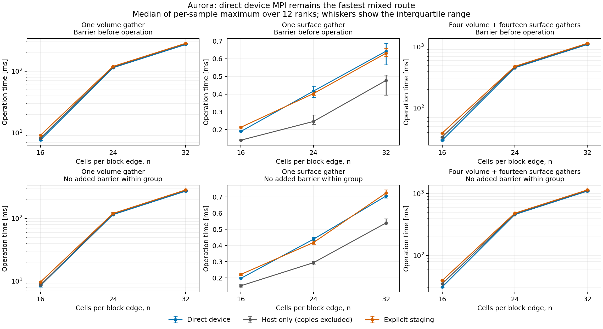

# Aurora communication comparison: retain direct device MPI

**Keep the existing direct-device Allgatherv path unchanged.** It has the
lowest median operation time for every volume and mixed case at n16,
n24 and n32, with and without the added barrier. Explicit staging did not
improve the four-volume/fourteen-surface sequence in any paired round.
This is a communication microbenchmark from one allocation, not a coupled
evolution speedup or a diagnosis of a particular MPI algorithm.



The [PDF](communication-comparison.pdf), [complete table](summary.md),
[CSV](summary.csv) and [detailed analysis](analysis.json) retain both modes,
all workloads, spread, paired ratios, route-position controls and per-rank
medians. Times below are **milliseconds**, using the median of each
sample's maximum over twelve ranks, with no added barrier inside the
measurement group. Device timings include their post-call fence; staged
timings include both copies and their fences. Host-only timings exclude
copies and therefore are not a drop-in cost for the device-resident state.

| n | Volume: device | Volume: host only | Volume: staged | Mixed: device | Mixed: host only | Mixed: staged |
| ---: | ---: | ---: | ---: | ---: | ---: | ---: |
| 16 | 8.45450 | 8.66383 | 9.66035 | 30.8528 | 34.7263 | 39.2952 |
| 24 | 115.468 | 118.834 | 120.854 | 458.132 | 472.061 | 482.552 |
| 32 | 274.476 | 283.440 | 287.137 | 1097.82 | 1128.04 | 1148.20 |

Ratios of mixed medians put staging **27.4%, 5.33% and 4.59% slower** than
direct device MPI in this mode. With a barrier before each operation,
the corresponding penalties are 31.1%, 5.56% and 4.77%. Direct device is
also faster than host-only for the mixed sequences, by the table's actual
operation costs; staging cannot recover a hidden copy saving here. These
are ratios of medians, distinct from the paired-round ratio summaries in
the JSON. All 36 mixed paired rounds favor direct device over staging.

The host-only control is informative about the size increase. Its
barrier-mode volume medians are 8.169, 116.955 and 280.713 ms: factors
14.32 and 34.36 relative to n16. Direct-device factors are 14.92 and 35.54,
while global receive-buffer sizes grow only by factors 3.375 and 8.
The sharp increase therefore persists with ordinary host buffers and
without explicit host/device staging. This does not uniquely identify
MPI collective selection, shared-node memory movement, topology or
resource contention; it does show that switching to host staging does
not remove the observed cost. This control does not profile internal MPI
operations and does not establish a vendor defect.

Isolated surface results do not justify a special transport branch.
Staging is about 4.7% faster by the n24 no-barrier median, a difference of
roughly 21 microseconds per gather, but is slower at n16 and reverses its
small n32 barrier-mode gain without the barrier. Some isolated volume
rounds also favor staging during outliers; the recommendation is based on
the group distributions and mixed sequence, not a claim that every call
is faster. Route-position medians preserve the main volume/mixed ranking.

There are 24 measured rounds per route for each individual-buffer group,
six for each mixed group, and three warmup rounds. All six route
permutations occur four times in individual groups and once in mixed
groups. Each route therefore occupies each position eight or two times,
respectively. All twelve ranks use distinct COMPOSITE GPU tiles on one
node. The exact arrays were checked at every workload endpoint: **11,664
measured rank-samples, 86,977,290,240 checked values, zero mismatches**.
The mixed workload validates final volume and surface arrays; intermediate
gathers use identical payloads. These counts include repeated checks and
are not independent statistical trials.

The spread bars are interquartile ranges, not confidence intervals. Rank
clocks are not assumed synchronized; each sample's maximum is taken before
its quantiles. Input preparation and local validation occur between
workloads, and the no-barrier mode still has a group-start barrier.
Consequently its arrival pattern differs from the evolved application.
The mixed workload contains communication only, with no RHS or boundary
compute. HostSpace allocation is recorded without assuming pinned memory.
Independently maximized component times must not be added; same-critical-
rank component means are retained separately. Global receive sizes are
not wire traffic, and no network bandwidth is inferred. One allocation,
fixed grid order and shared package resources limit generalization.

The complete exact report is retained once as deterministic
[gzip data](communication.report.json.gz), 541,697 bytes. Decompression
recovers the worker-bound 5,479,270-byte report, SHA-256
`648d367d79bea540df247ad195234a5efb6c5be1b331fd4cad368bb9b7cb6bfd`.
The benchmark executable SHA-256 is
`3200b532382fc47e0885601acd8e8fd49dbce9958db9d702988c73b67a91c586`;
the source-manifest SHA-256 is
`86b602e7e68fc93e6a76e16c9bd5c4aea9fcef64363670c5f95c6b0adf30fc13`.
[Provenance](provenance.json) preserves binding hashes and runtime details:
SYCLDeviceUSM, double precision, Kokkos 4.7.2, Intel compiler 2025.3.2 and
the reported MPICH 5.1.0a1/ch4:ofi build. Parent worker/plan/binding records
remain authoritative. The original uncompressed local campaign is intact.

Reproduce from any directory with NumPy and Matplotlib installed:

```sh
python3 docs/hyperbolic-shift-3d/reproduction/aurora/preflight-angular-v1/communication-analysis/analyze.py
```

Use the corresponding absolute script path when outside the repository.
The analysis verifies the compressed report against the parent worker
record, checks plan/source/binary bindings, and uses a byte-identical copy
of the frozen validation helper to recheck all samples. It then recomputes
summaries and plots. No source, transport or runtime setting was changed,
and no job or evolution was launched for this analysis.
