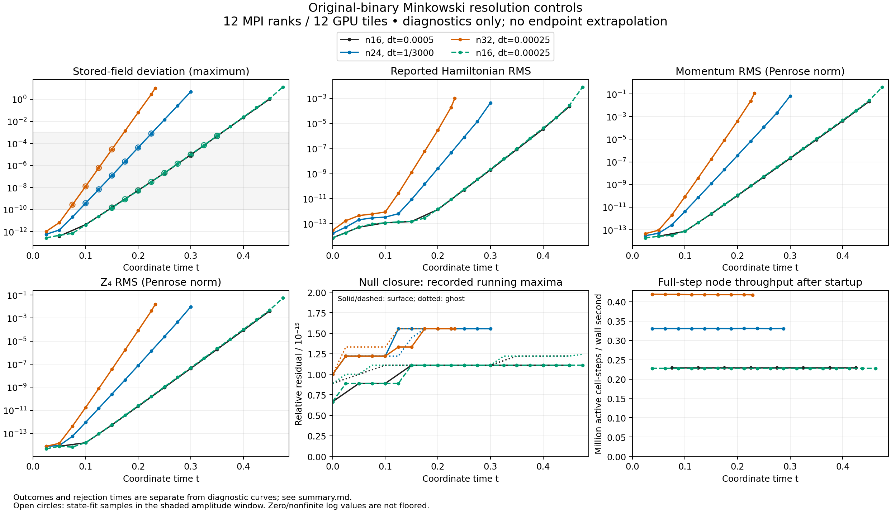

# Original-driver Minkowski resolution and timestep controls

Refining the unchanged scheme from n16 to n24 and n32 **did not suppress the
Minkowski instability**. The measured state-growth rate increased from 74.49
to 116.35 and 153.87 per coordinate-time unit. Halving dt at n16 gave 75.22,
only 0.974% above the original estimate. This is practical evidence against
very low spatial resolution or the original timestep being the sole cause
over the tested range. It is not a unique diagnosis of a boundary operator,
a proof about the continuum equations, or a temporal-convergence result.
**None of these trajectories qualifies as stable.**



[PNG](resolution-controls.png), [PDF](resolution-controls.pdf),
[complete metrics](analysis.json), and [generated summary](summary.md).
All horizontal axes use **coordinate time**, not t/M. The plots stop at
recorded diagnostics; they do not extend stale values to the later failure.

| Grid / dt | Native outcome | Last diagnostics | Accepted endpoint | State-growth rate | Fit times; samples; R² |
| --- | --- | ---: | ---: | ---: | --- |
| n16 / .0005 | Geometry failure | .45 | .4895 | 74.4915 | .15–.35; 5; .999626 |
| n24 / 1/3000 | Geometry failure | .30 | .3136667 | 116.3515 | .10–.225; 6; .999991 |
| n32 / .00025 | Walltime-bounded; science checks failed | .23225 | .23225 | 153.8732 | .075–.15; 4; .999994 |
| n16 / .00025 | Geometry failure | .475 | .486 | 75.2171 | .15–.35; 9; .999721 |

The n16, n24 and half-dt n16 reports identify `nonpositive interpolated scri
geometry`; their checkpoints are unadmitted and their final constraint
reports are stale. The n32 executable instead returned 0 with
`status=checkpointed`, current diagnostics, and native `admitted=1` at its
walltime bound. Its state, H and M exceeded the reviewed scientific limits;
the worker rejected it. **n32 is a bounded scientific rejection, not a
recorded numerical geometry failure or an admitted stability result.**
The new controls requested t=.6; the original n16 requested t=1. Neither
endpoint was completed. No failed or scientifically rejected checkpoint was
restarted to form this comparison.

For the last half-dt case, the native report/log show numerical rejection,
while the launcher returned 143 after logging rank 11 exit 2 and rank 4
signal 15. The worker records no timeout or storage error. This does not
establish a uniform MPI exit code or the cause of signal 15. The separate
[v2 package](../resolution-control-v2/README.md) retains that distinction.

The predeclared analysis window is positive state deviation from 1e-10 to
1e-3. Fits use unweighted least squares of log amplitude versus coordinate
time on the longest contiguous recorded interval in that window. All have
at least four points. Different grids seed different roundoff amplitudes and
use different fit times; failure times alone were not used to infer growth.
The fitted rate divided by n is 4.66, 4.85 and 4.81 for the three spatial
controls, consistent with growth tied to a grid scale. These data do not
isolate bulk, interpatch, algebraic or outer-boundary contributions.

The M and Z rates corroborate growing constraint errors: M rates are
75.57/114.14/151.67 and Z rates 75.58/114.09/151.35 at n16/n24/n32.
The half-dt values are 75.99 and 76.02. H also eventually grows, but its early
samples are closer to cancellation/roundoff: the first fitted H values are
only about 20 times their initial residual, and its fit R² decreases to .912
at n32. Those H slopes should not be interpreted as clean independent
eigenvalue estimates. All individual fits, empirical precision flags,
conditioning and descriptive standard errors are retained in the JSON;
correlated samples do not justify independent-sample confidence intervals.

The n16 timestep comparison also agrees when both are fit at the same five
recorded times .15/.20/.25/.30/.35: 74.4915 versus 75.1788. This secondary
check is retained in [assessment.json](assessment.json); it does not replace
the predeclared amplitude-window fits. One timestep halving and trajectories
seeded by floating-point noise do not establish an integration order.

Surface and interpolated-ghost null errors remain at or below
**1.56e-15** across all four histories/reports, despite large state and
constraint errors. Exact null closure alone therefore does not imply
stability. The plotted constraints use normalized compactified coordinate
volume. M and Z use the Penrose-metric covector norm. H is the recorded
evolved-variable formula; with a nonzero trace of the nominally tracefree
curvature, it need not equal the Hamiltonian reconstructed from full ADM
data. No recorded diagnostic values have been altered or imputed. Zero and
nonfinite values cannot appear on logarithmic axes and are omitted without
adding a floor; their original values remain in the source histories.

Larger blocks improved aggregate full-step throughput:

| Grid / dt | Active cells | Median wall s/step | Active cell-steps/s | Relative cell throughput | Coordinate time / wall s |
| --- | ---: | ---: | ---: | ---: | ---: |
| n16 / .0005 | 77,824 | .339992 | 228,900 | 1.000 | 1.4706e-3 |
| n24 / 1/3000 | 262,656 | .794020 | 330,793 | 1.445 | 4.1980e-4 |
| n32 / .00025 | 622,592 | 1.487436 | 418,567 | 1.829 | 1.6807e-4 |
| n16 / .00025 | 77,824 | .341612 | 227,814 | .995 | 7.3182e-4 |

These are node-wide timings on 12 MPI ranks / 12 GPU tiles, derived from
history intervals after discarding the first interval. They include
communication and diagnostics, not just GPU kernels. n24 measures 75 steps
per diagnostic interval; the other regular intervals contain 100, with a
final 29-step interval at the n32 bound. This unequal cadence and the
included diagnostic cost limit direct kernel-efficiency comparisons.
Higher cell throughput does not mean faster coordinate-time advancement
when there are more cells and smaller timesteps. Component timers are kept
separate because closure includes communication and cumulative timers are
MPI maxima rather than an additive cost decomposition.

All four controls use the original numerical commit
`113aaff783008204e1ff8cbf2fb8bb5f2af2204c`, source-manifest SHA256
`3f367265e2e627aa770d0ae78be4fac912f4c0980a09471382cf9b295c677d7f`,
and exact v4 SYCL executable SHA256
`6e7553b556dd9c4f8b56f81eb0f43c15cf0517a0b81776320a9a6c6d3c29ccef`.
They start independently from analytic Minkowski data on the fixed unrefined
19-block Cartesian-core/spherical-shell mesh. n*dt=.008 for n16/n24/n32;
the fourth run changes only the n16 timestep and diagnostic cadence. No
algebraic-projection or cross-face angular candidate is present.

The [original n16 package](../stability-v1/README.md),
[n32 allocation](../resolution-control-v1/README.md), and
[n24/half-dt allocation](../resolution-control-v2/README.md) retain their
own worker statuses and original artifacts. The analysis independently
verifies source/binary identity and each report/history hash against its
own worker; no worker record was combined or synthesized. Full checkpoint
verification and scheduler outcomes remain in those source packages.
[provenance.json](provenance.json) binds this analysis, its inputs and
source evidence. No checkpoint payload is copied here.

Reproduce from the repository root with NumPy and Matplotlib installed:

```sh
python3 docs/hyperbolic-shift-3d/reproduction/aurora/resolution-control-comparison-v1/reproduce.py
```

The wrapper checks the recorded analysis-script hash and supplies the
portable n16/v1/v2 directories separately to `analyze.py --require-all`.
This regenerates metrics and figures without evolving or accessing Aurora.
The [original protocol](../resolution-control-v1/protocol.md) is unchanged.
