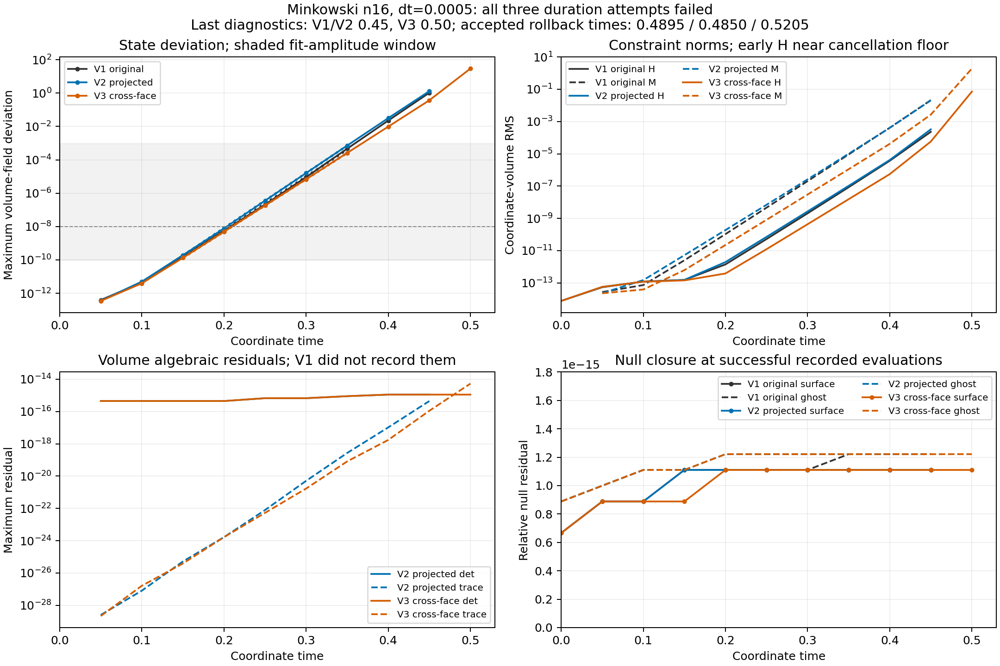

# V3 cross-face Minkowski duration attempt: failed

Aurora debug job **8983405**, using one node and twelve distinct GPU tiles,
rejected an intermediate stage with **`nonpositive interpolated scri geometry`**.
The last accepted state was at coordinate **t=0.5205**, step **1041**, before the
requested t=1 endpoint. The native process returned 2, the worker retained
`failed`, and PBS finished with exit status 1. This was a numerical rejection,
not a timeout or storage failure. The checkpoint is **unadmitted**.

The fresh diagnostic history ends at **t=0.5**. Its volume-field deviation
29.7642, H RMS 0.0712803, M RMS 1.92019 and Z RMS 0.350901 describe that earlier
diagnostic, not the accepted rollback state at t=0.5205 or the rejected stage.
The exact failed RK substep time was not recorded; it belongs to the attempted
interval [0.5205, 0.5210]. The prescribed scientific tolerances were unchanged.

Cross-face angular derivatives modestly reduce the fitted growth rate and
postpone rejection in this comparison, but **do not stabilize Minkowski**.
There is no new long-duration puncture, trumpet, 100M, AMR or convergence
qualification from this job.

## Comparison with the original and projected schemes

All three runs start from fresh analytic Minkowski data with n16 blocks,
77,824 active cells, dt=0.0005, one node and twelve ranks. V1 uses the original
scheme. V2 adds standard final-stage algebraic projection and cached sampling.
V3 retains projection and cached sampling and uses cross-face centered angular
scri derivatives. These are historical frozen builds, not a bitwise
single-operator toggle; similar fitted growth rates do not identify a unique
causal term.



[PDF figure](analysis/original-projected-angular.pdf) ·
[machine-readable comparison](analysis/comparison.json)

| Quantity | Original V1 | Projected V2 | Cross-face V3 |
|---|---:|---:|---:|
| Last accepted time | 0.4895 | 0.4850 | 0.5205 |
| Last diagnostic time | 0.45 | 0.45 | 0.50 |
| State deviation at common t=0.45 | 1.05674 | 1.31446 | 0.372503 |
| H RMS at common t=0.45 | 2.29235e-4 | 3.26628e-4 | 5.74631e-5 |
| M RMS at common t=0.45 | 2.11975e-2 | 2.04796e-2 | 2.65745e-3 |
| Z RMS at common t=0.45 | 4.14035e-3 | 3.91194e-3 | 4.58360e-4 |
| Descriptive state growth rate per coordinate time | 74.4915 | 75.8060 | 72.4355 |
| State-fit R² | 0.999626 | 0.999959 | 0.999997 |
| Median seconds per accepted step | 0.339992 | 0.115717 | 0.118155 |
| Outcome | Failed | Failed | Failed |

The fit selection is the longest contiguous interval with recorded state
deviation between **1e-10 and 1e-3**, with the earliest interval winning a tie.
For all three histories this selects five samples at **t=0.15, 0.20, 0.25,
0.30, 0.35**. The fit is unweighted ordinary least squares of log amplitude
against coordinate time. The JSON records the exact times, amplitudes,
conditioning and descriptive residual errors. Correlated diagnostic samples
do not provide independent-sample confidence intervals. H can remain near its
cancellation floor in the early fit window; its accompanying fitted slope is
not clean mode evidence. No fitted curve is extrapolated to a failed-stage
endpoint. Exactly zero values are omitted from logarithmic panels, never
replaced with a positive floor.

H and M use normalized compactified Cartesian coordinate-volume RMS norms.
Minkowski has no horizon, so the exterior H and M norms equal the domain norms;
no horizon-radius or horizon-error comparison is applicable. The state and
algebraic-residual panels are **volume** diagnostics. V1 did not record the
algebraic residuals. Throughput is the median history interval wall time per
accepted step after excluding the first interval; it includes diagnostics and
communication. The V1-to-V2 speed difference also includes cached sampling.

At the last V3 diagnostic, the recorded surface and ghost relative null
residuals are 1.11022e-15 and 1.22151e-15. Volume determinant and tracefree
residuals are 1.11022e-15 and 5.32907e-15. These small residuals at successful
evaluations coexist with the growing state and constraint errors. They do not
certify the subsequently rejected interpolated geometry or all intermediate
stages.

## Immediate rejection audit

The read-only audit uses both the original **worker-bound failed-stage
capture** and the unadmitted checkpoint. The checkpoint's V3 header, time,
step count, dt, dimensions, length and admission flag were independently
checked. No saved fields were repaired, clamped, projected, restarted or
admitted during the audit.

Every one of the 1,536 captured failed-stage surface nodes is finite, has
positive chi and has a positive-definite metric. The minimum nodal chi is
0.814441, minimum metric eigenvalue is 0.181756, and minimum determinant is
0.921365. The accepted rollback surface is also positive definite. Thus the
immediate failure here differs from V2's invalid **nodal** surface metric.

The existing six-by-six face-local ghost-boundary interpolation was replayed
using the same frozen geometry, donor selection, anchored weighted sum and
native leading-minor/determinant test. All six relevant headers are
byte-identical to the frozen V3 numerical commit. This is a CPU binary64
replay of the frozen stencil, **not a bitwise SYCL replay**.

Of **6,616 globally deduplicated exact-coordinate boundary queries**, three
are rejected. They describe **one direction after rounding coordinates to
12 decimals**, approximately (0.7362350454, 0.2712444904, 0.6199874066).
The distinct floating-point queries target outer +z block 17 at
(i,j,k)=(16,17,11), (17,17,11), (18,17,11), with +x block 13 supplying the
surface donors. Exact-coordinate query counts must not be interpreted as the
sum of rank-local failure counters.

| Quantity at the first rejected query | Value |
|---|---:|
| Interpolated chi | +0.868277 |
| Interpolated metric eigenvalues | −0.157136, +0.938804, +1.23322 |
| Interpolated determinant | −0.181924 |
| Minimum donor metric eigenvalue | +0.181756 |
| Minimum donor determinant | +0.921365 |
| Sum of interpolation weights | 1.000000 |
| Sum of absolute weights | 2.91178 |
| Most negative weight | −0.298731 |
| Rollback same-query minimum eigenvalue | +0.506925 |
| Rollback same-query determinant | +0.578220 |

All three failures are indefinite interpolated metrics. There are no
nonfinite-field, nonpositive-chi or valid-metric/nonpositive-normal-norm
rejections. The recorded q=0 at invalid metrics is consequential: native
`Geometry` rejects before constructing an inverse. Signed high-order weights
do not preserve positive definiteness even when every donor is positive.
This locates the immediate rejection trigger; it **does not establish the
origin of the earlier growing mode** or show that a positivity-preserving
interpolant alone would stabilize the coupled scheme.

The accepted rollback surface has determinant residual 1.11e-15 and an
independently recomputed absolute A-trace residual about 3.18e-12, where
surface A components have already grown to order 1e3–1e4. The failed
intermediate stage is not subject to the final-stage projection and has
larger algebraic residuals. These direct surface audits have different state,
time and spatial scope from the volume diagnostic panel.

Four temporary synthetic controls verify the audit's rejection branches:
constant positive identity accepts, while constant negative chi, indefinite
metric and nonfinite auxiliary data reject as expected. A separate NumPy
anchored interpolation agrees with every rejected C++ query within absolute
2e-13. The original five worker-bound payloads have identical hashes before
and after analysis.

- [Surface audit](analysis/surface-audit.json)
- [Interpolation summary](analysis/interpolation-summary.json)
- [All rejected queries, donor fields and weights](analysis/interpolation-audit.json)
- [Frozen source provenance](analysis/audit-provenance.json)
- [Synthetic controls](analysis/audit-controls.json)

## Evidence and reproduction

Numerical source commit:
[`ec0dd5afcf9d489e06c1fdf92e802a6fb8c14679`](https://github.com/HengruiZhu99/athenak/commit/ec0dd5afcf9d489e06c1fdf92e802a6fb8c14679).
The source-v10 manifest SHA-256 is
`86b602e7e68fc93e6a76e16c9bd5c4aea9fcef64363670c5f95c6b0adf30fc13`;
the projected-angular SYCL executable SHA-256 is
`a557b2090b8c41c6999969a008f1731e743eea21caa3fa257af386ab15b1847d`.
The plan SHA-256 is
`bddaabbbc2b6e1fa9da8ce6726c01f4edee3f58f0c7cd956641e28f803a36396`.

This package retains exact plan, binding, PBS script, worker status, admission,
report, history, process log and affinity log; `terminal.json` contains only
whitelisted terminal facts. The [unchanged protocol](protocol.md) was committed
before submission. The [preflight package](../preflight-angular-v1/README.md)
retains the frozen manifest, build record/cache, verification at admission and
supporting reports. Their source/binary/admission identities and hashes are
cross-checked by this analysis. Twelve distinct COMPOSITE tile masks 0.0–5.1
are verified against the affinity log on one node.

[Package verification](analysis/package-verification.json) reproduces **all
28 plan-bound checks**, including the nine failed checks; it verifies **all
five worker-bound artifacts**, their unchanged bytes, and the failed terminal
outcome. The 39,362,632-byte checkpoint and 19,681,280-byte failed-stage capture
remain in the ignored raw-output tree, not in this Git package. Their hashes
and sizes are retained in worker status and verification. The failed
checkpoint stays unadmitted regardless of successful evidence verification.

With the retained raw data and a configured local Serial Kokkos build:

```sh
python3 -B docs/hyperbolic-shift-3d/reproduction/aurora/stability-angular-minkowski-v1/analyze.py \
  --raw-dir output/hyperbolic-core-shell/aurora/stability-angular-minkowski-v1 \
  --build-dir build-hyperbolic-mpi \
  --output output/hyperbolic-core-shell/analysis/stability-angular-minkowski-replay-new
```

The output directory must be new. NumPy and Matplotlib are required. The
analysis reuses the hash-recorded history/surface helpers and the earlier
read-only interpolation auditor, builds the latter temporarily, and performs
no trajectory evolution. `inventory.json` hashes the packaged files except
itself. No unrelated scheduler-owner, environment or account-balance metadata
is included.
