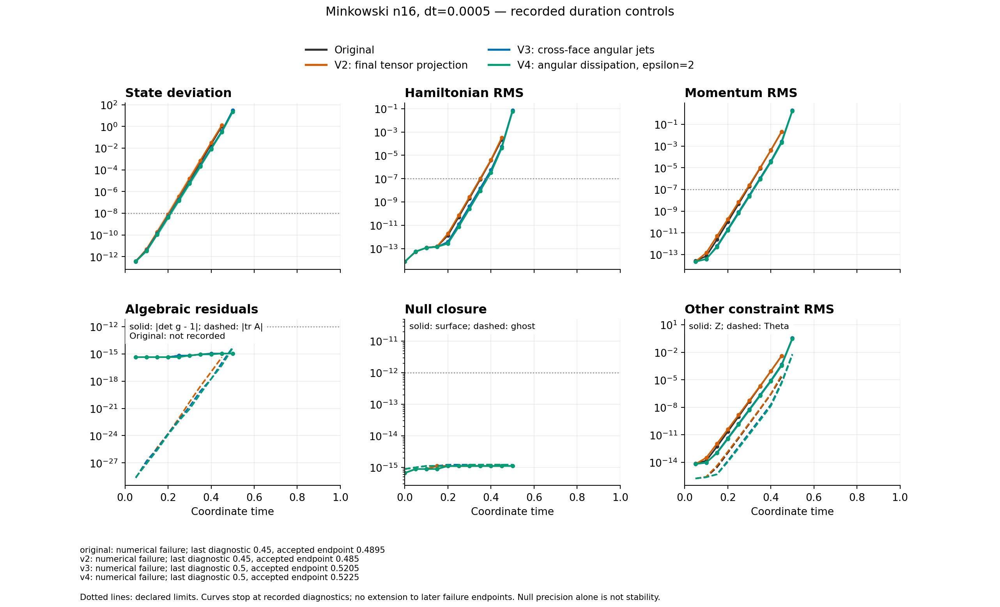

# V4 angular dissipation: Minkowski duration failure

The degree-seven, epsilon-two surface operator did **not** stabilize this n16
Minkowski evolution. Job 8983855 rejected an RK stage with
`nonpositive interpolated scri geometry` after 1045 accepted steps, at coordinate
time 0.5225. The target was t=1 and 2001 accepted steps. The last fresh diagnostic
was at t=0.5; its values are not measurements of the later rejected stage.

All four curves use the same n16 grid, nominal dt=0.0005 and coordinate time.
The fit follows the frozen protocol: the longest contiguous recorded interval
with state deviation between 1e-10 and 1e-3, at least four samples, and
unweighted least squares of log amplitude. All four selected the same five
times, 0.15 through 0.35.

| Case | Growth rate per coordinate time | R² | Last fresh diagnostic | Accepted endpoint at failure |
|---|---:|---:|---:|---:|
| Original | 74.49152948 | 0.999625706 | 0.45 | 0.4895 |
| V2: final tensor projection | 75.80602712 | 0.999958519 | 0.45 | 0.4850 |
| V3: cross-face angular jets | 72.43551866 | 0.999996599 | 0.50 | 0.5205 |
| V4: additional surface angular dissipation | 72.19500132 | 0.999984901 | 0.50 | 0.5225 |

V4's fitted rate is 0.332% below V3's. This small difference, and the endpoint
delay of 0.002, do not remove the rapidly growing numerical mode. The fit is
descriptive; correlated samples do not justify treating its OLS error as an
independent-sample confidence interval. These controls do not uniquely identify
the cause of the first growing mode.

At the last fresh V4 diagnostic, state deviation was 21.2761381, Hamiltonian RMS
0.05654916, and invariant conformal momentum RMS 1.65426011. The first recorded
violations of the declared state, H and M limits occurred at t=0.25, 0.40 and
0.35 respectively; these are sampling times, not interpolated threshold-crossing
times. The RMS measure is normalized compactified Cartesian coordinate volume.
It is neither proper-volume RMS nor the radial momentum diagnostic used in
some 1D comparisons. The early H residual is near cancellation/roundoff, and no
H growth rate is fitted there.

Null closure and accepted algebraic constraints remained small while the fields
grew: reported surface/ghost null maxima were 1.1102e-15/1.2213e-15, and the last
fresh determinant/trace residuals were 1.1102e-15/4.4409e-15. The recorded minimum
chi/lapse remained positive. Bulk CFL was at most 0.32392006 and the separate
isolated-Q CFL bound was 0.40227336, below its limit 2.7. These checks do not
establish positivity of a later rejected interpolation or stability of the
coupled equations. Original algebraic histories were unavailable and were not
reconstructed.

All 33 declared worker checks were independently replayed: 24 passed and nine
failed. The failed scientific checks were state, H and M; the other failures
were completed status, current diagnostics, checkpoint admission, target time,
total steps and segment steps. The process returned 2, with no worker timeout
or storage error. PBS ended in state F with exit status 1, and the allocation
was released. Campaign storage at worker finish was 1,805,843,205 bytes, below
the 5 GB cap. These are distinct numerical and scheduler outcomes.

The saved checkpoint is an accepted rollback state at t=0.5225 with the V4
header's **admitted flag equal to zero**. The report independently records
`checkpoint_admitted=false`. It is not eligible for restart; neither the
checkpoint nor the failed stage was repaired, clamped or evolved in this
analysis. The separate [positivity audit](positivity-audit/) examines the exact
rejected interpolation without asserting the cause of the earlier growth.

Source commit `d98e2a99bbf1d5546956be3d724c82715ca704ec`, source-manifest SHA256
`0e7967f1f33559ed79b9f97d6416dacc296f0f14663d35c682177a9ac07db60f`, and SYCL binary
SHA256 `fc8d8074351a01ade6fd05dcf460555c935cf4ffe66c9bda31cc517679500fff` match
the frozen [protocol](protocol.md), [plan](plan.json), worker binding and
epsilon-two [preflight admission](../preflight-dissipative-v1/admission.json).
All five downloaded artifact hashes and byte counts were checked, including
the rollback and failed-stage payloads. The one-node/twelve-rank/twelve-tile
mapping was verified from the affinity log and worker records.

The [analysis instructions](analysis/README.md) reproduce the PNG/PDF and small
JSON/CSV outputs from retained portable records. The [comparison JSON](analysis/final-v1/comparison.json)
includes every actual fit sample, every gate, missing-field semantics and
source/input hashes; the [summary CSV](analysis/final-v1/summary.csv) is a compact
table. Only small raw outcomes and whitelisted terminal facts are retained in
[raw-v4](analysis/raw-v4/); no scheduler environment or large checkpoint is
included. Earlier controls and their figures remain unchanged.

V4 is not admitted as a stable duration scheme. This result supplies no
puncture, wormhole-to-trumpet, 100M, convergence or production-AMR validation.
