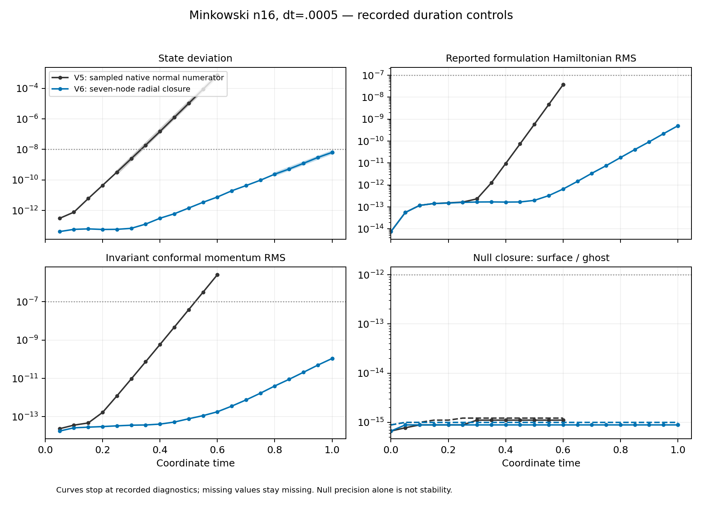

# V6 Minkowski: t=1 limits pass, positive late growth remains

Aurora job **8984226** completed fresh n16 Minkowski evolution to coordinate
**t=1**, dt=.0005, on one CompactBinaryMerger/debug node with twelve MPI ranks
and twelve GPU tiles. All **38 declared final checks** and all recorded
trajectory limits pass. The complete checkpoint's four finite state and RK
compensation arrays and exact V6 configuration were independently checked.
Scheduler state is F/exit0 and the allocation lock is released.

**This is a bounded test pass, not a stable long-time scheme.** The state and
constraints grow exponentially late in the trajectory. No convergence or
100 M admission is issued, and no puncture stability follows from this run.

| Quantity at t=1 | Result | Existing limit |
|---|---:|---:|
| State deviation | 6.3886730e-9 | 1e-8 |
| Formulation Hamiltonian RMS | 4.9826391e-10 | 1e-7 |
| Invariant conformal momentum RMS | 1.0889978e-10 | 1e-7 |
| Maximum surface null residual | 8.8817842e-16 | 1e-12 |
| Maximum ghost null residual | 9.9920072e-16 | 1e-12 |



The unchanged amplitude-window estimator gives growth **16.5751** over
t=.8–1, versus V5's **41.8419** over t=.25–.6: about a60% reduction, still
positive. These are different fitted intervals and potentially different
modes, not converged eigenvalues. The tiny final RK remainder gives two
near-identical t=1 diagnostics. Dropping the later one leaves five fit points
and growth **16.6224**. Both estimates are retained. No fit near the initial
roundoff plateau is used.

This result supports the importance of coupling the interior radial stencil
to the evolved endpoint. It does not establish that all unstable modes are
removed. The next read-only diagnostic should evaluate the actual V6 growing
direction rather than infer stability from its action on an old V5 direction.
A separate fresh puncture control can assess finite-time fidelity and core
behavior; the retained Minkowski growth must be resolved before long-time
qualification or convergence claims.

The native evolution reports721.38s for2001 steps. Median full diagnostic
interval cost is .35752s/step, compared with V5's .17059s/step. This includes
communication and diagnostics on separate allocations, not isolated GPU
kernel timing. The extra sparse radial stencils roughly double this case's
per-step cost. Larger-block throughput must be measured separately for V6.

The scientific source remains the immutable source-v13 commit
`7a9d83d4a16e0e43d2439c02478235996a2a7dcf`, independently verified in the
[V6 preflight](../preflight-donor-seven-v1/README.md). Its [preflight admission](admission.json)
qualifies the exact epsilon2/nodes7/last-three-row operator for tests only.
[identity.json](analysis/identity.json) binds the duration's source manifest,
binary, plan and admission. No failed checkpoint was resumed. Campaign
footprint after completion was **2,815,083,444 bytes**, below5GB.

Small raw reports/history and scheduler receipts are retained here. The full
39,362,664-byte checkpoint and unfiltered collection metadata are archived at
`output/hyperbolic-core-shell/aurora/stability-donor-seven-minkowski-v1`.
The portable terminal record contains only whitelisted fields and the source
collection hash. The [analysis](analysis/analyze.py) uses the unchanged prior
comparison routines, independently decodes V6, verifies payload hashes and
replays every gate. Its original results-v1 is retained locally; results-v2
adds endpoint-fit sensitivity without altering any recorded evolution data.

Reproduce with the complete local raw campaign and a fresh output directory:

```sh
python3 docs/hyperbolic-shift-3d/reproduction/aurora/stability-donor-seven-minkowski-v1/analysis/analyze.py \
  --raw output/hyperbolic-core-shell/aurora/stability-donor-seven-minkowski-v1 \
  --identity docs/hyperbolic-shift-3d/reproduction/aurora/stability-donor-seven-minkowski-v1/analysis/identity.json \
  --admission docs/hyperbolic-shift-3d/reproduction/aurora/stability-donor-seven-minkowski-v1/admission.json \
  --out output/v6-duration-repeat-new
```
