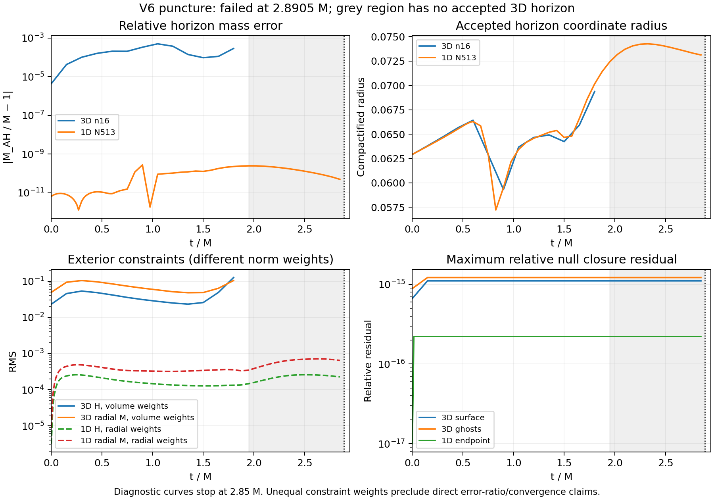

# V6 puncture: core lapse failure at 2.8905 M

Fresh Aurora job **8984262** failed at coordinate **t=.9635 =2.8905 M**,
step1927, before the declared coordinate-time1 target. The executable was
frozen source-v13 V6, n16, dt=.0005, epsilon2, twelve MPI ranks and twelve GPU
tiles on one CompactBinaryMerger/debug node. The inner-transition interpolation
prototype was **not** present. Scheduler state isF/exit1; the allocation lock
is released. The native checkpoint is explicitly **unadmitted**.

The first rejected active cell is1908, in the Cartesian core at
`(-.0546875,-.0078125,-.0078125)`, radius.05579241. Its saved failed-stage
lapse is **−2.80123044e-6** and chi is **.02859704**. Every saved value is
finite. The device's reason1 rejects nonfinite data or nonpositive chi/lapse;
this cell fails the lapse test. This is not the original scri-metric rejection.
The failed-stage array's SHA was matched to Aurora at collection, although
this auxiliary capture is not included in the worker's artifact manifest.
It is never resumed, repaired or used as admitted initial data.

Surface/ghost null residuals remain **1.1102e-15 /1.2213e-15**. Exact nullness
does not prevent the interior failure. At the last diagnostic, t=.95=2.85 M,
whole-domain H and invariant conformal M RMS are4.47379 and1.08676. Those
values are **not diagnostics at the failure time**. Exterior norms are
unavailable because no horizon meets the unchanged acceptance tolerance.

FastFlow finds an accepted horizon through1.8 M; from1.95 M onward it fails
the expansion-RMS1e-3 threshold. Its final trial residual is.00353345, using
lmax12/ntheta24/nphi48 and300 iterations. This reports a measurement rejection,
not disappearance of the physical horizon. The temporal radius trend agrees
qualitatively with the donor early on, but this run is not faithful long-time
reproduction. Core resolution and time integration, interpolation effects,
and the horizon diagnostic need separate controls; the immediate lapse
failure alone does not establish the cause.



The constraint panel is descriptive: 3D uses normalized compactified Cartesian
coordinate-volume weights, while the archived 1D history uses normalized
radial weights. The momentum curves are the radial component, not the
invariant momentum norm. Therefore their ratios are not convergence estimates.
No extrapolated horizon or replacement exterior cutoff is supplied after
horizon rejection. The shaded interval has no accepted3D horizon.

An independent verification replays **45 checks**, of which **31 pass and14
fail**, verifies all five worker-bound artifact hashes, and decodes all four
finite checkpoint arrays and exact V6 configuration. This verifies the
**failure record**, not scientific acceptance. The failures include completion,
current diagnostics, checkpoint admission, final time/steps, exterior norms,
and horizon acceptance. See [verification](analysis/verification.json).
The small reports/history and whitelisted scheduler record are retained here;
full checkpoint, failed-stage array and collection metadata remain under
`output/hyperbolic-core-shell/aurora/stability-donor-seven-puncture-v1`.

Campaign footprint after this job is **2,865,564,605 bytes**, below5GB.
No failed restart was submitted. The independently diagnosed V6 Minkowski
[inner-shell disturbance](../../scri-v6-interface-diagnosis-v1/README.md)
is relevant to the next control but is not yet proven to cause this puncture
failure. No standard Z4c campaign was run.

From the repository root, reproduce the integrity check with a fresh output:

```sh
python3 docs/hyperbolic-shift-3d/reproduction/aurora/stability-donor-seven-puncture-v1/analysis/verify.py \
  --raw output/hyperbolic-core-shell/aurora/stability-donor-seven-puncture-v1 \
  --out output/v6-puncture-verification-new
python3 docs/hyperbolic-shift-3d/reproduction/aurora/stability-donor-seven-puncture-v1/plot.py
```

The plot uses the preserved N513 donor history, whose SHA is recorded in
`analysis/reference.json`; the matched fresh t=1 donor control is separately
[verified](../../v6-offline-diagnostics-v1/README.md).
