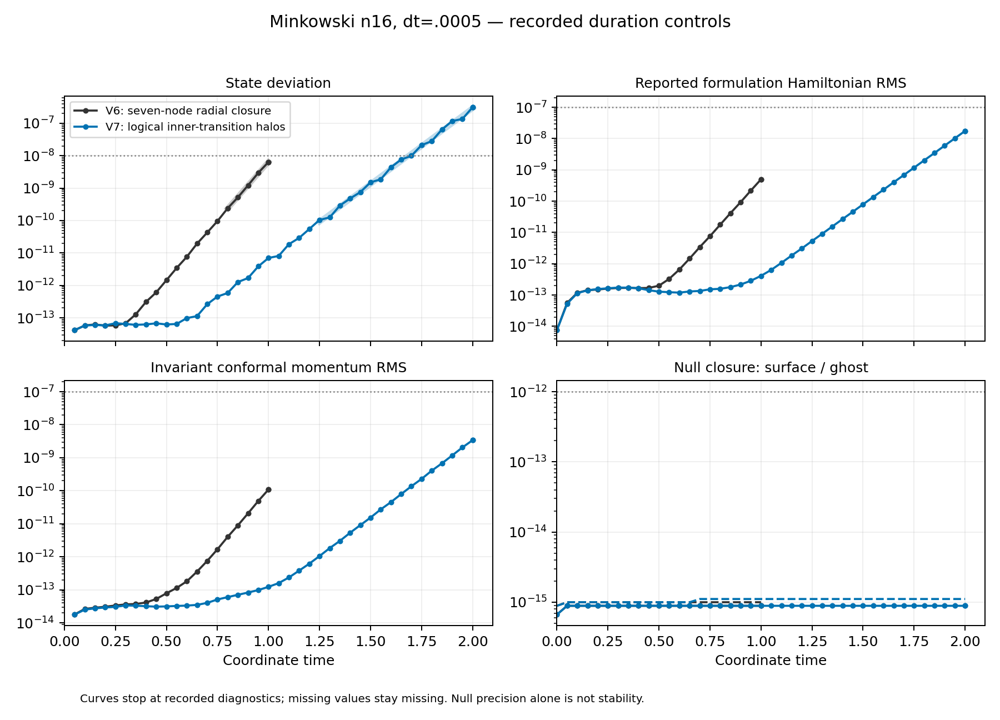

# V7 reaches time2 but retains an unstable inner-interface disturbance

Fresh Aurora job **8984359** reached coordinate **t=2**,4001 steps, on one
CompactBinaryMerger/debug node with12 MPI ranks and12 GPU tiles. The native
run completed without a geometry rejection, but **failed the unchanged
scientific state-error limit**. Scheduler F/exit1 records the worker rejection;
the allocation is released. No scientifically rejected checkpoint is resumed.

| Quantity at t=2 | Value | Limit |
|---|---:|---:|
| Maximum state deviation |3.11412e-7|1e-8|
| Hamiltonian RMS |1.75404e-8|1e-7|
| Invariant conformal momentum RMS |3.39173e-9|1e-7|
| Maximum surface null residual |8.88178e-16|1e-12|
| Maximum ghost null residual |1.11022e-15|1e-12|

Independent analysis verifies the worker-bound artifacts, strict V7 checkpoint,
source/binary/preflight/plan identity, and terminal release.38 of39 declared
report checks pass; the state limit fails. The native checkpoint's admission
flag istrue because its native validity tests pass; **the worker's scientific
rejection takes precedence**. Completion of the time interval is not stability.



The unchanged amplitude-window fit gives growth **10.76575** per coordinate
time (17 samples,t1.25–2,R²=.99715), versus16.57507 for V6. Dropping the
near-duplicate final diagnostic gives10.73875. This is slower growth, not its
elimination. V7 state error at t1 is7.00e-12 versus V6's6.39e-9; differing
roundoff seeds and dominant directions prevent interpreting this ratio as an
accuracy or convergence order. Median V7 full-step wall time is.35657s,
including communication and diagnostics.

## Endpoint localization

The [read-only checkpoint analysis](localization/localization.json) places
**99.8002%** of squared tangent-coordinate amplitude in the inner transition
shell,0.1998% in the Cartesian core, and6.80e-13 of the total on scri.
The inner shell's first two radial rows contain69.9816% of the total;
98.8387% lies in its outer two angular rows near face edges. Lambda and D
account for99.8763%. These are unweighted coordinate norms, not physical energy.

The plane spanned by the observed direction and its V7 tangent RHS has
projected values **10.81553 ±603.91678i**. The second-column relative residual
is.00042073; the zero first-column residual is constructed and not independent
evidence. Perturbation amplitudes1e-5 and1e-6 agree. These remain projected
values, not a full-spectrum stability proof. V6 on the same plane gives
−20.19609 ±539.57716i but has21–24% column residuals; simply reverting to V6
would not establish stability and would restore its known growing disturbance.

The diagnostic uses a retained CPU library whose45 captured source blobs are
verified byte-for-byte against frozen V7 commit9022f51f26e66acafdd3190d0c33f0c1ea53a661.
It applies the native RHS at perturbed Minkowski states, never evolves the
saved checkpoint, and finishes in34.49s under a385s bound. No evolved field,
floor, timestep, or acceptance limit was changed.

## Reproduction and scope

The [plan](raw/plan.json) retains n16,dt=.0005,epsilon2 and the original limits.
Full checkpoint and collection metadata remain under
`output/hyperbolic-core-shell/aurora/stability-inner-transition-minkowski-v1`.
Small logs, histories, reports and whitelisted scheduler records are retained
here. From the repository root, choose a fresh output path for either command:

```sh
python3 docs/hyperbolic-shift-3d/reproduction/aurora/stability-inner-transition-minkowski-v1/analysis/analyze.py \
  --raw output/hyperbolic-core-shell/aurora/stability-inner-transition-minkowski-v1 \
  --identity docs/hyperbolic-shift-3d/reproduction/aurora/stability-inner-transition-minkowski-v1/analysis/identity.json \
  --admission docs/hyperbolic-shift-3d/reproduction/aurora/preflight-inner-transition-v1/admission.json \
  --out output/v7-duration-recheck-new
python3 tst/hyperbolic_shift_3d/scri_v7_localization.py \
  --library output/hyperbolic-core-shell/scri-v6-hybrid-interface-build-v1/candidate.dylib \
  --checkpoint output/hyperbolic-core-shell/aurora/stability-inner-transition-minkowski-v1/output/minkowski.checkpoint \
  --identity docs/hyperbolic-shift-3d/reproduction/aurora/stability-inner-transition-minkowski-v1/analysis/identity.json \
  --output output/v7-localization-recheck-new
```

Long-time Minkowski and puncture stability,100M reproduction and convergence
remain unproven. The independently prepared fresh V7 puncture control follows
this released allocation to test whether the separate central lapse failure
persists; it is not an adoption of V7 as stable.
