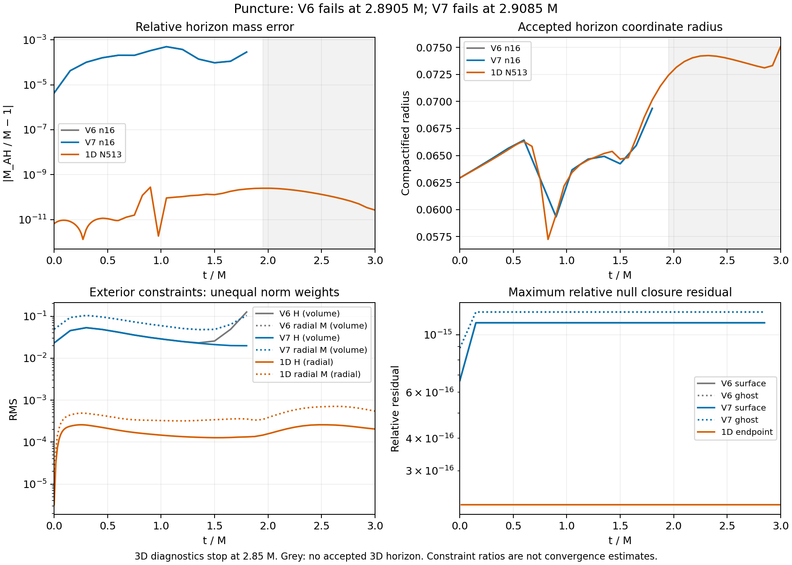

# V7 puncture: the core lapse failure persists at2.9085 M

Fresh Aurora job **8984472** failed at coordinate **t=.9695 =2.9085 M**,
step1939, before the target t1=3M. It used source-v14 V7, n16,dt=.0005,
epsilon2, one CompactBinaryMerger/debug node,12 MPI ranks and12 GPU tiles.
The allocation is terminal F/exit1 and released. The checkpoint is unadmitted.

The first rejected cell is1143, Cartesian block0, i/j/k=(7,7,4), at
(−.0078125,−.0078125,−.0546875), radius.05579241. Its failed-stage lapse is
**−2.85189e-6**, with chi=.02909384; all captured values are finite. This is
the same radius as V6's lapse failure, with a permutation of Cartesian axes.
V6 stopped at2.8905M; the targeted interface change has not removed this failure.
The auxiliary failed-stage file was SHA-verified against Aurora at collection,
but is not part of the worker's artifact manifest; that distinction is retained.

At the last fresh diagnostic, t=.95=2.85M, whole-domain H/M RMS are.223971
and.143930, versus V6's4.47379/1.08676 at that same diagnostic time. These are
**stale relative to the later failure**. Surface/ghost null residuals remain
1.11022e-15/1.22131e-15. The smaller constraint error does not make the run stable.

FastFlow has accepted horizons through1.8M and fails the unchanged expansion
RMS1e-3 threshold from1.95M onward, as V6 did. Its final trial residual is
.00355290, with lmax12/ntheta24/nphi48 and300 iterations. This is a measurement
rejection, not evidence that the physical horizon disappeared. Exterior norms
remain unavailable after rejection; no replacement cutoff is introduced.



The constraint comparison is descriptive.3D uses normalized compactified
Cartesian coordinate-volume weights;1D uses normalized radial weights. Both
momentum curves show the radial component. Their ratios are not convergence
orders. Missing horizons and zero/nonfinite logarithmic samples are omitted
without adding a floor. The shaded region has no accepted3D horizon.

The preserved N5131D control survives through3M with **zero lapse-floor calls**
and minimum interior conformal lapse.000512218. Its configured floor is not
responsible for survival during this interval; see
[the source-bound floor check](analysis/donor-floor-check.json). A core-resolution
and timestep control is needed before attributing the3D failure to the bulk
gauge or introducing a puncture-specific repair. The existing core spacing is
.015625, giving only about four cells across the initial horizon radius.

Independent verification replays46 checks:32 pass and14 fail. All five
worker-bound artifact hashes and all four finite checkpoint arrays are
verified under the strict V7 configuration. This verifies the failure record,
not scientific admission. [Verification](analysis/verification.json) retains
completion, current-diagnostic, horizon and exterior-norm failures. The final
campaign footprint is **3,626,818,554 bytes**, below5GB.

Full checkpoint, failed-stage data and collection metadata are local under
`output/hyperbolic-core-shell/aurora/stability-inner-transition-puncture-v1`.
The portable package retains small reports/history, exact plan/bindings and
whitelisted terminal data. Reproduce from the repository root with fresh output:

```sh
python3 docs/hyperbolic-shift-3d/reproduction/aurora/stability-inner-transition-puncture-v1/analysis/verify.py \
  --raw output/hyperbolic-core-shell/aurora/stability-inner-transition-puncture-v1 \
  --out output/v7-puncture-verification-new
python3 docs/hyperbolic-shift-3d/reproduction/aurora/stability-inner-transition-puncture-v1/plot.py
```

No failed checkpoint was restarted. Stable Minkowski and puncture evolution,
100M reproduction, convergence and production AMR remain incomplete.
