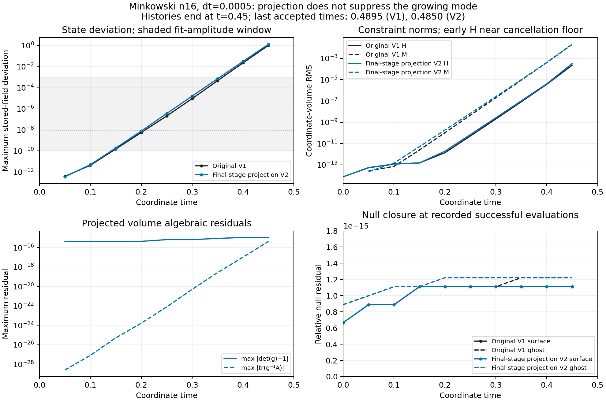

# Projected Minkowski duration test: failed

The optional final-stage algebraic projection **does not suppress the growing Minkowski mode** in this n16 control. The run accepted 970 steps to coordinate t=0.485, then rejected an RK candidate because a stored scri metric became indefinite. It did not reach the requested t=1. The V2 rollback checkpoint is unadmitted and has not been restarted.

The exact native error is `device scri projection failure at row 1520 reason invalid scri metric`. Here `Project` is the scri **null-closure** routine: it rejects the metric before applying closure. This differs from the original V1 failure, where face-local angular interpolation produced an indefinite metric despite positive-definite surface donors. The projected failure occurs at a stored surface node, before ghost interpolation, rather than at the accepted final-stage algebraic-normalization check.

The [protocol](protocol.md) is preserved unchanged. This is frozen numerical source-v5, commit `fdcb9f44f32aad9028ffc76d51113a9927d97a35`, with launcher-v6; combined manifest SHA-256 `8d0eba426c84cdf9997864cf7471a44914cc590b9a4d4ea2efe022b944287c93`. Projected binary SHA-256 is `362093fc8c998576c7d88a14afdc2c5ebcdcb6a68f408b7fdaf92ad62b7b1486`. The [admission](admission.json) from the [12-case preflight](../preflight-projected-v1/README.md) authorized this bounded duration test, without asserting stability. It used one Aurora debug node, 12 MPI ranks on 12 distinct GPU tiles, 19 blocks with 16³ active cells each, and dt=0.0005. The original face-local angular scheme and disabled J were retained. The cross-face candidate is not part of this evidence.

## History comparison



Both histories end with a fresh diagnostic at coordinate t=0.45. The original and projected last accepted times are 0.4895 and 0.4850, respectively; those times do not supply new constraint or field-deviation measurements. The projected terminal report explicitly has `diagnostics_current=false` and `diagnostic_time=0.45`.

| Measurement | Original V1 | Projected V2 |
|---|---:|---:|
| State growth rate, per coordinate time | 74.4915 | 75.8060 |
| Fit R² | 0.999626 | 0.999959 |
| State deviation at t=0.45 | 1.05674 | 1.31446 |
| H RMS at t=0.45 | 2.29235e−4 | 3.26628e−4 |
| M RMS at t=0.45 | 2.11975e−2 | 2.04796e−2 |
| Last accepted coordinate time | 0.4895 | 0.4850 |
| Immediate rejection | Interpolated scri metric | Stored scri RK-stage metric |

Both fits use the same five samples, t=0.15–0.35, selected by the state-amplitude window 10⁻¹⁰–10⁻³, and unweighted OLS of log(state deviation) against coordinate time. The projected rate is 1.76% larger. This supports persistence of fast growth despite final-stage algebraic repair; it does not identify a unique causal boundary operator. The candidate also includes cached-jet sampling, which can change roundoff seeding, so this is not a bitwise single-change comparison. Rates are inferred from the measured linear-growth interval, not from the close failure times. Fit residual errors are descriptive; samples are correlated. Early H is near a cancellation/roundoff floor and should not be treated as a resolved physical growth mode.

At t=0.45, the projected volume determinant and trace residuals are 1.11e−15 and 4.44e−16, while the state and constraints already greatly exceed the unchanged stability limits. Reported running surface/ghost null residuals remain ≤1.23e−15 through successful closure evaluations. These residuals do not certify the rejected RK stage: a valid null closure cannot be evaluated there. [comparison.json](analysis/comparison.json) retains all fit points, H/M/Z comparisons, cadence-aware step timings and their provenance. No failed-state constraint values are fabricated or appended to either history.

## Read-only surface audit

The failed-stage capture contains exactly one non-positive-definite metric among 1,536 stored scri nodes: global row 1520, outer block 18, −z face, angular indices (j,k)=(0,15). Its unit-sphere coordinate is approximately (−0.56453245, +0.56453245, −0.60216794), near a patch corner. All 31 fields are finite at every surface node and χ is positive everywhere.

| Row 1520 measurement | Accepted rollback | Rejected RK candidate |
|---|---:|---:|
| χ | 0.791082 | 0.691481 |
| det(g) | 1.0000000000000002 | −3098.04578 |
| Second leading principal minor | 0.351970 | −37.3018 |
| Metric eigenvalues | 0.311950, 0.995752, 3.219316 | −1.864227, 20.973099, 79.236694 |

Every accepted rollback surface metric is positive definite. Its maximum determinant residual is 1.11e−15; a separate NumPy contraction gives maximum absolute curvature trace 4.55e−13 on that surface, where curvature components are already large. These are fresh **surface-only** calculations at t=0.485, distinct from the stale volume diagnostics at t=0.45. The capture has no RK-substep/time header, so the rejected candidate is assigned only to the attempted interval [0.485,0.4855], without an invented exact abscissa. No fields were projected, clamped or repaired for this audit. [surface-audit.json](analysis/surface-audit.json) retains both full row tensors, all 31 row values, global minima, and the native leading-minor validity test.

## Terminal evidence and reproduction

Job `8982735` reached scheduler state F with scheduler exit status 1; the numerical child returned 2 with the stated geometry error. Worker records show no timeout or storage error. The allocation release is recorded. [terminal.json](terminal.json) keeps only whitelisted terminal facts; raw scheduler owner/email, environment and allocation-balance fields are omitted.

All four worker-bound artifact hashes and sizes were independently recomputed, all 22 recorded report checks reproduce, and plan/PBS/admission/source/binary bindings match. The failed completion/current-diagnostic/admission/state/H/M checks remain failures. Both large payloads remained byte-for-byte unchanged and are omitted from this portable package. The small [report and history](output/), worker record, plan, binding, and root verification are retained unchanged. [package-verification.json](analysis/package-verification.json) records the independent recheck; `inventory.json` lists retained files. The comparison figure was visually inspected.

Run the full read-only analysis from the repository root with NumPy, Matplotlib, and the hash-matched raw payloads still available:

```sh
python3 docs/hyperbolic-shift-3d/reproduction/aurora/stability-projected-minkowski-v1/analyze.py \
  --output output/hyperbolic-core-shell/aurora/projected-minkowski-reanalysis-new
```

`--output` must be new; `--raw-dir` selects another directory containing the four raw worker-bound artifacts under `output/`. The script reads the preserved original comparison history from the neighboring `stability-v1` package and reuses its established fit functions. It launches no evolution or remote action and never loads a checkpoint into the production restart path.

This result leaves stable Minkowski duration, puncture evolution to 100 M, and convergence unresolved. Algebraic normalization and numerical null closure alone have not supplied stability for the present boundary discretization.
