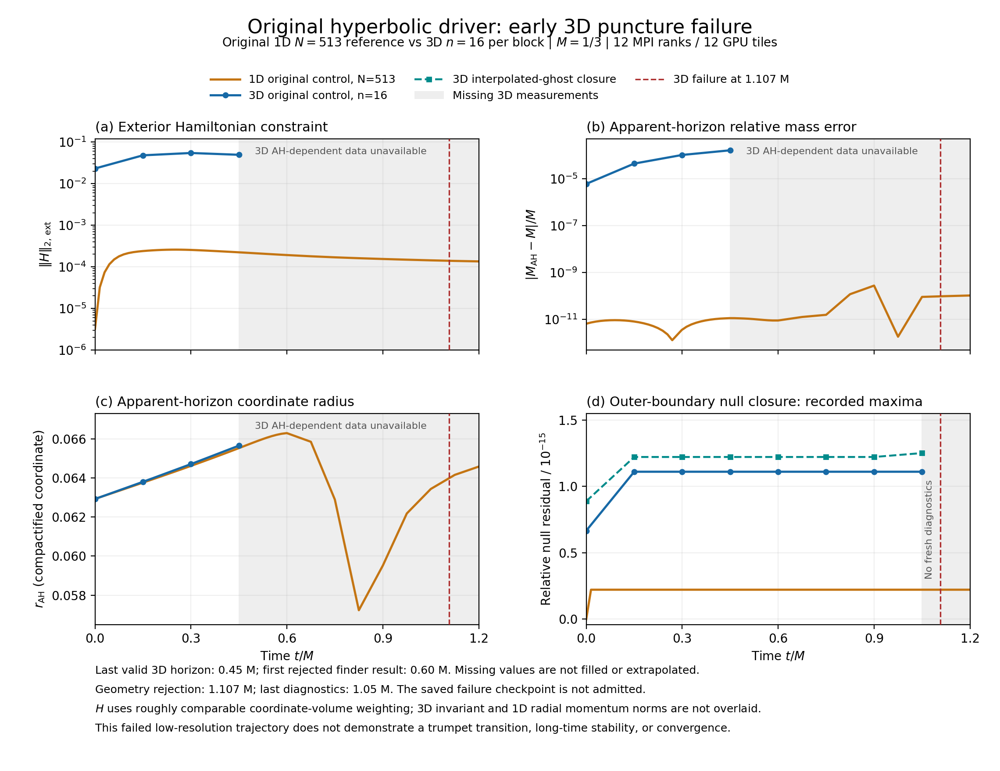

# Original 3D puncture control: early failure

The original hyperbolic-control puncture run failed after **738 accepted
steps**, at coordinate **t = 0.369 = 1.107 M**, with
`nonpositive interpolated scri geometry`. It used n = 16 per block,
77,824 active volume cells, dt = 0.0005, and 12 SYCL MPI ranks on 12 distinct
GPU tiles. The target was t = 1 = 3 M; **the run did not establish the
wormhole-to-trumpet transition or long-time stability**. One resolution
provides no convergence result. The worker stopped before the pulse case.

This run uses the same frozen source and binary as
[preflight-v2](../preflight-v2/README.md): adaptive J is disabled, and neither
the later algebraic-projection candidate nor the cross-face angular prototype
is present. The frozen source-manifest SHA-256 is
`3f367265e2e627aa770d0ae78be4fac912f4c0980a09471382cf9b295c677d7f`;
the MPI binary SHA-256 is
`6e7553b556dd9c4f8b56f81eb0f43c15cf0517a0b81776320a9a6c6d3c29ccef`.

The [PNG](puncture-vs-1d.png) and [PDF](puncture-vs-1d.pdf) compare this run
with the preserved [original 1D N513 history](../../original-1d-reference/history.csv),
whose [provenance](../../original-1d-reference/provenance.json) records a
completed 100.0001953 M trajectory with J disabled and bulk mu = 4. Both use
M = 1/3. Only the early interval 0 <= t/M <= 1.2 is displayed. The 1D curve
connects its recorded samples, including the interval from 1.125 M to 1.5 M
that crosses the right edge of the view.

The 3D fast-flow finder returned accepted horizons at four diagnostic times,
through **t = 0.15 = 0.45 M**. At t = 0.20 = 0.60 M and subsequent samples it
returned `horizon_found=false`; its trial expansion exceeded the configured
1e-3 tolerance. Horizon mass, coordinate radius and exterior constraints are
therefore **missing**, and remain NaN in the retained history and plot. A
finder rejection does not show that the physical horizon disappeared. The
grey bands begin after the last valid measurement; they do not locate a
physical transition or the exact onset of finder failure. Separate horizon
reanalysis of the saved failure state is not inserted into this trajectory.

| Last accepted horizon, t/M = 0.45 | Value |
| --- | ---: |
| Coordinate radius | 0.0656465829122 |
| Horizon mass | 0.333387150427 |
| Absolute relative mass error, `abs(M_AH-M)/M` | 1.6145128024e-4 |
| Outgoing-expansion RMS | 8.1155626621e-4 |
| Exterior H coordinate-volume RMS | 4.9444615916e-2 |

The last complete volume diagnostics are from **t = 0.35 = 1.05 M**, not the
final accepted time. At that sample, full-domain H L2 is 2.7721788611 and the
maximum stored-field deviation is 6.6988130734. The report explicitly sets
`diagnostics_current=false`. Recorded running maxima of surface and
interpolated-ghost null closure remain at 1.1102e-15 and 1.2507e-15. Their
smallness does not establish stable bulk or boundary evolution. No diagnostic
curve is extended from 1.05 M to the geometry rejection at 1.107 M.

The exterior H comparison uses approximately corresponding coordinate-volume
norms: 1D normalizes the radial sum weighted by `r**2 * jac` (including its
endpoint quadrature), while 3D normalizes Cartesian coordinate-volume cell
weights outside a coordinate sphere at the mean accepted fast-flow radius.
For exact spherical data, the continuum angular factor cancels in the
normalized norm. Discrete grids, horizon cutoffs, quadrature, and horizon
algorithms differ; this overlay is not a matched-resolution error estimate.
The 3D invariant momentum norm and 1D radial momentum component are different
quantities and are not overlaid. The radius panel shows the compactified
coordinate radius without dividing it by M; the mass panel uses M = 1/3 as
the reference, not the first measured horizon mass.

[verification.json](verification.json) checks all five worker-recorded
artifact hashes and byte counts: report, history, checkpoint, and fast-flow
summary/shape. It also verifies the plan binding, preflight source/binary
identity, all 22 reported acceptance checks, and the reference history hash.
The 39,362,632-byte checkpoint is omitted; its verified header records
`HYP3D_MPI_V1`, `admitted=0`, and t = 0.369. It is a failure artifact, not an
admitted restart. [assessment.json](assessment.json) records the time and
validity distinctions used here.

Reproduce the plots with `python3 plot_comparison.py` in this directory
(NumPy and Matplotlib required). The script verifies input hashes and keeps
all four missing 3D horizon samples missing. The package retains only small
scientific and binding records; it contains no binary, full checkpoint
payload, or raw scheduler/account records. `package-files.json` inventories
the retained files and excludes itself. No terminal-scheduler claim is made
from this local package.
