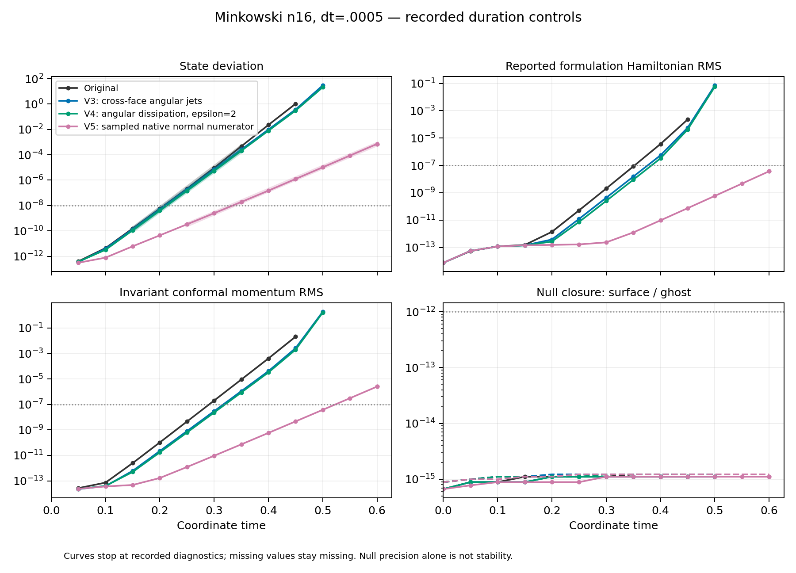

# Sampled-normal V5: completed duration, failed stability criteria

Aurora job **8984126** completed fresh Minkowski evolution to coordinate **t=.6** at n16, dt=.0005, using one debug node, twelve MPI ranks and twelve GPU tiles. It did not encounter the earlier metric exception, but it **failed the unchanged scientific limits**. No stable-duration or restart admission is issued. The native checkpoint's admission bit certifies its internal completion checks only; the campaign rejects it scientifically.

| Quantity | Result | Existing limit |
|---|---:|---:|
| Maximum state deviation | 7.2036097e-4 | 1e-8 |
| Final formulation Hamiltonian RMS | 3.7162913e-8 | 1e-7 |
| Final invariant conformal momentum RMS | 2.5347379e-6 | 1e-7 |
| Maximum surface null residual | 1.1102230e-15 | 1e-12 |
| Maximum ghost null residual | 1.2212454e-15 | 1e-12 |
| Maximum bulk CFL | .3239201 | .5 |

State error first exceeds its limit at the recorded t=.35 sample, momentum at t=.55. Geometry remains positive and the algebraic and null checks pass. Thirty-four of thirty-six final worker checks pass; native return code is zero, whereas the worker and scheduler correctly report failure (PBS exit 1). All four worker-bound artifacts, including the complete 39,362,664-byte checkpoint, were hash verified. The independent V5 decoder checked all four finite double arrays and the exact header/configuration. The terminal allocation lock is released.



The unchanged descriptive fit gives growth **41.8419** per coordinate time over t=.25–.6, compared with **72.1950** for V4 over .15–.35: approximately a **42% reduction**, still exponential growth. The fitted windows follow the same amplitude rule (1e-10 through 1e-3); they are not the same time interval or necessarily the same spatial mode. These are measured trajectory growth rates, not converged eigenvalues. The tiny final time remainder produces two near-identical .6 diagnostics; retaining only the earlier one gives **41.7778**, leaving the conclusion unchanged. Both fits and their selected points are retained. No Hamiltonian fit near roundoff is used.

This result supports a substantial contribution from the boundary normal discretization. It also demonstrates why the earlier negative action on the *V4* direction did not establish stability: the new coupled evolution still grows. The next diagnostic should identify the actual V5 direction and its coupled surface/volume action before another scientific change. This campaign does not establish which remaining term causes that growth.

The original [resolution and timestep controls](../resolution-control-comparison-v1/README.md) already rule out mere low resolution as the sole explanation of the original failure: growth increases approximately with n, whereas timestep halving changes it by less than 1%. The V5 campaign here is only n16; its own resolution dependence has not been measured. Its manufactured complete closure accuracy is approximately third order. Puncture duration, 100 M reproduction, convergence and production AMR remain unfinished.

## Cost and provenance

The executable reports 210.617 seconds for 1201 accepted steps, including the final approximately 1.07e-14 time remainder. Median diagnostic-interval cost is .17059 seconds per step, versus .11990 for V4, roughly 42% higher. These are separate allocations and overlapping MPI_MAX timer buckets, not isolated GPU-kernel measurements. The additional surface-owner halo exchange and five native numerator samples increase the closure work. Larger blocks improved aggregate throughput in the earlier resolution control, but n16 was retained here to isolate the changed operator.

The source is the immutable V12 build at **9d72318c14a2099b5aea118cca62e9fbd8773350**, with the actual twelve-tile [preflight and build evidence](../preflight-sampled-normal-v1/README.md). Its pinned admission permits testing, not scientific acceptance. [Reviewed identity](analysis/identity.json) binds the source manifest, executable, plan and admission. The V5 normal selector, epsilon2 degree7 angular term, standard final-stage algebraic projection, dt and error gates were unchanged from the preflight. No failed checkpoint was resumed.

The remote footprint at job completion was **2,125,925,565 bytes**, below the 5 GB cap. The complete checkpoint is retained locally and remotely; it is omitted from Git. Small raw records are in [raw/](raw/). The full scheduler environment stays only in the local archive; the portable terminal record contains whitelisted state/exit information and the original record hash.

## Reproduction

The exact executed comparison script is retained, including its historical draft wording. It imports the SHA-pinned previous analysis and replays all declared checks. From the repository root:

```sh
python3 docs/hyperbolic-shift-3d/reproduction/aurora/stability-sampled-normal-minkowski-v1/analysis/compare.py \
  --v5-dir docs/hyperbolic-shift-3d/reproduction/aurora/stability-sampled-normal-minkowski-v1/raw \
  --identity docs/hyperbolic-shift-3d/reproduction/aurora/stability-sampled-normal-minkowski-v1/analysis/identity.json \
  --admission docs/hyperbolic-shift-3d/reproduction/aurora/stability-sampled-normal-minkowski-v1/admission.json \
  --out /tmp/v5-duration-comparison-new
```

For full checkpoint verification, use `verify_payload.py --raw <complete-local-campaign> --out <new-json-path>`. The complete local campaign is under `output/hyperbolic-core-shell/aurora/stability-sampled-normal-minkowski-v1`. [Payload verification](analysis/payload-verification-v2.json) records array hashes and the endpoint sensitivity. Version 2 adds an explicit assertion that exactly the state and momentum history gates fail; version 1 remains in the local preparation archive. Neither script evolves or admits a checkpoint.
