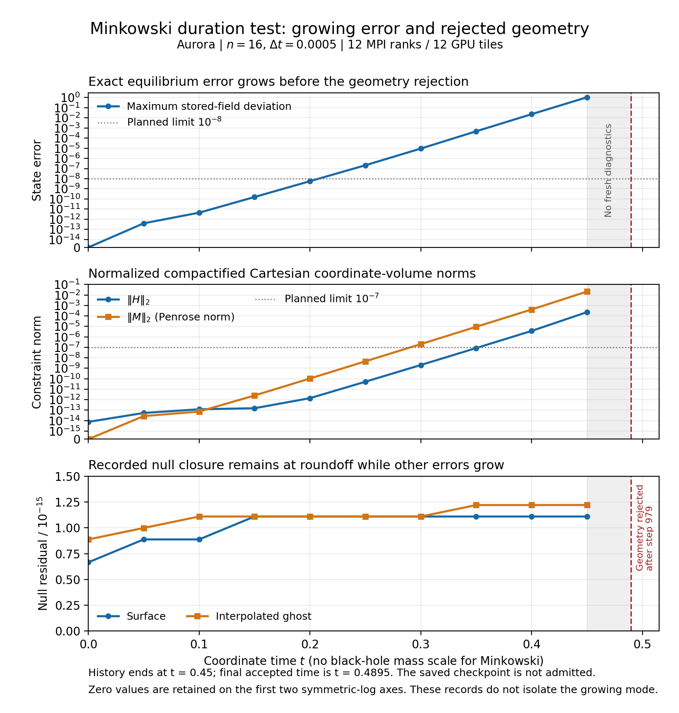

# Aurora stability-v1: Minkowski duration test failed

The first case failed after **979 accepted steps**, at coordinate
**t = 0.4895**, with `nonpositive interpolated scri geometry`. The target was
t = 1, using n = 16, dt = 0.0005, 77,824 active volume cells and 12 SYCL MPI
ranks on 12 distinct GPU tiles. The worker stopped before launching puncture
or pulse, so this plan supplies **no new puncture or pulse evidence**.

The last complete diagnostics are from **t = 0.45**, not the final accepted
time. The report explicitly sets `diagnostics_current=false`. Its saved
checkpoint has `admitted=0`, also confirmed in the native header, and must not
be used as an admitted restart. The numerical child exited with code 2;
this package makes no terminal-scheduler claim from the local download.

| Last complete diagnostics, t = 0.45 | Value |
| --- | ---: |
| Maximum stored-field deviation | 1.0567408912 |
| H L2 | 2.2923478434e-4 |
| M L2, Penrose norm | 2.1197543308e-2 |
| Maximum surface null residual | 1.1102230246e-15 |
| Maximum interpolated-ghost null residual | 1.2221389041e-15 |

The error starts near roundoff and grows rapidly. Recorded nullness remains
at roundoff while the equilibrium error and constraints grow; enforcing
nullness alone therefore does not establish stable evolution. **The first
growing mode and its origin have not been isolated.** The final geometry
rejection does not identify a unique cause in the bulk equations, scri
closure, interpolation, discretization or their coupling.

The [PNG](minkowski-failure.png) and [PDF](minkowski-failure.pdf) plot only the
retained history. The shaded interval marks the absence of fresh diagnostics
between t = 0.45 and t = 0.4895. H and M use normalized compactified Cartesian
coordinate volume; M uses the Penrose spatial norm. Minkowski has no
black-hole mass scale, so the horizontal axis is coordinate t. Reproduce the
figures with `python3 plot_minkowski.py` from this directory; Matplotlib is
required.

[verification.json](verification.json) confirms all three worker-bound
artifact SHA-256 hashes and byte counts: report, history and checkpoint.
The 39,362,632-byte checkpoint was checked locally and omitted from this
small package; its hash and header remain in the verification record.
The [binding](binding.json) and [worker status](worker-status.json) match the
same frozen source-manifest and MPI-binary identities as the passed
[preflight-v2](../preflight-v2/README.md). This failure supersedes any inference
of long-time stability from that four-step success, without changing the
preflight results themselves.

The package retains the plan, binding, worker status, report, history,
affinity log and execution log, plus this assessment and reproducible plots.
It contains no binaries, full checkpoint payload or raw scheduler/account
records. `package-files.json` inventories retained files and excludes itself.
