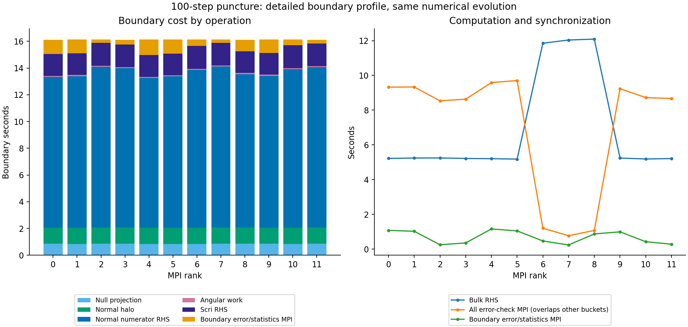

# Boundary timing instrumentation

Adds observability only to `coupled_mpi.cpp`; no equations, interpolation sums,
RK stages, rejection paths, or checkpoint fields change. This instrumentation
is **not** in frozen source-v22 used by Aurora job 8987308.

`boundary_phase_seconds_by_rank` has six columns: null projection, sampled-normal
halo fill, sampled-normal numerator RHS, angular residual/application, scri RHS,
and boundary error/statistics MPI synchronization. These subdivide the existing
closure bucket; surface gathers remain in the existing communication bucket.
They do not include every minor closure operation, such as the projected surface
copy. Each timed operator already completes its device reductions/fence before
returning, so no additional device fence is inserted.

`error_sync_seconds_by_rank` measures all calls to `SynchronizeError`, including
startup, diagnostics, and RHS checks. It overlaps the sixth boundary column and
other existing phase accounting. **Do not add it to exclusive phase totals.**
MPI timings include waiting and are not network transfer time. Timers on a rejected
stage can be partial; use completed runs for performance comparisons.

Local validation used the balanced target built with `make -j2`, two MPI ranks,
poisoned unused sparse workspace, and the same 61/39 ownership fixture as the
previous local fidelity run:

```sh
HYPERBOLIC_SPARSE_POISON=1 mpiexec -n 2 \
 build-hyperbolic-mpi/tst/hyperbolic_shift_3d/hyperbolic_shift_3d_mpi_continuous_positive_balanced \
 12 output/hyperbolic-core-shell/boundary-profile-local-v1/pulse \
 pulse .00075 .00025 - - 120 .001 .001 6 12 2 \
 output/hyperbolic-core-shell/sparse-stage-local-v1/balanced-bitwise/partition-test-n12-r2.txt
```

The complete 38,569,112-byte checkpoint equals the pre-instrumentation fixture
`output/hyperbolic-core-shell/sparse-stage-local-v1/balanced-bitwise/two.checkpoint`.
SHA256: `944ee7c7e04f423dbabf9b21c4bc9fbd3186788d726930ceb4c443b33d150f44`.
All timers are finite/nonnegative and each rank's six subphases sum to no more
than its aggregate closure time. Small raw evidence and verification are adjacent;
large checkpoints remain in local output. This is a fidelity check, not a GPU
performance claim.

## Verified Aurora profile

Job **8987400** completed on one debug node with all twelve MPI ranks/GPU tiles.
All ten cases and **410 independently recomputed checks** passed; 49 artifacts,
the pulse restart and complete puncture control/candidate checkpoints were
verified. Independent verification also checked every candidate timer matrix for
finite nonnegative values, complete rank coverage, and subdivision consistency.
The profiled run took 45.020 s total versus 45.108 s for frozen V21 sparse control;
after-initial-diagnostic time was 0.3292521 versus 0.3292524 s/step. This single
pair detects no material instrumentation cost; it is not a speedup claim.

The previously aggregated 16.1-second boundary bucket is mostly actual numerical
work. Across ranks, over 100 puncture steps:

| Operation | Time per rank |
|---|---:|
| Sampled-normal numerator RHS | 11.20–12.03 s |
| Scri RHS | 1.62–1.71 s |
| Normal halo interpolation/application | 1.20–1.23 s |
| Null projection | 0.85–0.86 s |
| Angular work | 0.081–0.091 s |
| Boundary error/statistics MPI | 0.24–1.16 s |

All-error-check MPI totals are roughly 8.5–9.7 s on ranks with cheaper bulk RHS,
versus 0.77–1.20 s on ranks 6–8 with expensive radial rows. These totals overlap
other timers and include waiting, not just transmission. They must not be added
to the exclusive phase accounting. The anticorrelation with bulk RHS time supports
addressing compute imbalance rather than counting all such time as network cost.

On the rank with the largest sum of exclusive phases, bulk RHS is 12.09 s,
normal numerator RHS is 11.47 s and scri RHS is 1.63 s. Together these physical
RHS operations account for about 56% of total native wall time, including startup.
Bulk RHS alone remains about 27%. Do not relabel the entire boundary bucket as
interpolation overhead, or imply the full performance goal is finished.



The next execution experiment is [field-batched direct radial derivatives](../radial-field-batch-v1/README.md),
which changes GPU work organization for both bulk and sampled-normal paths while
retaining the same stencil summation. It subsequently passed GPU qualification in job 8987760 and reduced per-step
time by 1.921x against the profiled sparse control; see the linked comparison. Asynchronous stage exchange remains deferred: the residual
sparse volume MPI cost is much smaller than the measured radial-path cost, and
introducing asynchronous dependencies/failure cleanup is not justified as the
first optimization from this profile. Coherent all-operator mesh-change rebuild
and qualification across such changes also remain outstanding.

Reproduce with `python3 docs/hyperbolic-shift-3d/reproduction/boundary-profile-v1/analyze_gpu.py`
after placing the verified raw campaign in local output. The [raw evidence](../aurora/preflight-boundary-profile-v1/README.md)
includes source/build pins, logs and independent verification. This remains a
short 0.15 M puncture test, with null errors about 1e-15 and zero lapse-floor
interventions; long-time stability and convergence limitations are unchanged.
