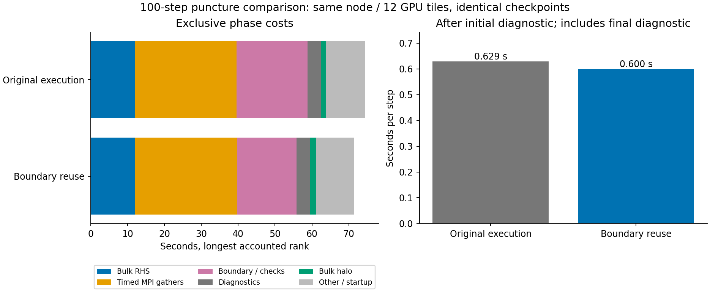

# V11 boundary execution candidate

Experimental execution optimization, with the same physical PDE, RK stages,
spatial stencils, floor policy and V11 checkpoint schema as the continuous-core
candidate. The default target stays unchanged. The separate target
`hyperbolic_shift_3d_mpi_continuous_positive_fast` enables:

- Reuse of boundary rates for an identical state and timestep. Upload, gathered
  stage/accepted states, and rollback invalidate the cache.
- Replicated small surface projection and angular dissipation on each rank,
  removing projection and angular-residual gathers. Expensive geometric boundary
  and sampled-normal RHS evaluations remain partitioned.
- Separate volume/surface/angular collective timing and call counts.

Steady-state Allgatherv calls decrease from 23 to 12 per RK4 step. This does not
remove volume Allgather or establish a wall-time speedup.

The bounded local audit compares whole checkpoints byte for byte against a
frozen pre-optimization V11 executable. Pulse evolution agrees across one/two
ranks and restart; two-step Minkowski and n16 puncture agree across execution
strategies and partitions. Cache hits occur and angular collective calls are
zero. Reproduce with `tst/hyperbolic_shift_3d/test_boundary_reuse_mpi.py`.

GPU job 8986786 passed all nine cases. Independent verification replayed 340
checks and verified 48 artifacts, including CPU/device parity, bitwise pulse
restart, and whole-checkpoint equality for the 100-step n16 puncture pair.
The new executable is `build-sycl-mpi-v20/tst/hyperbolic_shift_3d/`
`hyperbolic_shift_3d_mpi_continuous_positive_fast`; frozen source c97706ab7.

## Measured performance

One sequential same-node pair, 12 GPU tiles, identical dt=.0005 and diagnostics:

| Measurement | Uncached control | Boundary reuse |
|---|---:|---:|
| Native wall time, 100 steps | 74.386 s | 71.445 s |
| Seconds/step after initial diagnostic | .6287 | .5995 |
| Bulk RHS, longest accounted rank | 12.017 s | 12.016 s |
| Timed MPI gathers, same rank | 27.548 s | 27.649 s |
| Boundary work/checks, same rank | 19.270 s | 16.197 s |

This is 4.0% lower native wall time and 4.6% lower per-step time in this pair,
not a scaling study. Each row uses one actual rank for all exclusive components,
not a sum of independently maximized timers. Allgatherv calls fall from 2311 to
1205 including initialization/final diagnostics; volume calls remain 401.
The optimized bulk RHS share is still only 16.8% of native wall time.

Volume gathers account for 26.84 of 27.65 timed gather seconds on the optimized
rank. These timings include waiting for other ranks and do not isolate transfer
bandwidth. Surface and angular gather removal cannot eliminate this cost.
The next substantial optimization is a static sparse donor exchange plan,
including bulk, sampled-normal, boundary, diagnostic and horizon dependencies,
plus balancing the expensive outer-shell work. GPU-aware MPICH is already
explicitly enabled (`MPIR_CVAR_ENABLE_GPU=1`); it is not an omitted toggle.
Boundary timings include geometric RHS work and checking reductions, so they
should not be interpreted as pure projection overhead.

The separate fast target preserves the numerical method; the default remains
available as a reproducible control. Its GPU trajectory equivalence is tested
through .15M, while the V19 uncached duration run reached 3M and failed final
horizon acceptance. Neither result establishes long-time trumpet accuracy.
