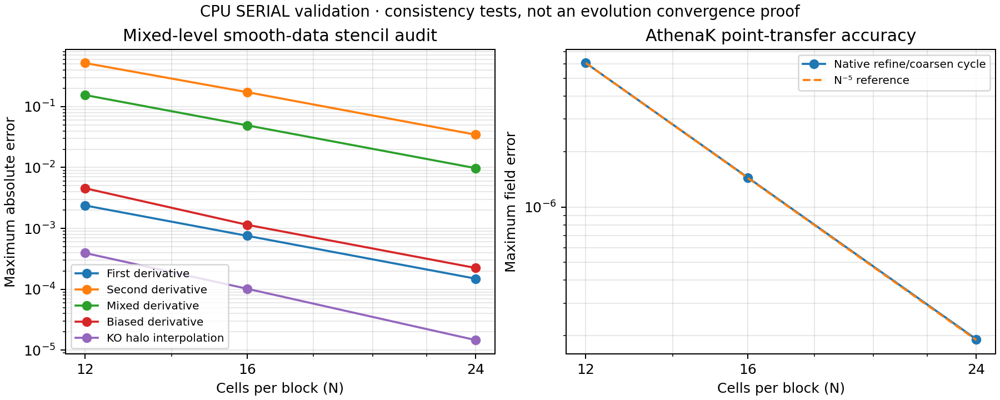
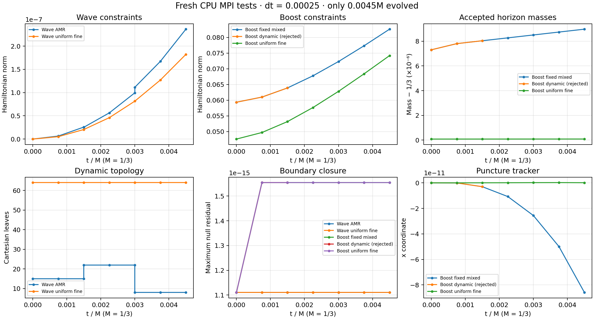

# Local Cartesian AMR integration

Development branch `codex/cartesian-amr-mpi`, based on committed handoff
`d82047d383a27377b969d593a360f4e2786daa29`. All work and tests are local.
No campaign checkout, Aurora job, launcher or automation is modified.

**Dynamic boosted-puncture refinement currently fails its positivity check.**
This is an experimental standalone AMR integration, not completed robust
AMR support or a production-readiness claim. Results and remaining qualifications are recorded below and in
`evidence/summary.json`. The frozen BC1/BC2/BG1 identities remain separate.

## Reused AthenaK machinery

`MeshRefinement::RegisterCC` registers additional named fine/coarse views.
The original MeshBlockTree owns the topology and enforces 2:1 balance; the
original UpdateMeshBlockTree, RedistAndRefineMeshBlocks, LoadBalance,
DerefineCCSameRank, CopyCC, CopyForRefinementCC, RefineCC, RestrictCC and
MPI pack/unpack functions perform the work. No alternative octree or generic
AMR engine is introduced. Empty registrations leave ordinary physics paths
unchanged. Registration validates dimensions and identical ordered names and
field counts across MPI ranks before assigning communication offsets.

The standalone native representation is explicitly enumerated in
`src/z4c/hyperboloidal/amr_fields.hpp`: chi 0, metric deviations 1:7,
A 7:13, P+3 13, Theta 14, Lambda 15:18, lapse deviation 18, B 19:22,
shift deviation 22:25, D 25:28 and adaptive J 28:31. All components remain
Cartesian. The 31-component accepted state and 31-component RK compensation
are independent registered arrays. No cast to the differently indexed
25-field main Z4c storage is used. Analytic offsets are polynomials of degree
at most two and commute with the reused degree-four interpolation.

`CartesianAMR` constructs the actual AthenaK Mesh and exports its leaf list
as a composite descriptor. Its RefineAround entry point uses AthenaK's
existing location criterion and interval policy; the qualification driver
uses prescribed flags to reproducibly exercise both refinement and coarsening.
The latter is a stress schedule, not a validated production error estimator.
Only one such Mesh may exist per process because the existing MeshBlockTree
has a static root pointer. The fixed spherical shells remain outside that tree. The older
`cubed_sphere/extension` is not used as a physics driver: it owns regular
25-field Z4c data, has one-rank admission and lacks this shell restart state.
Its separation of fixed shells and mesh-sequence invalidation is retained in
the adapter design; its admission guards are not removed. Main Z4c boundary
exchange cannot directly operate on the standalone field-major padded/sparse
storage or its distinct 31-field layout, so the existing standalone
SparseStageExchange supplies stage halos and patch stitching.

## Mixed-level and patch adaptation

The original continuous uniform-core policy and its mixed-level rejection
remain intact. An explicit `amr_cartesian_core` descriptor selects a separate
six-point point-interpolation closure. Cartesian active leaves supply unique
finest owners with deterministic ties. Same-level aligned points are copied;
nonaligned points use a complete degree-five polynomial reconstruction from
active donors. These reconstructions can be one-sided near the donor leaf
boundary. Derivatives retain the original centered/mixed/biased FD4 formulas;
no derivative is truncated at an internal leaf edge. Four complete halo layers
supply all KO8/advection/mixed-derivative donors, including corners.

The AMR KO closure continues the original tapered KO8 target-spacing formula
through interpolated halos. It agrees with the uniform-core formula away from
level changes. It is **not** the transpose of a single global mixed-grid
operator, so the uniform negative-semidefinite energy argument does not carry
over. The measured interpolation consistency is not an energy/stability proof.
The fixed shells retain their original KO and scri operators.

Restriction/prolongation for topology changes use AthenaK's existing five-point
NGHOST4 kernels: degree-four exact point interpolation, not conservative cell
averaging. Sixth-point halo interpolation does not raise this transfer order;
second derivatives of a newly regridded smooth field can therefore be limited
to third order at transfer defects. Manufactured transfer and operator trends
are measured separately.

At a synchronized accepted-step boundary the driver gathers the old accepted
state and compensation, fills native fine halos, invokes native AMR migration,
and reconstructs every host/device/sparse/surface/sampled-normal operator for
the replacement descriptor. Complete-state gathers at regrid are deliberate;
RK-stage communication continues to use SparseStageExchange. The current
adapter is not scalable in host memory: geometry and donor plans are replicated
on each rank, as in the standalone baseline. No stale operator references survive.

Fixed-shell values and compensation are copied by patch/layer/local-cell
identity, including independently evolved overlap samples. Cartesian overlap
cells are interpolated from the old hierarchy. All new bulk states and all
interpolated halos are checked for finite fields, positive chi/lapse and positive
metric principal minors. Invalid interpolants cause failure; no new repair is
applied. Existing scri closures/floors remain in their original locations.
Nominal leaf quadrature and the existing smooth Cartesian/shell partition of
unity are retained; evolved extra cells carry zero diagnostic volume.

The requested timestep is fixed in the qualification runs. Characteristic CFL
is recomputed from each actual leaf geometry at every stage, and the AMR target
rejects CFL above .4 or the existing relaxation limit. This is an admission
bound, not a proof of stability. There is no automatic timestep growth policy.
The scri penalty multiplier is independently fixed at
`.6510416666660156`; it is never inferred anew from a changed Cartesian spacing.

## Scientific state and restart

The driver includes the existing production Evolution implementation and its
point equations, compensated RK4, algebraic acceptance, gauge/auxiliary
sources, floors, tracker and moving-center FastFlow. Its compile definitions
are taken from the BC2 scientific target, while its custom descriptor and
checkpoint are separate. It retains the six shells, coefficient-four .6-.9
collar, C6 4M-12M slice, .2-.56 gauge blend, original scri derivatives,
physical-variable KO8 and direct chi/lapse evolution. The boosted case uses
fresh exact v=.1 Schwarzschild with the free initial gauge.

`HYP3D_AMR1` stores an exact scientific identity and all 31 field names, the full
canonical logical leaf list and refinement ages, ownership-independent accepted
bulk/surface state and compensation, tracker, horizon radius seed, diagnostics,
floor/sign counters and a historical event ledger. Old per-cell events are
archived with physical coordinates when topology changes; event counts are
never interpolated or multiplied across children. Boundary interpolation sign
aggregates have separate ledger records. All bytes before the trailing checksum
are protected by FNV-1a64 (accidental-corruption detection, not authentication).
Malformed/incomplete arrays, nonfinite payloads, invalid/unbalanced/duplicate
leaf lists, incompatible configuration and checksum failures are rejected.
Restart reconstructs the native tree and fresh plans for the current rank count.
The legacy campaign checkpoint functions explicitly reject an AMR descriptor.
This initial checkpoint format uses native scalar endianness and the local
LogicalLocation ABI; cross-architecture portability is not claimed. FastFlow
persists the mean-radius seed and tracker, not its internal angular warm-start
coefficients. Consequently restarted horizon diagnostic iterations need not be
bitwise identical even when the evolved state is identical.

## Reproduction

```
git submodule update --init kokkos
cmake -S . -B build-amr -DCMAKE_BUILD_TYPE=Release \
  -DAthena_ENABLE_MPI=ON -DAthena_ENABLE_HYPERBOLIC_SHIFT_3D_TESTS=ON \
  -DAthena_ENABLE_CUBED_SPHERE_TESTS=ON
cmake --build build-amr --target hyperbolic_shift_3d_amr_transfer \
  hyperbolic_shift_3d_amr_operators hyperbolic_shift_3d_amr_evolution -j6
mpiexec -n 4 build-amr/tst/hyperbolic_shift_3d/hyperbolic_shift_3d_amr_transfer 12
mpiexec -n 1 build-amr/tst/hyperbolic_shift_3d/hyperbolic_shift_3d_amr_operators 24
python3 tst/hyperbolic_shift_3d/validate_amr.py \
  --binary build-amr/tst/hyperbolic_shift_3d/hyperbolic_shift_3d_amr_evolution \
  --output output/amr-new --suite restart
```

Use a new output directory. The validation script freezes a copy of the binary
and records its SHA256, complete commands, status, time and checkpoint hashes.
Other suites are `matrix`, `boost`, `controls` and `equilibrium`. The `boost`
suite intentionally stops on the unresolved dynamic failure; `controls`
expects that rejection and then runs fixed-mesh/restart/uniform controls. The `analyze_amr.py` reader compares all
arrays, including auxiliary fields and compensation; `--uniform` interpolates
a uniform fine core onto the final coarsened control coordinates for a bounded
field-error comparison. Such a two-grid comparison is not a convergence proof.

Further checks (use fresh output paths):

```
ctest --test-dir build-amr -R '^hyperbolic_shift_3d_amr_(transfer|operators)' --output-on-failure
python3 tst/hyperbolic_shift_3d/validate_amr.py --binary build-amr/tst/hyperbolic_shift_3d/hyperbolic_shift_3d_amr_evolution --output output/amr-controls --suite controls
python3 tst/hyperbolic_shift_3d/validate_amr.py --binary build-amr/tst/hyperbolic_shift_3d/hyperbolic_shift_3d_amr_evolution --output output/amr-equilibrium --suite equilibrium
python3 tst/hyperbolic_shift_3d/test_amr_checkpoint.py --binary build-amr/tst/hyperbolic_shift_3d/hyperbolic_shift_3d_amr_evolution --checkpoint output/amr-new/wave-save.checkpoint --output output/amr-rejections
python3 tst/hyperbolic_shift_3d/analyze_amr.py output/amr-new/wave-full.checkpoint output/amr-new/wave-restart.checkpoint --output output/amr-restart-comparison.json
python3 tst/hyperbolic_shift_3d/audit_amr_rejection.py --prefix output/amr-controls/boost-rejected --output output/amr-rejection-audit.json
```

The existing main tests require Python pytest/numpy and the `athena` target:
`python3 tst/hyperbolic_shift_3d/validate_main_amr.py --binary build-amr/src/athena --output output/amr-main`.
Plot scripts consume the committed evidence directly. The collector expects the
archived suite directory names in its source; complete commands also appear in
each manifest. `validate_main_amr.py` preserves the original error tables by
disabling only test cleanup.

## Validation results and limits

The final checks use N12 blocks, dt=.00025, unchanged six-shell exterior and
penalty multiplier .6510416666660156 (actual penalty CFL .1875 at N12).
Six accepted steps reach t=.0015, or **0.0045M**. This is deliberately bounded
local integration evidence, far shorter than the prior 4.23M failure.

- Actual native transfer, balancing and redistribution pass on 1/2/4 ranks.
  The exercised leaf sequence is 8→15→71→15→8, including 72 and 124 sent
  blocks on 2 and 4 ranks. Polynomial state error is below 9e-14, including
  independently populated B/D/J and compensated RK arrays.
- Smooth transfer has measured order 4.98–4.99. First/mixed derivatives trend
  to 3.995/3.992, second derivatives to 3.965, biased advection to 4.024, and
  KO halo-interpolation consistency to 4.786. These are separate manufactured
  tests, not an evolution convergence result. The raw constant-row weight sum
  differs by up to 5.7e-12; anchored interpolation preserves constant values.
- Dynamic non-symmetric wave evolution exercises 15→22→8 Cartesian leaves,
  both directions of shell exchange, changed ownership and rebuilt plans.
  One-rank uninterrupted, final two-rank uninterrupted, and two-to-four-rank
  restart checkpoints are byte-identical, SHA256
  `8e8d28add8411268d5ba8c83a8f83b4b5b857b2f03f0b024aa1bd67b9a8de69a`.
  All 31 fields, compensation, boundary arrays, counters and tracker agree.
  The final nominal-core difference from the uniform fine control is at most
  2.41e-7 across fields, using sixth-point sampling onto AMR coordinates.
- The fixed mixed-level boosted run and its two-to-four-rank restart complete.
  All eight checkpoint arrays and the puncture tracker are bitwise identical.
  Only the final horizon-radius seed differs (8.06e-10); the accepted final
  horizon masses differ by 1.45e-12, from different FastFlow warm starts.
- Fresh dynamic Minkowski and uniform fine controls both complete. Their final
  Hamiltonian norms are 2.3642e-7 and 1.8215e-7, respectively, with positive
  chi/lapse and zero floor events. The fixed mixed boosted and uniform fine
  controls finish with Hamiltonian norms .0826164 and .0742025; their accepted
  horizon masses are .3333423114 and .3333334166. All requested boosted horizon
  records are accepted (no mass acceptance gaps in this short window).
  The maximum boosted field difference from the fine control is .001829 in B;
  this is a bounded comparison, not a demonstrated convergence order.
  Across these runs, null residuals stay below 1.6e-15 and determinant residuals
  below 1.2e-15; all recorded floor counts remain zero.
- Six collective checkpoint rejection cases pass: scientific identity, field
  names, timestep, initial-data kind, truncation and checksum corruption.
- All four new CTests pass. Existing continuous-positive device and two-rank
  mesh-plan tests pass (293.59 s total). Main Z4c MPI AMR convergence (16 ranks)
  and physical-boundary AMR regressions pass (299.25 s total); their original
  error tables are retained. These are CPU Kokkos SERIAL tests, not GPU tests.

### Rejected boosted refinement

The dynamic boosted case reaches accepted step 2, t=.0005, then rejects the
15→22-leaf transfer. At (0.00375,−0.00375,−0.00375), native five-point
prolongation produces chi=−0.0002924790344160026. The accepted core minimum
was 7.535607e-5, and **all 125 prolongation donor values are positive** (minimum
6.350912e-4). Lapse is .00954247 and the three metric principal minors are
positive. This is a chi interpolation overshoot, not the prior BG1 indefinite
metric/advection failure.

An independent reconstruction matches the rejected value to 2.88e-18.
`evidence/boost-rejection-audit.json` retains every donor value, coordinate and
weight; `audit_amr_rejection.py` reconstructs it from the preserved raw arrays.
Both the accepted pre-regrid state and rejected candidate remain local and
have SHA256 receipts. No rejected state was evolved or used as a restart.
No floor, limiter, gauge or equation was changed to make this pass.

Therefore **unrestricted dynamic boosted-puncture AMR is not robust yet**.
A separately specified, accuracy-tested admissible transfer policy or a justified
refinement restriction is needed before that claim can be made. The present
fail-fast behavior exposes the defect; it does not solve it.

### Cost and evidence

Final one-rank wave/restart-reference execution took 97.75 s including setup;
the final two-rank wave took 80.25 s. The one-rank fixed mixed boosted control
took 64.80 s. Runs shared the workstation, so these are reproduction costs,
not strong-scaling measurements. Each nominal native array needs
`capacity × 31 × (N+8)^3 × sizeof(Real)` bytes; state and compensation both
have fine and coarse allocations, in addition to replicated composite plans.

`evidence/summary.json`, `evolution-summary.json`, the suite manifests and
per-run histories record statuses, commands, exact executable hashes,
constraints, positivity, null residuals, trajectory, accepted masses and floor
counts. Binary checkpoints/candidates are retained under `output/amr-local/`
with receipts; they are not committed as large binary blobs. The early
`matrix-v1` rank sweep precedes the final checksum/shell-copy hardening and is
preliminary. Its uniform control was launched after those fixes; final wave
and restart comparisons are independently recorded. Initial harness failures
(missing input keys, insufficient capacity and a rejection-test output-name
collision) are preserved and distinguished from numerical failures.

Additional limitations: no mixed-level KO energy bound, no long-time or
resolution-converged boosted evolution, replicated host-memory cost, no
qualified automatic error estimator, and no nonzero floor-event restart
fixture. Ordinary successful floor counts are zero. The prescribed regrid
schedule is a stress test rather than a production refinement strategy.



