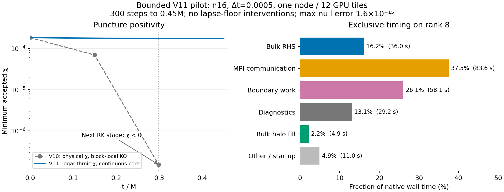
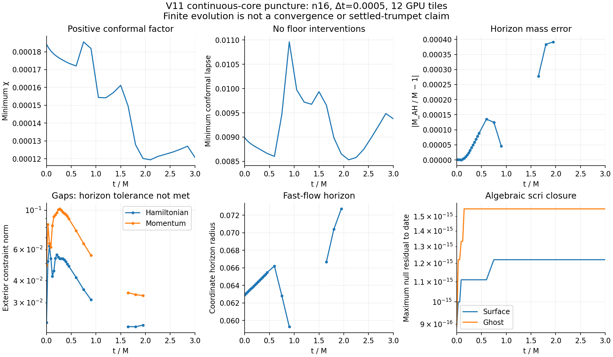

# V11 candidate: continuous core and logarithmic positive variables

Experimental V11 candidate with bounded GPU pilots; no long-time or convergence admission.

## Captured V10 failure

Aurora job 8986048 stopped after 199 accepted steps at coordinate t=0.0995
(t/M=0.2985). Eight chi values in the failed RK stage were negative; all lapses
were positive and all state values finite. At active cell 4095, chi was
-1.3254012381e-7 and conformal lapse was 0.0101527162. The last accepted minimum
chi was 1.5166211558e-7. This is a near-puncture positivity failure, not an
outer-boundary or negative-lapse failure. Null closure remained at roundoff.

Block-local dissipation was truncated differently at duplicate Cartesian
points: initial chi KO rates -0.00341536 (12 terms) and -0.000940721 (9 terms)
at identical physical coordinates. A complete uniform Cartesian stencil still
has a large negative physical-chi KO rate, -0.00283256: seam repair alone is
not a positivity argument. The 1D donor instead evolves log/reference chi and
uses logarithmic chi/lapse dissipation. The V10 evidence and these diagnostics
are retained, including the failed unadmitted checkpoint; it is never resumed.

## Candidate changes

- Unique evolved Cartesian points, with overlap only outside the full cube.
  Internal leaf faces use exact copies and a continuous Cartesian KO stencil.
  Spherical-shell overlap is retained. At n16, evolved cells decrease from
  189512 to 159200 (106496 nominal cells unchanged).
- RK evolves log chi and log conformal lapse. The same native physical PDE rates
  are divided by the corresponding positive variable; physical spatial jets
  remain unchanged. KO acts on log(variable/reference), using the donor's fixed
  puncture reference factors. Other fields retain physical RK and KO.
- Physical lapse floor 1e-10: conformal alpha >= 1e-10 Omega, only for finite
  candidate logarithms. Every stage/acceptance intervention and its largest
  radius are reported. There is no chi floor and nonfinite states still fail.
- Exact per-rank block masks and selective active transposes eliminate redundant
  halo work, including a rank that formerly filled all 26 blocks. Poisoned-unused
  storage tests compare all twelve ownership ranges to the full CPU RHS.
- Phase timers are exclusive per rank. Prior V10 exchange/closure/diagnostic
  counters overlapped and must not be added to infer cost fractions. Full-state
  MPI Allgather remains; sparse neighbor exchange is not implemented here.

This is not an identical spatial discretization of the 1D chart: the donor
reconstructs spatial derivatives analytically in its puncture variables, while
this candidate still differences physical 3D fields. The 1D donor also advances
physical lapse in time; this candidate additionally uses its logarithm for RK.
No spherical symmetry is enforced and no continuum gauge coefficient is changed.
The continuous-core candidate currently requires a uniform Cartesian level;
it rejects nonuniform refinement rather than claiming AMR support.

## Local evidence

CPU/device complete RHS relative error <5e-19 on smooth nonspherical data;
all twelve selective ownership ranges agree, including poisoned unused halos.
Map/J/H checks pass; no internal Cartesian seam truncates the 15-term KO stencil.
Two-step pulse checkpoints are bitwise equal across one/two ranks and restart.
V7 control matches its frozen checkpoint bitwise. Cross-schema and nine malformed
geometry/topology/positive-variable descriptors are rejected.
Two n16 puncture steps at dt=0.0005 pass, min chi 0.000184108, min lapse 0.00898299,
zero floor interventions, surface/ghost null error <1.2e-15. These are short checks,
not evidence of wormhole-to-trumpet stability or evolution convergence.

Build targets end in continuous_positive_geometry, continuous_positive_device,
and mpi_continuous_positive. The V11 checkpoint has 152 header bytes: V10 geometry
plus mesh scheme 4 and a 16-byte <dii> positive-variable descriptor (1e-10,1,0).
Physical state is stored; chi/lapse compensation uses logarithmic coordinates.
Old checkpoint schemas are rejected. Reproduce MPI checks with
`tst/hyperbolic_shift_3d/test_continuous_positive_mpi.py`.

## GPU pilots and performance

GPU preflight v2 passed 257 gates and 39 artifacts, including bitwise restart.
The V11 puncture pilot completed 300 steps to coordinate .15=0.45M, beyond V10's
negative-chi failure at .2985M. Minimum chi 0.000173574, minimum conformal lapse
0.00866459, zero floor interventions, null closure <=1.56e-15. Horizon mass
relative error is 8.82e-5; exterior H/M norms are .04832/.08967. Pole and clock
residuals reach .00788/.01017, so exact null closure is not a claim of full scri
regularity or evolution convergence.

Minkowski completed the same 300 steps to coordinate .15: state drift 2.11e-13,
H/M norms 2.15e-13/2.81e-13, null closure <=1e-15, zero floor interventions.
Both original pilot workers flagged inherited, contradictory step/cell metadata
checks. Original failed records are retained. Separate pilot-metadata-audit.json
files derive the correct 300/159200 counts from the predeclared target and V11
mesh and qualify the numerical results without changing any numerical criterion.

Puncture took 222.70 s, Minkowski 192.72 s, including startup. Puncture horizon
sampling every .01 cost 29.2 s. On the longest measured rank, bulk RHS was 16.2%,
MPI communication 37.5%, boundary work 26.1%, diagnostics 13.1%, bulk halo fill
2.2%, and other/startup 4.9%. Timers are exclusive. MPI timing currently groups
volume, surface, and angular-residual collectives; it does not isolate which
kind dominates. Full-state Allgather and repeated surface collectives remain.
The halo cleanup and 16% cell reduction have not established a substantial wall-
time speedup, and bulk RHS does not yet dominate. Sparse donor exchange, fewer
surface collectives, and balancing the costly outer-shell kernels are candidates
for subsequent measured optimization. A 3M run is estimated at 22–25 minutes at
this resolution if stable, excluding queue time.

## Continuation to 3M

The same V19 executable reached t=3M with no RHS error and no lapse-floor
interventions, total 2001 steps. Minimum chi .0001208043 and conformal lapse
.00937907 remain positive; null closure <=1.56e-15. Measured evolution time for
both segments is 22.92 minutes. Full-domain H/M norms are .0518183/.0371362.

Overall scientific validation still fails: the horizon finder misses its
unchanged .001 expansion tolerance at the final sample (.00139189), so final
horizon mass and exterior norms are unavailable. Accepted horizon samples are
shown with gaps; no rejected trial is promoted to a measurement. This establishes
that the original negative-chi RHS failure has been bypassed to 3M, not faithful
long-time trumpet evolution or convergence.

