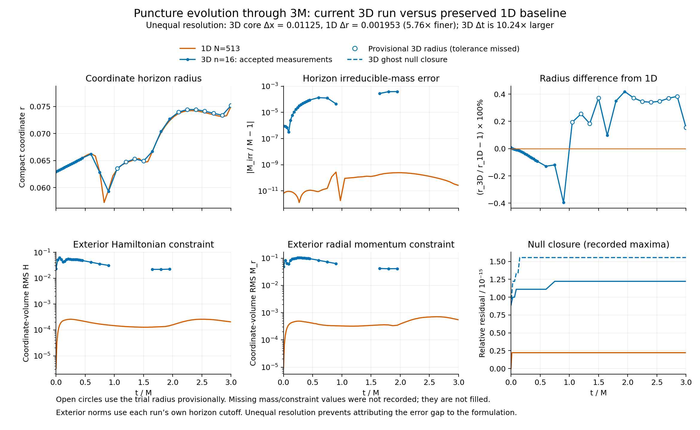

# Current 3D puncture versus preserved 1D evolution

This is an **unequal-resolution behavioral comparison**, not a convergence
test or a measurement of errors caused specifically by the 3D formulation.
No new evolution was run. The plots use the archived original gamma4 N513
reference and the V11 continuous-core/logarithmic-variable GPU trajectory.

| Resolution measure | Preserved 1D | Current 3D | Ratio, 3D/1D |
|---|---:|---:|---:|
| Near-horizon coordinate spacing | 1/512 = .001953125 | .36/32 = .01125 | 5.76 |
| Coordinate timestep | .000048828125 | .0005 | 10.24 |
| Initial horizon radius / spacing | 32.22 | 5.59 | — |

The 3D label n16 means 16 nominal cells per block, with two Cartesian blocks
per axis across the core, not 16 cells across the entire physical domain.
Overlap cells do not refine the core spacing. The 1D run enforces spherical
symmetry and has no angular discretization error. The retained donor manifest
confirms grid_stretch=0 and cfl=.025; its hash and arguments are recorded in
resolution-provenance.json. A uniform 1D grid with roughly 90 points would have
comparable radial spacing near the horizon, although its stencil, origin
treatment, horizon search and lack of patch interpolation would still differ.

## What agrees and what does not

The 3D horizon follows the 1D early increase, dip, and recovery. Across the 22
accepted 3D samples, the largest radius difference from linearly time-interpolated
1D data is 0.419%. There are 12 rejected horizon samples; the last accepted
measurement is at 1.95M. Following the requested provisional interpretation, open circles show trial
radii where the tolerance was missed, and the radius curve includes them. The
full radius series remains within 0.419% of the time-aligned 1D history; at 3M
the provisional difference is 0.154%. Their residuals remain quality flags.
Mass and exterior norms were not recorded for those samples and are not filled
by assuming a radius. Native acceptance flags remain unchanged.

At 1.95M, the last accepted horizon:

| Quantity | 1D N513 | 3D n16 |
|---|---:|---:|
| Coordinate horizon radius | .0724116 | .0727147 |
| Relative irreducible-mass error | 2.48e-10 | 3.92e-4 |
| Exterior Hamiltonian RMS | 1.465e-4 | 2.240e-2 |
| Exterior radial momentum RMS | 3.464e-4 | 4.155e-2 |

Thus exterior H and radial M are about 153 and 120 times larger at this sample.
These ratios combine resolution, timestep, stencil, quadrature and interface
differences. They do not identify which difference dominates, or show that a
resolution increase alone will fix the discrepancy. At 3M the 3D volume
evolution is finite but the final horizon expansion RMS .0013919 exceeds the
unchanged .001 criterion. Final 3D horizon mass/exterior norms remain unavailable.

Both schemes enforce algebraic null closure at roundoff: 1D recorded relative
residual about 2.22e-16; 3D surface <=1.23e-15 and ghost <=1.56e-15. Neither
this identity nor early radius agreement establishes complete scri regularity,
convergence, or a settled trumpet. Both runs report no lapse-floor interventions.

## Definitions and reproducibility

Mass M=1/3, so t/M=3t. Coordinate radius r is not rescaled. Compare the 1D
area-derived horizon mass with 3D horizon_irreducible_mass, not an unspecified
Christodoulou mass. Compare 1D M_exterior_rms with 3D Mr_exterior_L2: both are
the radial covector component, not the 3D invariant momentum norm.

Both norms use normalized compact coordinate-volume weighting, r²dr versus
mapped d³x. Each run uses its own measured horizon cutoff, so integration
regions and quadratures differ slightly. A precise discretization study needs
a common prescribed cutoff. The 1D search chooses the outermost outward root;
FastFlow is a local continuation search. Radius proximity does not prove global
root identity. The 1D histories are interpolated in time only for the matched
CSV/difference panel, with no extrapolation. The main overlays show recorded
points. Gaps in 3D quantities are preserved.

The V11 variant now uses logarithmic chi/lapse RK and reference KO, continuous
Cartesian stencils, and a counted 1e-10 physical lapse floor. It retains physical
spatial jets; the donor reconstructs derivatives in its rescaled puncture chart
and advances physical lapse in time. These differences remain even at matched
spacing. Full 3D evolution does not impose spherical symmetry.

Run `python3 docs/hyperbolic-shift-3d/reproduction/continuous-positive-vs-1d/compare.py`.
The script verifies retained history hashes against prior audits, checks time
ordering and missing-data masks, and produces comparison.png/pdf, matched-times.csv
and comparison.json. The original 3M scientific validation remains failed on
horizon-dependent criteria; this comparison does not change that result.

## Meaning of gaps and dashed lines

The dashed blue null curve is the separate interpolated-ghost closure check;
the solid blue curve is the surface closure. It is not a missing-data segment.
Missing mass/constraint points arose when FastFlow missed its 1e-3 expansion
RMS criterion (rejected samples span about 1.04e-3–2.16e-3). Volume evolution
continued. Treating the radii provisionally is useful for the current stability
study, but does not recover unrecorded mass or volume-integral data. Future
diagnostics can retain candidate-area mass and exterior norms separately, using
the candidate radius as a provisional cutoff and retaining the residual flag.
