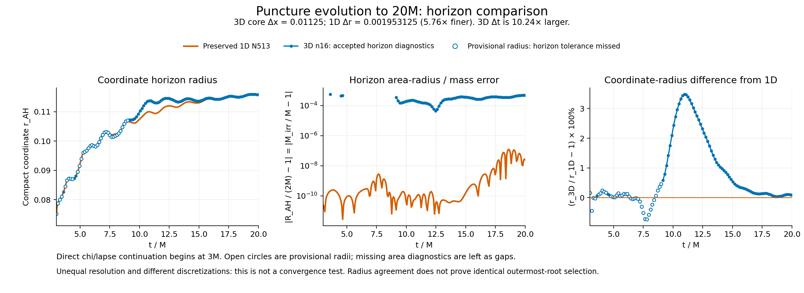
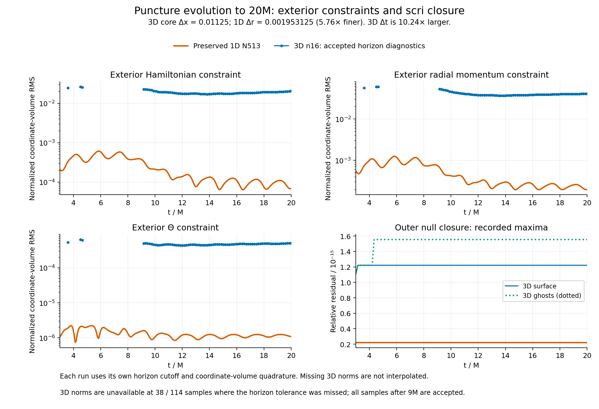

# 3D n16 continuation versus the preserved 1D N513 baseline

The direct-chi/direct-lapse continuation completed 3M to 20M on Aurora job 8990504.
The comparison uses its verified history and the same original gamma4 N513
baseline used in the earlier 3M comparison. No new 1D evolution was run. Input
SHA256s, time-aligned values and reproduction code are retained here.

| Quantity | Preserved 1D | Current 3D |
|---|---:|---:|
| Near-horizon coordinate spacing |1/512=.001953125|.36/32=.01125|
| Coordinate timestep |.000048828125|.0005|
| Coordinate horizon radius at 20M |.115732329|.115831206|
| Relative horizon areal-radius/mass error at 20M |2.494e-8|4.810e-4|
| Exterior Hamiltonian RMS at 20M |6.893e-5|2.059e-2|
| Exterior radial momentum RMS at 20M |1.982e-4|4.057e-2|
| Exterior Theta RMS at 20M |1.092e-6|5.033e-4|

The 3D core is 5.76 times coarser in coordinate spacing and uses a 10.24-times
larger timestep. n16 is the per-block label: two Cartesian blocks per axis give
32 core cells across width .36. Shell spacing is mapped and differs from this
core number. The 1D run enforces spherical symmetry; the3D evolution does not.
The 3D time/KO variables and floor policy also differ from the preserved 1D chart.
This is an unequal-resolution behavioral comparison, not a convergence test.
The norm gap cannot be attributed to resolution alone from these two runs.

The horizon follows the 1D trajectory, with a transient maximum accepted
coordinate-radius difference of3.4858% at
10.9500M. The difference decreases to .08544% at 20M. The final
3D areal radius is .04810% above2M. Thus the final agreement should not be
read as a bound on the entire trajectory. Exterior H and radial momentum
norms are respectively 299 and205 times the 1D values at 20M; neither is converged
by this single comparison. Both runs maintain roundoff-level algebraic nullness.

## Definitions and missing diagnostics

Mass M=1/3, so t/M=3t. The coordinate horizon radius is shown without rescaling.
The area radius R_AH=sqrt(area/(4pi)) gives M_irr=R_AH/2, so their fractional
errors are identical here. The reference mass is the initial Schwarzschild M.
The 1D radial covector momentum RMS is paired with 3D Mr_exterior_L2, not the
3D invariant momentum norm. Both use normalized compact coordinate-volume
weighting (r²dr versus mapped d³x); each uses its own measured horizon cutoff
and quadrature. This does not match the exterior integration regions exactly.

Of 114 3D samples,76 have accepted complete horizons. The 38 rejected searches
span 3M through 9M; all samples after 9M are accepted. Open circles show only their
complete provisional radii. Area/mass and exterior norms were not recorded for
those samples and remain gaps. No missing values are invented. A dotted teal
curve denotes ghost null closure, not a gap. FastFlow is a local search, while
1D selects an outermost root; radius proximity alone does not establish global
root identity.

The difference plot and CSV use linear time interpolation of the 1D history at
3D diagnostic times with no extrapolation. Main overlays show retained histories.
The plots start at 3M because that is where this direct-variable trial begins;
they do not label the inherited 0–3M logarithmic evolution as this new scheme.
Run `python3 docs/hyperbolic-shift-3d/reproduction/direct-chi-lapse-v1/comparison-1d/compare.py`
to reproduce the PNG/PDF plots and tables.
