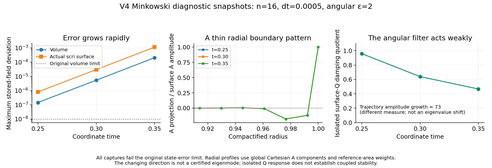

# Early 3D growing-error snapshots

These are three fresh n16 V4 Minkowski captures from job 8983924, with the
same epsilon-two binary and dt=0.0005 as the failed duration test. Every capture
exceeds the original volume-state error limit. Their acquisition and source
bindings are [independently verified](../aurora/linear-window-dissipative-v2/acquisition/README.md).
There is no scientific restart or stability admission.

The center panel projects each outer radial plane's Cartesian tracefree
extrinsic-curvature tensor A onto the contemporaneous surface A pattern. It
uses reference solid-angle weights and tensor Frobenius weights; the actual
surface coefficient is one by definition. The two nearest volume planes have
coefficients about -0.119 and -0.179, while the next planes are much smaller.
The three normalized radial profiles nearly overlap. This shows a sharply
localized radial surface/interior mismatch, without identifying which operator
first generates it. The curves connect discrete measurements; no intermediate
radial solution is inferred.

The last panel shows the isolated angular-Q energy quotient, not an eigenvalue
shift. Its decline from 0.959 to 0.467 explains why merely extending the same
angular filter is not currently supported. The independently measured whole
direction amplification is about 73 per coordinate time. These are different
norms and measurements, and must not be subtracted as a stability estimate.
The end-to-end direction correlation is 0.99459, with a 10.39% residual after
best-fit amplification; a single eigenmode has not been certified.

The [data table](data.json) and retained [comparison input](comparison-input.json)
contain hashes and values. `python3 plot.py` recreates the PNG and PDF using
only small retained data. `python3 extract.py`, from any working directory,
rechecks the three local full-checkpoint hashes against their worker records
and regenerates the table; those archived full checkpoints are required for
this optional raw-data extraction. `extract.py` uses the same analytic
reference-cell area formula as the native angular plan, checks positivity and
total area 4 pi, and reads the V4 88-byte header explicitly. No field is evolved
or repaired by this plotting workflow.
