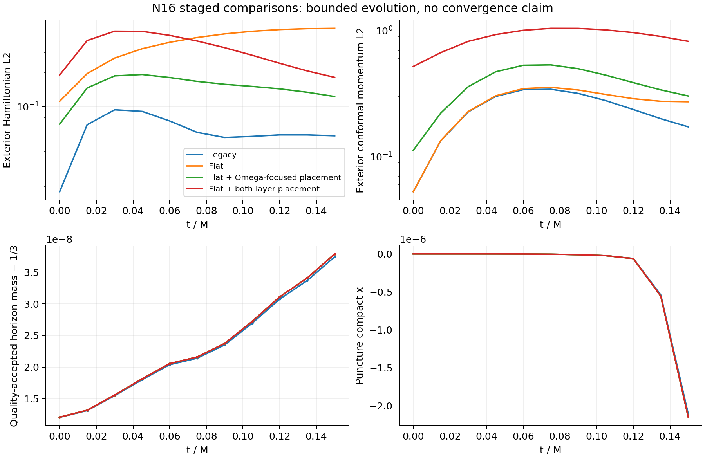

# Bounded staged Aurora comparison

The optimized baseline remains the scientific control. The flat conformal-frame
implementation and both radial placements pass their implementation/interface
gates, but the selected N16 experiments do not improve accuracy overall.
No convergence or long-time robustness improvement is demonstrated.

Jobs 9037790 and 9037836 ran sequentially on one Aurora debug node each, with
12 ranks/GPU tiles, the same frozen scientific binaries and source ddc5b4800.
All cases use boosted Schwarzschild v=0.1, M=1/3, core64³, six shells, 200
steps to t=0.05 (t/M=0.15), and the original outer/scri/floor controls. The
characteristic-spacing calculation selects the requested dt cap of 0.00025;
maximum recorded stage CFL is 0.085632 or less. The first two stages change
conformal frame plus adapted inner equations/gauge, then only shell placement.

The repeated legacy checkpoint is byte-identical across allocations, and every
scientific history column also matches exactly. See [the repeat receipt](baseline-repeat.json).
The combined table uses that second baseline, flat and first placement from
job 9037790, and final placement from job 9037836. Input provenance is explicit
in [input-map.json](input-map.json); raw evidence is retained separately for
[both jobs](../aurora-v1/README.md) and [the follow-up](../aurora-v2/README.md).

| Case | Final exterior H L2 | Final exterior conformal M L2 | Final total physical M L2 | Driver seconds | Median seconds/step including diagnostics |
|---|---:|---:|---:|---:|---:|
| Legacy control | 0.055438 | 0.173118 | 0.041468 | 83.068 | 0.30004 |
| Flat, original shells | 0.487624 | 0.273915 | 0.111581 | 86.516 | 0.31749 |
| Flat, Omega-focused shells | 0.122737 | 0.304228 | 0.094899 | 89.683 | 0.31987 |
| Flat, both-layer shells | 0.180826 | 0.824873 | 0.182830 | 90.952 | 0.32159 |

H is a physical constraint. The exterior momentum column uses the conformal
metric, whose normalization changes with Omega; the physical momentum norm
is reported over the full domain. All norms use normalized compact-coordinate
volume. The two radial experiments share the same Omega, permitting direct
comparison of their conformal momentum norms. Full precision and intermediate
samples are in [comparison.json](comparison.json) and the raw histories.

The final placement lowers final exterior H by 62.9% relative to flat alone,
but remains 3.26 times legacy; total physical momentum is 4.41 times legacy.
The first placement has lower H and momentum than the final placement. The
final placement refines both the Omega and gauge intervals by coarsening an
outer layer; this tradeoff has measurable errors and is not a preferred
scientific default. The unsmoothed Omega derivative profiles and
[resolution audit](../local-gates/resolution-audit.json) expose the narrow C6
join and redistribution. Neither smoothness nor cell counts prove resolution.

All 11 samples per case have a found, complete horizon satisfying the 1e-2
postprocessing expansion-quality threshold (online tolerance 1e-3). There are
zero mass gaps in these runs; the analysis preserves gaps if they occur.
Maximum mass error is 3.79e-8 or less, final expansion RMS about 1.06e-5.
Final compact puncture x is -2.10905e-6 in legacy and -2.15133e-6 in all flat
cases. This early agreement does not qualify the exterior evolution.

Chi floors activate only at sampled radii <=0.004872: legacy has 1176 stage
and 392 accepted-step interventions; each flat case has 1184 and 400. Lapse
and surface floors remain zero. Total H reaches about 24.6 near the puncture;
this is distinct from the exterior norms in the table. All pre-floor sign
records are retained. There were no rejected numerical trajectories or
walltime continuations in these two allocations.

Scri surface/ghost nullness stays below 1.56e-15. Final maximum pole/clock
residuals are about 5.292e-4 / 8.823e-4 in legacy and flat with original shells,
5.291e-4 / 8.822e-4 in the Omega-focused case, and
1.129e-3 / 1.382e-3 in the both-layer case. An unchanged final shell does not
prevent errors from coarser interior shells from influencing scri residuals.

The timings are single bounded runs with diagnostics, setup and checkpoint
costs; interval medians exclude the first two diagnostic intervals. The two
baseline medians differ by 0.23%. The final experiment costs about 7.2% more
per diagnostic interval and 9.5% more driver time than its same-allocation
baseline. These are not repeated performance benchmarks or evidence of a new
speedup. Earlier 1.627–1.710x setup-heavy speedups and 3.86–4.08x strong-scaling
results belong to the integrated performance study linked from the main README.



## Reproduce the combined analysis

From the repository root, with Python and matplotlib available:

```sh
python3 - <<'PY'
from pathlib import Path
import hashlib, json, tarfile
base = Path('docs/hyperbolic-shift-3d/reproduction/hyperboloidal-refined-v1/aurora-comparison')
out = Path('build-refined/reproduce-comparison-inputs')
out.mkdir(parents=True, exist_ok=True)
for name, item in json.loads((base/'input-map.json').read_text()).items():
    archive = (base/item['archive']).resolve()
    receipt = json.loads((archive.parent/'archive-receipt.json').read_text())
    assert hashlib.sha256(archive.read_bytes()).hexdigest() == receipt['archive_sha256']
    with tarfile.open(archive) as stream:
        data = stream.extractfile(item['member']).read()
    assert hashlib.sha256(data).hexdigest() == item['sha256']
    assert Path(name).name == name
    (out/name).write_bytes(data)
PY
python3 tst/hyperbolic_shift_3d/analyze_refined.py \
  build-refined/reproduce-comparison-inputs build-refined/reproduced-comparison \
  --placement-label 'Flat + both-layer placement'
```

The stored report binds every analyzed history/report by SHA256. Raw archive
receipts additionally bind all logs, launch plans and build provenance. Large
checkpoints remain in the recorded Aurora scratch directory with their hashes;
there is no instruction to overwrite existing campaign outputs or resubmit jobs.
