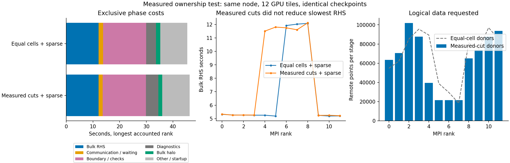

# Measured fixed ownership candidate

`hyperbolic_shift_3d_mpi_continuous_positive_balanced` accepts a final partition
file argument after the angular dissipation coefficient. The cells, numerical
operators, stage arithmetic, and V11 checkpoint format stay unchanged. The
provided contiguous ownership ranges replace equal-cell rank splitting; all
pack/unpack and halo dependencies are built for those ranges. The report records
the actual cuts, minimum/maximum local sizes, and source profile SHA256.

`plan_cost_partition.py` reads a completed V11 report with exclusive per-rank
RHS timings. It estimates constant cost per cell within each measured rank's
ownership interval and proposes approximately equal-cost cuts. MPI waiting is
excluded. It uses explicit ownership cuts when available and the historical
equal-cell partition otherwise. Predictions omit communication, boundary work,
and within-interval variation: they must be tested, not treated as speedups.

The C++ reader rejects mismatched resolution, total cells or rank count,
non-covering/empty/reversed ranges, malformed digests, overflow, and trailing or
truncated input. Rank zero reads the file and synchronizes errors before
broadcasting cuts. The Aurora controller requires a bound partition input and,
for subsequent admitted phases, the exact preflight-admitted partition bytes.
A different file at the same path does not inherit admission.

Local poisoned-workspace regressions use deliberately unequal synthetic cuts
(61%/39%) on two ranks, plus a one-rank-to-two-rank restart. Pulse, Minkowski,
puncture, rejected-stage captures, and rollback checkpoints match the frozen
boundary-reuse control byte for byte. The synthetic profile digest is all zeros
and is explicitly a correctness fixture. It is not a measured performance plan.
Reproduce with `test_sparse_stage_mpi.py --measured-partition` and the balanced
executable, using the same required arguments as the sparse regression.

This is fixed ownership selected at startup, not in-flight repartitioning or
AMR field migration. Native geometry changes and AMR remain outside the current
runner. The twelve-tile comparison below validates fidelity, but does not establish a
load-balancing speedup.

Validation also includes four planner tests, the C++ descriptor-reader negative
controls, and all 103 offline Aurora controller/worker tests. GPU evidence is described below.

The tested GPU candidate is frozen at `85b8ba91a45dca07496d941e765ea6929006c352`
(source-v22). `inputs/partition-n16-v21-r12.txt` is generated from the verified
sparse run in job 8987177; its sidecar records the cost estimate and source
report digest. The profile is also retained alongside the cuts. This input was tested in job 8987308.

## Same-node GPU result: no performance improvement

Job **8987308** used one debug node, CompactBinaryMerger, twelve MPI ranks and
all twelve GPU tiles. Both cases used sparse exchange and boundary reuse; only
volume ownership changed. The control is frozen V21 and the candidate is V22.
All ten cases and **425 independently replayed checks** passed. Complete pulse
restart and 100-step puncture checkpoints are byte-identical. Source, binaries,
partition/profile inputs, logs, 49 artifacts and checkpoint arrays were verified
independently; see [raw evidence and verifier](../aurora/preflight-measured-partition-v1/README.md).

| Metric | Equal-cell sparse control | Measured-cut sparse candidate |
|---|---:|---:|
| Native wall time, including startup | 45.346 s | 46.207 s |
| Seconds/step after initial diagnostics | 0.33035 | 0.33456 |
| Maximum rank bulk RHS time, 100 steps | 12.080 s | 12.117 s |
| Maximum/minimum rank RHS time | 2.328 | 2.323 |
| Maximum rank boundary/check time | 16.164 s | 16.185 s |
| Diagnostic time | 3.680 s | 4.636 s |

The candidate is **1.3% slower per step** and 1.9% slower overall in this single
sequential pair. The per-step estimate includes final diagnostics. This is not
a statistically established regression, but there is no evidence of a benefit.
The slowest RHS cost did not fall despite reducing those ranks' cell counts;
the number of ranks incurring the expensive RHS path increased. A piecewise
constant rank-average cost model therefore does not explain the observed GPU
scaling. These timings alone do not establish whether the cause is occupancy,
branch behavior, or stencil cost. The next experiment needs finer kernel/boundary
timing, rather than another untested adjustment to the same cost model.

The experimental measured-cut target remains separate; equal-cell sparse is the
best verified execution choice. This does not undo the previously verified
1.92x per-step improvement of sparse exchange plus boundary reuse over frozen
uncached V11. Do not multiply results from different jobs into a new same-node
speedup claim.

Recreate the plot and JSON with `python3 docs/hyperbolic-shift-3d/reproduction/measured-partition-v1/analyze_gpu.py`
after collecting the raw campaign under `output/hyperbolic-core-shell/aurora/`.
The plot uses a single rank with the largest sum of recorded exclusive phases;
all-rank error synchronization was not separately timed in this frozen run.
The boundary bucket includes synchronization waiting and is not all device work.

Null errors remain 1.11e-15 on the surface and 1.55e-15 in the ghost closure;
there were zero lapse-floor interventions. Both short puncture runs reached
0.15 M with accepted horizon residual 1.036e-4. The logarithmic chi/lapse scheme,
floor, interpolation order, and scientific acceptance are unchanged. This does
not establish long-time stability, horizon convergence, AMR evolution, or a
resolution-matched 1D/3D accuracy result.
