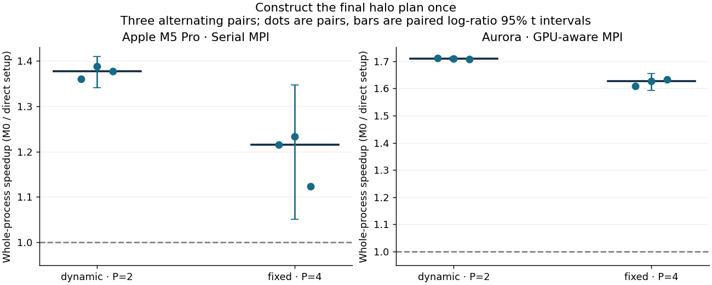
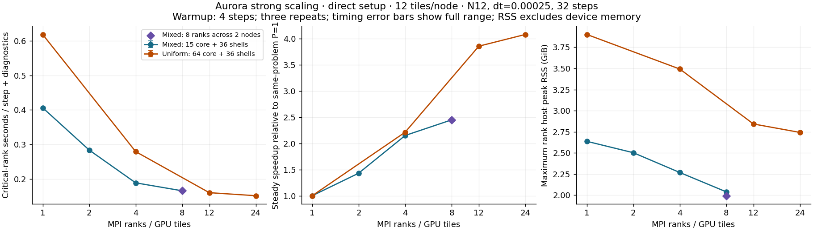

# Hyperboloidal AMR performance and scaling

The useful change is to construct the final inner-transition halo plan once.
The previous Evolution constructor built the default plan, then discarded and
rebuilt it when selecting logical inner-transition interpolation. The opt-in
`hyperbolic_shift_3d_amr_setup` target supplies that existing selection during
construction. Donors, interpolation order, geometry, ownership, all31 fields,
compensated RK4, diagnostics and HYP3D_AMR1 serialization remain unchanged.

The ordinary `hyperbolic_shift_3d_amr_evolution` target stays available as the
instrumented control. This is a measured setup/regrid optimization, not a new
integration or AMR admissibility method. See [the construction proof and focused
test](setup-design.md), [experimental design](experiment-design.md), and
[exact reproduction/provenance notes](reproduction.md).

## Repeated setup comparisons

| Backend / case | Ranks | M0 process (s) | M4 process (s) | Paired median speedup | Paired 95% t interval |
|---|---:|---:|---:|---:|---:|
| CPU / dynamic | 2 | 79.342 | 57.641 | 1.376× | 1.341–1.409 |
| CPU / fixed | 4 | 42.020 | 34.479 | 1.216× | 1.051–1.347 |
| Aurora / dynamic | 2 | 64.713 | 37.855 | 1.710× | 1.704–1.715 |
| Aurora / fixed | 4 | 23.323 | 14.350 | 1.627× | 1.591–1.654 |

Three alternating pairs per row. Fixed: eight steps, 15 Cartesian leaves;
dynamic: six steps and 15→22→8 leaves. The same six-shell exterior and
every-step diagnostics are retained. The intervals assume independent log
ratios and do not remove workstation scheduling uncertainty.

## Aurora strong scaling

| Problem | Ranks / used nodes | Step + diagnostics (s) | Full range (s) | Steady speedup / efficiency | Process (s) | Max rank host RSS (GiB) | Max node RSS upper bound (GiB) |
|---|---:|---:|---:|---:|---:|---:|---:|
| Mixed | 1 / 1 | 0.40608 | 0.40603–0.40622 | 1.00× / 100.0% | 26.08 | 2.64 | 2.64 |
| Mixed | 2 / 1 | 0.28373 | 0.28354–0.28380 | 1.43× / 71.6% | 22.07 | 2.50 | 4.99 |
| Mixed | 4 / 1 | 0.18870 | 0.18865–0.18883 | 2.15× / 53.8% | 18.96 | 2.27 | 8.33 |
| Mixed | 8 / 2 | 0.16585 | 0.16577–0.16585 | 2.45× / 30.6% | 17.91 | 1.99 | 7.54 |
| Mixed | 8 / 1 | 0.16569 | 0.16568–0.16573 | 2.45× / 30.6% | 18.13 | 2.04 | 15.29 |
| Uniform | 1 / 1 | 0.61845 | 0.61829–0.61847 | 1.00× / 100.0% | 37.20 | 3.90 | 3.90 |
| Uniform | 4 / 1 | 0.27922 | 0.27915–0.27946 | 2.21× / 55.4% | 25.78 | 3.49 | 12.23 |
| Uniform | 12 / 1 | 0.16022 | 0.16020–0.16024 | 3.86× / 32.2% | 21.55 | 2.84 | 33.04 |
| Uniform | 24 / 2 | 0.15143 | 0.15138–0.15148 | 4.08× / 17.0% | 21.14 | 2.74 | 32.53 |

Each row has three repeats of the same 32-step problem; four warmup steps
are excluded from the critical-rank steady window. Speedup uses that problem’s
one-rank median. Both nodes were allocated for this sweep; “used nodes” follows
the explicit ranks-per-node launch. The two eight-rank mixed rows isolate
placement. Node memory is the sum of individual rank peaks under the verified
PALS contiguous placement, an upper bound rather than simultaneous RSS.

The steady windows are stable: the largest critical-rank within-window coefficient
of variation is 0.382%, and second-half/first-half means range from 0.99776 to
1.00075. Eight mixed ranks take 0.16569 seconds per step on one node and 0.16585
on two; this is not a useful placement gain. Whole-process two-node times span
17.855–19.961 seconds versus 18.131–18.278 within one node, so the small median
difference is not reliable. Uniform 12→24 ranks reduces steady time by only
5.5%, while aggregate host RSS peaks nearly double.

## Decisions

| Milestone | Decision | Evidence and limit |
|---|---|---|
| M0 observability | Retain | Exclusive driver samples and per-generation nested work, communication, host RSS and optional allocation/kernel census. Final schema 2 adds peer/normal counts. |
| M1a exact-block transfer | Keep isolated experiment; do not promote | Same-P complete checkpoints/histories pass. GPU overall time is flat; CPU P4 regresses. GPU staging consumes additional memory. |
| M1b radial mask | Remove from final source | About 0.25% improvement in the short GPU steady window, no whole-process gain, and CPU regressions/noise. Source and evidence remain in branch history and the frozen overlay. |
| M4 direct final halo setup | Retain as optimized target | Full donor/weight/geometry comparison and bitwise trajectory tests; repeated process-time savings on CPU and GPU. |
| M2 compact local storage | Defer | Large replicated padded/state and coexistence allocations remain. A complete FD/mixed/advection/KO/scri/moving-horizon read-set proof is needed before changing indexing. |
| M3 native participation/ownership | Defer | Native equal costs, capacity and eight-root guard remain. [Concrete metadata, payload and transaction gates](native-contract-gates.md) precede any change. |
| Async exchange, fusion, new measured cuts | Defer | No validated cost model or dependency/transport proof supports a specific stage rewrite; historical rank-average costs are not reused. |

The timing fixtures are deliberately short. Setup savings amortize as the number
of steps grows; the dynamic fixture has two prescribed regrids in six steps.
The reported process-time gain is not a claim of equal RK throughput gain or
equal speedup in a long physical campaign.

## Scientific limits

All matched cases retain N12, dt=.00025, six layers with interfaces
[.305,.45,.6,.75,.875,1], the original restoration/gauge/KO8/scri operators,
physical-variable dissipation, algebraic acceptance and tracker/FastFlow cadence.
The penalty multiplier remains .6510416666660156 and measured penalty CFL is
.1875. Characteristic CFL remains a separate column in every scientific history.
No resolution or cadence reduction is counted as an optimization.

Dynamic boosted refinement still rejects at step 2 with
chi=-.0002924790344160026 at (.00375,-.00375,-.00375). The control, radial
experiment and setup candidate have identical GPU accepted/rejected capture
hashes. Independent positive-donor reconstruction agrees to 2.8731e-18. These
rejected states are preserved and never restarted or treated as throughput data.

The mixed problem retains its native initialization/coarsening ceiling of eight
MPI ranks. The 64-root uniform problem is a different mesh, with the same fixed
36 shell patches; its larger rank sweep is strong scaling of that separate
problem. There is no weak-scaling, long-time stability, convergence, mixed-grid
KO energy-estimate or production-readiness claim.

## Correctness coverage

The same-backend A/B checkpoints include complete bulk and surface fields, RK
compensation, counters/ledger, tracker, horizon seed and topology metadata.
Same-rank diagnostic histories are independently compared byte for byte.

* CPU Serial MPI1/2/4 dynamic nonsymmetric wave (15→22→8 leaves), uniform
  wave, and dynamic Minkowski match the frozen baseline. Wave restart saves
  after the first regrid on two ranks and resumes through coarsening on four.
* Fixed mixed-level boost and uniform boost controls complete. GPU fixed/uniform
  wave/boost and dynamic Minkowski match the same-backend frozen control.
* The fixed boosted two-to-four-rank restart preserves all eight checkpoint
  arrays and tracker exactly. Only its horizon-radius seed differs by
  8.05365e-10, the preexisting fixture-specific FastFlow warm-start behavior;
  this exception is not used in same-P A/B comparisons.
* All six collective malformed/checksum/configuration checkpoint rejections
  pass. Native NGHOST4 transfer tests pass at CPU/GPU MPI1/2/4; native operator
  tests pass locally. The four-layout setup contract passes on CPU and GPU.
* Radial batching, exact-block snapshots, poisoned sparse exchange, one-rank
  stale/rejected plan publication, nonzero compensated-state repartition,
  rollback and complete failed-stage capture pass their focused fixtures.
  V11 lifecycle tests supplement the direct-variable AMR1 cases; they do not
  replace them. No counter semantics changed and no new nonzero floor-event
  restart qualification is claimed.
* Both relevant main-Z4c regressions pass (16-rank AMR wave convergence and AMR
  physical-boundary behavior; 171.78 seconds combined).

## Platforms

Local: Apple M5 Pro, 18 heterogeneous CPU cores, 48 GiB RAM, macOS 26.7.1,
Serial Kokkos, Open MPI 5.0.10. CPU affinity is not reliably pinned. Aurora:
Intel Data Center GPU Max 1550 tiles, driver 1.6.33578+77, Intel DPC++ 2025.3.2
from the explicitly selected oneAPI release/2025.3.1 module, Kokkos 4.7.2 SYCL,
MPICH 5.0.0.aurora_test.87e2045. `MPIR_CVAR_ENABLE_GPU=1`, one intended visible
tile per rank, implicit scaling disabled, and explicit CPU binding are recorded
in the allocation probes. Actual compiler commands and module inventories are
in the evidence archives.

## Baseline and rejected experiments

All speedup ratios are control time divided by candidate time. Setup tables use
the instrumented M0 control; they are not products of the separate baseline
overhead comparison and the setup comparison. Three original-to-M0 GPU pairs
give median 1.002× (95% interval 0.997–1.008). The corresponding CPU median is
0.954× with a broad 0.826–1.109 interval; this workstation sample cannot resolve
small instrumentation overhead.

Exact-block diagnostic transfer gives median 0.935× CPU process speedup and
1.000× GPU speedup. On GPU rank 2 it reduces 17 transfer calls from 0.784 to
0.410 seconds in the first pair, but the full boosted diagnostic interval is
about 20 seconds and whole-process time stays flat. Its observed device-space
peak increases from 1.496 to 1.575 GB in the separate profiled runs. The radial
mask gives CPU process ratios 0.979/1.001/0.939 at P1/2/4 and 1.000 on GPU P4.
The isolated fenced Prepare intervals also show no gain (critical rank: 0.01650
versus 0.01693 seconds over 74 calls). No bandwidth, occupancy, or register
conclusion follows from these wall-time measurements.

## Memory and remaining bottleneck

The 15-leaf case still allocates 444,602,496 bytes (424 MiB) per rank for its
two padded buffers, plus replicated global state/base and host geometry/plans.
The separate two-rank dynamic allocation run observes a maximum SYCL-device-space
peak of 3,474,736,680 bytes across generation coexistence. Direct setup changes
construction work, not this distributed-storage design or native reservations.

The bounded next step is to split the remaining host-model setup time into
geometry construction, leaf/owner searches, and halo donor assembly on the same
8/15/22-leaf fixtures. If lookup dominates, prototype one indexed lookup with
explicit finest-owner/tie/tolerance/overlap proofs and rerun the existing exact
contract plus three alternating pairs. Keep native participation and buffer
capacity unchanged until their independent contract gates are implemented.

## Evidence notes

The optional profiler is intrusive and is excluded from normal timing pairs.
Its single-run process overhead was within about 0.3% of matched ordinary-run
medians, which does not establish zero kernel perturbation. CPU timing uses an
18-core heterogeneous Apple M5 Pro without reliable affinity; every accepted
speedup table reports spread. Aurora affinity and one visible GPU tile per rank
are recorded, with actual device-pointer MPI_Alltoall validation across nodes.

Early profiler `[unlabeled]` live-label counters wrapped when SYCL freed scratch
under a different label; those invalid counts are excluded and the final
pointer-attribution test covers the fix. Per-space observed allocation peaks,
not sums of label peaks, quantify the retained GPU memory evidence. Host RSS
excludes device allocations. Summed rank RSS peaks are an upper bound, not a
simultaneously measured node footprint or GPU-memory measurement.

Source archives, large states and binaries remain in the task-owned artifact
locations in [reproduction.md](reproduction.md); small raw evidence and SHA256
receipts are retained here. Raw failed builds, expected numerical rejection and
the excluded CPU timing pair are preserved. No unrelated campaign/job or original
checkout was changed.

## Resource use and retained evidence

| Aurora job | Nodes | Largest probe / evolution | Walltime used | Node-hours |
|---|---:|---:|---:|---:|
| 9037417 | 1 | 12 / 4 tiles | 00:19:45 | 0.32917 |
| 9037490 | 2 | 24 / 24 tiles | 00:26:21 | 0.87833 |

Both bounded one-hour debug jobs exited 0. They ran sequentially, used at most
two concurrent task nodes, and consumed **1.2075 node-hours** (3 node-hours
requested). Account/queue, before-submission job lists, submission receipts,
allocation/mapping probes and final scheduler receipts are archived. PBS's
`ngpus=0` bookkeeping is not a device-usage measurement; the allocation probes
record the actual visible GPUs and successful device-pointer communication.

[Verification](evidence/verification.json) records 41 successful artifact checks,
including the explicitly resolved stale-CMake build failure.
[Machine-readable resources](evidence/resources.json),
[CPU setup summary](evidence/cpu-m4-summary.json),
[GPU setup/scaling summary](evidence/gpu2-summary.json),
[scaling rows](plots/scaling.json), and
[window variability](evidence/scaling-window-variability.json) support the tables.
The compressed raw packages preserve detailed per-rank phases/work/memory,
commands, histories, manifests and build/test logs.
