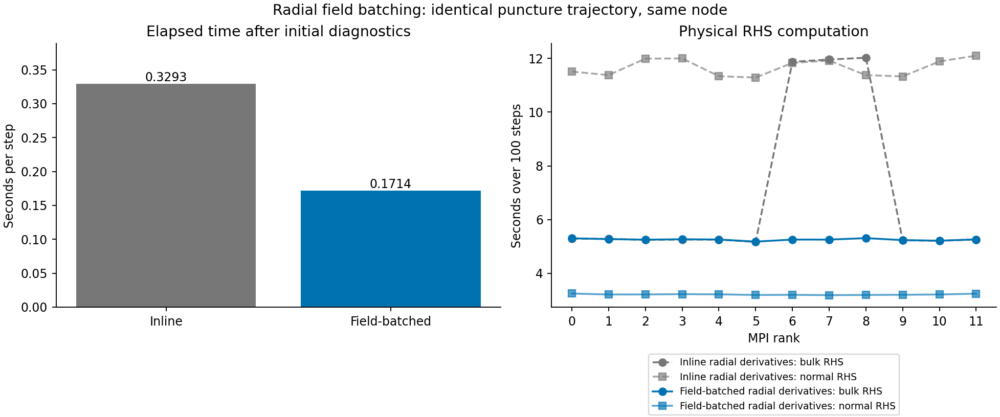

# Field-batched direct radial derivatives — verified short GPU comparison

The V21/V22 ownership audit found that ranks with any direct radial closure rows
were expensive, even when only 69 such rows were owned. Reducing their cell count
did not reduce the slowest RHS time. See the [ownership evidence](../measured-partition-v1/README.md).
This motivates a kernel organization experiment; it does not establish a GPU
occupancy or compiler diagnosis.

`HYPERBOLIC_RADIAL_FIELD_BATCH=1` selects an experimental execution path. The
`hyperbolic_shift_3d_mpi_continuous_positive_radial_batch` target uses the existing
sparse exchange, equal-cell ownership and boundary reuse. Default targets retain
inline radial derivative application.

The radial plan still builds donor indices and derivative weights once. It now
optionally allocates a compact row lookup and scratch jets for selected rows.
`Prepare` refreshes derivatives in **one launch across selected rows × fields**,
using the same `Kernel::Derivatives` summation order. Bulk RHS, bulk diagnostics,
and sampled-normal numerator evaluations consume these current-stage jets.
They are recomputed on every call; no state-dependent derivative is treated as
mesh-only data. Scratch is reused only as storage. A returned view belongs to
its plan and is valid until the next preparation; this synchronous runner finishes
its device reduction before another preparation.

The generic batched pass computes first and second derivatives for all 31 fields;
consumers requesting first derivatives alone receive zero second derivatives,
as before. This adds work for unused second derivatives and memory traffic, so a
GPU speedup must be measured, not assumed. Storage is 12 doubles per selected
row/field plus integer row lookup/IDs. No interpolation order, donor location,
physical equation, floor, characteristic criterion, null closure, or RK sum is
changed. The V11 checkpoint schema is unchanged. Reports identify the path as
`radial_derivative_execution: stage_field_batch`.

## Local validation

- The derivative test passed **110,019 field-row comparisons** with zero error
  against CPU and exact value equality against direct device application. It
  reuses each plan for three changed input states, toggles first/second derivative
  requests, and covers twelve simulated partitions, noncontiguous and empty
  ownership, poisoned radial ghosts and invalid shape/index rejection.
- All **eleven** poisoned-workspace MPI cases passed. Complete pulse checkpoints
  match with one/two ranks and a one-to-two-rank restart; Minkowski and puncture
  checkpoints match the existing boundary-reuse control byte for byte.
- A rejected RK stage preserves exactly the same rollback checkpoint and complete
  failed-stage capture. Scientific acceptance and zero lapse-floor interventions
  are checked by the unchanged regression runner.

Reproduce the build and bounded tests:

```sh
cmake -S . -B build-hyperbolic-mpi
cmake --build build-hyperbolic-mpi -j2 --target hyperbolic_shift_3d_radial_field_batch hyperbolic_shift_3d_mpi_continuous_positive_radial_batch
build-hyperbolic-mpi/tst/hyperbolic_shift_3d/hyperbolic_shift_3d_radial_field_batch
python3 tst/hyperbolic_shift_3d/test_sparse_stage_mpi.py \
 --binary build-hyperbolic-mpi/tst/hyperbolic_shift_3d/hyperbolic_shift_3d_mpi_continuous_positive_radial_batch \
 --control build-hyperbolic-mpi/tst/hyperbolic_shift_3d/hyperbolic_shift_3d_mpi_continuous_positive_fast \
 --mpiexec /opt/homebrew/bin/mpiexec \
 --initial output/hyperbolic-core-shell/continuous-positive-local-v1/puncture-n16.txt \
 --output-dir output/hyperbolic-core-shell/radial-field-batch-local-v1/mpi
```

Use a fresh output directory. The MPI runner has a 410-second aggregate deadline;
individual local tests are bounded by 420 seconds. Small logs, reports and binary
hashes are retained in `local/`; large state/failure files remain in local output.
These are local fidelity checks. The separate SYCL comparison below now covers
device parity and pulse restart, but a full GPU rejected-RK-stage capture remains
outstanding. These checks do not establish long-time stability, convergence or
AMR evolution.

The broader native operator target `hyperbolic_shift_3d_radial_batch_device` also
passed the existing Minkowski/nonspherical parity matrix: bulk RHS, complete scri
rates, normal samples, twelve-way ownership, poisoned halos and invalid-input
rejection. These checks used the Serial backend locally and do not stand in for
SYCL qualification. Bulk scaled error against the CPU reference was at most
4.33e-19; sampled-normal and scri rate errors were zero.

The Aurora controller now treats the candidate as its own V11 execution identity
and requires `radial_derivative_execution=stage_field_batch` in admission. The
new `radial_field_batch` component adapter requires a SYCL backend, exact direct
derivative equality, all 110,019 field-row comparisons, three changed-stage
refreshes, and CPU scaled error <=2e-12 (the native derivative test tolerance).
All 105 offline controller/worker tests passed; the final admission and parser
changes were checked again with two focused tests. No GPU admission was issued.

## Verified Aurora result

Job **8987760**, frozen source `146fb4b251274c4a5f90ee57b688ae63e73e510a`,
passed all eleven cases and **419 independently replayed checks**. The reader
verified 63 artifacts, every component rank log, complete pulse restart and
puncture control/candidate checkpoint equality, and timer accounting. All twelve
MPI ranks were bound to distinct GPU tiles on one debug node. The preceding
job 8987469 stopped at its startup storage guard before running tests; the retry
changed the output directory and storage allowance only.

The same-node n16 puncture comparison holds initial data, timestep, ownership,
sparse exchange and diagnostics fixed, with 100 steps to 0.15 M:

| Measurement | Frozen V23 inline control | V24 field batching |
|---|---:|---:|
| Seconds/step after initial diagnostics | 0.329252 | 0.171426 |
| Total native wall time, including startup | 45.319 s | 29.342 s |
| Slowest-rank bulk RHS, 100 steps | 12.024 s | 5.311 s |
| Sampled-normal RHS range across ranks | 11.287–12.103 s | 3.189–3.249 s |
| Largest null-closure residual | 1.55e-15 | 1.55e-15 |
| Lapse-floor node interventions | 0 | 0 |

This is a **1.921x per-step speedup**, or a 47.9% reduction in step time, relative
to the already optimized sparse/boundary-reuse driver. Total native wall time
improves by 1.545x. This single pair does not supply uncertainty bars, and its
speedup must not be multiplied by earlier speedups measured in other jobs to
claim a controlled comparison against the original uncached V11 executable.

The expensive-rank bulk RHS penalty disappears in this run: all twelve ranks
now take about 5.2–5.3 seconds; the maximum/minimum bulk-RHS ratio falls
from 2.326 to 1.025. This confirms that the execution organization
was a major cost; it does not identify register spilling, occupancy or a compiler
mechanism without additional hardware profiling. All rank points are present
in the plot; line styles distinguish the two execution paths.



The new component test passes 110,019 field-row derivative comparisons per tile
with exact direct-device equality, three changed-stage refreshes, noncontiguous
and empty ownership, and poison/rejection checks. Minkowski, nonspherical native
operator parity and pulse restart also pass. The complete puncture state and
compensation arrays match the control byte for byte. This preserves the short
trajectory; it does not repair the baseline's late horizon-quality, constraint,
resolution-comparison or long-time convergence limitations.

Reproduce the plot with `python3 docs/hyperbolic-shift-3d/reproduction/radial-field-batch-v1/analyze_gpu.py`.
The [raw evidence, source/build pins, verifier and cleanup records](../aurora/preflight-radial-field-batch-v2/README.md)
are retained. Mesh-change bundle integration and GPU failure-capture qualification
remain outstanding; default targets have not been silently switched.
