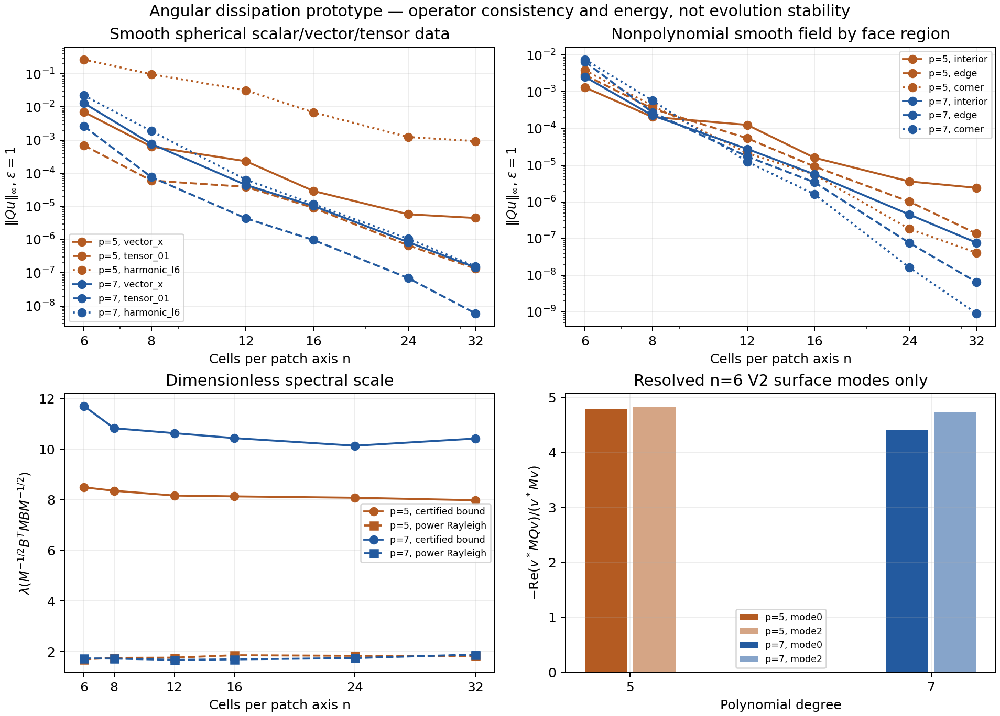

# Local angular dissipation operator study

Degree seven qualifies for a **controlled opt-in native candidate**, subject to
native closure/parity and coupled-operator testing. This package does not admit
a stable evolution, a positivity-preserving interpolant, or a completed 1D
reproduction. No production equations, remote files, or GPU jobs were changed.

All twelve local cases completed: degree five and seven at `n=6,8,12,16,24,32`.
The largest worker took 2.74 seconds; at most two workers ran concurrently.



## Definition and reproducibility

`prototype.py` exposes `geometry(n)`, `build_plan(n,degree)`, and
`Plan.apply_b`, `apply_bt`, `apply_q`. Inputs are point-major arrays, including
complex arrays and arrays with trailing field dimensions. The operator is

\[
Q=-\epsilon n M^{-1}B^T M B,\qquad h=1/n.
\]

`M` is the positive, exact solid angle of each native cubed-sphere angular cell
on the unit reference sphere. Its sum is `4*pi` to roundoff. These are fixed
compactified coordinate areas, not evolved-metric or physical scri areas.
`native_geometry.cpp` calls the existing `CompositeMesh::Geometry` and verifies
the Python coordinates, native face/k/j ordering, and midpoint area Jacobian at
every tested resolution. Coordinates and labels match exactly; midpoint area
differences are at floating-point roundoff. The exact cell areas are obtained
by the analytic spherical-rectangle integral, not midpoint quadrature.

Each row uses the nearest 48 (degree five) or 78 (degree seven) actual nodes,
including all distance ties. No owner-face query, reconstructed ghost, or
extrapolated metric value enters this operator. Stencils cross actual patch
edges and corners. A scaled tangent-plane Legendre basis reproduces all total
degree-five/seven polynomials (21/36 moments). SVD gives the minimum-norm
reconstruction coefficients. `B` is the center-value reconstruction residual.
It is evaluated through center-subtracted differences, preserving constants
exactly. The explicitly stored transpose uses the corrected zero-sum diagonal;
the two arithmetic paths agree as adjoints to roundoff, not bitwise.

The local center is included. In exact arithmetic the reconstruction vector is
an orthogonal-projector column; consequently each residual row has Euclidean
norm at most one and its coefficient one-norm is at most the square root of
its neighbor count. This does not prove coercivity on every nonconstant mode.

Run from the repository root with Python, NumPy and Matplotlib installed:

```sh
python3 docs/hyperbolic-shift-3d/reproduction/scri-dissipation-prototype-v1/prototype.py build-native \
  --build-dir build-hyperbolic-mpi --output /tmp/angular-native

python3 docs/hyperbolic-shift-3d/reproduction/scri-dissipation-prototype-v1/prototype.py study \
  --n 16 --degree 7 --native-library /tmp/angular-native/geometry.dylib \
  --output /tmp/angular-n16-p7

python3 docs/hyperbolic-shift-3d/reproduction/scri-dissipation-prototype-v1/analyze.py
```

The native extension is `.so` on Linux. The first command reuses existing local
CMake compile flags and Kokkos libraries; it does not change those builds.
Repeat the second command for both degrees and all six resolutions, using
fresh output directories. For n6 also pass
`--modes docs/hyperbolic-shift-3d/reproduction/scri-linear-audit-v1/cases/surface-n6-final/v2/local-modes.npz`
to reproduce the mode measurements used by the analysis. A newly generated
suite can be summarized with `analyze.py --input PATH_TO_SUITE --output NEW_OUTPUT`,
where its case directories are named `n6-p5`, `n6-p7`, etc.
Each worker enforces a 390-second internal budget.
The retained study used NumPy 2.3.5; plotting and dense independent checks used
NumPy 2.0.2 / Matplotlib 3.9.4. No SciPy is required.
The final command regenerates the summary, interval orders, dense n6 checks
and figure directly from the retained portable cases. Only the two small n6
plans are retained; larger plans are deterministic reconstructions.

## Energy, bounds and measured consistency

For the added operator alone,

\[
\frac{d}{dt}\frac12u^*Mu\bigg|_Q
=-\epsilon n(Bu)^*M(Bu)\le0.
\]

All cases preserve constants exactly. Random complex energy identities,
weighted adjoint checks and the two quarter-turn symmetries generating the
proper cube rotations agree to approximately `1e-14` or better. Dense n6
weighted matrices have minimum eigenvalues within `2e-16` of zero. Their
largest eigenvalues are 1.6965383 (degree five) and 1.7327580 (degree seven),
after removing the factor `epsilon*n`.

| Quantity across tested grids | Degree five | Degree seven |
|---|---:|---:|
| Neighbor count | 48–49 | 78–79 |
| Maximum incoming row count | 60 | 100 |
| Maximum residual-row coefficient one-norm | 2.927 | 3.437 |
| Maximum moment-system condition number | 110.9 | 753.0 |
| Maximum moment residual | 4.48e-15 | 6.56e-15 |
| Maximum support chord radius / h | 7.868 | 9.713 |
| Certified normalized spectral upper bound | 7.979–8.490 | 10.133–11.700 |
| Finite power Rayleigh estimate | 1.696–1.857 | 1.675–1.885 |
| Minimum max-norm order, n24→n32 | 0.901 | 6.103 |
| Minimum max-norm order, n16→n24 | 3.286 | 4.112 |

The mass ratio stays below 4.860; the reference-sphere area formula bounds it
by `3*sqrt(3)` for any uniform angular resolution. The spectral upper bound is
the maximum row sum of `abs(A).T @ abs(A)`, with `A=sqrt(M) B / sqrt(M)`.
It bounds the largest eigenvalue of `A.T @ A`. The 160-iteration power values
are Rayleigh lower estimates, not upper bounds or fully converged eigenvalues;
their residuals are retained in every report.

For RK4 acting on this operator alone, the bound requires
`dt * epsilon * n <= 2.7852935634 / bound`. Across this study, degree seven's
most restrictive sufficient value is 0.238055. This is not a timestep
admission for the coupled PDE or its boundary penalties.

Degree `d` moment annihilation gives `Bu=O(h^(d+1))` on a smooth surface field.
Bounded support/h, row and incoming counts, coefficients and area ratios then
give the conservative `Qu=O(h^d)` bound even without adjoint cancellations.
No `2*d+1` order is assumed. This study checks the required bounded quantities
over the reported resolutions; it does not establish uniform floating-point
conditioning at every future resolution.

The data include Cartesian components of spherical vectors and tracefree
tensors, harmonics through degree six, and a smooth nonpolynomial field.
All/interior/edge/corner errors and every adjacent-grid order are retained in
`orders.csv`; edge/corner bands are the first/last two angular rows. Degree
seven has the better finest-grid behavior. Its earlier interval minimum is
only 4.112, so the finite grids do not uniformly exhibit the formal seventh
order. Degree five has particularly uneven final vector/harmonic slopes;
the weak final-pair maxima are in face interiors, so this is not attributed
specifically to patch seams.
Spherical vector/tensor data are damped by a finite truncation term; this is
not an exact reduction to the 1D scheme or a symmetry-enforcing projection.

The native six-interior-node radial ghost lift amplifies a boundary-only
perturbation `e` by `1024/231` at the first ghost and `1024/33` at the second.
The resulting last-active fourth-order radial second difference is
`(256/77)*e/dr^2`, where `dr=.25/n`. Thus degree seven's formal `O(h^7)`
surface forcing leaves `O(h^5)` after this worst-case amplification; degree
five leaves only `O(h^3)`. This supports choosing degree seven for a first
surface-only candidate. Full mixed-jet bounds and the stability of the
coupled lifting remain unproved. A matching fixed-width collar can be tested
separately later.

## Resolved-mode measurement and limits

The independently resolved **frozen-volume V2 surface** modes are supplied by
the neighboring [linear audit](../scri-linear-audit-v1/README.md), at n6 with
all 19 complex field coordinates. At `epsilon=1`,

| Surface mode | Original growth eigenvalue | Added-Q energy damping Rayleigh, degree five | Degree seven |
|---|---:|---:|---:|
| 0 | 7.55694659 | 4.78829907 | 4.41494629 |
| 2 | 7.44348141 | 4.83144989 | 4.73032266 |

These are `-Re(v* M Q v)/(v* M v)`, measured in the fixed area-weighted
Frobenius coordinate norm. The factorized energy gives the same numbers.
They are **not eigenvalue shifts**. No full-coupled eigenmode is resolved, and
the existing full probe cannot establish stability of this modification.
Modes 1 and 3 are retained as measurements but are not labeled resolved.

Before native admission, add the filter only to independent surface fields;
recompute the null target and dependent D from the dissipative geometry rates
before ghost filling. Applying the filter after existing D closure is wrong.
The source must remain opt-in with a distinct scheme identity, and require
CPU/device parity, closure to roundoff, combined-operator/timestep checks,
Minkowski and puncture duration tests, and comparison against the original 1D
baseline. The semidefinite operator does not make signed metric interpolation
positivity-preserving: retain invalid-geometry rejection and separately
monitor donor and interpolated minimum eigenvalues.

Independent read-only review found no blocker for this standalone study. It
confirmed the mass formula, spectral bound and coefficient-projector identity.
The retained n6 diagonal/anchor representation discrepancy is at most
`3.33e-16`; a production factored transpose should scatter each off-center
term to its donor and subtract it at the row, preserving the same incidence
structure explicitly. This is a roundoff implementation refinement, not a
different differential operator.
