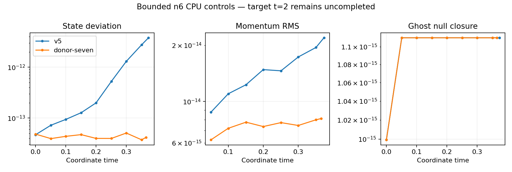

# Seven-node radial closure: bounded CPU evolution and native MPI implementation

The optional radial closure now has device kernels and a separate native MPI
target, `hyperbolic_shift_3d_mpi_donor_seven`. This package records **Serial
backend** checks; it establishes neither SYCL parity nor duration stability.
It follows the [CPU derivative/action control](../scri-donor-seven-cpu-v1/README.md).

The last three radial cell rows use six active centers plus the evolved scri
endpoint, including mixed derivatives and the full Cartesian chain rule.
The same plan supplies the sampled complete pole numerators. Surface jets and
their normal derivative use seven nodes. The bulk equations, angular operator,
4 N/h − 8 C/h penalties and independent Lambda/Theta evolution are unchanged.
Dependent D is reconstructed in the existing stage order. This is an explicit
candidate, not a default switch, SBP construction or stability proof.

## Bounded fresh Minkowski controls

Both n6 runs use dt=.008/6, target coordinate time 2, compensated RK4,
final algebraic projection, and a 325-second native / 350-second external bound.
Both stopped at their wall-time bound. Neither checkpoint is admitted and
neither result completes its requested duration.

| Closure | Reached coordinate time | State deviation | H RMS | M RMS | Ghost null residual |
|---|---:|---:|---:|---:|---:|
| V5 sampled normal | .3733333 | 3.8044e-12 | 2.1237e-14 | 2.1917e-14 | 1.1102e-15 |
| Seven-node radial | .3653333 | 4.1609e-14 | 1.9496e-14 | 8.1057e-15 | 1.1102e-15 |

These short near-roundoff trajectories warrant a longer test; they do not
show that the candidate removes the late instability. No growth exponent is
fit at these amplitudes. [comparison.json](duration/comparison.json) verifies
the original artifact hashes and finite saved arrays; the raw histories and
execution records are in [duration/raw](duration/raw). Full arrays and the
captured compilation tree remain under local `output/`, not in Git.

## Device, ownership and restart checks

The standalone device radial plan matches the CPU with maximum scaled error
zero over 36,673 field rows on Serial, including empty/noncontiguous ownership
and poisoned exterior radial ghosts. The coupled component also matches CPU
bulk RHS, sampled numerators and surface rates exactly for Minkowski and a
nonspherical smooth fixture. It simulates twelve ownership partitions in one
process; it is **not** twelve-process GPU execution. The old sampled-normal
component remains passing. [Logs](device/donor-component-v2.log) retain both
fixture results, nullness and dependent-D compatibility.

Actual local one- and two-rank MPI runs give bitwise-identical whole
checkpoints for four direct pulse steps and a two-plus-two restart, including
both compensation arrays. The rebuilt V5 control also matches its preserved
pre-change checkpoint bitwise. Cross-scheme, altered-configuration, truncated
and unadmitted restarts are rejected. See [verification.json](mpi/verification.json).
These are four-step ownership/restart tests, not puncture stability tests.

V6 checkpoints have a 104-byte header and exact normal tuple `(2,7,4,3)`:
scheme 2, seven radial nodes, bulk order 4, three radial closure rows. V5
retains `(1,6,4,0)` and its original magic. Readers and the Aurora controller
require the distinct V6 scheme and row metadata. The controller's 82 offline
tests pass, including V6 admission, payload/metadata and component parsing
checks. Actual Serial component output is explicitly rejected as GPU
admission. [source-files.json](source-files.json) records the native source
identities; [inventory.json](inventory.json) binds the copied raw records.

Remaining work: actual SYCL parity and twelve-rank restart preflight, longer
Minkowski evolution, isotropic puncture stability and matched 1D diagnostics.
No convergence, 100 M, production AMR or nonspherical evolution claim follows
from this package.
