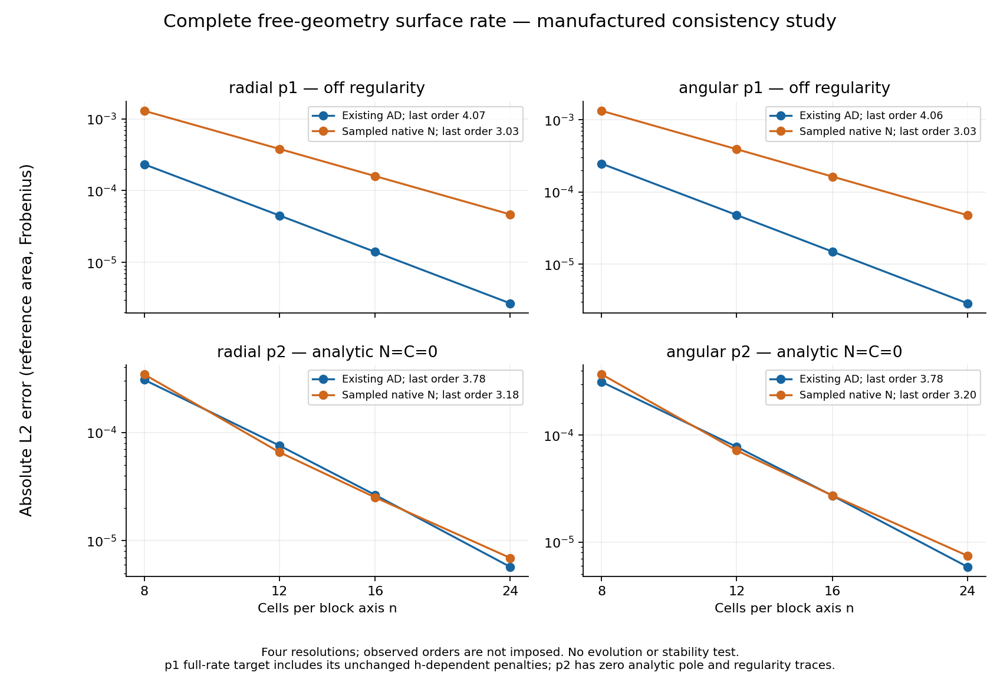
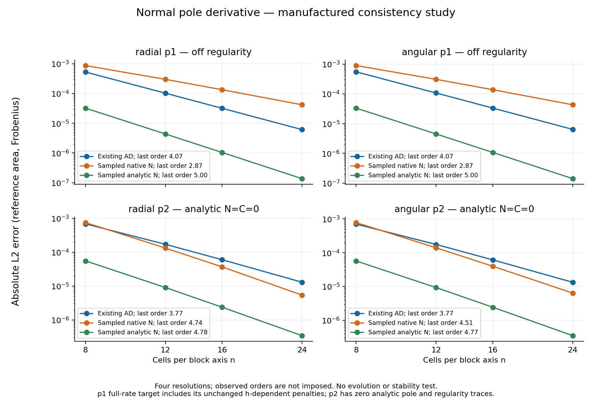

# Manufactured accuracy of the optional sampled-numerator closure

The optional CPU closure is consistent on these four smooth fixtures, but its
**complete free-geometry surface rate shows roughly third-order convergence**
over this resolution range. The existing AD closure is closer to fourth order.
This is an accuracy study, not an evolution or stability result; it supplies no
Minkowski-duration, puncture, AMR, GPU or scientific-restart admission.



All runs used one exact CPU binary and native-header snapshot, n=8/12/16/24,
one process and one native worker, with a 390-second external ceiling per run.
The four completed worker times were 2.77, 4.15, 6.34 and 13.36 seconds.
No fields were advanced in time. Errors below are absolute; only the reference
solid-angle measure is normalized, never the analytic rate magnitude.

| Fixture | AD full-rate L2 at n24 | Sampled full-rate L2 at n24 | AD order, 16→24 | Sampled order, 16→24 |
|---|---:|---:|---:|---:|
| Radial p1 | 2.6827e-6 | 4.6669e-5 | 4.072 | 3.033 |
| Angular p1 | 2.8782e-6 | 4.7786e-5 | 4.062 | 3.033 |
| Radial p2 | 5.7202e-6 | 6.9230e-6 | 3.777 | 3.177 |
| Angular p2 | 5.8706e-6 | 7.4577e-6 | 3.776 | 3.198 |

These are pairwise observed orders, not a proven asymptotic order. The sampled
full-rate p2 orders vary appreciably: 4.08→3.35→3.18 for radial, and
4.04→3.37→3.20 for angular. Its last-pair maximum-component orders are lower,
2.87 and 2.73 respectively. The full tables, component groups and seam/interior
norms are retained in [results](results/); [summary.json](summary.json) retains
every global norm and pairwise order. The global norm is primary. The seam
region comprises two angular cells next to each face edge and shrinks with h;
it is not a fixed physical region.

## Fixtures and independent checks

With s=r², the radial amplitude is
`F=(1-s)^p sin(2.3*s+.37)`, for p=1 and p=2. The angular variant multiplies F by
`1+.25*sin(1.3*x+.7*y-.9*z)`, a smooth global Cartesian function across seams.
The manufactured native fields are

```
chi = 1 + .0125 F                 P = -3 + .02 F
g = diag(exp(.0125 F), exp(-.0125 F), 1)
Axx = .01 gxx F                   Ayy = -.01 gyy F
Theta = -.007 F                   Lambda_i = .008 x_i F
alpha = (1+s)/2                   beta = -x
B = D = J = 0.
```

All other metric/A components vanish. Lambda is independent; it is never
reset to the contracted connection. The amplitude termed “radial” has radial
F but a fixed Cartesian tensor polarization, so its full metric is not a
spherically symmetric perturbation. Both powers satisfy the exact prescribed
boundary values, det(g)=1 and tr_g(A)=0. For p2 the first derivatives also
vanish at scri: the native analytic pole and regularity traces are zero to
roundoff. These profiles are not claimed to solve the interior PDE or its
constraints. The p1 profiles are off regularity; their complete-rate target
explicitly retains the unchanged h-dependent `4N/h-8C/h` terms. Absolute
errors avoid artificial improvement from dividing by that growing target.

Analytic Cartesian first and second jets are constructed by explicit product
and chain rules. Independent checks across the completed runs include:

- First/diagonal-second/mixed-second finite-difference jet errors at most
  1.39e-9, 2.93e-8 and 6.14e-9 respectively.
- Native post-damping pole algebra agrees with `TensorPoleSources` within
  1.77e-15; analytic AD normal derivatives agree with an independent five-point
  sampled-pole derivative within 1.72e-11.
- Six-node derivative polynomial moments through degree five have residual
  at most 4.27e-14, and the endpoint diagonal matches 1126/315 within 4.45e-16.
- Boundary null residual remains below 1e-15. Volume determinant and A-trace
  errors are at most 2.23e-16 and 2.61e-18.
- Every p2 run checks native exact pole and regularity maxima below 2e-12;
  the observed values are at roundoff, not set to zero by the test.

## What is compared



The analytic reference is `+d_n N` from exact jets at the actual surface rows.
The existing AD path uses native six-node endpoint jets. The optional path
calls the production CPU `SampledPoleNormalDerivative` helper: five actual
half-cell donors plus the endpoint, current geometric ghosts, native volume
first jets, actual interior Omega and the same post-damping native numerator.
There is no Omega floor, regularity reset or modified coefficient.

The “sampled analytic N” control evaluates exact analytic numerators at those
same six nodes and applies the same derivative weights. It approaches fifth
order (last-pair orders 5.00 for p1 and 4.77–4.78 for p2). The sampled-native
minus sampled-analytic error is separately retained. Together these controls
distinguish the polynomial formula from the numerical jet/ghost contribution;
they are compatible with differentiation exposing a lower-order error where
interior and endpoint first-jet formulas differ. They do not establish a
universal leading-error formula from four resolutions.

The complete free-geometry reference is `R-d_nN+4N/h-8C/h`, evaluated with
analytic jets and the actual h. The AD result is the native `BoundaryRates`.
The sampled result replaces only its normal term: `old + AD_normal - sampled`.
Thus regular terms and all weak penalties remain unchanged. The manufactured
surface values are constant Minkowski values, so the optional angular Q is
exactly zero; this study does not test nonzero Q accuracy. Dependent D and bulk
rates are outside this complete-*free-geometry* comparison. Ordering and
default-off equivalence are tested separately by the native closure tests.

## Reproduction and provenance

Run the portable evidence checks and regenerate figures from small data:

```sh
python3 docs/hyperbolic-shift-3d/reproduction/scri-sampled-accuracy-v1/verify.py
python3 docs/hyperbolic-shift-3d/reproduction/scri-sampled-accuracy-v1/plot.py
```

For a fresh bounded CPU replay, use the matching checkout and a configured
Serial Kokkos build (the recorded build uses `build-hyperbolic-mpi`), then:

```sh
python3 tst/hyperbolic_shift_3d/scri_sampled_accuracy.py build \
  --build-dir build-hyperbolic-mpi --output /tmp/scri-accuracy-build
python3 tst/hyperbolic_shift_3d/scri_sampled_accuracy.py run \
  --binary /tmp/scri-accuracy-build/scri_sampled_accuracy --n 8 \
  --output /tmp/scri-accuracy-n8
```

Run n12, n16 and n24 sequentially with distinct new directories after n8
passes. The driver refuses unsupported n, timeouts above 390 seconds, hash
mismatches and existing output directories. Its `summary` command accepts
repeated `--run` directories and a new `--output` file. Matplotlib is needed
only to regenerate plots; the C++ run and result summarization do not require
NumPy. A CMake executable-only target is also available as
`hyperbolic_shift_3d_scri_sampled_accuracy`; it is not an automatic resolution
campaign.

[compile-evidence](compile-evidence/) preserves the exact harness/driver,
modified native header, compile command and source hashes. Thirty-nine other
native headers match Git commit `d98e2a99bbf1d5546956be3d724c82715ca704ec`, as
recorded in [frozen-header-bindings.json](frozen-header-bindings.json). The
reported HEAD alone does not reproduce the then-uncommitted optional header;
use its retained bytes. An exact replay requires those source versions and
the recorded numerical build settings; later production changes must not be
mistaken for the tested implementation. Binary hash:
`efaf4ed9842ac4b0d98c584e02016dc673aea5b257e1fd76a8e1b23e76dfceb3`.

The first n8 attempt stopped at the finite-value guard because the new
manufactured lambda fixture left a coordinate jet partially uninitialized.
It produced no scientific report. Its [failure receipt and source](initial-harness-failure/)
are retained. Initializing that fixture's coordinate jet corrected the test;
all reported results use the distinct build-v3 binary above. No native
production equation changed in response to that harness failure.
