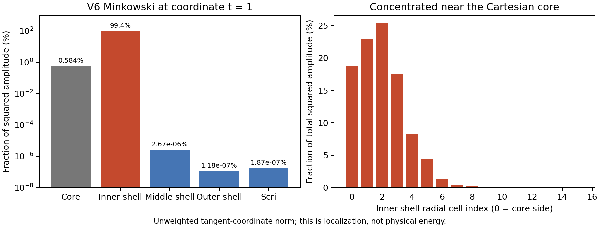

# V6's remaining disturbance is concentrated at the inner-shell interfaces

The actual Aurora V6 Minkowski t=1 checkpoint has **99.4162%** of its squared
tracefree tangent-coordinate amplitude in the innermost shell, **0.5838%** in
the Cartesian core, and only **1.8656e-9** of the total on scri. The innermost
two angular rows along shell-face edges contain **96.9187%** of the total.
Lambda and D account for **99.8037%** of the total. These are unweighted
coordinate norms, not a physical energy or constraint norm.

This is a different dominant disturbance from the earlier outer-boundary
curvature mode. Direct differentiation of the complete native RHS along the
observed V6 direction gives projected rate18.3747 but shape residual.99946:
it is emphatically **not a real eigenvector**. Its action is nearly identical
under V5 and V6 boundary operators. The new radial closure did not merely
reduce the same old mode's growth rate; a different interior disturbance is
now dominant. The time-history growth16.6 remains a descriptive estimate.

The plane spanned by this direction and its RHS has projected pair
**16.3354 ± 554.6811 i**, consistent with an oscillating growing disturbance.
The second-column residual is6.91%, so these are **projected values, not
verified eigenvalues**. Changing finite-difference amplitude from1e-5 to1e-6
changes the real part by1.1e-6. The first-column residual is zero by construction
and provides no independent accuracy evidence.

## Controlled interpolation comparison

An optional selector in the read-only diagnostic adapter disables physical-radius
halo donor chains using the already-existing logical-coordinate interpolation.
It retains V6's endpoint, radial closure, equations, damping, dissipation and
independent fields. No evolution executable exposes this selector, and no
production policy or existing run was changed. Surface/radial sampling plans
retain their original construction; this control changes `grid` halo rows.

On the **same V6 two-vector plane**, this change gives projected pair
**−18.5946 ± 575.2487 i**, with relative column residuals10.90% and12.54%.
The full action on the first direction changes by13.47%. Both perturbation
sizes agree. This supports an interpolation contribution to the observed
instability, but does not prove stability of logical interpolation or rule
out other unstable modes. It does not authorize restarting the failed or
bounded evolution from a saved checkpoint.

The current physical-radius interpolation follows donor lines at fixed
angular coordinates. In the cube-to-sphere transition layer, each line's
inner radius varies with angle. Near the cube corners, sampling all lines
at the same radius can require extrapolation across a line's inner end.
Logical-coordinate interpolation avoids that particular extrapolation.
This is a code-based mechanism to investigate, not yet a proven complete
cause. A candidate should target this region while retaining the previously
validated coupling across spherical radial seams. Fresh evolution and
accuracy controls remain necessary before adopting it.

## Targeted inner-transition control

The second diagnostic selector uses logical-coordinate interpolation only in
transition-layer regions whose centered radial donor stencil does not cross
the outer spherical seam. Other layers and the spherical radial seam retain
the physical-radius chains. The existing evolution default remains unchanged.
On the same two-vector plane it gives **−18.59465 ± 575.24865 i**, essentially
the same directional improvement as the unrestricted logical-halo control.
Eight additional full-array actions retain bitwise V6 agreement.

A separate n8/n16/n24 smooth-wave interpolation check gives RMS errors on
changed halo rows **7.8107e-4, 7.2707e-6, 4.4644e-7**. Constants are preserved
to3.60e-14. Every outer-layer and exterior-scri row is bitwise unchanged;
resetting the selector restores every original halo row bitwise. These are
interpolation checks, not evolution convergence. The largest donor-row
absolute weight sum rises from about421–441 to1029.68, so the control is **not
an interpolation contraction**. Negative growth on this particular plane does
not establish a global energy estimate or remove the need for fresh stability
tests. No timestep or evolved variable is reset by either diagnostic.

The candidate setter lives in `CompositeDifference` with defaultfalse. Only
the read-only adapter selects it. `hybrid-build/source-tree` retains its exact
two-file prototype delta, and `interpolation-check` retains the standalone
C++ test's command, hashes and results. It is not yet wired to device/MPI
evolution or a new checkpoint schema.

## Verification and reproduction

All diagnostics independently decode the hash-bound V6 checkpoint from
[Aurora job8984226](../aurora/stability-donor-seven-minkowski-v1/README.md).
The source/library snapshots and checkpoint schema are checked before use.
Six full-array evaluations match the previous frozen V6 CPU library bitwise;
the new interface selector separately preserves V6 on eight full-array
evaluations. The full-RHS direction, localization/plane and interpolation
control take36.96s,15.22s and47.78s respectively, each single-process with a
385s external bound. They are diagnostics, not time evolutions.

`source-audit.json` verifies all captured source hashes against their recorded
Git commits. The sole interface-build difference is the retained adapter
`interface-build/scri_candidate_probe.cpp`. No binary or full checkpoint is
included here. Small execution records, action results and exact source/build
manifests are retained. The raw local outputs are respectively
`output/hyperbolic-core-shell/scri-v6-{direction,localization,interface-control}-v1`.

Run `tst/hyperbolic_shift_3d/scri_v6_direction.py`,
`scri_v6_localization.py`, and `scri_v6_interface_control.py` with `--help`
for explicit library, checkpoint and fresh-output arguments. The complete
commands are in each `execution.json`. The first two use the preserved
`.../scri-v6-direction-build-v1/candidate.dylib`; the interface control uses
`.../scri-v6-interface-build-v1/candidate.dylib` and checks against the former.
`python3 plot.py` reproduces the figure from the retained localization JSON.
