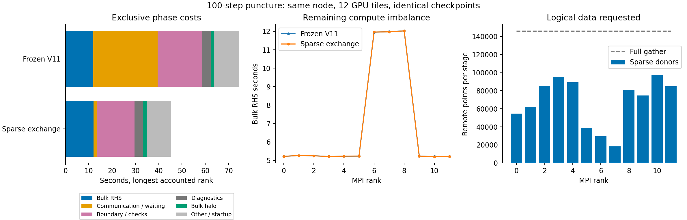

# Persistent sparse stage exchange

Experimental target `hyperbolic_shift_3d_mpi_continuous_positive_sparse` adds a
persistent sparse volume exchange to the boundary-reuse V11 implementation.
The default V11 and boundary-reuse targets remain reproducible controls.
No physical equations, interpolation arithmetic, RK coefficients, positivity
policy, null closure, or checkpoint format are changed.

## Construction versus application

The existing mesh constructors already cache interpolation locations, tensor
product weights, derivative maps, and reference geometry. Halo application is
a batched device kernel, not one launch per interpolated cell. State-dependent
scri geometry and null relations are still recomputed. Moving horizon sampling
locations are not treated as fixed mesh data.

The new exchange plan unions bulk halo/KO, sampled-normal, and owned scri
sampling dependencies. Whole owned blocks are included for existing diagnostic
and moving-horizon sampling. Construction exchanges donor requests once, then
retains device indices, device value buffers, and MPI counts/displacements.
Each stage packs all outgoing values, exchanges only requested remote values,
and unpacks in bulk. Current owned values are copied into the existing globally
indexed workspace. The workspace still occupies full global size; this change
reduces transfer, not its allocation. Whole-block dependencies are conservative
and may need further narrowing after profiling.

Full checkpoints and failed-stage captures explicitly gather owned values; a
partial sparse workspace must never be dumped as a global snapshot. Output
therefore retains full-state exchange. Surface communication is unchanged from
the boundary-reuse target. Communication is currently synchronous; computation
and communication overlap and measured-cost partitioning remain follow-up work.

The mesh owner must advance `MeshPlanEpoch` before changing topology, geometry,
or rank ownership, and rebuild the plan collectively. Mismatched or stale keys
are rejected collectively, including a mismatch on only one rank. Rejected
rebuilds invalidate the old plan. This is a tested lifecycle contract for the
fixed-mesh runner, **not implemented AMR evolution or field transfer**.

## Reproduction and scope

Build the sparse evolution target and `hyperbolic_shift_3d_sparse_exchange`.
The latter runs with MPI and checks exact donor values, duplicate and empty
request lists, poisoned unrequested entries, changed mesh size/geometry/cuts,
one-rank stale keys, inconsistent ownership, and alias rejection. It accepts
`--report PATH` for a machine-readable rank-zero result.

`tst/hyperbolic_shift_3d/test_sparse_stage_mpi.py` accepts `--binary`, `--control`,
`--mpiexec`, `--initial`, and a fresh `--output-dir`. The control is the frozen
boundary-reuse binary; the initial data is the existing n16 puncture file. It
compares entire pulse, Minkowski, puncture, and restarted checkpoints byte for
byte, with all unrequested sparse entries poisoned as NaNs. An intentionally
nonphysical finite interior curvature perturbation exercises RK rejection,
rollback, and full failed-stage capture. It is not a stability experiment.

Local evidence is in `local/`. These are short correctness tests, not evidence
of a GPU speedup, long-time trumpet accuracy, or convergence. The previous 3M
run's rejected late horizon samples and unresolved constraint accuracy remain
unchanged. The same-node GPU comparison is now independently verified below.

## Report fields

- `sparse_exchange_by_rank`: pack/precheck seconds, MPI/wait seconds, unpack
  seconds, outgoing donor points (including copies requested by multiple ranks),
  incoming donor points, applications, successful builds.
- `mesh_plan_setup_seconds_by_rank`: mesh/host plans and ownership; bulk device
  plan; bulk halo plan; surface plans; normal plans; angular device plan; sparse
  communication plan; buffers and reference/floor storage. These are startup
  measurements and not added again to exclusive evolution phase timers.
- `volume_exchange`: `cached_sparse_alltoallv` or the control's `full_allgatherv`.
- `sparse_poison_unused`: debug poisoning enabled through
  `HYPERBOLIC_SPARSE_POISON=1`; off for production timing.

MPI timings include waiting for other ranks. Neither these timings nor startup
costs alone identify transfer bandwidth or load imbalance. The requested goal
of RHS-dominated execution remains open.

## Verified Aurora comparison

Job 8987177 passed ten cases and all 409 independently replayed checks. The
100-step n16 puncture run decreased from **74.504 s to 45.435 s** including
startup, with **identical full checkpoints**. After the initial diagnostic,
seconds/step decreased from **0.63006 to 0.32860** (1.92x speedup; includes the
final diagnostic). This is one same-node pair against the frozen uncached V11
executable; both sparse exchange and boundary reuse are enabled in the candidate.
It is not a replicated statistical comparison or a fast-only isolation test.

Logical requested remote values decreased by **53.66%**. On the respective
longest-accounted ranks, recorded communication/waiting fell from 27.56 s to
1.44 s while bulk RHS stayed near 12.0 s. These communication timers include
waiting but exclude some standalone synchronization calls. Sparse-plan setup
was performed once per rank; its measured time includes waiting for other ranks
to finish earlier startup phases. No per-stage stencil reconstruction occurs.

Bulk RHS accounts for 26.5% of native wall time on the longest-accounted rank,
and its slowest/fastest rank ratio remains 2.31. Measured fixed ownership is the
next candidate; boundary work and synchronization need finer attribution before
claiming that RHS dominates. Remaining scientific limitations are unchanged.

The raw small evidence, immutable build receipts, reviewed plan, and independent
verifier are under `../aurora/preflight-sparse-stage-v1/`. Whole checkpoints are
archived locally with verified checksums; redundant remote copies are purged
only after verification. The archive hash is recorded in the cleanup receipt.
