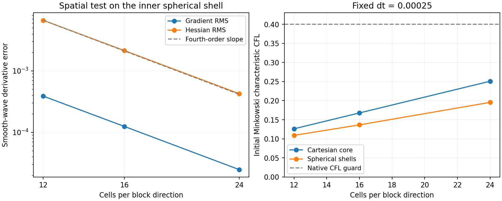

# Spherical inner boundary with an overlapping Cartesian core (V10)

Experimental fixed mesh: Cartesian half-width 0.18 (previously 0.125), eight
Cartesian blocks, six spherical faces in each annulus [0.16,0.45], [0.45,0.75],
and [0.75,1]. Face angles use equiangular tangent coordinates. All fields remain
Cartesian components; the finite differences use the complete inverse-map
Jacobian and Hessian. This is a new candidate, not an established stability fix.

The core has three extra evolved cells on each side of every leaf. The innermost
shell has three extra angular and outward radial cells; its spherical inner
boundary couples directly through geometric overlap. Three interpolation ghosts
lie beyond the evolved region. Aligned donor nodes are copied exactly; other
axes require complete centered six-node active stencils. There is no inner
extrapolation fallback. Core and shell values in the overlap evolve independently.

Constraint quadrature uses a quintic radial partition of unity from r=0.16 to
r=0.18 on nominal cells; extra evolved cells have zero diagnostic weight.
Positivity, finite-state and maximum-error checks include all evolved cells.
This avoids double counting, but midpoint quadrature still has finite resolution
error; the measured total sphere-volume errors are recorded with the results.
The physical volumes used by KO are not partition weighted.

Angular scri areas use the actual equiangular cell boundaries. The existing
moving-normal null closure and dependent auxiliary reconstruction are retained.
No lapse floor, Lambda reset or enforced spherical symmetry is introduced.
The continuum equations and gauge coefficients are unchanged.

## Local checks

- All inner ghosts have eligible active donors at n12,16,24. Maximum absolute
  weight sum is below 2.69; constant error is below 2.5e-15.
- Analytic inverse/Jacobian/Hessian checks pass. Smooth-wave gradient and Hessian
  errors decrease at approximately fourth order. At n16 the transition-shell
  maximum Hessian error is 0.006736, versus 0.01399 for the previous overlap map.
  This compares spatial operators on different meshes, not evolution convergence.
- At n16 and dt=0.00025, characteristic CFL is 0.167835 in the core and at most
  0.136583 in the shells. The core sets the limit. A proposed dt=0.0005 remains
  below the native 0.4 guard initially; evolving characteristics must still pass.
- Full local CPU/Serial device parity is exact for Minkowski and nonspherical
  fields, including twelve-way ownership, poisoned exterior ghosts and independent
  D. Null errors are below 1.12e-15.
- Two-step pulse checkpoints agree bitwise across one/two MPI ranks and restart.
  Four corrupted topology descriptors, two corrupted radii and cross-schema
  restart attempts are rejected. 97 controller/preflight tests pass.

At n16 there are 106496 nominal and 189512 evolved cells. V10 checkpoints have
136 header bytes: mesh identity (3,2,3,3) followed by float64 (0.18,0.16). The
schema fixes equiangular shells and the diagnostic partition; other geometry
must receive a new identity. The preflight decoder understands V10; the general
Python checkpoint exporter still deliberately rejects this schema.

Build targets: hyperbolic_shift_3d_spherical_overlap_geometry,
hyperbolic_shift_3d_spherical_overlap_device,
hyperbolic_shift_3d_mpi_spherical_overlap. Geometry CLI accepts n, the retained
unused overlap argument 3, and optional coordinate CSV output. Generate puncture
input with initial_data.py on that CSV. test_spherical_overlap_mpi.py records
bounded commands and hashes. Raw local evidence is in
output/hyperbolic-core-shell/spherical-overlap-local-v1.

Two-step n16 native evolutions at dt=0.0005 pass: Minkowski CFL 0.33567,
puncture CFL 0.31116, with null closure below 1.12e-15. The puncture horizon
is found at both samples (t=0 and 0.001). These do not establish duration stability.
The source was committed as 77277bd25 and built on Aurora with SYCL/MPI
(make -j64, 269 seconds). An independent read-only audit verified all 2643
source-file hashes against Git and the build configuration/binary identities.
GPU preflight job 8985881 has been submitted on one debug node, 12 ranks/tiles,
CompactBinaryMerger. GPU qualification and duration tests remain pending. No wormhole-to-trumpet stability,
100M result, dynamic AMR validation or evolution convergence is claimed.

