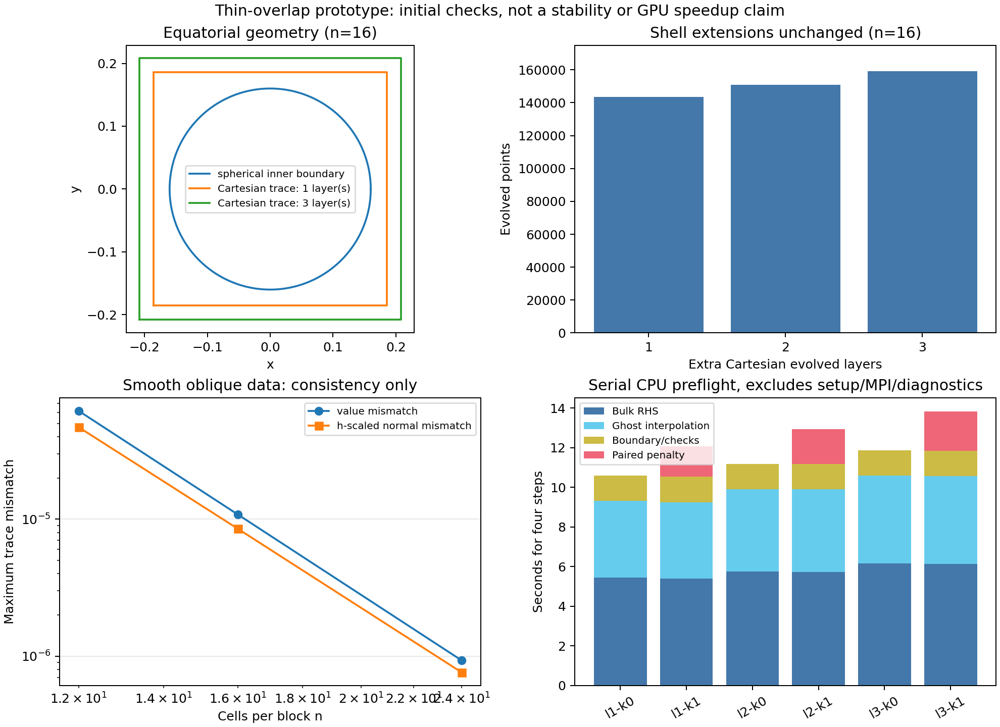
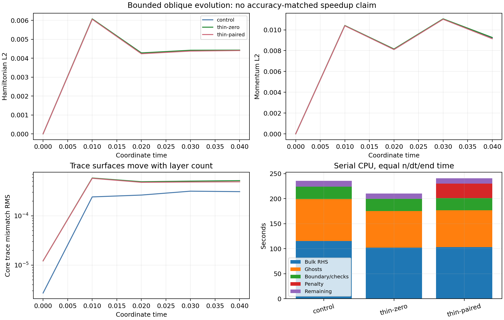
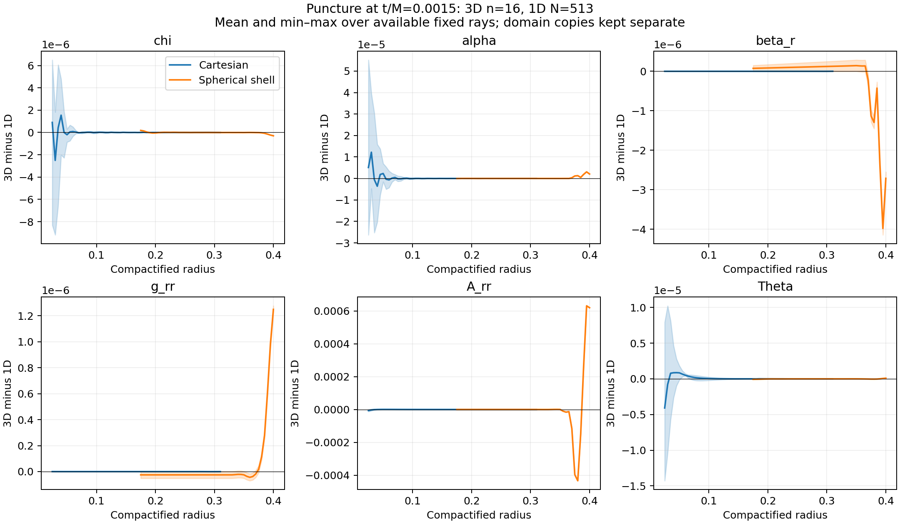
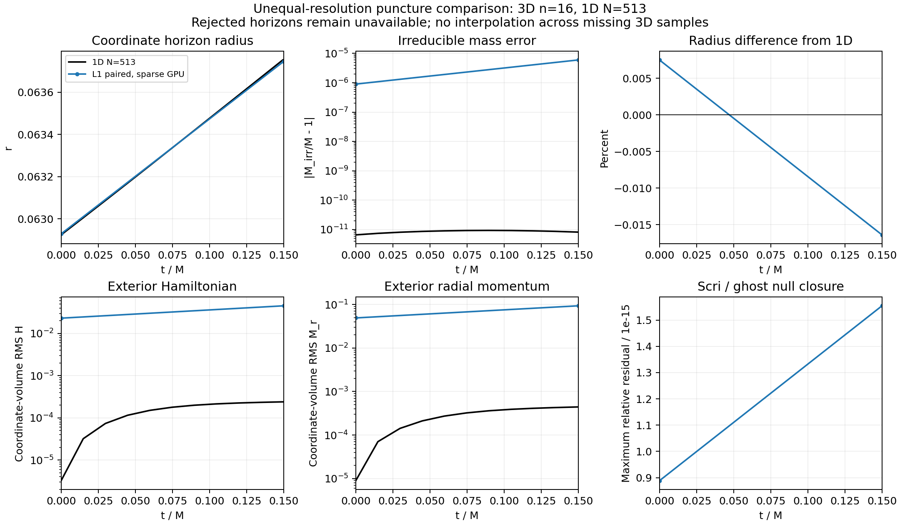
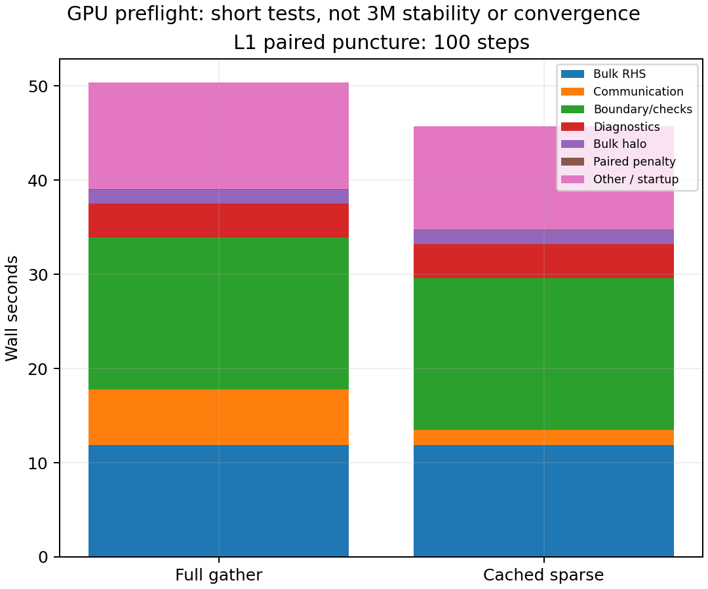
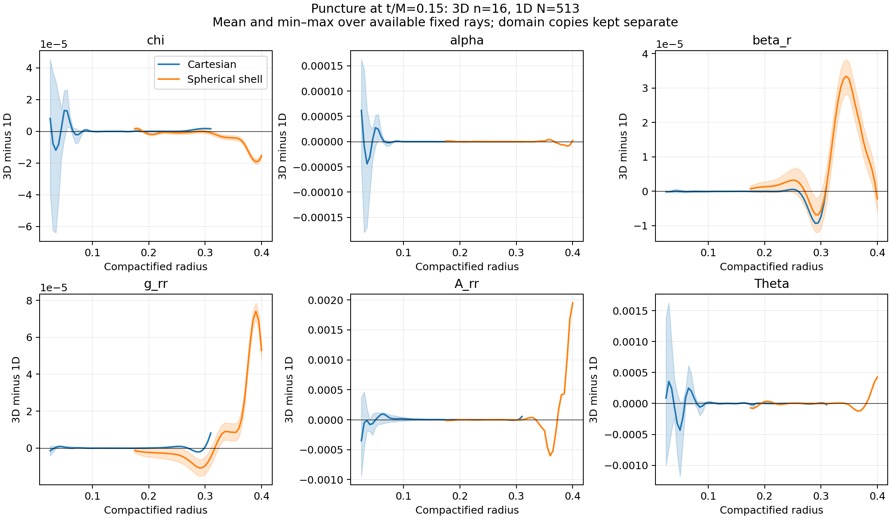

# Thin-overlap prototype: preliminary evidence

Experimental branch `codex/hyperbolic-thin-overlap`, based on
`e48a8c43f` of `codex/hyperbolic-core-shell`. The V11 default remains a control.
See [design and derivation](DESIGN.md) and the [user specification](request.txt).

Implemented: separate Cartesian extension count; an explicit shifted
six-point donor fallback; paired weighted-adjoint penalties on common value
and normal-derivative traces; batched cached device application; two-interface
diagnostics; an isolated penalty timestep bound; and configuration-bound V12
restart. The volume remains cell centered, avoiding a new puncture node at
r=0. Spherical shells remain spherical. Actual VC MeshBoundaryValues classes
are inspected infrastructure, not wholesale dependencies of this prototype.

## Preliminary results

| Check | Result |
|---|---|
| Centered donors, n12, one/two layers | Rejected: missing donor coverage |
| Centered donors, n16, one layer | Rejected: missing donor coverage |
| Centered donors, n16, two/three layers | Construct successfully |
| Explicit shifted donors, one layer, n12/16/24 | Construct successfully, no outside-hull extrapolation |
| Positive-weight penalty energy identity | Relative discrepancy <2e-15 in tested random data |
| Constant trace mismatch | <1.2e-14 |
| CPU/device physical penalty RHS | Maximum difference 5.42e-19 |
| Partitioned trace norms | Equal to whole-domain norms in the fixture |
| Minkowski, 1/2/3 layers, kappa=0/1 | Four steps preserve state to 3.94e-15, no floor interventions |
| Three layers, zero penalty, shifted donors off | V11 checkpoint payload bitwise identical |
| Nonspherical short evolution | One/two ranks and restarted checkpoint bitwise identical |
| Restart with different penalty strength | Rejected |

At n16 the one-layer configuration has 143,632 evolved points, compared with
159,200 for the control: 9.78% fewer. Shell angular and radial extensions are
unchanged. This is not elimination of geometric overlap, nor an accuracy-
matched speedup. The initial serial CPU measurements show additional penalty
work; no GPU speedup is established.



The smooth-data plot measures interpolation consistency only. These short
Minkowski/oblique tests are not interface-crossing, long-time stability,
puncture, or convergence qualification. The `3M` result in the neighboring
V11 report belongs to the preserved control, not this variant. No horizon
acceptance tolerance has changed.

Reproducible local preflight:

```sh
cmake -S . -B build-thin-overlap -DCMAKE_BUILD_TYPE=Release \
  -DAthena_ENABLE_MPI=ON -DAthena_ENABLE_HYPERBOLIC_SHIFT_3D_TESTS=ON
cmake --build build-thin-overlap --target \
  hyperbolic_shift_3d_paired_trace hyperbolic_shift_3d_paired_trace_device \
  hyperbolic_shift_3d_mpi_thin_trace hyperbolic_shift_3d_mpi_continuous_positive_fast -j2
build-thin-overlap/tst/hyperbolic_shift_3d/hyperbolic_shift_3d_paired_trace 16 1 1
build-thin-overlap/tst/hyperbolic_shift_3d/hyperbolic_shift_3d_paired_trace_device
python3 tst/hyperbolic_shift_3d/test_thin_trace_mpi.py \
  --binary build-thin-overlap/tst/hyperbolic_shift_3d/hyperbolic_shift_3d_mpi_thin_trace \
  --control build-thin-overlap/tst/hyperbolic_shift_3d/hyperbolic_shift_3d_mpi_continuous_positive_fast \
  --mpiexec /path/to/mpiexec --output /fresh/output/directory
```

Runtime variables, only for the experimental target:
`HYPERBOLIC_TRACE_LAYERS` (1..3, default 1),
`HYPERBOLIC_TRACE_SHIFTED` (0/1, default 1),
`HYPERBOLIC_TRACE_KAPPA` (nonnegative, default 0), and
`HYPERBOLIC_TRACE_NORMAL_RATIO` (nonnegative, default .25).
The extra `oblique` initial condition is a compact off-center lapse pulse;
its continuous evolution is not an exact analytic solution.

## Bounded oblique probe and sparse integration

The prototype source is `b9685c413`; the following longer probe uses the same
frozen executable as the first preflight. All three cases completed 80 steps
to coordinate t=.04 with dt=.0005, n12, and identical diagnostics:

| Variant | Native seconds | H L2 at .04 | M L2 at .04 |
|---|---:|---:|---:|
| Three-layer control | 235.91 | .00442054 | .00922456 |
| One layer, zero penalty | 210.38 | .00442873 | .00926886 |
| One layer, kappa=1, eta=.25 | 240.82 | .00440651 | .00914741 |

All retained null errors <=1.12e-15 and used zero lapse-floor interventions.
The added penalty used 28.73 seconds. Its small constraint reduction has not
shown enough benefit to offset that cost on this short CPU case. These are
exploratory local timings with other local work present, not a dedicated GPU
benchmark. The pulse is off-center and evolves through the interface region;
reflected characteristic amplitudes and independent time/space convergence
remain unmeasured. The three-layer result is a coarse control, not truth.



`oblique-probe/comparison.json` also records volume-weighted lapse, chi,
radial-shift and tangential-shift differences on common nominal sample
coordinates. The diagnostic partition and cutoff are the same. Trace mismatch
plots have different physical Cartesian trace locations as layer count changes;
their absolute values are not a common-location error comparison.

The separately committed sparse work `fd522df9248c4911c9352057156b3ec58e7dc02b`
is integrated through a distinct `hyperbolic_shift_3d_mpi_thin_trace_sparse`
target. Its dependency union includes trace interpolation AND adjoint-lift
support, in addition to bulk, sampled-normal, scri and diagnostic dependencies.
Poisoned two-rank oblique, restart and short puncture runs reproduce complete
non-sparse checkpoint bytes. The puncture fixture reaches only .0015M, not 3M.
Its initial data agree exactly with all 143,632 corresponding V11 samples.

The Aurora controller now binds each thin geometry/penalty configuration and
whitelists per-case environment variables. It rejects stale V11 or changed
V12 admission parameters. Worker tests were updated for the new explicit
environment argument; the initial mock-signature failure is retained beside
the repaired controller tests. All 106 controller/preflight tests subsequently
passed. No physical acceptance threshold was changed.
No GPU job has been submitted from this experimental fork yet.

## Remaining gates

1. Longer oblique and spherical interface probes, reflection/error diagnostics
   and independent timestep refinement. Preserve failed cases.
2. Qualify the integrated sparse trace target on all 12 GPU ranks; local
   poisoned two-rank trajectory equivalence has passed.
3. Fresh frozen SYCL+MPI source/build and a 12-tile, single-debug-node preflight,
   sharing the existing campaign allocation/storage guards.
4. Isotropic puncture through at least 3M, with matching 1D norm conventions
   and accepted horizons only. The n16 thin initial data have been generated,
   with provenance retained; a two-step equivalence fixture passed, but no
   successful duration test is claimed.
5. Comparable-accuracy performance and convergence comparison; AMR evolution
   remains a separate unresolved infrastructure limitation.

Recommendation pending these gates: retain V11 as the control. One-layer
coupling is a viable bounded experiment only with an explicit donor policy;
its construction and dissipative added term alone do not justify adoption.

### GPU qualification preparation

`aurora/thin_plan.py` generates a separately bound 12-tile preflight for the
V12 variant. It checks paired-lift CPU/device parity on each tile, short
Minkowski preservation for Cartesian layers 1/2/3 and kappa 0/1, an oblique
full-gather versus poisoned sparse restart comparison, and a 100-step puncture
comparison through 0.15 M. The V12 checkpoint auditor verifies the 184-byte
header, point count, log-variable configuration, and exact trace parameters;
it rejects geometry or penalty mismatches before accepting equivalence.
This plan is preparation, not GPU evidence until a completed collected run
is recorded below. It does not qualify the requested 3 M puncture evolution.

```sh
python3 tst/hyperbolic_shift_3d/aurora/thin_plan.py --output plan.json
```

The proposed frozen source/build names are `source-thin-v1` and
`build-sycl-mpi-thin-v1`, separate from the ongoing control/performance work.

The frozen Aurora build at source commit
`c530acdac932d1925f7c76810deec88280511b4d` succeeded with SYCL+MPI,
Intel compiler 2025.3.2, and `make -j64` in 309.48 seconds. Source manifest
SHA256 is `e8a3d5c2839797c60c32874e930eca2631beaac4f414f22e5e098502cb54b8ac`.
The 108 local controller/auditor tests passed; the independent V12 decoder
also verified all 9,000,416 doubles of the existing CPU puncture pair.
Build and test receipts are in `gpu-preparation/`.

The first submission attempts did not launch a thin-overlap evolution. The
first submit was rejected before submission because the existing performance
task occupied the sole debug allocation. A subsequent nine-case split plan
(`preflight-thin-core-v1`) was rejected at bind because the simultaneous
result packaging left insufficient storage for its six checkpoints plus
reserve. Both rejection records are retained. No locks or other task data
were deleted to bypass these checks.

The nine-case split plan preserves the device test, L1/kappa1 equilibrium,
oblique full/sparse restart and puncture pair. The remaining five equilibrium
configurations still need a second batch. `verify_gpu.py`, `analyze_gpu.py`,
and `compare_1d.py` prepare independent artifact, timing and accepted-horizon
analysis; they are not evidence of a completed GPU campaign. The 1D plotter
has been exercised against the existing short CPU history only. Missing
horizon samples remain unavailable, including coordinate radius.


After the previous task collected its evidence and storage became available,
the nine-case plan was bound, verified and submitted as Aurora job
**8987368** (`CompactBinaryMerger`, debug, one node, 12 ranks/tiles).
Plan SHA256: `77cf85eb32825b3225e63b236352616b22f0ef1d34655eb445ad576b643144ac`.
Submission is not scientific completion; results remain pending until the
worker and independent artifact/checkpoint verification both finish.


### First GPU preflight: retained failed restart comparison

Job 8987368 finished with the expected failure exit after the strict oblique
restart comparison failed. The penalty CPU/device check passed on all twelve
tiles (maximum scaled rate error 3.86e-18); L1/kappa1 Minkowski and all three
oblique segments completed. Minkowski state drift was 8.05e-15. Every completed
evolution had zero counted floor interventions and scri/ghost null residual
at most 8.89e-16. The two puncture cases were not reached.

The direct/split oblique checkpoints differed by at most 6.13e-15 over
9,000,416 doubles. This is retained as a **failed exact comparison**, not
promoted to a pass. The source uses `Step(min(dt,end-time))`: decimal .0025
lands on a clipped step in the split run, while the direct .005 run uses a
full step there. Replaying that clock shows different step sizes at steps
10 and 20. This is a candidate explanation; communication and restart are
being isolated in a new bound plan without changing tolerances or equations.

`gpu-core-v1/` contains the verified reports, histories, component logs,
worker/scheduler records, hashes and independent recorded-failure audit.
All four raw checkpoints were copied locally and hash verified. The redundant
remote Minkowski checkpoint was then removed with a recorded receipt.
The updated plan generator uses dyadic endpoints for its exact restart test;
that test change is not a change in the evolution discretization.


The local clock isolation now completed: decimal full/split runs differ by
6.90e-16, while the dyadic full/split runs match **all 4,236,832 payload doubles
exactly**, despite changing from one full-gather rank to two sparse ranks.
`clock-restart/` retains commands, binary hashes, reports, histories and the
independent comparison. This establishes the clock explanation locally;
GPU direct/communication and dyadic-restart isolation is still pending.

### Common-location snapshot profiles

The read-only `hyperbolic_shift_3d_thin_snapshot_profile` target reads admitted
V12 snapshots and writes values plus physical radial derivatives for all 31
stored Cartesian components. It verifies the exact descriptor/length and
finiteness of all four arrays, including unused compensation/surface arrays.
It never advances, floors or repairs the input state.

The 1,462 rows use the same physical points for every grid: radii .025 to .4
in .005 increments, six axes, eight cube diagonals, and the oblique pulse axis
and its opposite. Cartesian and first-shell copies are kept separate. Core
samples remain inside the nominal cube; spherical samples start at .175.
Six-point polynomial stencils stay inside the evolved donor hull. The values
are raw native deviations: alpha=v18+(1+r^2)/2 and beta_i=v(22+i)-x_i.
These are fixed-ray samples, not a complete angular quadrature, native-cell
constraint evaluation, or a characteristic reflection measurement.

```sh
cmake --build build-thin-overlap --target hyperbolic_shift_3d_thin_snapshot_profile -j2
build-thin-overlap/tst/hyperbolic_shift_3d/hyperbolic_shift_3d_thin_snapshot_profile   run.checkpoint run.profiles.csv
```

`profile-audit/` records equilibrium, manufactured Cartesian-linear fields,
physical radial derivatives, descriptor rejection and an unchanged-input hash.
The manufactured shell value/derivative errors are 2.42e-9 / 6.05e-9; Cartesian
errors are at roundoff. These validate the analysis tool, not evolution
convergence.

The fresh preserved-library 1D reference completed through coordinate time 1
(3M) in 20,481 steps and 147.92 seconds, with zero counted floor interventions.
Its maximum relative null residual was 2.22e-16. `baseline-1d-n513-to3m/`
retains initial/final field profiles, diagnostics, library and source hashes,
and the command. This supplements, rather than replaces, the preserved 100M
history. The extra step comes from the endpoint-clipped decimal clock.

`compare_profiles.py` contracts the Cartesian tensors/vectors into radial
components and compares six physical fields against six-point interpolation
of a same-time 1D profile. It rejects mismatched times and extrapolation.
`profile-comparison-short/` exercises it on the existing two-step CPU puncture
at **0.0015M**, using a fresh same-time 1D control. This is analysis-tool and
short-time evidence only. The shaded bands show min/max among the available
rays, whose coverage changes with radius; they are not sphere quadratures.
Tensor-contraction and polynomial-interpolation tests passed. The derivative
sampler is tested separately in `profile-audit/`.



The follow-up GPU clock plan has now passed binding and verification. Its
submission was rejected before qsub because another authorized one-node debug
job (8987760) occupies the shared allocation slot. The plan uses the frozen
native binaries and does not change equations, timestep acceptance, or exact
comparison tolerances. `gpu-preparation/clock-*.json` records the preparation
and rejection. GPU clock isolation, puncture preflight, the remaining layer
matrix, and the new 3M thin-overlap evolution are still pending.

After that job finished and its owner released the allocation lock, the clock
batch submitted as **8987796**, with plan hash
`7d18a14cad22ffcb9bd68b97550e3f960d5ab4d00668f4d7972bf0e52a3d5399`.
The 108 local controller/preflight tests passed again after the dyadic plan
change. Submission does not qualify the result; `verify_gpu.py --mode
clock-isolation` independently audits the collected eight-case batch and its
three exact comparisons. This mode explicitly does not issue puncture or full
preflight admission.

### GPU clock isolation verified

Job **8987796** finished successfully. All eight cases passed, and the local
independent audit verified artifact hashes, finite checkpoint arrays, and all
three exact payload comparisons: direct full versus sparse, resumed full
versus sparse, and direct versus restarted dyadic evolution. Each comparison
covers all 9,000,416 payload doubles with zero difference. Thus the original
tiny mismatch is reproduced by changing the decimal endpoint-clipped timestep
sequence; matched-clock communication and restart are exact in these tests.
The original failed comparison remains recorded. No evolution equation or
acceptance tolerance was changed.

`gpu-clock-v1/` retains the plan, worker and scheduler records, reports,
histories, artifact hashes and independent audit. All runs had zero counted
floor interventions and maximum null residual 8.89e-16. Eight terminal raw
checkpoints (576,028,096 logical bytes) were copied and hash verified locally,
then removed remotely with a second hash check; the post-cleanup campaign
footprint was 2,995,664,486 bytes. No active-job input was removed.

The short puncture pair is submitted as **8987916**, plan hash
`94fea609b78880af24a767e492bf1b6868ef06d0f5c81f332d3013b50c4f6587`.
It uses 100 matched timesteps through 0.15M and a full/sparse exact comparison.
This is preflight; the new 3M puncture, layer matrix, reflection and convergence
comparisons remain outstanding.

### Short GPU puncture pair verified

Job **8987916** finished successfully. Both n=16, L1/kappa1 runs completed
100 steps through 0.15M. The independent local audit verified all hashes and
finite arrays and compared all 9,000,416 doubles exactly. Both horizons were
accepted using the unchanged tolerance; floor interventions were zero and
the maximum scri/ghost residual was 1.55e-15. Evidence is in `gpu-puncture-v1/`.

At the endpoint the accepted radius is 0.063745812, 0.0164% below the
time-interpolated preserved 1D reference. The relative irreducible-mass error
is 6.00e-6. Exterior H and radial-momentum RMS are 0.0454503 and 0.0934656;
the corresponding time-interpolated 1D values are 0.000239381 and 0.000442225.
The 3D core spacing is 5.76 times the 1D spacing, the quadratures and accepted
horizon cutoffs differ, and only two 3D diagnostic times were saved. These
results establish neither adequate constraint accuracy nor convergence.



The same-node sequential communication-only pair took 50.393 s with full
gather and 45.748 s with sparse exchange: 1.102x throughput in this single
pair. Logical remote payload per stage fell 52.2%; this is not a measured
network-traffic count. The representative sparse rank spent 11.907 s in bulk
RHS, 16.139 s in boundary/check work and 1.580 s in communication. RHS is
only 26.0% of total wall time, so it does not yet dominate. Maximum per-rank
penalty application and trace construction were 0.304 s and 0.851 s. Boundary
work is the next measured bottleneck; repeated timing and comparable-accuracy
layer comparisons remain necessary. Use `analyze_gpu.py --pair-only` to
reproduce this plot without implying that the layer matrix has completed.



`gpu-puncture-profile-comparison/` also compares separate Cartesian and shell
copies at 0.15M against a fresh same-time preserved-library 1D evolution.
`baseline-1d-n513-to015m/` retains that reference and its provenance. These
fixed-ray differences expose angular variation near the puncture and shell
differences, but do not isolate their causes or establish reflection levels.



The nine-case layer/control batch **8987986** passed independent verification, plan hash
`12d47a6ddd8c5ddf979612ab9eb0d7beb599f3726be9d2d8c5c0711aeadd1d39`.
It covers the five remaining short Minkowski configurations, L1 zero/paired
spherical pulses, and matched V12 L3/zero/shifted-off and preserved V11 pulse
controls. `gpu-matrix-v1/` records all nine completed cases. The matched V12/V11
control has bitwise-equal shared headers and all 9,965,632 payload doubles.
All five remaining Minkowski cases retain H RMS below 2.42e-15 and momentum
RMS below 1.13e-14. Every case has zero floor interventions and maximum scri
null residual 8.89e-16. Pulse results stop at coordinate 0.005 (20 steps);
these are preflight results, not interface-crossing or reflection evidence.

Using the unchanged frozen executable, the L1 paired Minkowski stability
run was submitted as **8988125**, target coordinate time 1 with 2,048 steps
of exactly representable dt=1/2048. Its plan hash is
`c82280864c7eafa19ba4693c743ce538dc281341d9229110449b33161fbf8dca`.
The scoped `admit_paired_lowres.py` admission combines the independently
verified operator, clock/restart, sparse-equivalence and short-puncture
checks; it does not relabel the earlier failed batch as passed.
This longer run is pending, and uses one CompactBinaryMerger debug node
with all twelve ranks/tiles.
Longer interface-crossing waves, new 3M thin-overlap punctures, timestep/spatial
convergence, and an accuracy-matched cost recommendation remain open.

### Optional cached time-series profiles (CPU qualified)

`HYPERBOLIC_TRACE_PROFILES=1` enables the existing fixed-location values and
radial derivatives at each diagnostic time for V12 grids with n >= 12.
`thin_profile_samples.hpp` shares the offline reader's sampling construction;
all locations, stencils and weights are built once for the immutable grid.
The output is `<prefix>.profiles.csv`, with separate Cartesian/shell copies
and 1,462 rows per sample. A mesh or geometry change requires rebuilding the
sampler; this does not add adaptive mesh support.

Only at diagnostic times, owned values are copied into persistent host buffers
and gathered to root for sampling. This diagnostic gather is separate from
sparse RK communication and never invalidates the evolution boundary cache.
Collection and sampling/write timers are reported separately and are included
in diagnostic time; construction is reported separately as setup. The feature
defaults off. The controller binds and sanitizes its explicit environment flag.

`profile-evolution-audit/` records bounded CPU tests: frozen/new disabled/full
and new enabled/two-rank poisoned-sparse evolutions have byte-identical complete
checkpoints. Online final samples match both the new reader and the frozen
independent reader byte for byte, and sampled Minkowski values/derivatives
remain at roundoff. Seven controller tests passed. GPU observer invariance and
long wave use still require a new separately frozen build and preflight. These
profiles enable future reflection analysis; their existence is not a completed
reflection measurement.
