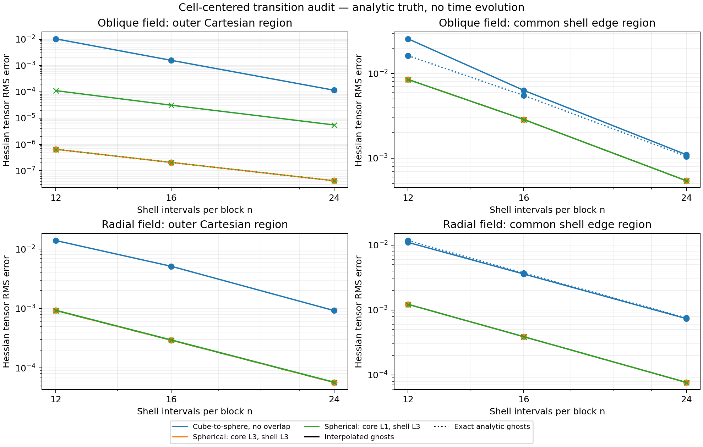
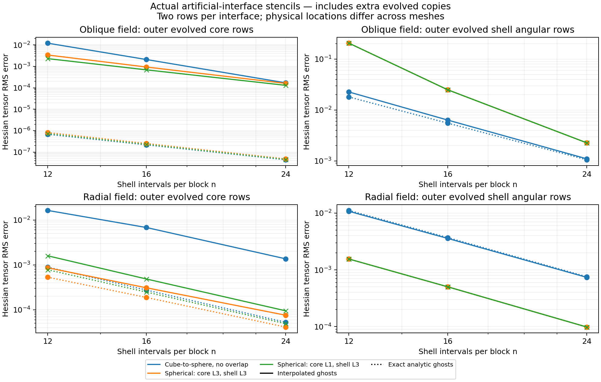

# Transition error is reduced in some regions, not resolved

This audit retains the cell-centered scheme, as the user explicitly requested.
It changes no evolution equation, scri closure, positivity treatment or penalty.
No vertex test was run. The other agent’s larger-overlap branch is not imported.

## What the history establishes

The V6 audit at `28c3b1b0e` localized 99.4% of squared disturbance amplitude in
its cube-to-sphere transition shell, predominantly near angular edges. This was
not the earlier outer-boundary mode. The targeted logical interpolation in V7
(`9022f51f2`) reduced its growth but did not eliminate it: the preserved V7
Minkowski run reached time 2 with state error 3.11e-7, failing its 1e-8 gate.
The independent V7 direction audit also retained a growing projected mode.
See [V6 localization](../../scri-v6-interface-diagnosis-v1/README.md) and
[V7 duration/localization](../../aurora/stability-inner-transition-minkowski-v1/README.md).

The spherical-map change `77277bd25` and continuous-core/log-variable change
`faee66ea3` addressed different issues: map/overlap geometry versus duplicate
Cartesian KO stencils and negative chi. Their results cannot be assigned to
the paired penalty in this thin-overlap branch. The former V11 3M result was a
finite evolution with rejected final horizon, not complete scientific validation.
The remote VC donor heads were also inspected; their grid layout is vertex-based,
but that layout is not used by the current cell-centered evolution.

## Controlled spatial measurement

`transition_accuracy.cpp` evaluates exact fields sin(x+2y-3z) and exp(-20 r²),
with analytic Cartesian gradients/Hessians. It applies the actual fourth-order
mapped finite-difference operator, including the inverse-map Hessian. Each
measurement is repeated after replacing interpolation ghosts with exact analytic
values. The difference between the two numerical derivatives isolates the
interpolation contribution; it is not obtained by subtracting error norms.

Four cell-centered descriptors are measured at n=12,16,24:

- `legacy-v7`: historical .125 cube with one Cartesian block, no evolved overlap,
  targeted logical inner interpolation; a geometry/policy reconstruction, not a
  replay of the frozen full V7 evolution.
- `matched-nonoverlap`: .18 cube with eight Cartesian blocks, cube-to-sphere
  transition map and no evolved overlap. It matches the current core spacing,
  cube extent and shell interval count, while changing the shell map/coupling.
- `control-l3`: spherical shells starting at .16, three extra evolved Cartesian
  layers, three shell angular layers, original centered donor policy.
- `thin-l1`: the same spherical shells, one extra Cartesian layer, three shell
  angular layers, explicit shifted-stencil fallback within the evolved hull.

No paired-penalty RHS is applied in this derivative test. Its effect on evolution
must be tested separately. All ghosts use evolved donors except the deliberately
analytic outer boundary in this interior-only audit; selected points have r<.4,
so no scri closure or hyperboloidal regularity claim follows.

Nominal common-shell masks use max(|x|,|y|,|z|)>=.18 and r<.4; their edge mask
requires the second-largest absolute coordinate to exceed 0.8 times the largest.
These are fixed physical masks with mesh-specific midpoint quadratures. The
outer-core mask is .14<=max(|x|,|y|,|z|) for the matched configurations. The legacy
smaller cube uses a proportionally smaller core mask and is not plotted as a
matched control. Norms are normalized coordinate-volume sums of all nine
Hessian-component errors; they are not physical constraint norms.

Crucially, a second measurement includes the two outermost **evolved** interface
rows, including extra copies with zero physical-diagnostic partition weight.
Their physical locations differ with overlap width and resolution. Therefore
this second comparison is a measurement of each actual artificial boundary,
not a same-location convergence order or a matched-accuracy cost comparison.

## Results

At n=16, Hessian RMS on the actual evolved interface rows is:

| Field and region | Matched nonoverlap | Current thin L1 | Thin L1 with exact ghosts |
|---|---:|---:|---:|
| Oblique, outer core | 2.086e-3 | 6.880e-4 | 2.289e-7 |
| Radial, outer core | 6.800e-3 | 4.850e-4 | 2.477e-4 |
| Oblique, outer shell angular rows | 6.342e-3 | 2.500e-2 | 2.499e-2 |
| Radial, outer shell angular rows | 3.584e-3 | 5.027e-4 | 5.023e-4 |

There is no uniform improvement. The current geometry reduces the radial-field
error and core-interface oblique error, while its extended shell angular rows
have larger oblique error. Exact ghosts barely change that shell error: mapped
finite-difference truncation on the extended angular grid dominates this test.
At the outer core, ghost interpolation is a substantial contributor. This is
an operator-local diagnosis, not proof that either error causes a particular
nonlinear instability.

The fixed common region on nominal shell points improves: n16 oblique Hessian
RMS falls from 6.342e-3 to 2.868e-3 and radial RMS from 3.584e-3 to 3.884e-4.
Looking only at these nominal points would miss the larger error in extra
angular rows. All measured errors decrease under the tested refinement, but
this does not establish evolution convergence, bounded reflection, or stability.
The one- and three-core-layer variants retain the same shell angular extension,
so reducing only the Cartesian extension does not remove this source of error.





The next targeted geometry control should test whether reducing the **shell
angular extension** improves its actual interface stencils, while retaining
pure spherical shells, high-order ghost support, cached transfers and rejection
of extrapolating donors. That remains a proposed control, not an adopted fix.
Full spherical/oblique evolution and a fresh >=3M puncture test are still needed.

Reproduce the spatial measurements with a fresh output directory:

```sh
cmake --build build-thin-overlap --target hyperbolic_shift_3d_transition_accuracy -j2
python3 tst/hyperbolic_shift_3d/run_transition_accuracy.py \
  --binary build-thin-overlap/tst/hyperbolic_shift_3d/hyperbolic_shift_3d_transition_accuracy \
  --out output/transition-audit-new
python3 docs/hyperbolic-shift-3d/reproduction/thin-overlap-v1/plot_transition_accuracy.py \
  --raw output/transition-audit-new --out output/transition-plots-new
```

`raw/` retains all twelve measurements, exact commands, executable hashes and
source hashes. Each process is bounded at 120s and the serial driver at 400s.
