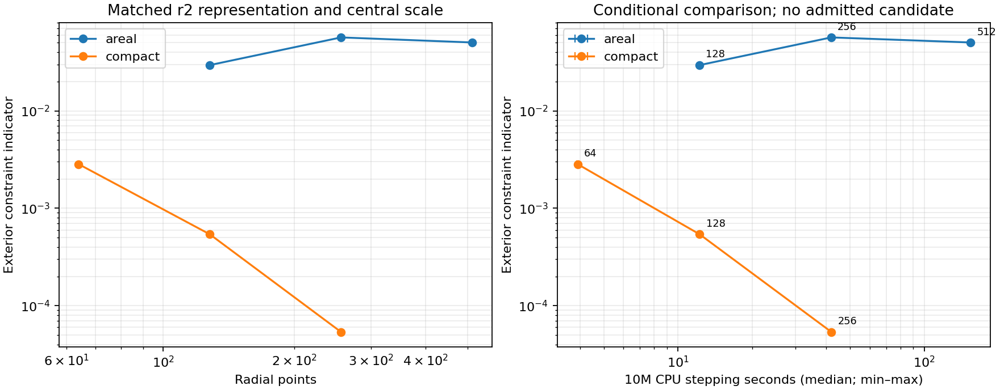

# Controlled local accuracy–cost comparison

The compact slicing/r2 representation is the best exterior-only candidate in
the measured family. **No candidate passes the boundary/late-response gates,
and there is no admitted robustness or fixed-accuracy speedup claim.**

Eighteen serial runs compare six configurations, with three repeats in rotated
order. All use the same Release binary (v18), central20M anchor, separated
gauge speeds, r2 chi derivative representation, reference/source construction,
uniform grids, penalties, KO, no floors, and 10M duration. Areal slicing uses
the original 20–40M transition; compact slicing ends at r=.97 while retaining
the same central map anchor. Execution source hashes match across the batch.
Every repeated configuration produces bitwise identical final field arrays.

Fixed dt targets characteristic CFL .4 using the actual initial maximum
coordinate speed 2.41421356. Maximum measured stage CFL is .400136 (compact
N64); all others are below .400016. The explicit timestep opt-in is retained.
This is a disclosed measurement choice, not a robust timestep recommendation.
The complete dt/M, spacing/M, steps/M, RHS calls and evolved speeds are in the
machine-readable comparison. Thread environment variables are fixed to one;
unrelated operating-system activity is not excluded.

| Slicing | Points | Exterior indicator at 10M | Median stepping wall seconds | Min–max seconds |
|---|---:|---:|---:|---:|
| Areal | 128 | .0294926 | 12.2376 | 12.2371–12.2659 |
| Areal | 256 | .0567318 | 41.9186 | 41.8906–41.9552 |
| Areal | 512 | .0503176 | 154.1863 | 154.1477–154.1915 |
| Compact | 64 | .00283955 | 3.9084 | 3.8796–3.9660 |
| Compact | 128 | .000540649 | 12.2387 | 12.2335–12.2756 |
| Compact | 256 | .0000537199 | 41.9716 | 41.8262–41.9752 |

The indicator is the maximum dimensionless physical H/M/Theta/Z RMS at 301
common reference R/M=25–100 samples, uniformly weighted in log R. It is a
constraint indicator, not a bound on solution error. PCHIP versus linear
interpolation disagreement is retained per component; for the compact cases
the largest disagreement is .000367, .0000670 and .00000419, respectively.
The target screen requires both interpolations to satisfy the threshold; that
screen is not a rigorous interpolation-error bound. Earlier independent field
differences and temporal/spatial convergence remain in REFERENCE-VARIABLES.md.

Stepping times include the same diagnostic cadence and saved outputs, and
exclude construction and Python startup/imports. Construction is recorded
separately: median .055/.106/.207 seconds for areal N128/256/512 and
.110/.185/.335 seconds for compact N64/128/256. These are local CPU wall times,
not GPU-hour measurements. At equal N128 the compact constraint indicator is
54.6 times smaller with essentially unchanged stepping cost. The areal errors
do not converge monotonically and remain far above the thresholds below.

A separate N256 half-timestep run gives an exterior constraint-profile relative
L2 change of 8.77e-12 and a maximum field change of 9.64e-12 on .65<r<.995.
This two-timestep check is not an order estimate, but rules out material
temporal contamination of the observed plateau. Initial independent physical
H RMS is below 3.9e-10 at all three areal resolutions. The evolved H peak is
near reference R/M=34.96 and 34.99 at N256 and N512, respectively, within the
original slicing transition; unsmoothed samples are in
`evidence/areal-control-check-v19/areal-constraint.png`. The cause of this
nonconvergent areal control is unresolved. A continuum constraint-propagation
audit is needed before blaming only spatial resolution or the outer boundary.

| Exterior indicator target | Cheapest measured compact case | Median seconds | Areal case reaching target |
|---|---|---:|---|
| .003 | N64 | 3.9084 | None through N512 |
| .001 | N128 | 12.2387 | None through N512 |
| .0001 | N256 | 41.9716 | None through N512 |

A finite fixed-target areal/compact cost ratio cannot be computed from these
data. Do not extrapolate an areal convergence curve or convert its failure to
reach a target into an infinite speedup. The conditional measured Pareto set
contains the three compact cases; imposing the boundary/perturbation admission
gate leaves the admitted set empty.



Reproduce with fresh output paths:

```
build-spherical/python/bin/python tst/spherical_optimization/run_serial_cost.py \
  --library build-spherical-v18/libcurrent_spherical.dylib \
  --output fresh-serial-cost --repeats 3
build-spherical/python/bin/python tst/spherical_optimization/analyze_serial_cost.py \
  --runs fresh-serial-cost --output fresh-cost-comparison
```

The batch plan, individual configuration/source archives, raw states, histories,
logs, timings and checksums are preserved under `evidence/serial-cost-v19`.
The analyzer records all input hashes and rejects a changed execution source,
different binary, unmatched duration or nonidentical repeated final states.
