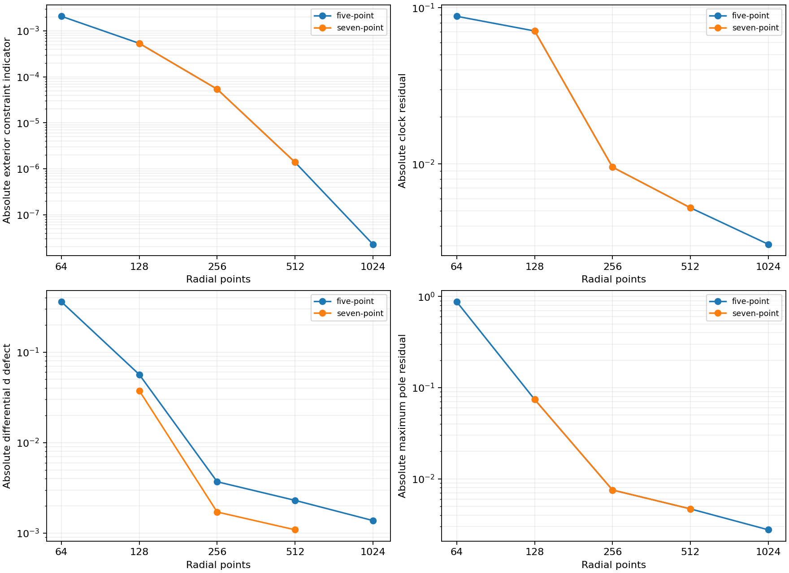
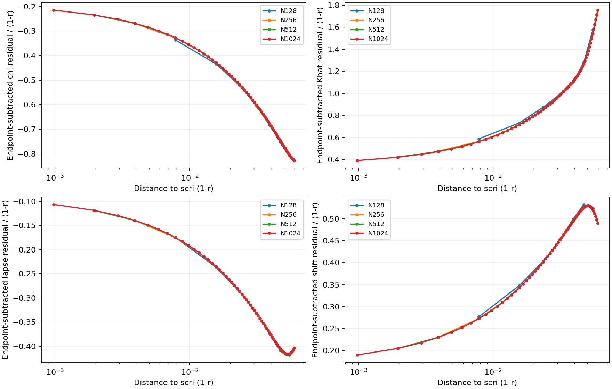
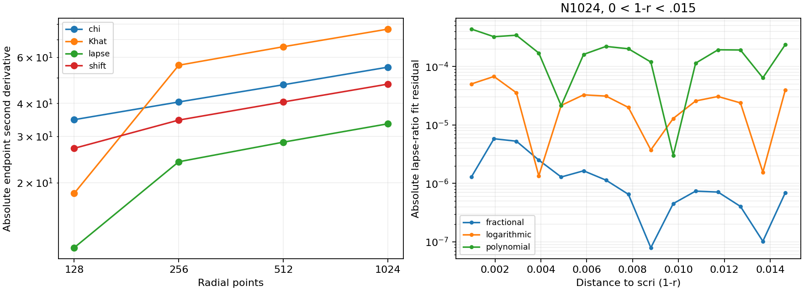

# Fine-grid boundary regularity audit

N1024 confirms excellent exterior convergence but does **not** close the scri
regularity gate. Clock, pole and auxiliary residuals decrease slowly while
endpoint second derivatives grow. Near-boundary data are consistent with a
limited-smoothness tail. Finite-range fits cannot distinguish a continuum
fractional mode from a numerical boundary layer conclusively; that distinction
must be resolved before calling the candidate smooth at scri.

No continuum equations or evolution policies were edited in this phase. The
compatible-lapse candidate uses the same v18 shared C++ binary and existing
five-point outgoing closure. The seven-point outgoing option is an existing,
explicitly selected numerical control. All new evolutions complete without
floors. The parent campaign and Aurora are untouched.

## N1024 control and outgoing-width comparison

At 10M, the current five-point policy gives:

| N | Exterior constraint indicator | Clock | Differential D defect | Maximum pole |
| --- | ---: | ---: | ---: | ---: |
| 256 | 5.39559e-5 | −.00954442 | −.00370006 | .00753722 |
| 512 | 1.38793e-6 | −.00524429 | −.00230548 | .00467734 |
| 1024 | 2.27976e-8 | −.00306283 | −.00137953 | .00275933 |

The exterior indicator is the established dimensionless physical H/M/Theta/Z
RMS maximum on reference R/M25–100. The finest exterior ratio corresponds to
order 5.924. The finest clock, D and pole ratios correspond to orders .775,
.740 and .761, respectively. The preceding boundary ratios are .863, .682
and .687. These measurements show decreasing residuals, but not high-order
boundary accuracy or smoothness. Three time-direction increments agree on D.

The N1024 run's accepted maximum characteristic CFL is .40000605, with no
floors. Its explicit dt is .00016188365322494482, slightly above the exactly
matched .4 target (.00016188121636466832); this difference is disclosed rather
than silently treating the steps as identical. The run took about 606 seconds
while other work was active, so it is not a controlled cost measurement.

The seven-point outgoing trace leaves the sampled N64 initial and N128 10M
leading eigenvalues unchanged to the displayed digits (.645169 and .031033).
Its nonlinear N128/256/512 D defects are −.0374839, .00171367, .00109114,
versus .0564775, −.00370006, −.00230548 for five points. Clock and exterior
errors are essentially unchanged. Its N128 20M gauge response is
2.00964666e-6, versus 2.00964670e-6 for five points. Widening the outgoing
trace is therefore a modest auxiliary-error improvement, not a cure for the
regularity issue. The five-point policy remains the working candidate; no
new policy is admitted from this comparison alone.



## Preparation and diagnostic stencil sensitivity

`audit_boundary_resolution.py` evaluates each saved state with reference
preparation steps 1.25e-4, 6.25e-5 and 3.125e-5. Clock is unchanged at displayed
precision and D changes by roughly 1e-9 or less. This excludes an immediate
same-state preparation error as the observed defect; it does not independently
exclude every accumulated trajectory error. The endpoint reference jets were
already analytic in these runs.

Independent endpoint polynomial stencils of width 5/7/9/11 are constructed on
the same nodal residuals and passed through the same shared shift-normal
condition. Width seven reproduces the actual clock within 1e-8. At N1024,
the four clocks are −.00200268, −.00306283, −.00432178, −.00579795. Simply
increasing a diagnostic stencil's width does not approach a common answer at
fixed resolution. The widths are diagnostics only; no altered endpoint scheme
is evolved or claimed stable.

The final near-boundary plots subtract each field's endpoint deviation from
its initial-reference deviation, then divide by 1-r. This removes a changing
endpoint value before assessing slope behaviour. The first preliminary audit
retained endpoint drift in this ratio; its source/data are preserved in
`boundary-resolution-v24`. The refined audit and plot use the corrected
endpoint-subtracted quantity in `boundary-resolution-refined-v24`.



## Second derivatives and competing tail fits

Endpoint lapse second derivatives at N256/512/1024 are −23.9956, −28.4909,
−33.4611. Corresponding chi values are −40.5085, −47.0932, −54.9394; Khat
values are 55.8769, 65.7056, 76.6643. Growing derivatives are a separate issue
from the small exterior constraints and decaying first-order boundary defects.

For a residual with endpoint removed, define y(x)=delta_field(x)/x, x=1-r.
`audit_boundary_tail.py` compares four-coefficient polynomial and x log x
models with `a+b*x^p+c*x+d*x²`, whose exponent p is also fitted. It retains
three windows and both inclusion/exclusion of the nearest two cells. On the
N1024 lapse window 0<x<=.015, the fitted p is .72516, corresponding to a field
term x^1.72516. Ratio-fit RMS values are 2.27e-6 (fractional), 3.18e-5
(logarithmic), and 2.19e-4 (polynomial). The .03 window gives p=.70793.
The broader .06 window includes additional structure and does not support the
same fit; all results remain in the audit. The fractional model also has an
extra fitted parameter. These are suggestive finite-range diagnostics, not
proof of a noninteger continuum exponent or a differentiability theorem.



## Reproduction and next step

Runs are `compatible-lapse-f1-n1024-10M-v24` and
`outflow7-compatible-n{128,256,512}-none-10M-v24`; the two N128 20M outgoing
controls and pilot/spectrum directories carry the same `outflow7-compatible`
prefix. Each run contains its complete manifest and archived execution source.
The final diagnostic source snapshot is `boundary-regularity-source-v24`.
Use fresh output paths, for example:

```sh
build-spherical/python/bin/python tst/spherical_optimization/audit_boundary_resolution.py \
  --library build-spherical-v18/libcurrent_spherical.dylib \
  --runs docs/spherical-optimization/evidence/compatible-lapse-f1-n512-10M-v23 \
    docs/spherical-optimization/evidence/compatible-lapse-f1-n1024-10M-v24 \
  --output NEW_BOUNDARY_AUDIT
build-spherical/python/bin/python tst/spherical_optimization/audit_boundary_tail.py \
  --runs docs/spherical-optimization/evidence/compatible-lapse-f1-n512-10M-v23 \
    docs/spherical-optimization/evidence/compatible-lapse-f1-n1024-10M-v24 \
  --output NEW_TAIL_AUDIT
```

Next investigate the leading near-scri powers of the shared continuum
linearization and its gauge/reference sources, including mixed orders of
metric/lapse and curvature/connection variables. Compare that prediction with
the observed fields and outgoing characteristics before varying outer gauge
parameters or inventing another endpoint stencil. Robust RK4 margins and
controlled fixed-error costs remain required after the regularity assessment.
No 3D/boosted stability inference or Aurora work is authorized by these results.
