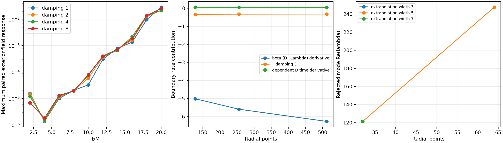

# Auxiliary damping and outgoing boundary trials

No candidate is admitted. Exposing the existing auxiliary damping parameter
does not change the principal part, native geometry or stationary sources.
On 257 off-constraint jets, the change in the regular D RHS is precisely
`-(kappa_D-1)D`, with maximum discrepancy 4.45e-16. The actual auxiliary
routine agrees within 1.12e-16. Negative and nonfinite parameters are rejected.
The default compiled RHS is bitwise unchanged from the v16 build.

The matched N128 compact-slicing/r2 gauge-pulse pairs all complete 20M without
floors. The unperturbed reference and sources remain fixed in each pair.

| Auxiliary damping | Final exterior paired field maximum | Exterior constraint indicator | Differential D defect |
|---|---:|---:|---:|
| 1 | .02855 | .001305 | 6.348 |
| 2 | .02181 | .001153 | 5.792 |
| 4 | .02155 | .001138 | 6.375 |
| 8 | .02587 | .001448 | 5.829 |

Paired responses use raw total fields at r>.8 and are dominated by D/Lambda;
they are not energy norms. Constraints use the existing dimensionless maximum
H/M/Theta/Z log-R RMS over reference R/M=25–100. Damping1 uses characteristic
C=.5, the others .4; the saved .5/.25 response control differs by only 5.68e-5
in relative L2 at 20M. These runs are not controlled performance comparisons.
Lapse/shift response is slightly larger for the stronger damping values.
None removes delayed growth or the differential boundary mismatch.

## Boundary balance

The saved 10M N128/256/512 states were re-evaluated without changing their
data. At N512 the bulk D rate decomposes into 8.48271 from the raw Lambda
rate, −8.44692 from its penalty, −6.26821 from beta times the derivative of
D−Lambda, and −.32019 from damping. The directional time derivative of the
dependent-D functional is .04896, leaving a 6.60158 defect. Three directional
probe epsilons are retained. The advective difference derivative dominates;
the raw Lambda and penalty terms nearly cancel. Excluding the endpoint in
3/5/7-point derivative probes does not yield a converged replacement.

## Rejected outgoing trace closure

The continuum auxiliary combination C=D−Lambda obeys
`C_t = beta C_r - kappa_D D`; its outward coordinate transport speed at scri
is −beta. An explicit experimental spatial policy extrapolates only its
endpoint trace from 3/5/7 interior values, keeps Lambda independent, and uses
the actual shared null/clock equations to determine compatible lapse/shift
normal derivatives. The existing degree-seven Hermite derivative correction
then modifies the last three gauge derivative rows. Bulk D values and geometric
constraints are not projected. This is a numerical boundary policy, not a new
continuum equation or a boundary well-posedness proof.

A changing-geometry fixture reproduces the outgoing cubic trace to 1.1e-12
and clock equation to 6.6e-13, while retaining nonzero Theta and independent
Lambda. Nevertheless, the frozen initial operator rejects the policy:

| Points | Extrapolation width | Largest real eigenvalue | Eigenvalue times endpoint spacing |
|---|---:|---:|---:|
| 32 | 3 | 121.4723 | 3.8563 |
| 32 | 5 | 121.4522 | 3.8556 |
| 32 | 7 | 121.4455 | 3.8554 |
| 64 | 5 | 247.6969 | 3.9007 |

The eigenmode peaks in endpoint radial traceless curvature. Two Jacobian
finite-difference steps agree to relative 1.01e-10 or better. Exact linear
flow also amplifies the mode; decreasing RK4 dt cannot remove this spatial
instability. Only .001M construction pilots were run; no long evolution was
launched after the failed operator gate. The code is retained explicitly as
a rejected reproduction option. Its algebraic compatibility is insufficient.

## Reproduction and remaining work

The v18 binary and final source snapshot are in
`evidence/auxiliary-damping-build-v18`; each evolution and operator run also
retains its own authoritative source archive. Use a fresh output directory:

```
build-spherical/python/bin/python tst/spherical_optimization/test_auxiliary_damping.py \
  --library build-spherical-v18/libcurrent_spherical.dylib --output fresh-damping-test
build-spherical/python/bin/python tst/spherical_optimization/test_outflow_boundary.py \
  --library build-spherical-v18/libcurrent_spherical.dylib --output fresh-outflow-test
build-spherical/python/bin/python tst/spherical_optimization/analyze_boundary_trials.py \
  --evidence docs/spherical-optimization/evidence --output fresh-boundary-plots
```



Future boundary work must address the coupled geometric regularity and gauge
normal system, rather than merely tuning damping or imposing an outgoing D
trace. A consistent regular boundary formulation needs changing-geometry
equivalence, absence of grid-scaled unstable modes, differential compatibility
under refinement and paired nonlinear tests. Controlled exterior-only costs
can be measured now, but do not define an admitted robust Pareto frontier.
No spherical test establishes boosted/3D stability or GPU-hour improvement.
