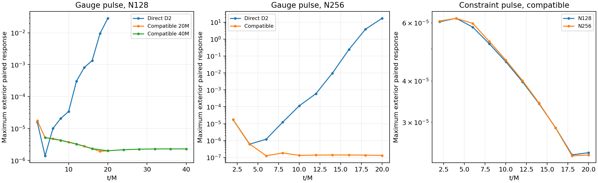
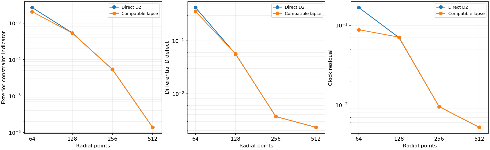

# Compatible lapse derivative trial

An explicit spatial candidate removes the previously identified rapidly
growing discrete gauge branch in the tested Jacobians and greatly reduces
20M paired pulse responses. It is still experimental: boundary regularity,
longer controls, robust RK4 limits and controlled costs remain separate gates.
The shared C++ equations, sources and central-radius configuration are unchanged.

## Defined numerical change

`--compatible-lapse f`, with 0<=f<=1, replaces the lapse residual's direct
second derivative by `(1-f*w) D2 + f*w D1 D1`. Only this second derivative
changes. The physical lapse remains the evolved RK variable. The stationary
reference jets are added after differentiating the residual, retaining the
actual continuum RHS of the nonstationary initial state. First derivatives,
component advection, physical KO, geometric fields and boundary conditions are
unchanged. This is a spatial discretization choice, not an equation or variable
change, a constraint projection, or a smoothing step on D.

For the shared gauge join [a,b], L=b-a, the compact C2 weight rises from zero
to one on [a-L/2,a+L/8], stays one through b-L/8, and falls to zero at b+L/8.
Each ramp is 6z^5-15z^4+10z^3. No independent central radius is introduced.
For the 20M configuration the four locations are
.71223253, .77967803, .86061263, .88759083. The window is zero in the puncture
and scri neighbourhoods. Two applications of the existing polynomial D1
operator produce the composed derivative, including the existing puncture
stencil policy. The default f=0 does not execute this change.

The policy is expressible as a compatible radial lapse-Hessian stencil on a
mapped 3D shell, retaining angular derivatives. That implementation and its
interface tests have not been performed. A centered D1 has a checkerboard
nullspace; full composition inherits it. The successful tests below are
necessary numerical evidence, not a general energy or stability proof.

## Identity, consistency and actual Jacobians

On an evolved off-constraint N64 state, default RHS and all jets are bitwise
identical to the pre-change snapshot. With f=1 the initial RHS is also bitwise
identical, only the lapse second jet changes, and the last three boundary rows
remain identical. Independent sin(12r) second-derivative errors at N64/128/256
are 7.13825e-7, 1.10111e-8, 1.71149e-10, giving orders 6.019 and 6.008.

Unlike the previous frozen-coefficient intervention, the new Jacobians are
finite differences of the actual candidate RHS, including state-dependent
coefficients. On the original 10M states:

| Policy | N64 leading real part | N128 leading real part |
| --- | ---: | ---: |
| Original direct D2 | .398770 | 1.757428 |
| Half composition f=.5 | not sampled | 1.496497 |
| Full composition f=1 | .315938 | .031040 |

The half-composition N128 mode remains oscillatory, with imaginary part
39.24196. It is preserved as an unsuccessful control. The f=1 leading N128
pair has imaginary part .477853; the previous 45.65024-frequency growing
branch is removed. Two finite-difference increments agree at relative matrix
norm about 5.3e-11. Positive real eigenvalues remain, and the saved RK4 versus
exact-flow scaled norms retain substantial nonnormal amplification.

The original-state spectra are named
`compatible-lapse-f{1,0.5}-n{64,128}-old10M-spectrum-v23`, with only the table's
sampled combinations present. The jets/parity checks are
`compatible-lapse-jets-v23`, with the pre-change snapshot in
`compatible-lapse-default-before-v23`. Each run records its configuration and
source archive. No existing numerical evidence was overwritten.

## Nonlinear pulses, time and space

All new evolution runs complete without floors. The maximum accepted
characteristic CFL is .4002144, with initial maximum coordinate speed
2.41421356. The paired pulse sources and reference fields remain unperturbed.
At 20M the maximum raw exterior paired field differences are:

| Pulse | Direct D2 N128 | Direct D2 N256 | Compatible N128 | Compatible N256 |
| --- | ---: | ---: | ---: | ---: |
| Lapse/shift | .02854896 | 17.04797 | 2.00965e-6 | 1.33062e-7 |
| Theta/Lambda | .000205644 | .3303175 | 2.42552e-5 | 2.38736e-5 |

The N128 compatible gauge response is 2.30153e-6 at 40M, with exterior RMS
3.78243e-7 and lapse/shift maximum 1.13767e-8. This longer control does not
reproduce the earlier rapid growth. It is a finite-duration, two-resolution
pulse check, not proof of arbitrary-time stability. The constraint response
remains finite and nearly resolution independent, rather than vanishing;
this is a perturbed solution, not an exact constraint-satisfying reference.



The N64 temporal control uses measured characteristic targets .4/.2/.1. At
1M, resolved fields give orders 3.9966–4.0326; B differences are only
1.88e-11 and 4.64e-13 and do not give a reliable fourth-order estimate. At
10M, the largest field RMS differences are 1.083e-9 and 2.838e-10; fieldwise
ratios are irregular (.095–4.391). Thus the 10M runs establish very small
step sensitivity, not resolved fourth-order order at that time. The 1M
transient is the resolved RK4 test. Both sets and interpolation sensitivity
are preserved; no unsuccessful convergence ratio is omitted.

At 10M, using the established physical H/M/Theta/Z indicator over reference
R/M25–100 and independent field interpolation:

| Points | Exterior indicator | Differential D defect | Clock residual |
| --- | ---: | ---: | ---: |
| 64 | .002075697 | −.358808 | −.0881281 |
| 128 | .000535113 | .0564775 | −.0710049 |
| 256 | .0000539559 | −.00370006 | −.00954442 |
| 512 | .00000138793 | −.00230548 | −.00524429 |

The four-resolution field self-differences decrease, with finest adjacent
log2 ratios 2.85–5.16. These are measured self-difference ratios, not a claim
that all fields have reached the formal sixth-order spatial regime. The
boundary residuals are essentially unchanged at the fine resolutions: the
candidate resolves the interior mode but does not yet qualify the boundary.



The candidate's own N128 10M trajectory has leading frozen eigenvalue real
part .03103255, consistent with .03103965 on the old trajectory. The N64
initial operator's leading real part is .64516869. Spectra, two-increment
checks, RK4 polynomials and nonnormal norms are retained. Full 26-variable
interior radial/transverse/oblique symbols are checked on the N512 trajectory
at eleven saved times: zero defective numerical clusters, maximum imaginary
part 8.79e-16 and maximum eigenspace condition 364479. The gauge-pulse
characteristic decomposition at N256
has maximum basis condition 580.37 and projector residual 7.3e-14; these are
Euclidean modal diagnostics, not energy reflection coefficients or boundary
well-posedness. No boosted or 3D evolution claim follows.

## Reproduction and remaining gates

Each `compatible-lapse-f1-...-v23` run has a complete manifest, source archive,
raw states and result. Representative commands, with new output destinations:

```sh
build-spherical/python/bin/python tst/spherical_optimization/run.py \
  --library build-spherical-v18/libcurrent_spherical.dylib --output NEW_RUN \
  --n 128 --compact-end .97 --separated --chi-reference-power 2 \
  --compatible-lapse 1 --outflow-boundary --boundary-normal-system shift \
  --reference-tail scri --reference-step .000125 --reference-jets \
  --normal-policy analytic --algebraic-chart --duration 20 --probes \
  --fixed-dt .0012994935290136316 --experimental-timestep
build-spherical/python/bin/python tst/spherical_optimization/analyze_compatible_lapse.py \
  --evidence docs/spherical-optimization/evidence --output NEW_PLOTS
```

For the paired pulse add `--perturbation gauge` or `constraint`; the default
amplitude is 1e-5, center .9 and half-width .025. At other resolutions the
characteristic-matched fixed step is the N128 value times 127.5/(N-.5).
The older f=0 path remains selectable and bitwise checked. All three shared
C++ CTests pass. The final source snapshot is `compatible-lapse-source-v23`.

Next: resolve boundary clock/pole/differential-D convergence and its sensitivity
to reference jets/outgoing extrapolation without reintroducing a normal-lapse
boundary mode; confirm pulse robustness at the selected timestep margin; then
measure the candidate's RK4 limit and serial fixed-error costs. The concurrent
runs here are not controlled cost comparisons. No candidate is admitted yet.
Parent campaigns and Aurora remain untouched.
