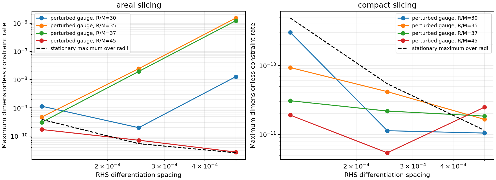

# Local continuum constraint propagation audit

The large areal-slicing error at 10M is not reproduced as a continuum
constraint-production term on the sampled smooth initial geometries.
This narrows the investigation toward the discretization/evolved state, but
does not prove the continuum equations correct for arbitrary data.

At reference R/M=30,35,37,45, the audit constructs each native areal and compact
geometry using its local map ODE. Initial first/second radial jets come from
50-digit analytic differentiation; a tightly integrated local map makes the
neighboring values coherent. The native C++ map supplies only the center
anchor. The independent initial geometry agrees with the compiled initializer
to its map tolerance, and physical constraints are below 1.3e-14 in coordinate
units. All probes lie in the complete outer gauge and native Omega frame.

The stationary outer data give a maximum shared RHS component of 9.1e-13.
A second test changes lapse by the smooth factor `1+.1r²` and adds `.03r³` to
shift, retaining the same constrained geometry and independent Lambda/Theta.
The resulting actual geometry RHS is nonzero: for areal slicing at R/M35,
the radial A rate is approximately 244 and Lambda rate approximately −359.
No background RHS is removed and no field is frozen by the audit.

Seven-point differences of these compiled RHS values supply their first and
second spatial derivatives. A complex directional derivative of the independent
physical constraint formulas then evaluates their instantaneous production.
The three RHS-difference spacings are .0005, .00025 and .000125. For the steep
areal case at R/M35, the momentum rate decreases from −4.14e-5 to −6.60e-7 to
−1.04e-8, consistent with sixth-order differentiation before roundoff. At the
finest spacing, the maximum dimensionless rate across all samples is 1.15e-9;
the stationary controls expose the second-difference roundoff floor. Rates are
scaled as derivatives of `(M²H, M²Momentum, MTheta, MZ)` with respect to t/M.



This test uses no evolution grid, numerical dissipation, scri closure or penalty.
It therefore addresses a different question from the unsuccessful areal 10M
resolution controls. It excludes a readily detectable initial continuum
constraint source on these data, not later instability or numerical error.
The sharper areal geometry also amplifies imposed smooth gauge changes more
strongly than the compact profile. Further causal attribution requires evolved
operator/forcing localization, not extrapolation from this initial-data check.

```
build-spherical/python/bin/python tst/spherical_optimization/audit_constraint_propagation.py \
  --library build-spherical-v18/libcurrent_spherical.dylib \
  --radii 30 35 37 45 --output fresh-propagation
build-spherical/python/bin/python tst/spherical_optimization/analyze_constraint_propagation.py \
  --audits fresh-propagation --output fresh-propagation-plots
```

The audit retains physical unscaled rates, per-field RHS values, initial
constraint and embedding errors, script/binary hashes and all spacings.
