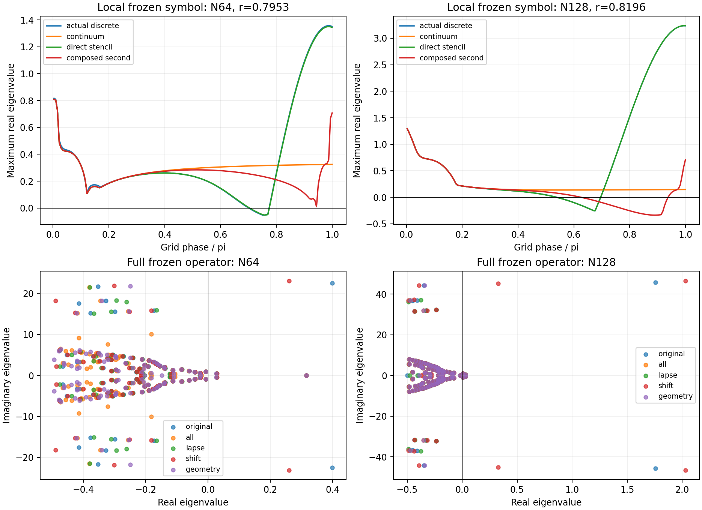
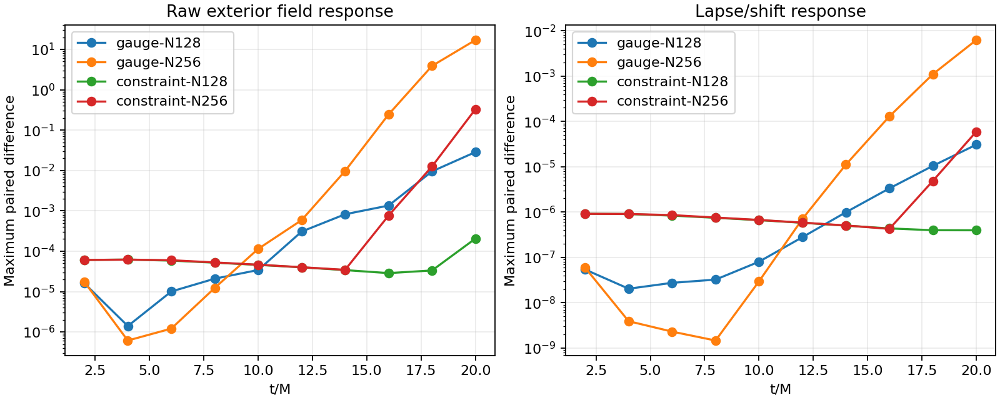
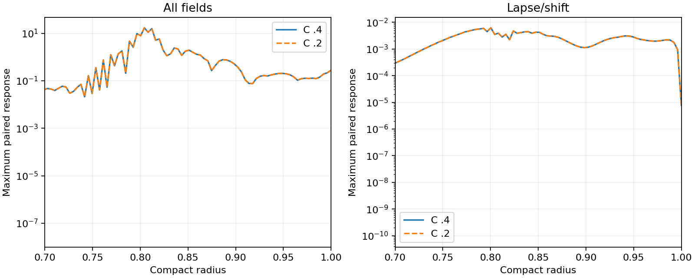

# Interior discrete gauge mode

The frozen 10M growing mode is strongly affected by the mismatch between the
central first-derivative and direct second-derivative symbols. This is a
numerical mechanism in the gauge transition, in addition to the unresolved
boundary regularity issue. It is not evidence of a new continuum equation
error, and no new evolution scheme is admitted here.

## Local symbol

`audit_discrete_symbol.py` reconstructs physical-variable Jacobian rows from
the saved scaled N64/N128 frozen operators. Applying each row to Fourier nodal
perturbations includes the actual reference-chi derivatives, component
advection, coefficients, KO and local terms. Independently, derivatives of the
shared C++ interior RHS with respect to independent q, q′, q″ give A, B, C.
Two perturbation sizes agree to relative norm below 1.3e-10 in sampled jets.
The comparison operators are A+ikB−k²C, A+s1 B+s2 C+beta(sa−s1)I, and the same
stencil operator with s2 replaced by s1². The latter substitutions freeze local
coefficients and omit spatial variation of the chi/r² representation.

At N64, r=.79528, the actual high-phase branch peaks at
1.35732+22.86800i; the direct stencil gives 1.35069+22.85400i.
At N128, r=.81961, these become 3.23595+47.52080i and
3.23662+47.50867i. The maxima are at phases .98754 pi and .99377 pi.
The near-Nyquist branch is absent in the composed-second substitution.
However, the latter still has a positive real maximum near .71 at Nyquist.
All rates use the solver coordinate time; time in mass units is t/M=3t.

A centered D1 has a checkerboard nullspace, whereas the direct D2 retains a
nonzero Nyquist response. Composing D1 twice removes that difference but also
inherits the nullspace. This diagnostic therefore does not justify adopting
D1² everywhere or declaring high-frequency stability.

## Full variable-coefficient operator intervention

`audit_compatible_operator.py` adds C(r)[D1²−D2] to selected columns of the
saved full Jacobian, scaled consistently with the saved variables. For chi it
also includes the r² product/quotient factors. The D row receives the actual
Lambda correction. A C2 compact taper is zero outside (.72,.89), and one on
[.78,.86]; all boundary rows and their neighbourhood remain unchanged. The
intervention holds the original trajectory and local coefficients fixed. It
is a linear diagnostic, not the Jacobian of a tested nonlinear discretization.

| Second-derivative columns changed | N64 max real eigenvalue | N128 max real eigenvalue |
| --- | ---: | ---: |
| None | .398770 | 1.757428 |
| All | .315932 | .031096 |
| Lapse only | .315937 | .031061 |
| Shift only | .315936 | 2.028828 |
| Geometry and other columns | .315934 | .031074 |

For lapse-only and all-column interventions the leading mode moves from the
gauge transition to the puncture neighbourhood. Positive eigenvalues remain;
these interventions have no absolute contractivity claim. Eigenpair residuals
are below 1.5e-17 in the reported matrix-scaled measure. The initial support
window was too wide for the N64 active endpoint coordinates; the guard rejected
it before spectra were computed. Its source and traceback are preserved in
`evidence/compatible-operator-v22`. The narrower guarded diagnostic is in
`evidence/compatible-operator-reproduced-v22`. A platform NumPy matrix-product
warning occurred in the residual calculation; all reported residuals and
spectra are finite.



These results support designing and testing a compatible spatial treatment
of the coupled gauge/geometry derivatives. They do not establish that lapse
alone is the unique cause: changing geometry columns also removes the growing
branch, and changing shift columns alone makes N128 worse. Neither extra KO
nor a hidden constraint reset was applied. The C++ equations and evolution
policies are unchanged in this phase.

## Reproduction

Use the frozen v18 Release library and Python environment documented in
[SHIFT-NORMAL-BOUNDARY.md](SHIFT-NORMAL-BOUNDARY.md). Choose new output paths;
the scripts reject overwriting numerical evidence.

```sh
build-spherical/python/bin/python tst/spherical_optimization/audit_discrete_symbol.py \
  --library build-spherical-v18/libcurrent_spherical.dylib \
  --spectra docs/spherical-optimization/evidence/shift-normal-n64-spectrum-10M-v21 \
    docs/spherical-optimization/evidence/shift-normal-n128-spectrum-10M-v21 \
  --output /tmp/discrete-symbol-reproduction
OPENBLAS_NUM_THREADS=1 VECLIB_MAXIMUM_THREADS=1 \
  build-spherical/python/bin/python tst/spherical_optimization/audit_compatible_operator.py \
  --library build-spherical-v18/libcurrent_spherical.dylib \
  --spectra docs/spherical-optimization/evidence/shift-normal-n64-spectrum-10M-v21 \
    docs/spherical-optimization/evidence/shift-normal-n128-spectrum-10M-v21 \
  --output /tmp/compatible-operator-reproduction
build-spherical/python/bin/python tst/spherical_optimization/analyze_discrete_symbol.py \
  --local /tmp/discrete-symbol-reproduction \
  --global-audit /tmp/compatible-operator-reproduction \
  --output /tmp/discrete-plots-reproduction
```

## Refined nonlinear pulses

The original shift-normal scheme was run to 20M at N256 with no pulse, a
smooth lapse/shift pulse, and a smooth Theta/Lambda pulse. Pulse amplitude is
1e-5, center .9 and half-width .025, as in the N128 controls. A matching
N128 constraint run was added. All complete without floors, but completion
conceals a severe refinement failure in the paired exterior response:

| Pulse | N128 maximum response | N256 maximum response | N256 lapse/shift response |
| --- | ---: | ---: | ---: |
| Gauge | .02854896 | 17.04797 | .00623139 |
| Constraint | .000205644 | .3303175 | .0000595037 |

These are raw maximum component differences on r>.8 at 20M, not energy norms.
N256 gauge RMS is 1.25258, versus .00453009 at N128. The maximum accepted
characteristic CFL is .400025 across the four new runs, calculated using the
actual characteristic speeds; the initial maximum speed is 2.41421356.
The observed refinement growth rules out admitting the existing scheme on the
basis of its 10M exterior convergence. It is consistent with the grid-sensitive
frozen branch, though that association alone does not prove all late nonlinear
growth comes from one mode. These concurrent runs are not cost measurements.



Raw runs are `shift-normal-n256-{none,gauge,constraint}-20M-v22` and
`shift-normal-n128-constraint-20M-v22` under `evidence/`. Each manifest includes
its exact configuration, source archive, binary identity and timestep. The
existing `analyze_paired_profiles.py` reproduces the comparison from those
pairs and the N128 `shift-normal-{none,gauge}-20M-v21` controls.

The matched N256 gauge pair was repeated at half timestep. The maximum final
response changes from 17.0479696 to 17.0509539; the relative exterior L2
difference is 2.22425e-4. The fine-step peak is Ar at r=.8043053, within the
gauge transition. Both runs again complete without floors. Thus halving the
step does not cure the failure and the tested RK4 step is not its primary
cause. Two steps alone do not establish temporal order. The comparison,
including input hashes, is `evidence/refined-pulse-timestep-v22`; reproduce
with `analyze_pulse_timestep.py --coarse BASE PULSE --fine HALF_BASE HALF_PULSE
--output NEW_DIRECTORY` using the named N256 runs and their
`20M-halfstep-v22` counterparts.



The final source snapshot is `evidence/discrete-mode-source-v22`. All three
shared C++ CTests pass. The diagnostic difference stencil annihilates
polynomials through degree seven to roundoff; saved eigenvalues/modes are
finite and the original full spectra reproduce within 1e-10. These checks do
not replace testing an actual nonlinear derivative candidate. The next phase
should implement such a candidate, verify its actual Jacobian and refined
pulse behaviour, then revisit boundary convergence and robust RK4 margins.
The prior exterior accuracy–cost table remains conditional; no candidate is
admitted and no boosted/3D stability or GPU-hour gain is claimed.
