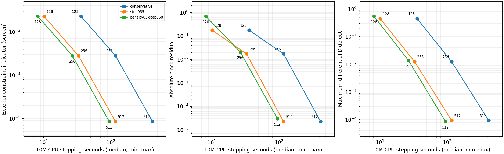

# Controlled local accuracy–cost result

The final benchmark compares the conservative guard, a qualified CFL .55
step at penalty .6510416666660156, and penalty .5 with CFL .68. All cases
use the same shared continuum formulation, central 20M scale, Release binary,
execution-source hashes and diagnostic cadence. Only grid size, penalty and
explicit step policy differ. See [COST-PROTOCOL.md](COST-PROTOCOL.md) for the
targets declared before timing and [PENALTY-TRADEOFF.md](PENALTY-TRADEOFF.md)
for finite-duration pulse and timestep qualification.

Each of nine cases ran serially three times in rotated order, with library
thread counts fixed to one. No other laboratory evolution or spectral/plot
workload ran during this batch; unrelated OS activity was not excluded.
All three final states agreed bitwise in each of the nine cases.
Timings below include stepping diagnostics and output. Setup and full
subprocess times are retained separately in the JSON.

Measured host: Apple M5 Pro, 48 GiB memory, 18 logical CPUs. No CPU affinity was imposed.

## Measured 10M times and accuracy

| Policy | N | CPU stepping seconds, median [min,max] | Exterior E | Clock magnitude | Max D defect |
|---|---:|---:|---:|---:|---:|
| conservative | 128 | 36.0117 [35.8362,36.0516] | 0.002295526 | 0.1763696 | 0.4403928 |
| step055 | 128 | 10.1172 [10.0806,10.1202] | 0.002295526 | 0.1763696 | 0.4403928 |
| penalty05-step068 | 128 | 8.1577 [8.1430,8.1738] | 0.002294272 | 0.6961518 | 0.5432117 |
| conservative | 256 | 117.5124 [117.2829,117.6949] | 0.0002845391 | 0.01737064 | 0.01242662 |
| step055 | 256 | 32.9702 [32.9200,33.0431] | 0.0002845391 | 0.01737064 | 0.01242662 |
| penalty05-step068 | 256 | 26.6755 [26.6753,26.7038] | 0.0002845402 | 0.02066362 | 0.01384361 |
| conservative | 512 | 419.7551 [419.7317,420.2520] | 8.532723e-06 | 2.252058e-05 | 9.288299e-05 |
| step055 | 512 | 117.6443 [117.5492,118.5679] | 8.532723e-06 | 2.252061e-05 | 9.288288e-05 |
| penalty05-step068 | 512 | 95.1555 [94.9610,95.2075] | 8.532723e-06 | 2.99095e-05 | 8.58456e-05 |

E here is the larger of PCHIP and linear-interpolated maximum dimensionless
physical H/M/Theta/Z RMS over 301 logarithmic reference R/M25–100 samples.
Both interpolation estimates must pass a target. It is a constraint indicator,
not a certified solution-error bound. Clock and D are separate fixed laboratory
coordinate quantities (M=1/3); D uses the maximum of three directional probes.
The coarse N128 boundary residuals exclude it from every boundary-aware box.

## Fixed-target selections

| Screen | Policy | Cheapest measured N | Median seconds | Conservative/policy cost ratio |
|---|---|---:|---:|---:|
| exterior E≤0.003 | conservative | 128 | 36.0117 | 1.000× |
| exterior E≤0.003 | step055 | 128 | 10.1172 | 3.559× |
| exterior E≤0.003 | penalty05-step068 | 128 | 8.1577 | 4.414× |
| exterior E≤0.001 | conservative | 256 | 117.5124 | 1.000× |
| exterior E≤0.001 | step055 | 256 | 32.9702 | 3.564× |
| exterior E≤0.001 | penalty05-step068 | 256 | 26.6755 | 4.405× |
| exterior E≤0.0001 | conservative | 512 | 419.7551 | 1.000× |
| exterior E≤0.0001 | step055 | 512 | 117.6443 | 3.568× |
| exterior E≤0.0001 | penalty05-step068 | 512 | 95.1555 | 4.411× |
| loose: E≤0.003, clock≤0.1, D≤0.1 | conservative | 256 | 117.5124 | 1.000× |
| loose: E≤0.003, clock≤0.1, D≤0.1 | step055 | 256 | 32.9702 | 3.564× |
| loose: E≤0.003, clock≤0.1, D≤0.1 | penalty05-step068 | 256 | 26.6755 | 4.405× |
| medium: E≤0.001, clock≤0.01, D≤0.01 | conservative | 512 | 419.7551 | 1.000× |
| medium: E≤0.001, clock≤0.01, D≤0.01 | step055 | 512 | 117.6443 | 3.568× |
| medium: E≤0.001, clock≤0.01, D≤0.01 | penalty05-step068 | 512 | 95.1555 | 4.411× |
| tight: E≤0.0001, clock≤0.001, D≤0.001 | conservative | 512 | 419.7551 | 1.000× |
| tight: E≤0.0001, clock≤0.001, D≤0.001 | step055 | 512 | 117.6443 | 3.568× |
| tight: E≤0.0001, clock≤0.001, D≤0.001 | penalty05-step068 | 512 | 95.1555 | 4.411× |

These are cheapest measured cases within this small family; there is no
grid-count extrapolation or global-optimum claim. Tiny differences between
near-identical exterior indicators should not be interpreted as significant
ranking of penalty accuracy. The meaningful additional benefit is the larger
qualified step at comparable frozen-spectrum margin. The selected boundary
boxes require more points than the loose exterior-only screen.

## Step and diagnostic accounting

| Policy | N | Steps | RHS calls | dt/M | min dr/M | Steps/M | Max accepted characteristic CFL |
|---|---:|---:|---:|---:|---:|---:|---:|
| conservative | 128 | 6641 | 33216 | 0.0015058824 | 0.023529412 | 664.1 | 0.15452203 |
| step055 | 128 | 1866 | 9341 | 0.0053604108 | 0.023529412 | 186.6 | 0.550044 |
| penalty05-step068 | 128 | 1509 | 7556 | 0.006627417 | 0.023529412 | 150.9 | 0.68017332 |
| conservative | 256 | 13308 | 66551 | 0.00075146771 | 0.011741683 | 1330.8 | 0.1545104 |
| step055 | 256 | 3739 | 18706 | 0.0026749604 | 0.011741683 | 373.9 | 0.55000259 |
| penalty05-step068 | 256 | 3024 | 15131 | 0.0033072237 | 0.011741683 | 302.4 | 0.68000538 |
| conservative | 512 | 26641 | 133216 | 0.00037536657 | 0.0058651026 | 2664.1 | 0.15450971 |
| step055 | 512 | 7485 | 37436 | 0.0013361728 | 0.0058651026 | 748.5 | 0.55000016 |
| penalty05-step068 | 512 | 6054 | 30281 | 0.0016519954 | 0.0058651026 | 605.4 | 0.68000035 |

Initial maximum coordinate speed is 2.414213562373095; the largest evaluated speed in this batch is 2.41482894949.
The conservative policy is limited by its scri guard; optimized cases use
the explicit experimental fixed step. Final shortened steps and all report
RHS calls count in these totals. No change of time normalization is counted
as a speedup.

## Scope and reproduction

The historical matched areal baseline in [ACCURACY-COST.md](ACCURACY-COST.md)
misses all three exterior targets. No finite cost ratio against that baseline
is inferred. The ratios above isolate step/penalty optimization within the
final shared continuum family. Outer damping .25 improves boundary regularity
at the price of larger exterior error on a fixed grid; that tradeoff remains
in [OUTER-LAPSE.md](OUTER-LAPSE.md).

The working CFL .68 has matched pulse controls through 40M at N128/256 and
unperturbed fine-grid accuracy through 10M at N512. A late gauge-response
upturn remains resolved and preserved. Neither local completion nor these
CPU speedups establish all-time, boosted or 3D stability, or GPU-hour gains.
The separate [3D transfer gate](HANDOFF-AUDIT.md) remains mandatory.

Run from the repository root, with fresh output directories:

```sh
build-spherical/python/bin/python tst/spherical_optimization/run_cost_plan.py \
  --library build-spherical-v26/libcurrent_spherical.dylib \
  --specification docs/spherical-optimization/evidence/cost-specification-v28.json \
  --output fresh-serial-cost --repeats 3
build-spherical/python/bin/python tst/spherical_optimization/analyze_cost_plan.py \
  --library build-spherical-v26/libcurrent_spherical.dylib \
  --runs fresh-serial-cost --output fresh-cost-analysis
build-spherical/python/bin/python tst/spherical_optimization/report_cost_plan.py \
  --comparison fresh-cost-analysis/comparison.json --output fresh-cost-report.md
```

The archived results are `evidence/serial-cost-v28` and
`evidence/serial-cost-final-v28`. Source/dependency identities and the
complete run index are in `evidence/penalty-controls-source-v28`. The local
v26 binary and build/test records remain in `evidence/outer-lapse-build-v26`.
Use the rebuilt platform library (`.so` on Linux) when reproducing elsewhere;
runtime numbers are hardware-specific.


