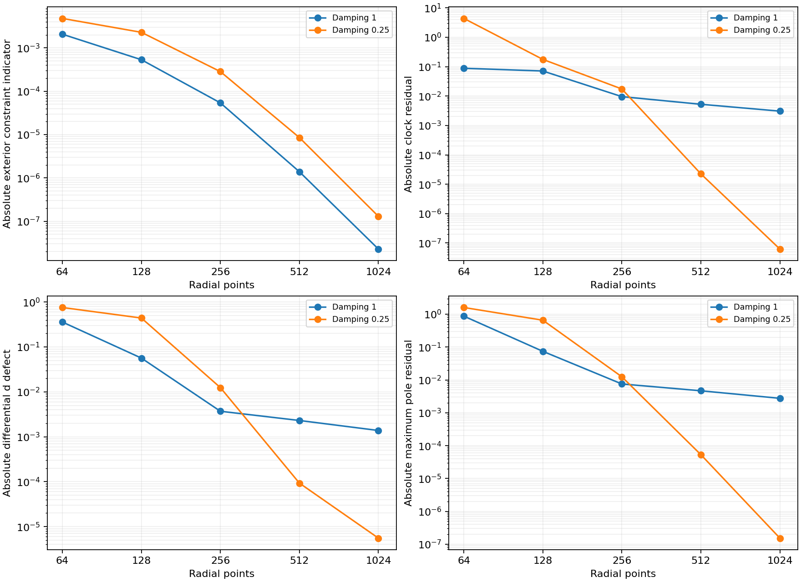
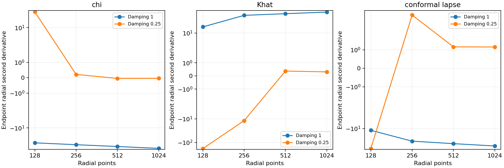
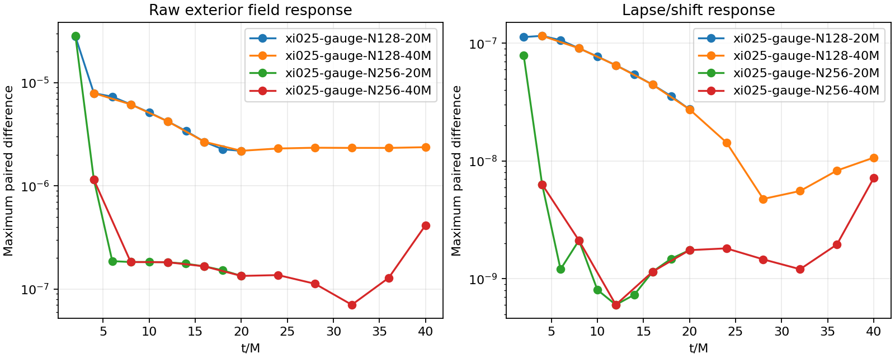

# Shared outer lapse damping experiment

The continuum gauge change predicted by [SCRI-INDICIAL.md](SCRI-INDICIAL.md)
is now implemented and tested locally. It is a promising boundary-regularity
candidate, not an admitted stable formulation or a measured cost improvement.
The default remains one. The candidate is `outer_lapse_damping=.25` with the
same central radius, slicing, reference-variable representation, compatible
lapse derivative, outgoing shift-normal closure, dissipation and penalty.

## Shared equation and consistency checks

`HyperbolicShiftParameters::outer_lapse_damping` supplies the constant part of
`xi(r)=outer_lapse_damping+2*(1-r*r)^4`. It changes the shared lapse pole term
`-2*xi*alpha*(alpha-alpha_CMC)`. The exactly blended central telegrapher
remains unchanged. This is a lower-order gauge change, not a principal-speed
rescaling. The central Z4c radius still sets the transition locations.

The stationary gauge reference is rebuilt from the same parameters. With
`W=1-inner_weight`, the total source-balanced lapse RHS difference is

```
delta(alpha_t) = -2*delta(xi)*W*alpha*(alpha-alpha_stationary)/Omega.
```

The spherical analytic scri normal, 3D host scri normal, and staged/inline
3D device scri normal all use this coefficient. The device bulk already
carries the complete parameter object. The 3D configuration parser accepts
the positive finite coefficient; configuration and mesh fingerprints
identify nondefault values while preserving default descriptors.

The local Release binary is frozen in `evidence/outer-lapse-build-v26`, SHA256
`ee9e4c6c1123c0be8aaa638420b13b7413b463426671ca86b0151bbecd9e05d8`.
Ten CTests pass: default and nondefault spherical/Cartesian polynomial-jet
comparisons for both slicing profiles, reference-variable identities, and
Serial host/device bulk and scri comparisons. The bulk tests include the
stationary reference source; the scri tests include both sampling paths and
nonstationary nonspherical fixtures. These are equation/parity tests, not 3D
trajectory or GPU stability tests.

`test_outer_lapse_damping.py` compares 257 off-constraint states against the
frozen v18 library. Default initial fields, sources, RHS components and scri
normal are bitwise identical. At the new coefficient, core RHS components
are bitwise unchanged and the source-balanced identity has maximum absolute
error `7.11e-15`. Initial lapse RHS differences are `2.66e-15`. The
finite-difference-extracted principal matrix changes by at most `3.64e-12`,
consistent with cancellation of different zero-order sources. The first
attempt incorrectly demanded bitwise matrix equality; that test failure is
preserved in `outer-lapse-parity-v26`, and the corrected check and measured
error are in `outer-lapse-parity-v26b`.

Independent one-sided finite differences of the actual shared bulk lapse
pole agree with the analytic scri normal to `3.53e-11` on arbitrary changing
geometry and nonzero gradients. The outgoing shift-normal fixture retains
nullness and dependent-D agreement (`1.26e-12`) with unchanged lapse jets.
The build logs also retain a missing MPI include dependency and a stale
configuration-fixture failure, both resolved before the final passing tests.
No MPI job was launched.

## Predicted power and evolved checks

With shift restoration four, the previously checked limiting gauge factor is
`xi*(s*s+7*s+2)-8`. Damping one gives `s=.7720018727`; damping .25 predicts
`s=3`, hence metric/lapse power four in that leading mode. Recomputing the
weighted pencils from the new actual C++ RHS gives the relevant roots
`3.081798, 3.025484, 3.008581, 3.002590, 3.000879` at distances
`.01, .003, .001, .0003, .0001` from scri. This checks the implementation
against the prediction without a numerical boundary stencil. It does not
exclude nonlinear resonances, other modes or logarithmic terms.

Five resolutions complete 10M without floors at matched initial
characteristic CFL .4, measured using the actual maximum speed
`2.4142135624`. The table uses the same reference areal interval 25–100M,
independent physical H/M/Theta/Z constraints, and three-epsilon differential
auxiliary checks as prior reports.

| Points | Exterior indicator | Clock residual | Differential D defect |
|---:|---:|---:|---:|
| 64 | 4.80665e-3 | -4.36904 | -7.56000e-1 |
| 128 | 2.29553e-3 | -1.76370e-1 | 4.40393e-1 |
| 256 | 2.84539e-4 | -1.73706e-2 | 1.24266e-2 |
| 512 | 8.53272e-6 | 2.25206e-5 | 9.28833e-5 |
| 1024 | 1.29575e-7 | 6.22049e-8 | 5.53445e-6 |

The 512-point exterior indicator is about 6.15 times larger than damping
one, while its absolute clock and auxiliary defects are about 233 and 24.8
times smaller. These are different accuracy requirements; a boundary gain
alone is not a fixed-accuracy runtime improvement. Coarse boundary values
are large, and the clock changes sign, so the steep last adjacent ratio is
not an established asymptotic order.

At N128/256/512 the endpoint lapse second derivatives are
`-39.9263, 6.19390, 1.16304`; chi second derivatives are
`36.8285, .214469, -.0445624`; Khat second derivatives are
`-180.702, -11.9126, .370353`. This is markedly different from the growing
second derivatives with damping one. Same-state reference-step and endpoint
stencil sensitivity are retained in `outer-lapse025-boundary-fine-v26`.
The N1024 values are respectively `1.15595, -.0389120, .309973`. The
last changes in these second derivatives are small relative to the preceding
changes. Independent endpoint stencil widths 7/9/11 give lapse second
derivatives `1.155947, 1.155900, 1.156009`; width five gives `1.159498`.
Their clock values are `6.22e-8, -1.03e-7, 3.65e-8` (width five `2.29e-6`).
These checks support convergence of the derivatives required by the PDE,
without proving analyticity or excluding higher-order logarithmic terms.

The finest exterior ratio corresponds to order 6.04; the auxiliary defect
ratio is 4.07. The clock/pole ratios near 8.5 need not be asymptotic orders.
Reference preparation step halving and quartering leave the clock unchanged
and change the differential D probe by less than `3e-9`. At N1024 the
PCHIP/linear exterior interpolation disagreement is at most `1.42e-9`,
versus indicator `1.30e-7`. The new exterior error remains 5.68 times larger
than damping one at this resolution.





At 1M, the resolved N64 temporal orders range from 3.97 to 4.05; the tiny B
component has an irregular order and is retained. At 10M, N128 timestep
halving and quartering give maximum exterior field differences `5.36e-11`
and `7.87e-12`, with irregular orders 2.77–3.83. This supports small temporal
contamination, not uniform fourth-order behavior at 10M. The four-resolution
spatial self-differences decrease, with finest adjacent log2 ratios
2.75–5.13 across fields. Adding N1024 gives finest self-difference ratios
5.25–6.08; interpolation disagreement remains recorded.

The initial N64 frozen semidiscrete maximum real eigenvalue is `.645168`,
and the evolved N12810M value is `.0383926`. These operators are not
contractive; scaled nonnormal RK/exact amplification is retained. The full
26-field radial/transverse/oblique point-symbol sample on 11 saved N512
states finds zero defective clusters, maximum imaginary part `1.04e-15`
and maximum basis condition `364480`. Sampling does not prove endpoint
uniformity or nonspherical stability.

## Perturbed and longer controls

Paired compact gauge and constraint pulses complete 20M without floors.
Their maximum raw exterior (`r>.8`) responses are:

| Points | Gauge, 20M | Constraint, 20M | Gauge, 40M |
|---:|---:|---:|---:|
| 128 | 2.19077e-6 | 2.42949e-5 | 2.37458e-6 |
| 256 | 1.34327e-7 | 2.39483e-5 | 4.16417e-7 |

The earlier resolution-driven 20M failure is absent here. At 40M the finer
response is still smaller, but rises late: N256 goes from `7.05e-8` at 32M
to `1.29e-7` at 36M and `4.16e-7` at 40M. Its largest final component is
Lambda near `r=.94129`, whereas the N128 peak is Ar near `r=.87451`.
Do not describe this as asymptotic decay or an all-time stability result.
A matched damping-one long control and timestep refinement can distinguish
this late response from a new gauge effect or numerical growth.

The N256 gauge-probe characteristic analysis uses actual evolved point
symbols; sampled coordinate speeds range from `-.40858` to `2.37727`,
with maximum eigenspace condition 587.11. The pulse mixes characteristic
sectors and scatters in the bulk; returning components are not a pure
boundary reflection coefficient. No unit-speed assumption is made.



## Reproduction and remaining gates

The frozen build contains source hashes, compiler flags, all test logs and
batch command builders for the resolution, temporal and pulse controls.
The final diagnostic sources, dependency versions and twenty-run index are
in `evidence/outer-lapse-source-v26`. Each evolution also preserves its own source archive, binary hash,
configuration, raw profiles and failure status. Build locally with the
spherical CMake target and a local Kokkos source; run CTest. The MPI library
is optional and used only to compile the existing configuration-parser bulk
parity test, which runs as a normal local process.

For an individual 128-point control, use:

```sh
build-spherical/python/bin/python tst/spherical_optimization/run.py \
  --library build-spherical-v26/libcurrent_spherical.dylib --output NEW_RUN \
  --n 128 --radius 20 --compact-end .97 --separated --algebraic-chart \
  --reference-jets --reference-step .000125 --reference-tail scri \
  --normal-policy analytic --chi-reference-power 2 --compatible-lapse 1 \
  --outflow-boundary --boundary-normal-system shift --outflow-width 5 \
  --outer-lapse-damping .25 --duration 10 \
  --fixed-dt .0012994935290136316 --experimental-timestep
```

The fixed step for another N is this step times `127.5/(N-.5)`.
`analyze_chart.py`, `analyze_convergence.py`, `audit_boundary_resolution.py`
and `analyze_boundary_refinement.py` reproduce the displayed comparisons
from explicitly named immutable runs. Concurrent stepping times in this
phase are not controlled cost measurements. The fine boundary evidence is now favorable. The late pulse upturn,
robust RK4 margins and controlled serial fixed-error costs still require
qualification before an overall accuracy–cost admission. No Aurora or parent campaign work
was performed.

## Timestep follow-up

[RK4-LIMITS.md](RK4-LIMITS.md) records the subsequent timestep, amplitude and
long-pulse controls. It qualifies CFL .55 over the tested local durations and
preserves the refined .625/.65 failures. The late response is resolved in time
and amplitude; that does not establish its continuum origin or asymptotic decay.
