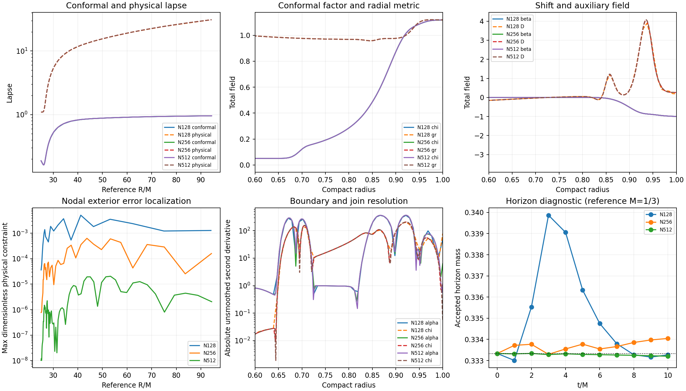

# Lower penalty and finite-duration timestep selection

The selected local working policy is penalty **.5**, with an explicit fixed
step corresponding to initial characteristic CFL **.68**. This retains the
shared outer lapse damping .25, compatible-lapse fraction one, compact slicing
endpoint .97, exact algebraic chart, r2 reference representation, shift-only
normal closure and width-five outgoing auxiliary stencil. It is qualified for
the tested spherical durations and resolutions, not all-time stability or 3D
adoption. The larger .6510416666660156 penalty at CFL .55 remains a controlled
comparison, not a discarded failure.

## Attributable accuracy and boundary effect

At matched CFL .4, the 10M exterior constraint indicator changes negligibly
when the penalty is reduced. Boundary residuals worsen on the coarse grid but
refine toward the same limit. These are raw fixed-coordinate residuals, with
M=1/3; their units are not combined into a single error norm.

| N | Exterior E, penalty .5 | Clock | Differential D defect |
|---|---:|---:|---:|
| 128 | .00229427246 | .69615183 | .54321167 |
| 256 | .000284540193 | −.020663623 | .013843612 |
| 512 | 8.53272335e−6 | −2.99094946e−5 | 8.58447274e−5 |

The corresponding .651 penalty exterior indicators are .00229552565,
.000284539128 and 8.53272338e−6. Its N512 clock and D defect are
2.25205775e−5 and 9.28833143e−5. Endpoint lapse second derivatives for penalty
.5 are −47.3763, 6.30276 and 1.16509; the higher-penalty N512/1024 values
1.16304/1.15595 provide an independent refinement comparison. The changing-
geometry shift-normal identity still gives zero null-time derivative and a
D algebraic closure residual of −1.29e−12; this fixture is distinct from the
evolved differential-D defect.

The N128/256/512 field self-difference orders range 2.75–5.13 at 10M, with
interpolation sensitivity retained. This coarse triplet is not an asymptotic
sixth-order claim. The higher-penalty N256/512/1024 study in
[OUTER-LAPSE.md](OUTER-LAPSE.md) supplies the finer spatial evidence. Penalty .5
N64 time refinement at 1M gives orders 3.96–4.32 from CFL .68/.34/.17.
At N512 10M, CFL .68 versus .4 changes exterior fields by at most 5.39e−13 RMS.

## Frozen limits and nonlinear failures

The saved initial N64 and evolved N128 10M decaying-spectrum RK4 bounds are
.779776828 and .776702063, respectively. CFL .68 has about 12.45% margin below
the latter. Positive-growth eigenvalues and RK/exact nonnormal amplification
remain in the record; this is not a contractive-energy or uniform stability
proof. The earlier actual-RHS sensitivity audit identified a scri-localized
penalty-stiff mode, motivating this single-parameter change.

| N | Completed through 10M | Preserved failure |
|---|---|---|
| 64 | .4, .68, .75, .78 | .8 at 1.92560384M |
| 128 | .4, .68, .75 | .78 at 7.34356788M; .8 at 1.44243782M |

All three failures have nonpositive chart metric and retain the last accepted
state and failed stage. The difference between frozen and observed limits is
expected for evolving, nonnormal operators. The working .68 is below the
largest successful 10M sample; .75 is not promoted on survival alone.

## Perturbation controls and limitations

At N256 40M, paired gauge responses at .68 and .4 differ by relative exterior
L2 2.01e−6 (maximum absolute difference 8.79e−13). Constraint responses differ
by 4.34e−8 (maximum 1.40e−12). Doubling gauge amplitude and normalizing back
gives relative exterior difference .00022463. At matched .4, changing only the
penalty alters the final exterior gauge response by relative 8.996e−5.
The final gauge response is 4.16417e−7, peaked in Lambda at r=.941292;
the constraint response is 2.53810e−5, peaked in Ar at r=.874755.

At .68, N128/N256 40M gauge maxima are 2.37458e−6/4.16417e−7. The N256 response
falls to 7.05e−8 at 32M then rises again. This late upturn is resolved in timestep
and amplitude and is not erased by the penalty change. The characteristic
pulse analysis retains incoming and outgoing components; mixed initial data,
bulk scattering and nonnormality prevent calling their ratio a pure boundary
reflection coefficient. No all-time decay claim follows.

Full 26-variable radial/transverse/oblique point symbols on 11 N512 evolved
states have no detected defective clusters, maximum imaginary speed 8.64e−16
and maximum eigenspace condition 364462. Endpoint uniformity and actual
nonspherical evolution remain outside this check. Initial maximum coordinate
speed is **2.414213562373095**, not one; all runs record actual RK-stage CFL,
worst evolved speed, dt/M, spacing/M, steps/M and active limiter.

## Reproduction and evidence

Saved runs and analyses are under `evidence/penalty05-*-v28`, with the matched
N128 pilot in `evidence/outer-lapse025-penalty05-n128-10M-v27`. The source snapshot
`evidence/penalty-controls-source-v28` freezes commands, dependency versions,
run index and analysis scripts. Use fresh output directories; no runner
silently overwrites or restarts a failed case. The v26 binary is unchanged.

- `penalty05-three-10M-v28` and `penalty05-boundary-v28`: independent constraints,
  three differential probes and endpoint stencil/refinement controls.
- `penalty05-refinement-v28`, `penalty05-spatial-v28`, `penalty05-temporal-v28`:
  plots and convergence arrays.
- `penalty05-rk-margin-v28`, `penalty05-n{64,128}-timestep-analysis-v28`:
  frozen spectra, amplification, nonlinear limits and failures.
- `penalty05-gauge-controls-v28`, `penalty05-constraint-controls-v28`,
  `penalty05-gauge-refinement-v28`, `penalty05-characteristic-pulse-v28`:
  paired perturbations and retained late upturn.
- `penalty05-evolved-symbols-v28`, `penalty05-n512-step-control-v28`:
  evolved full symbols and the fine-grid temporal control.

The [final repeated cost result](FINAL-COST.md), following the
[predeclared protocol](COST-PROTOCOL.md), compares this policy against
the conservative guard and the higher-penalty .55 step with serial repeated
measurements. Boundary-aware screens prevent the coarse exterior gain from
being presented as adequate boundary accuracy.

A complete N512 10M command for the selected local policy is:

```sh
build-spherical/python/bin/python tst/spherical_optimization/run.py \
  --library build-spherical-v26/libcurrent_spherical.dylib --output NEW_RUN \
  --mode 1 --n 512 --radius 20 --compact-end .97 --separated \
  --algebraic-chart --chi-reference-power 2 --reference-jets \
  --reference-step .000125 --reference-tail scri --normal-policy analytic \
  --compatible-lapse 1 --outflow-boundary --outflow-width 5 \
  --boundary-normal-system shift --outer-lapse-damping .25 \
  --penalty .5 --ko .5 --duration 10 \
  --fixed-dt .0005506651464588556 --experimental-timestep
```

For this same uniform-grid map, the fixed dt for N points is
`.0022091389993231735 * 127.5/(N-.5)`. Do not transfer that expression to a
different map, grading, central scale or gauge without recomputing speeds and
restrictions. Keep defaults for the legacy guard when not explicitly opting
into the measured policy.


Final diagnostic plots and data are in `evidence/final-diagnostics-revised-v28`
and `evidence/final-localization-v28`. They retain physical and conformal lapse,
metric/chi/shift/D profiles, unsmoothed second derivatives, nodal exterior
constraint maxima, regional norms and accepted horizon histories. At N512 the
10M lapse/shift gradient half-maximum features span 29 grid points, and the
Lambda/D features span 10/11 points. The accepted horizon mass is .33320449
(reference 1/3); this diagnostic is not part of the declared constraint/boundary
cost screen. Coarse transient horizon errors remain visible.


