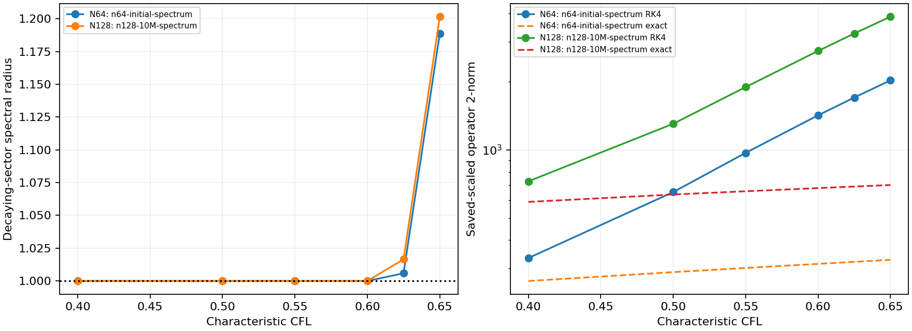
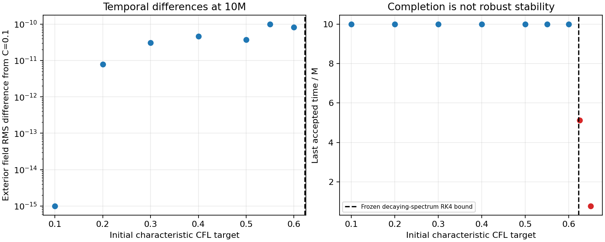
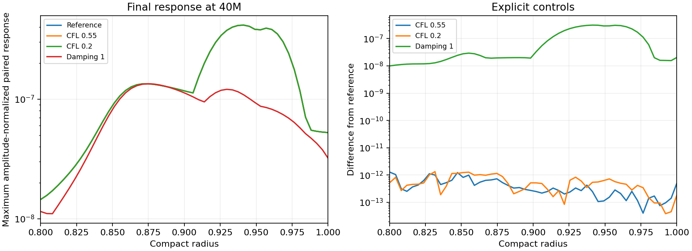

# Measured RK4 limits and late pulse controls

For the [outer lapse damping .25 candidate](OUTER-LAPSE.md), characteristic
CFL .55 is a working local choice with approximately 12% margin below the
sampled frozen decaying-mode limits. It preserves the measured accuracy and
paired perturbation response through the tested durations. CFL .625 is
rejected by the refined nonlinear run despite surviving at N64. These are
finite-duration spherical results, not an all-time, boosted or 3D stability
certificate. The penalty remains `.6510416666660156`; a lower-penalty pilot
is separate and not selected.

No equations or compiled kernels changed in this phase. The v26 Release
binary remains `ee9e4c6c1123c0be8aaa638420b13b7413b463426671ca86b0151bbecd9e05d8`.
The timestep sweep now copies an immutable run's complete configuration,
including reference variables, compact slicing, lapse damping, compatible
lapse derivatives and outgoing shift-normal boundary. Its historical default
initial state and RHS remain bitwise equal. The temporal comparator rejects
unrelated formulation or diagnostic changes.

## Frozen limits and their source

The saved initial N64 and evolved N12810M Jacobians give decaying-eigenspace
RK4 bounds `C_char=.624128638` and `.622568870`. Positive real eigenvalues
remain (`.645168` and `.0383926`), so neither full operator is contractive.
The plots retain RK4 versus exact linear-flow amplification in the saved
local variable scaling. At CFL .55, RK/exact 2-norms are 971/302 and
1894/658 respectively. These large values are evidence of nonnormality in
that scaling, not continuum energy norms or a nonlinear instability proof.



The initial N64 critical mode has eigenvalue `-684.067799+17.450483i`
in coordinate-time units (M=1/3), peaks
in Lambda at scri, and has more than `1-2e-15` of its squared raw component
weight at r>.9. Its eigenvalue condition is 1801.59. Actual shared-RHS
directional derivatives reproduce the saved Jv to relative `9.1e-9` or
better. Two perturbation sizes and two parameter-increment sizes give
`d Re(lambda)/d penalty=-1399.787` and negligible KO sensitivity. The
normalized penalty sensitivity is 1.332; it is a local eigenvalue derivative,
not an additive damping budget. This identifies boundary stiffness rather
than inner telegrapher relaxation or KO as the tested limiting branch.

## Nonlinear failure bracket and accuracy margin

Both 10M sweeps include characteristic CFL .1, .2, .3, .4, .5, .55, .6,
.625 and .65. All cases through .6 complete without floors. Failures retain
the failed RK stage, last accepted state, traceback, history and manifest.

| Points | CFL | 10M-target result | 40M-target result |
|---:|---:|---|---|
| 64 | .55 | completed | completed |
| 64 | .6 | completed | completed |
| 64 | .625 | completed | completed |
| 64 | .65 | failed at 1.14479M | not repeated |
| 128 | .55 | completed | completed |
| 128 | .6 | completed | completed |
| 128 | .625 | failed at 5.11676M | same failure time |
| 128 | .65 | failed at .77287M | not repeated |

The N64 .625 completion does not override the refined failure or the frozen
bound. At that step the critical frozen RK multiplier has magnitude
1.00589; short-time, evolving-background survival is insufficient.
The .65 N64 failure reports a nonpositive chart metric. The other failures
are retained without floors or a changed restart. A failure time is the last
accepted time, not the time of a successful target completion.



At 10M, maximum exterior field RMS differences from CFL .1 are `1.73e-8`
(N64, .55) and `9.91e-11` (N128, .55). At N512, .55 versus .4 differs by
`4.18e-13`. These differences are far smaller than their measured spatial
errors; the very small differences do not establish another temporal order.
The prior resolved early-time fourth-order test remains in OUTER-LAPSE.md.
At 40M, N128 .55 and .6 differ from .4 by `8.98e-11` and `1.50e-10` in
maximum exterior field RMS. N256 .6 also completes 10M without floors.

The working .55 choice is the largest tested step with at least a nominal
10% margin below both sampled decaying-mode bounds and with the following
40M paired perturbation checks. This is an explicit experimental step; the
production/default policy guards have not been deleted or reinterpreted as
mathematical stability bounds.

| Points | Duration | dt/M | min dr/M | Steps/M | Worst accepted C_char |
|---:|---:|---:|---:|---:|---:|
| 64 | 10M | .01076303 | .04724409 | 93.0 | .551424 |
| 128 | 10M | .005360411 | .02352941 | 186.6 | .550044 |
| 256 | 40M | .002674960 | .01174168 | 373.85 | .550003 |
| 512 | 10M | .001336173 | .005865103 | 748.5 | .5500002 |

All use `explicit_fixed_dt`. Initial maximum coordinate speed is
2.4142135624, not one. Worst evaluated speeds for these rows are
2.42046418, 2.41440670, 2.41422493 and 2.41421425. The saved results also
include nominal dt/min_dr, characteristic/scri/telegrapher policy limits,
setup/stepping cost and RHS counts. Concurrent runtimes in this phase are
not controlled cost comparisons. The .55 step uses about 27% fewer steps
than .4; this is not a measured wall-time speedup claim.

## Late response is resolved in time and amplitude

The N256 40M gauge response at damping .25 is `4.16417e-7` in the raw
exterior maximum norm. Halving the .4 step changes the response by
`2.88e-6` relative L2; increasing to .55 changes it by `2.15e-6`. The
maximum absolute response difference is at most `1.34e-12` for these
controls. The late upturn therefore does not originate in leading RK4
error. Doubling the initial gauge pulse from 1e-5 to 2e-5 changes the
amplitude-normalized final response by `2.25e-4` relative L2 (0.023%).

A matched damping-one N25640M pair gives `1.34532e-7`, with its peak in Ar
near r=.87476, versus Lambda near r=.94129 at damping .25. Thus the gauge
change affects the small late response. Both are below the input amplitude,
and the .25 response remains smaller at N256 than at N12840M (`2.37458e-6`).
These observations do not identify a continuum mode or a pure boundary
reflection, and do not establish asymptotic decay.

The N256 constraint-pulse response at 40M is `2.53810e-5`. CFL .55 versus
.4 changes it by `4.86e-8` relative exterior L2 and at most `1.84e-12`
absolutely. Both gauge and constraint pairs at .55 complete without floors.
These controls support the finite-duration step choice while retaining the
late-signal qualification.



## Attributable lower-penalty pilot

Keeping the continuum equations, reference sources, outgoing closure and
all other policies fixed, penalty .5 raises the initial N64 frozen decaying
RK4 bound to `.779776828`; its maximum real eigenvalue remains `.645168`.
The limiting eigenvalue changes branch, so a linear extrapolation of the
original mode's sensitivity would overpredict the gain.

The matched-CFL .4 N12810M pilot completes without floors, but its clock
residual is `.696152` versus `-.176370` at the existing penalty. The D defect
is `.543212` versus `.440393`. Exterior indicators are almost equal
(`.00229427` versus `.00229553`). This is a possible speed/accuracy tradeoff,
not an improvement claim. Fine boundary refinement, an evolved operator and
perturbation checks are required before changing the working penalty.

## Reproduction and next gate

The source/dependency snapshot and a 39-run index are preserved in
`evidence/rk4-controls-source-v27`. There are 35 completed no-floor runs and
four preserved failed runs. The unchanged binary is frozen in the v26 build.
For a new sweep output, for example:

```sh
build-spherical/python/bin/python tst/spherical_optimization/sweep_timestep.py \
  --library build-spherical-v26/libcurrent_spherical.dylib \
  --run docs/spherical-optimization/evidence/outer-lapse025-n128-10M-v26 \
  --targets .1 .2 .3 .4 .5 .55 .6 .625 .65 --output NEW_SWEEP
```

`audit_rk_margin.py` reads saved linearizations; `audit_stiff_mode.py`
recomputes actual RHS directional sensitivities. `analyze_timestep.py` and
`analyze_response_controls.py` reproduce the displayed temporal and paired
response comparisons. The N512 comparison explicitly labels its N128 frozen
bound; no N512 Jacobian was computed in this phase.

Next resolve the lower-penalty tradeoff with a small refinement study, then
perform serial rotated repeated costs at fixed exterior and boundary error.
The existing areal baseline misses its specified targets, so a finite
areal/optimized fixed-target ratio cannot be invented. A matched comparison
against the conservative timestep policy can separately quantify the benefit
of the empirically qualified step. No Aurora work, parent-campaign changes,
boosted evolution or 3D stability claims were made.
