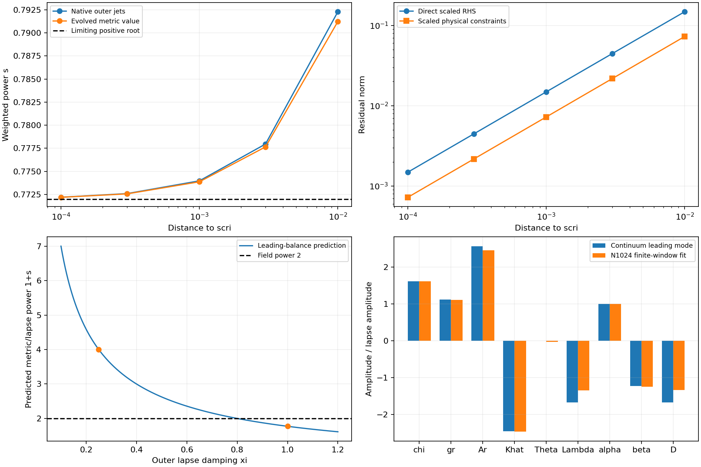

# Leading continuum powers at scri

The shared continuum RHS admits a constraint-compatible leading mode with
weighted power **s=(-7+sqrt(73))/2=.7720018727** under the current outer gauge
parameters. Metric and lapse perturbations then have power 1+s≈1.772, so their
second coordinate derivatives scale as (1-r)^(-.228). This supplies a continuum
mechanism consistent with the observed slow boundary residual convergence and
growing second derivatives. It does not establish a nonlinear regularity theorem
or prove that this is the only mode in the measured tail.

No C++ equation, evolution policy or gauge parameter was changed in this phase.
The evidence is from the existing shared v18 binary, without a numerical
boundary condition, finite-difference evolution stencil, penalty or KO term.

## Weighted balance and numerical checks

Let x=1-r and use the ten-coordinate algebraic chart
`chi, gr, Ar, Khat, Theta, Lambda, alpha, beta, B, D`.
For an amplitude v_j, take delta q_j=v_j*x^(s+w_j), with
w=(1,1,0,1,1,0,1,1,0,0). First and second radial derivatives follow analytically.
Scale RHS row i by x^(1-s-w_i). B=0 is invariant in the exact outer gauge and
is removed from this leading subsystem. Time derivatives of finite smooth
amplitudes enter one power higher in this ansatz.

Independent q/q′/q″ derivatives of the shared C++ RHS construct the quadratic
pencil M0+s M1+s² M2. Native outer reference jets are analytic; a second control
uses the evolved endpoint's conformal metric value 1.08537749 with explicitly
frozen outer jets. The latter is a local leading-coefficient control, not a
stationary solution or an evolution projection.

The native finite-distance root near the relevant branch is:

| x | Weighted root |
| --- | ---: |
| .01 | .79228733 |
| .003 | .77795788 |
| .001 | .77397493 |
| .0003 | .77259252 |
| .0001 | .77219895 |

The frozen evolved-metric control approaches the same limit (.77218840 at
x=.0001). Generic trial exponents have full-rank leading pencils, so the root
is not an arbitrary null direction. The quadratic generalized eigenproblem
also produces infinite and very large noise-sensitive roots; all are saved.
Only branches with a finite, distance-convergent limit enter the conclusions.
Two jet increments expose coefficient sensitivity, reaching about 1e-7 at
the smallest distances.

A quadratic distance extrapolation of the last three pencils identifies
simple rational coefficient matrices, within maximum entry difference
1.52e-6. Those matrices are saved in `scri-indicial-balance-v25/audit.json`.
SymPy factors their determinant. This is a checked numerical identification
of leading algebra, not an independent symbolic derivation of every omitted
continuum term. A separate direct shared-RHS perturbation check avoids the
jet-Jacobian construction: the scaled residual norm decreases from .14784 at
x=.01 to .0014895 at x=.0001, approximately O(x), as the leading balance predicts.
Two amplitude increments are retained, including roundoff sensitivity at the
finest point.

Independent physical H/M/Theta/Z directional derivatives give zero leading
constraint coefficients: their scaled H/M/Z residuals decrease approximately
as x, and the normalized Theta amplitude is about 1e-15. Thus this is a
constraint-compatible leading mode; it is not simply a leading Theta/Z error
that can be removed by stronger constraint damping. No constraint is reset in
any evolution or audit.

## Gauge parameter dependence

Denote the shared shift restoring coefficient by R_beta (currently 4), and the
scri value of the outer lapse damping coefficient c.xi by xi (currently 1).
R_beta here is a gauge coefficient, not the reference areal radius. The shared
outer gauge formulas put `1-R_beta` in the shift diagonal of M0 and `-2*xi`
in the lapse diagonal. With the other geometric parameters unchanged, the
identified determinant is

```
(8/15) s (s-2) (s+1) (31s-269)
    * [xi * (s² + (R_beta+3)s + 2) - 2 R_beta].
```

At R_beta=4, xi=1 the relevant factor is s²+7s-6. This dependence suggests a
specific next candidate rather than another unmotivated boundary stencil:

| Outer lapse damping xi | Positive weighted s | Metric/lapse power 1+s |
| --- | ---: | ---: |
| 1, current | .772002 | 1.772002 |
| .8 | 1 | 2 |
| .4 | 2 | 3 |
| .3 | 2.575909 | 3.575909 |
| .25 | 3 | 4 |
| .2 | 3.588723 | 4.588723 |
| .1 | 6 | 7 |

These parameter entries are **predictions, not tested candidates**. In
particular xi=.4 coincides with another s=2 factor, so a root table alone
cannot establish absence of logarithmic terms or a complete basis. The first
proposed test is xi=.25. It retains positive lapse damping and predicts a
substantially smoother power. Its nonlinear dynamics and RK4 limit remain
unknown. Changing shift restoring alone cannot move this branch above s=2
when xi=1 and R_beta stays finite and positive.

Any implementation must expose this in the shared gauge parameters, rebuild
stationary reference sources consistently, and pass the same xi to analytic
lapse-pole normals at scri. The current normal adapters use a literal one;
changing only the bulk lapse source would be inconsistent. Default behavior,
flat-core telegrapher identity, off-constraint tensor/spherical parity and
changing-geometry pole-normal checks must pass before evolution sweeps. The
3D host/device paths must receive the parameter consistently or explicitly
reject an unsupported nondefault option. No 3D adoption is established here.

## Comparison with evolved data

The N1024 data were fitted at the predicted exponent using analytic remainder
terms, retaining two windows and exclusion/inclusion of the nearest two cells.
At 0<x<=.03 with the nearest two cells excluded, normalized metric, lapse,
shift and trace amplitudes agree reasonably with the predicted mode. The full
nine-component relative difference is 9.8%; the connection/driver components
show the largest discrepancy, around 20%. Other windows give discrepancies
of 15–27%. These differences and all fit residuals are preserved. The evidence
supports excitation of this continuum mode but does not justify identifying
the entire nonlinear tail with one exact eigenvector.



## Reproduction and next work

The scripts require NumPy, SciPy, Matplotlib and SymPy (1.14.0 was used).
Source and dependency identities are frozen in `scri-indicial-source-v25`.
Choose fresh output destinations:

```sh
build-spherical/python/bin/python tst/spherical_optimization/audit_scri_indicial.py \
  --library build-spherical-v18/libcurrent_spherical.dylib --output NEW_PENCILS
build-spherical/python/bin/python tst/spherical_optimization/audit_indicial_balance.py \
  --pencils NEW_PENCILS --output NEW_BALANCE
build-spherical/python/bin/python tst/spherical_optimization/analyze_indicial.py \
  --evidence docs/spherical-optimization/evidence --output NEW_PLOTS
```

`audit_indicial_mode.py` reproduces the direct RHS and evolved-polarization
checks using the saved balance, frozen-metric pencils and N1024 run. The first
native-pencil script is also preserved in its output folder before adding
the frozen-metric control option. All original numerical outputs remain intact.

Next implement and verify the shared xi=.25 parameter/source/normal path, then
compare boundary regularity, refined pulses and exterior accuracy. Robust
RK4 limits, controlled fixed-error costs and the final transfer gate remain
required. No candidate is yet admitted; the parent campaign and Aurora remain
untouched.

## Implementation follow-up

The predicted parameter is now implemented and independently checked in
[OUTER-LAPSE.md](OUTER-LAPSE.md). This report remains the frozen pre-change
continuum analysis; its earlier pending-action statements describe that phase.
